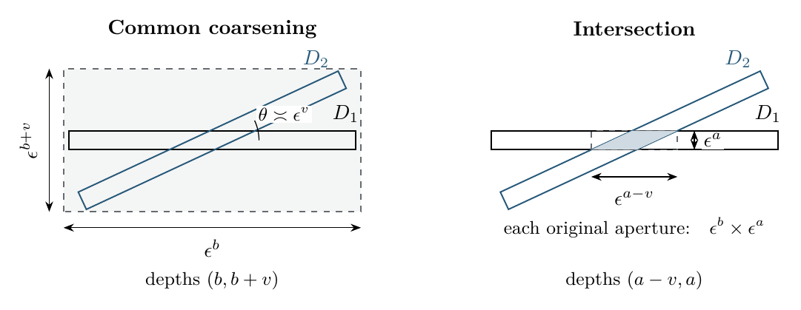
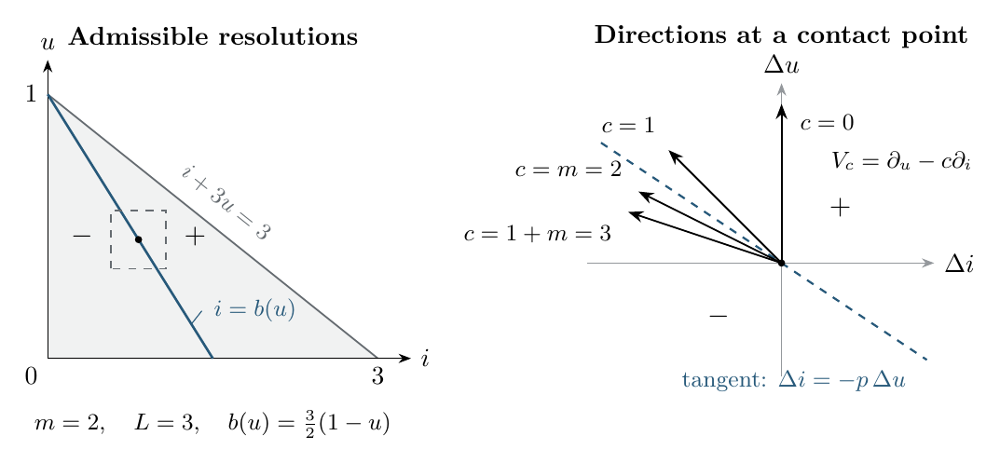
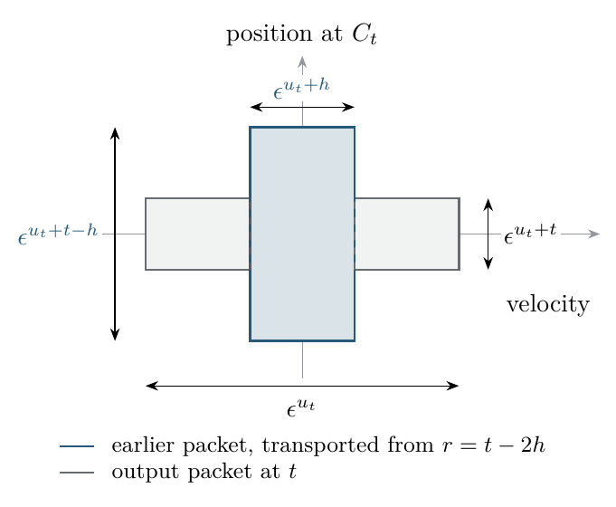

# Bochner–Riesz multipliers in three dimensions

**Author:** OpenAI  
**Date:** September 24, 2026

> *Source:* [OpenAI Math Release preprint](https://github.com/openai/math/blob/main/preprints/Bochner-Riesz-Multipliers-in-Three-Dimensions-September-24-2026/Bochner-Riesz-Multipliers-in-Three-Dimensions-September-24-2026.pdf). Converted to Markdown with LaTeX math from the original TeX source. The paper's custom macros are expanded to standard LaTeX; section, theorem, equation, figure and reference numbers match the PDF.

## Abstract

We prove the three-dimensional Bochner–Riesz conjecture in its strict-order formulation. The main result is boundedness of the Bochner–Riesz multipliers on $L^3(\mathbb{R}^3)$ for every positive order. Interpolation and duality then give the full conjectured strict range.

## Contents

1. [Introduction](#sec-introduction)
2. [Finite entropy, conditioning, and passage to profiles](#sec-entropy)
3. [The planar projection estimate](#sec-projection)
4. [Extremal positive transport and its aspect](#sec-classical-extremality)
5. [Exclusion of isotropic extremizers](#sec-isotropic)
6. [The matched plane and its traces](#sec-characteristic-plane)
7. [Rate transfer at matched clocks](#sec-rate-transfer)
8. [Closure of the classical growth argument](#sec-classical-closure)
9. [Packet scores and finite decompositions](#sec-packet-structure)
10. [Finite packet composition and the uncertainty boundary](#sec-packet-composition)
11. [Finite packet repayment and closure](#sec-packet-repayment)
12. [Oscillatory integrals and Bochner–Riesz multipliers](#sec-multiplier)
- [References](#references)

## 1. Introduction

We prove the Bochner–Riesz conjecture in three dimensions in its strict-order formulation. The main estimate is boundedness on $L^3$ for every positive order; interpolation and duality then give the full range of exponents.

For $f\in\mathcal S(\mathbb{R}^3)$, use the Fourier transform

$$
\widehat f(\xi)=\int_{\mathbb{R}^3}f(x)e^{-2\pi i x\cdot\xi}\,dx,
$$

where $\mathcal S$ denotes the Schwartz space. For $\delta>0$, define

$$
T_\delta f(x)
=\int_{\mathbb{R}^3}(1-\lvert \xi\rvert^2)_+^\delta
\widehat f(\xi)e^{2\pi i x\cdot\xi}\,d\xi . \tag{1.1}
$$

**Theorem 1.1.** For every $\delta>0$, there is a finite constant $C_\delta$ such that

$$
\lVert T_\delta f\rVert_{L^3(\mathbb{R}^3)}
\le C_\delta\lVert f\rVert_{L^3(\mathbb{R}^3)}
\qquad(f\in\mathcal S(\mathbb{R}^3)). \tag{1.2}
$$

Consequently $T_\delta$ has a unique bounded extension to $L^3(\mathbb{R}^3)$.

Theorem [1.1](#thm-bochner-riesz) gives

$$
\lVert T_\delta f\rVert_{L^p(\mathbb{R}^3)}
\lesssim_{p,\delta}\lVert f\rVert_{L^p(\mathbb{R}^3)},\qquad
\delta>\max\left\{3\left|\frac1p-\frac12\right|-\frac12,0\right\},
\quad 1\le p\le\infty . \tag{1.3}
$$

Corollary [12.4](#cor-full-bochner-riesz) supplies the interpolation argument, including the bounds for complex orders. The order is fixed before choosing any constants. Dilation gives the same bounds for multipliers $(1-|\xi|^2/R^2)_+^\delta$ at every $R>0$; for finite $p$ in (1.3), these means converge to $f$ in $L^p$ as $R\to\infty$. This recovers Fourier inversion by arbitrarily mild spherical smoothing at the central exponents $3/2\le p\le3$.

### 1.1 The problem and its development

The problem belongs to the theory of summability of Fourier expansions. Riesz's work on one-dimensional summation methods [[29](#ref-29)] preceded Bochner's spherical means for multiple Fourier series [[1](#ref-1), [2](#ref-2)]. The multiplier $(1-|\xi|^2)_+^\delta$ softens the boundary of the frequency ball; the question is how much smoothing is needed to preserve an $L^p$ norm. Radial inversion and radial summability were studied by Herz and Welland [[12](#ref-12), [40](#ref-40)]. For general functions the geometry of frequency directions is essential. Using a Kakeya construction, Fefferman proved that in dimension at least two the order-zero ball multiplier is unbounded on $L^p$ for $p\ne2$ [[8](#ref-8)], while Carleson and Sjölin established the conjectured positive-order range in the plane [[5](#ref-5)].

Geometric decompositions connect this problem with the arrangement of long thin tubes and with Fourier restriction. Córdoba's work on radial multipliers and Kakeya maximal functions developed this connection through rectangle decompositions and almost orthogonality [[6](#ref-6), [7](#ref-7)]. Bourgain combined geometric maximal-function estimates with improved restriction and multiplier bounds in three dimensions [[3](#ref-3)]. The bilinear restriction theorems of Wolff for the cone and Tao for the paraboloid and elliptic surfaces [[35](#ref-35), [41](#ref-41)] led, through Lee's multiplier reduction, to sharp-order Bochner–Riesz estimates for $\max\{p,p'\}\ge10/3$ [[17](#ref-17)]; here $p'$ is the Hölder conjugate of $p$. The threshold exponent follows from Lee's printed strict range by interpolation with $L^2$, keeping a positive margin in the order.

Polynomial partitioning and subsequent multiscale refinements brought further progress on restriction [[11](#ref-11), [37](#ref-37)]. For the multiplier itself, Wu obtained the conjectured strict-order range when $\max\{p,p'\}\ge13/4$ [[42](#ref-42)]. Guo, Oh, Wang, Wu, and Zhang developed a pseudoconformal approach and an induction on two scales for transferring restriction methods to Bochner–Riesz estimates [[10](#ref-10)]. More recently, Gao, Wu, and Xi established the strict-order multiplier range $\max\{p,p'\}\ge22/7$ [[9](#ref-9), Corollary 1.3]. Wang and Wu's related diagonal extension estimate holds for $p>22/7$ [[38](#ref-38), Theorem 0.2]. The connection also runs in the other direction: Tao showed that the Bochner–Riesz conjecture implies the spherical restriction conjecture [[34](#ref-34)]. Our argument directly establishes the scalar multiplier bound on $L^3(\mathbb{R}^3)$ for every fixed positive order. Zipeng Wang has also proposed a proof of the Bochner–Riesz conjecture in all dimensions [[39](#ref-39), version 6, Theorem One].

Let $S^2=\{\omega\in\mathbb{R}^3:|\omega|=1\}$ and let $\sigma$ be surface area measure on $S^2$. For bounded measurable $g:S^2\to\mathbb{C}$, define

$$
Eg(x)=\int_{S^2}g(\omega)e^{2\pi i x\cdot\omega}\,d\sigma(\omega).
$$

Tao's implication applied to (1.3) gives, for every real $p>3$,

$$
\lVert Eg\rVert_{L^p(\mathbb{R}^3)}
\le C_p\lVert g\rVert_{L^\infty(S^2,\sigma)},
$$

where $C_p<\infty$ depends only on $p$. This is the spherical extension estimate also proved in OpenAI [[23](#ref-23), Theorem 1.1]. For the separate diagonal extension theorem on compact smooth positively curved surfaces, possibly with smooth boundary, see OpenAI [[21](#ref-21), Theorem 1.1]; that general-surface statement is not deduced here from the spherical multiplier theorem.

An independent route through critical local smoothing gives the same full strict fixed-radius range in (1.3), uniformly in the radius [[22](#ref-22), Corollary 11.2]. It also gives strong maximal Bochner–Riesz bounds and almost-everywhere summation for $3\le p<\infty$ and $\delta>1-3/p$ [[22](#ref-22), Theorem 11.1]. These results are not inputs to the argument here.

The geometric input here is the sharp planar Furstenberg estimate of Ren and Wang [[28](#ref-28)]. It belongs to a line of projection theory that includes the classical work of Marstrand and Kaufman [[15](#ref-15), [19](#ref-19)] and the discretized sum-product and projection methods of Bourgain [[4](#ref-4)]. Oberlin formulated a sharp prediction for exceptional projection directions [[20](#ref-20)]. Important advances toward the Furstenberg problem include the packing-dimension results of Orponen and Shmerkin [[24](#ref-24), [31](#ref-31)], their joint Hausdorff-dimension improvement [[25](#ref-25)], and their proof of the conjectured bound when the associated family of affine lines has equal Hausdorff and packing dimensions [[26](#ref-26)]. Building on that regular case, Ren and Wang removed the additional equality assumption. We use their finite incidence theorem. Section [3](#sec-projection) derives the form needed for probability weights, auxiliary tags that may share a slope, and incidence graphs of positive product mass; Section [2](#sec-entropy) supplies the finite conditioning used in later applications.

### 1.2 From geometric growth to oscillatory cancellation

The proof has two stages. We first control the information gained by observing positive masses moving along lines. We then transfer that control to wave packets, whose squared amplitudes are positive but whose superposition is oscillatory. The main obstruction is at the uncertainty boundary: an earlier packet cannot be assigned a position as precisely as a later observation requires. The second stage records this discrepancy as fine velocity information and shows that too much growth would make that information exceed its finite capacity.

**Positive masses on lines.** A particle $T$ carries bounded data $(V,A)\in\mathbb{R}^2\times\mathbb{R}^2$ and moves along $c\mapsto A+cV$. Fix a small parameter $\epsilon$. An aperture observation at duration $t$ records velocity in a rectangle of widths $\epsilon^b,\epsilon^a$, $b\le a$, and position in a transported rectangle of widths $\epsilon^{b+t},\epsilon^{a+t}$. Its orientation is also recorded. For $0<\gamma<1$, the weight

$$
w(b,a)=a+b-\gamma(a-b)
$$

rewards fine resolution while penalizing eccentricity. The score in (4.1) subtracts the particle information required by the observation and adds twice the time entropy conditional on the particle. Its largest asymptotic increase per unit duration is denoted by $\beta$. Theorem [4.2](#thm-classical-growth) proves $\beta\le\gamma$.

To prove this bound, assume excessive growth and localize a sequence whose scores approach the largest possible rate. The aspect penalty makes the orientations of such observations coherent. Choosing the least possible aspect produces a saturated path: its intermediate observations attain the same growth rate. There are two alternatives. An isotropic extremizer is excluded in Section [5](#sec-isotropic) by combining time-fiber richness, planar projections, and a Loomis–Whitney argument. In the other alternative, the orientation and longitudinal resolutions advance at a fixed ratio $m>0$.

The latter case produces four data coordinates with resolution speeds $0,1,m,1+m$. Their particle-information profile is Lipschitz, but ordinary almost everywhere differentiability does not give a derivative on the particular plane selected by the path. Section [6](#sec-characteristic-plane) proves the needed trace and affine approximation there. Planar projections then transfer lower bounds between the coordinate rates. When $m=1$, the middle coordinates share a speed and only their joint rate is available. Two conditional projection tests and a reciprocal pinned-direction argument supply the missing inequalities. The latter is related to the radial-projection bootstraps of Shmerkin and Wang and of Orponen, Shmerkin, and Wang [[27](#ref-27), [32](#ref-32)]. Section [8](#sec-classical-closure) combines these rate constraints with the saturated path's contact and jump conditions to obtain a contradiction.

**Oscillatory packets.** Write $\lambda^{-1}=\epsilon^{{H_{\mathrm P}}}$. At duration $t$, a packet has velocity depth $u_t=({H_{\mathrm P}}-t)/2$ and position depth $u_t+t$. The packet score in (9.6) uses squared oscillatory amplitudes, and its largest growth rate is denoted by ${\beta_{\mathrm q}}$. Sections [9](#sec-packet-structure)–[10](#sec-packet-composition) construct finite decompositions, control their tails, and track the loss when only part of an assigned atom class is retained. These constructions use the Fourier-series localization and almost orthogonality underlying classical wave-packet methods [[10](#ref-10), [35](#ref-35)].

Away from the uncertainty boundary, a coarser observation faithfully locates the packets, so the positive-mass estimate applies. At the boundary, a separate coherent estimate is required. It leaves a layer of fine velocity information, which must be carried to the preceding step. Section [11](#sec-packet-repayment) proves that hypothetical growth ${\beta_{\mathrm q}}>\gamma/2$ increases this information by at least $(4{\beta_{\mathrm q}}-2\gamma)h$, up to controlled errors, at every backward step of fixed length $2h$. The layer holds at most $2h$ units, up to vanishing errors. A fixed finite number of steps therefore yields a contradiction and proves Theorem [9.1](#thm-packet-growth): ${\beta_{\mathrm q}}\le\gamma/2$.

**The multiplier.** Packet growth gives the oscillatory estimate of Theorem [12.1](#thm-oscillatory-estimate), with an arbitrarily small positive power loss. On a physical shell of radius $\lambda$, the Bochner–Riesz kernel has amplitude of order $\lambda^{-2-\delta}$. The pseudoconformal distance-phase change of variables used in Guo et al. [[10](#ref-10)] puts this shell into the required phase class. Section [12](#sec-multiplier) verifies all phase and amplitude bounds uniformly in the shell and obtains the operator norm $O_{\delta,\nu}(\lambda^{-\delta+\nu})$. Choosing $0<\nu<\delta$ proves Theorem [1.1](#thm-bochner-riesz) by summation. A beta-integral representation supplies the complex-order bounds used in Stein's analytic interpolation theorem [[33](#ref-33)], completing (1.3).

### 1.3 Finite laws and order of limits

Entropy permits a common language for these geometric and analytic steps. We use finite entropy and relative entropy [[16](#ref-16), [30](#ref-30)], conditional copies and submodularity [[36](#ref-36)], and homogeneous profiles across scales. Multiscale entropy and comparable-partition methods have important precedents in Hochman [[13](#ref-13)], Hochman and Shmerkin [[14](#ref-14)]. Section [2](#sec-entropy) proves the precise finite-law statements used here.

Small normalized mutual information yields a comparison with a product law after trimming; it does not give exact independence. Theorem [2.7](#thm-finite-conditioning) specifies which labels are fixed and which remain free, so later conditioning uses the correct comparison population. For the characteristic-plane argument, first fix a homogeneous component and its limiting profile, then choose the approximation scale, and only afterwards take the finite precision small relative to that scale. Theorem [6.1](#thm-characteristic-trace) and Corollary [6.2](#cor-finite-characteristic-trace) state these successive steps.

Packet composition also keeps two finite populations distinct. Its upper estimate concerns a retained superposition, while its earlier lower test uses the whole assigned cap class. Proposition [10.1](#prop-finite-packet-composition) records the loss from retention. Section [11](#sec-packet-repayment) carries the remaining fine velocity information through a fixed finite number of cuts, using the one-step statement of Proposition [11.4](#prop-finite-repayment).

Throughout, $\mathsf{H},\mathsf{I}$ denote entropy and mutual information divided by $\log(1/\epsilon)$, whereas ${\mathsf H_{\mathrm{nat}}},{\mathsf I_{\mathrm{nat}}}$ use natural logarithms. The notation $\log_{1/\epsilon}\!\left(r\right)$ uses the normalized units. The Planck depth is always ${H_{\mathrm P}}$, distinct from entropy. A positive depth increment is fixed before the small-parameter limit; when increments subsequently shrink, that additional limit is stated separately.

## 2. Finite entropy, conditioning, and passage to profiles

The geometric arguments will use conditional point and parameter populations whose masses must remain controlled after labels are fixed. We first develop the finite probability estimates that justify those operations, and then explain their passage to limiting entropy profiles. All probability spaces in the finite statements are finite, with cardinalities allowed to depend on $\epsilon$. Put $\ell=\log(1/\epsilon)$ and write ${\mathsf H_{\mathrm{nat}}},{\mathsf I_{\mathrm{nat}}}$ for natural-log entropy and mutual information, with $\mathsf{H}={\mathsf H_{\mathrm{nat}}}/\ell$ and $\mathsf{I}={\mathsf I_{\mathrm{nat}}}/\ell$. The exact particle index $T$ may have an arbitrarily large alphabet; no bound on its entropy is required. Every comparison measure is specified explicitly and need not be a marginal of the law being estimated.

### 2.1 Entropy estimates with unrestricted parent alphabets

Our conventions are the usual finite entropy and relative entropy [[16](#ref-16), [30](#ref-30)]. Conditional copies and entropy submodularity also feature in Tao's entropy calculus [[36](#ref-36)]; the comparison and retention bounds required here are proved below.

We use the chain rule, nonnegativity of conditional mutual information, and ${\mathsf H_{\mathrm{nat}}}(X)\le\log|\mathcal X|$ for an $\mathcal X$-valued observation. Here are the particular consequences, including quantitative restriction estimates, that we will need.

**Lemma 2.1 (Determination, masses, and restriction).** Let $A,B,D,T$ be finite observations. Then

$$
\begin{align}
{\mathsf I_{\mathrm{nat}}}(T;B)&\le{\mathsf I_{\mathrm{nat}}}(T;A)+{\mathsf H_{\mathrm{nat}}}(B\mid A), \tag{2.1} \\
|{\mathsf H_{\mathrm{nat}}}(B\mid T)-{\mathsf H_{\mathrm{nat}}}(A\mid T)|
&\le{\mathsf H_{\mathrm{nat}}}(B\mid A)+{\mathsf H_{\mathrm{nat}}}(A\mid B). \tag{2.2}
\end{align}
$$

If, outside an event of probability $\zeta$, $B$ has at most $N$ possible values given $A$, and $|\mathcal B|\le M$, then

$$
{\mathsf H_{\mathrm{nat}}}(B\mid A)\le\log2+\log N+\zeta\log M. \tag{2.3}
$$

For nonnegative numbers $m_b$ with $m_b>0$ on the support of $B$,

$$
{\mathsf H_{\mathrm{nat}}}(B)+\mathbb E\log m_B\le\log\sum_bm_b. \tag{2.4}
$$

Finally, let $\mathsf P,\mathsf Q$ be laws on the same space with $\mathsf Q\le K\mathsf P$, $K\ge1$. For arbitrary $B,D$,

$$
\begin{align}
{\mathsf H_{\mathrm{nat}}}^{\mathsf Q}(D\mid B)
&=\mathbb E_{\mathsf Q}[-\log\mathsf P(D\mid B)]
-\mathbb E_{\mathsf Q_B}
\operatorname{KL}(\mathsf Q_{D\mid B}\Vert\mathsf P_{D\mid B}), \tag{2.5} \\
\mathbb E_{\mathsf Q_B}
\operatorname{KL}(\mathsf Q_{D\mid B}\Vert\mathsf P_{D\mid B})
&\le\log K. \tag{2.6}
\end{align}
$$

In particular, restriction to an event of $\mathsf P$-mass $m>0$ costs at most $\log(1/m)$ in (2.6). None of these estimates depends on the cardinality of $B$ or $T$.

*Proof.* The chain rule gives ${\mathsf I_{\mathrm{nat}}}(T;B)\le{\mathsf I_{\mathrm{nat}}}(T;A,B) ={\mathsf I_{\mathrm{nat}}}(T;A)+{\mathsf I_{\mathrm{nat}}}(T;B\mid A)$, proving (2.1). Apply the chain rule to ${\mathsf H_{\mathrm{nat}}}(A,B\mid T)$ in both orders to obtain (2.2). Adjoining the indicator of the exceptional event costs at most $\log2$; conditioning on its two values gives (2.3). For (2.4), normalize $m$ to a probability law and use nonnegativity of its relative entropy from the law of $B$. Expanding the conditional relative entropy gives (2.5). Its expectation is at most $\operatorname{KL}(\mathsf Q_{B,D}\Vert\mathsf P_{B,D})$, which by marginalization is at most $\operatorname{KL}(\mathsf Q\Vert\mathsf P)\le\log K$. $\blacksquare$

We call a determination *of zero cost* when the right side of (2.3), divided by $\ell$, tends to zero. This includes bounded ambiguity between comparable translated grids, provided the translation is recorded. When $|\mathcal B|\le\epsilon^{-C}$, vanishing exceptional probability is sufficient for the last term.

**Lemma 2.2 (Domination and conditioning on typical cells).** Let $\mathsf U,\mathsf V$ be probability laws on the same finite space with $\mathsf U\le A\mathsf V$, $A\ge1$, and let $C$ be a finite observation. For $0<\eta<1$,

$$
\mathsf U_C\{c:\mathsf U_C(c)<\eta\mathsf V_C(c)\}\le\eta. \tag{2.7}
$$

At every other $\mathsf U_C$-positive value,

$$
\mathsf U(\,\cdot\mid C=c)
\le \frac A\eta\,\mathsf V(\,\cdot\mid C=c).
$$

The estimate is independent of the number of values of $C$.

In particular, let $\mathsf P$ be a finite law, let $\mathcal E$ have mass $m=\mathsf P(\mathcal E)>0$, and put $\mathsf U=\mathsf P(\,\cdot\mid\mathcal E)$ and $r_C(c)=\mathsf P(\mathcal E\mid C=c)$. Then

$$
\begin{gathered}
\mathsf U_C(c)=\frac{\mathsf P_C(c)r_C(c)}m,\qquad
\mathsf U_C\{r_C< t\}\le\frac tm\quad(t>0),\\
\mathsf U(\,\cdot\mid C=c)
\le r_C(c)^{-1}\mathsf P(\,\cdot\mid C=c).
\end{gathered} \tag{2.8}
$$

The last inequality is asserted on positive $\mathsf U_C$ fibers. Thus for $0<\eta_0<1$, outside $\mathsf U_C$-mass $\eta_0$, their domination constants are at most $(m\eta_0)^{-1}$.

Suppose further that $C$ is a function of a finite parent observation $X$, and write $r_X(x)=\mathsf P(\mathcal E\mid X=x)$. On every positive $C=c$ fiber, for $0<\eta_1<1$,

$$
\mathsf U\{r_X(X)<\eta_1r_C(c)\mid C=c\}\le\eta_1. \tag{2.9}
$$

Removing these parent values does not change a conditional law given $X$. Let $d_-\le d_+$ be real numbers. If a finite child $Y$ satisfies, on every $(X,Y)$ value attained in $\mathcal E$,

$$
d_-\le-\ell^{-1}\log\mathsf P(Y\mid X)\le d_+,
\qquad \ell=\log(1/\epsilon),
$$

then there are at most $\epsilon^{-d_+}$ retained children over each parent, and, with $\mathsf U_c=\mathsf U(\,\cdot\mid C=c)$,

$$
d_- -\frac{\log(1/r_C(c))}{\ell}
\le \mathsf{H}^{\mathsf U_c}(Y\mid X)\le d_+. \tag{2.10}
$$

More precisely, outside $\mathsf U_c$-mass at most $\eta_1+\eta_2$,

$$
d_- -\frac{\log(1/(\eta_1r_C(c)))}{\ell}
\le-\ell^{-1}\log\mathsf U_c(Y\mid X)
\le d_+ +\frac{\log(1/\eta_2)}{\ell},
\qquad 0<\eta_2<1. \tag{2.11}
$$

These conclusions concern the retained support and sampled conditional values. They assert no lower mass bound for every untrimmed child.

*Proof.* Summing $\mathsf U_C(c)<\eta\mathsf V_C(c)$ over the indicated values proves (2.7). On its complement, divide $\mathsf U(\omega)\le A\mathsf V(\omega)$ by $\mathsf U_C(c)\ge\eta\mathsf V_C(c)$. This proves the first part. For an event restriction the displayed identity for $\mathsf U_C$ is exact. Summing it over $r_C< t$ proves the second assertion in (2.8); conditioning on $\mathcal E$ inside one $C$ fiber proves the third.

Because $C$ is determined by $X$, on a positive $C=c$ fiber we have

$$
\mathsf U_{X\mid c}(x)
=\mathsf P_{X\mid c}(x)\frac{r_X(x)}{r_C(c)}.
$$

Summing over $r_X<\eta_1r_C(c)$ gives (2.9). The original conditional child law on this fiber is still $\mathsf P(Y\mid X)$. The upper surprise bound on $\mathcal E$ gives $\mathsf P(y\mid x)\ge\epsilon^{d_+}$ for every retained child, so summing these masses gives the support count. Apply Lemma [2.1](#lem-entropy-restriction) to $\mathsf U_c\le r_C(c)^{-1}\mathsf P(\,\cdot\mid C=c)$ for the lower bound in (2.10); the support count gives its upper bound.

For a retained parent,

$$
\mathsf U_c(y\mid x)
=\frac{\mathsf P(Y=y,\mathcal E\mid X=x)}{r_X(x)}
\le\frac{\mathsf P(y\mid x)}{r_X(x)}.
$$

On the parents retained in (2.9), this is at most $\epsilon^{d_-}/(\eta_1r_C(c))$. On any parent fiber the support count bounds by $\eta_2$ the $\mathsf U_c$-mass of children with $\mathsf U_c(y\mid x)<\eta_2\epsilon^{d_+}$. The two exceptional sets give (2.11). $\blacksquare$

**Lemma 2.3 (Finite splitting and resampling).** For any finite tag $Q$,

$$
\begin{aligned}
0\le{\mathsf H_{\mathrm{nat}}}(D\mid B)-{\mathsf H_{\mathrm{nat}}}(D\mid B,Q)&\le{\mathsf H_{\mathrm{nat}}}(Q),\\
|{\mathsf I_{\mathrm{nat}}}(T;D\mid Q)-{\mathsf I_{\mathrm{nat}}}(T;D)|&\le{\mathsf H_{\mathrm{nat}}}(Q),\\
{\mathsf I_{\mathrm{nat}}}(U;V\mid Z,Q)&\le{\mathsf I_{\mathrm{nat}}}(U;V\mid Z)+{\mathsf H_{\mathrm{nat}}}(Q).
\end{aligned}
$$

The conditional quantities on the left are averages of the quantities on the individual tag fibers. If $U,V$ are conditionally independent given $Z$ under $\mathsf P$, and $\mathsf R\le K\mathsf P$, then

$$
{\mathsf I_{\mathrm{nat}}}^{\mathsf R}(U;V\mid Z)\le\log K.
$$

Given a joint law of $(T,C,V)$ and a kernel $\kappa(u\mid T,C)$, one may adjoin $U$ by this kernel while preserving that entire joint law. The new $U$ is conditionally independent of $V$ given $(T,C)$, and its joint law with $(T,C)$ is the prescribed kernel law.

*Proof.* The first difference equals ${\mathsf I_{\mathrm{nat}}}(D;Q\mid B)$. For the second, the chain rule gives

$$
{\mathsf I_{\mathrm{nat}}}(T;D\mid Q)-{\mathsf I_{\mathrm{nat}}}(T;D)
={\mathsf I_{\mathrm{nat}}}(T;Q\mid D)-{\mathsf I_{\mathrm{nat}}}(T;Q),
$$

the difference of two numbers in $[0,{\mathsf H_{\mathrm{nat}}}(Q)]$. Likewise

$$
{\mathsf I_{\mathrm{nat}}}(U;V\mid Z,Q)-{\mathsf I_{\mathrm{nat}}}(U;V\mid Z)
={\mathsf I_{\mathrm{nat}}}(U;Q\mid V,Z)-{\mathsf I_{\mathrm{nat}}}(U;Q\mid Z)
\le{\mathsf H_{\mathrm{nat}}}(Q).
$$

For the dominated law, decompose conditional relative entropy against $\mathsf P_{U\mid Z}\otimes\mathsf P_{V\mid Z}$ into conditional mutual information plus the two nonnegative marginal relative entropies. Its average is at most $\operatorname{KL}(\mathsf R_{U,V,Z}\Vert\mathsf P_{U,V,Z})\le\log K$. Finally the resampled joint law is exactly $\mathsf P(t,c,v)\kappa(u\mid t,c)$; summing and conditioning prove all its stated properties. $\blacksquare$

**Lemma 2.4 (Finite homogenization).** Fix a law $\mathsf P$, a finite list $(X_j,Y_j)$, $1\le j\le q$, and numbers $A_j\ge0$ such that $|\mathcal Y_j|\le\epsilon^{-A_j}$. There is no cardinality assumption on $X_j$. For $a,\sigma,\theta>0$, there are disjoint events $E_z$ whose union has probability at least $1-q\epsilon^\sigma-\theta$, with the following properties. The number of events is at most

$$
J=\prod_{j=1}^q\left(1+\left\lceil\frac{A_j+\sigma}{a}\right\rceil\right),
\qquad m_z:=\mathsf P(E_z)\ge\theta/J.
$$

For each $z,j$ there is $d_{j,z}\in[0,A_j+\sigma]$ such that, on $E_z$,

$$
d_{j,z}\le -\ell^{-1}\log\mathsf P(Y_j\mid X_j)
\le d_{j,z}+a. \tag{2.12}
$$

If $\mathsf R$ is any law supported on $E_z$ satisfying $\mathsf R\le K\mathsf P(\,\cdot\mid E_z)$, then

$$
d_{j,z}-\frac{\log(K/m_z)}\ell
\le\mathsf{H}_{\mathsf R}(Y_j\mid X_j)\le d_{j,z}+a. \tag{2.13}
$$

More precisely, for every $0<\eta<1$, outside a set of $\mathsf R$-probability at most $2\eta$,

$$
d_{j,z}-\frac{\log(K/(m_z\eta))}\ell
\le-\ell^{-1}\log\mathsf R(Y_j\mid X_j)
\le d_{j,z}+a+\frac{\log(1/\eta)}\ell. \tag{2.14}
$$

There are at most $\epsilon^{-(d_{j,z}+a)}$ retained $Y_j$ values over each fixed $X_j$ value. The support-count assertion and (2.12) are uniform on the retained support, before any further restriction is chosen.

*Proof.* For every $x$,

$$
\sum_{y:\,\mathsf P(y\mid x)<\epsilon^{A_j+\sigma}}
\mathsf P(y\mid x)\le|\mathcal Y_j|\epsilon^{A_j+\sigma}
\le\epsilon^\sigma.
$$

Discard these tails for the $q$ observations and partition the remaining surprise values into intervals of length $a$. This produces at most $J$ cells. Discard cells of mass less than $\theta/J$; their total mass is at most $\theta$. This proves the first assertions. For each retained $x,y$, (2.12) gives $\mathsf P(y\mid x)\ge\epsilon^{d_{j,z}+a}$, so summing over retained $y$ gives the stated count. It follows that the upper entropy bound in (2.13) holds under every law on that support. The lower bound follows from (2.5), since $\mathsf R\le(K/m_z)\mathsf P$ and the original surprise is at least $d_{j,z}\ell$.

For the pointwise upper bound on conditional masses, discard $x$ for which $\mathsf R_{X_j}(x)<\eta\mathsf P_{X_j}(x)$; their total $\mathsf R$-mass is at most $\eta$. At all remaining $x$,

$$
\mathsf R(y\mid x)
\le\frac{K}{m_z\eta}\mathsf P(y\mid x)
\le\frac{K}{m_z\eta}\epsilon^{d_{j,z}}.
$$

For the reverse surprise bound, on each fiber the total $\mathsf R$-mass of values with $\mathsf R(y\mid x)<\eta\epsilon^{d_{j,z}+a}$ is at most $\eta$ by the support count. Averaging in $x$ and combining the two exceptional sets proves (2.14). $\blacksquare$

Joint bins give a sharper version for increments. Suppose $G$ is any parent, possibly containing $T$, and on retained triples $(g,b,d)$,

$$
\epsilon^{b_0+a}\le\mathsf P(B=b\mid G=g)\le\epsilon^{b_0-a},
\qquad
\epsilon^{d_0+a}\le\mathsf P(B=b,D=d\mid G=g)\le\epsilon^{d_0-a}.
$$

Dividing these inequalities gives conditional surprises for $D\mid(G,B)$ in $[d_0-b_0-2a,d_0-b_0+2a]$ and at most $\epsilon^{-(d_0-b_0+2a)}$ retained children per $(g,b)$. Indeed, the sum of the lower joint masses cannot exceed the upper parent mass. Lemma [2.1](#lem-entropy-restriction) therefore bounds entropy errors under a density loss $K$ by $2a+\log K/\ell$, independently of the size or entropy of the parent. These are estimates for retained support and for sampled conditional values; no assertion about every untrimmed conditional fiber is needed.

### 2.2 From small information to explicit product comparisons

**Lemma 2.5 (Zero information and product domination).** Let $\pi$ be a law and let $\Lambda$ be a comparison probability law with $\pi\ll\Lambda$. Write $L=d\pi/d\Lambda$ and $D=\operatorname{KL}(\pi\Vert\Lambda)$. For every $v>0$,

$$
\pi(\log L>v)\le\frac{D+1/e}{v}. \tag{2.15}
$$

Consequently, if $D=o(\ell)$, there is $v=o(\ell)$ such that $\pi(\log L>v)=o(1)$, and the remaining subprobability is bounded by $e^v\Lambda$. This applies in particular to

$$
\Lambda(a,b,c)=\pi_C(c)\pi_{A\mid C}(a\mid c)
\pi_{B\mid C}(b\mid c),
\qquad D={\mathsf I_{\mathrm{nat}}}^\pi(A;B\mid C).
$$

Conversely, if a probability law $\rho$ satisfies $\rho\le K\prod_{i=1}^k\mu_i$, then

$$
\operatorname{KL}\left(\rho\middle\Vert\prod_i\rho_i\right)\le\log K. \tag{2.16}
$$

*Proof.* Since $x\log(1/x)\le1/e$ on $0\le x\le1$, $\mathbb E_\pi(\log L)_-\le1/e$. Thus $\mathbb E_\pi(\log L)_+\le D+1/e$, and Markov's inequality gives (2.15). For example, when $\ell\to\infty$ and $D=o(\ell)$ take $v=\sqrt{(D+1)\ell}$. For the converse, expand

$$
\operatorname{KL}\left(\rho\middle\Vert\prod_i\mu_i\right)
=\operatorname{KL}\left(\rho\middle\Vert\prod_i\rho_i\right)
+\sum_i\operatorname{KL}(\rho_i\Vert\mu_i)\le\log K.
$$

$\blacksquare$

**Lemma 2.6 (Simultaneous replacement by actual marginals).** Let $\nu$ be a subprobability of mass $m>0$ on a finite space. For $1\le l\le r$, suppose a tuple of observations $(F_{l1},\ldots,F_{lk_l})$ satisfies

$$
\nu_{F_{l1},\ldots,F_{lk_l}}
\le A_l\prod_{j=1}^{k_l}\mu_{lj}, \tag{2.17}
$$

where every $\mu_{lj}$ is a specified probability law. Put $q=\sum_l k_l$. Repeated occurrences of an observation with different comparison laws are counted separately. For $0<\eta< m/q$ there is a restriction $\nu'$ of $\nu$, of mass $M\ge m-q\eta$, such that $\rho=\nu'/M$ satisfies all the bounds

$$
\rho_{F_{l1},\ldots,F_{lk_l}}
\le A_l M^{k_l-1}\eta^{-k_l}
\prod_{j=1}^{k_l}\rho_{F_{lj}}. \tag{2.18}
$$

Support counts persist, and every marginal mass upper bound for $\nu$ persists for $\rho$ with the factor $M^{-1}$. In particular, taking $\eta=m/(2q)$ retains mass at least $m/2$.

*Proof.* Starting with $\nu$, repeatedly remove all points with $F_{lj}=v$ whenever its current positive marginal is less than $\eta\mu_{lj}(v)$. Once a value is removed its marginal remains zero, so this procedure terminates. Charge the mass removed at such a step to the pair $((l,j),v)$. Each pair is charged at most once, by less than $\eta\mu_{lj}(v)$; summing proves the loss bound $q\eta$. On every surviving factor value, $\mu_{lj}(v)\le\nu'_{F_{lj}}(v)/\eta =M\rho_{F_{lj}}(v)/\eta$. The old upper bounds hold for the restricted subprobability. Insert these factor inequalities into (2.17) and divide by $M$ to obtain (2.18). Restriction can only remove support, and normalization has precisely the claimed effect on masses. $\blacksquare$

The next theorem specifies the laws compared when labels are fixed. A point may be an exact finite particle or a tuple of spatial observations. Additional finite tags may be included in a label.

**Theorem 2.7 (Finite stars and conditioning with named comparison laws).** Let $\pi(p,b)$ be a probability law with $\mu=\pi_P$, $\lambda=\pi_B$. Let $E$ be an allowed set with $\pi(E)\ge1-\zeta$ and suppose

$$
\boldsymbol1_E(p,b)\pi(p,b)\le K\mu(p)\lambda(b),\qquad K\ge1. \tag{2.19}
$$

Choose $0<\alpha<1$ with $\zeta<1-\alpha$, retain only point fibers with $r(p):=\pi(E\mid P=p)\ge\alpha$, and normalize the pairs in these fibers and in $E$ to a law $q$. Its retained mass $M_0$ satisfies

$$
M_0\ge1-\frac{\zeta}{1-\alpha},\qquad
q(p,b)\le M_0^{-1}\pi(p,b),\qquad
q(b\mid p)\le c\lambda(b),\quad c:=K/\alpha. \tag{2.20}
$$

For a fixed integer $n\ge1$, sample $B_1,\ldots,B_n$ independently given $P$ with kernel $q(b\mid p)$, and let

$$
S(p,b_1,\ldots,b_n)=q_P(p)\prod_{i=1}^nq(b_i\mid p).
$$

The following are comparison probability laws on the whole star:

$$
\begin{align}
\Lambda_0&=q_P\otimes\lambda^{\otimes n},
&S&\le c^n\Lambda_0, \tag{2.21} \\
\Lambda_i&=q_{P,B_i}\otimes\bigotimes_{j\ne i}\lambda_{B_j},
&S&\le c^{n-1}\Lambda_i\quad(1\le i\le n). \tag{2.22}
\end{align}
$$

Here $q_{P,B_i}$ is a copy of the retained pair law $q$. It may be replaced by the original $\pi$ in (2.22) at the additional cost $M_0^{-1}$.

Let $R=wS/m$, where $0\le w\le1$ and $m=\mathbb E_Sw>0$. Fix an index set $J\subset\{1,\ldots,n\}$ of *fixed labels*; write $F=\{1,\ldots,n\}\setminus J$ for the *free labels*. Choose any observation

$$
C=(B_J,Z),\qquad Z=f(P,B_J).
$$

Thus the function defining $Z$ involves the point and the fixed labels only. For every $0<\eta<1/(n+1)$, there is a set of $C$ values of $R_C$-mass at least $1-(n+1)\eta$ on which, simultaneously,

$$
\begin{align}
R(\,\cdot\mid C)&\le\frac{c^n}{m\eta}\Lambda_0(\,\cdot\mid C), \tag{2.23} \\
R(\,\cdot\mid C)&\le\frac{c^{n-1}}{m\eta}
\Lambda_i(\,\cdot\mid C),\quad1\le i\le n. \tag{2.24}
\end{align}
$$

For a fixed value $C=(b_J,z)$, put $z_{b_J}(p)=f(p,b_J)$. Ignoring the deterministic coordinates $B_J$, these comparison laws are exactly

$$
\begin{align}
\Lambda_0(\,\cdot\mid b_J,z)
&=q_P(\,\cdot\mid z_{b_J}(P)=z)
\otimes\bigotimes_{j\in F}\lambda_{B_j}, \tag{2.25} \\
\Lambda_i(\,\cdot\mid b_J,z)
&=q_P(\,\cdot\mid B_i=b_i,z_{b_J}(P)=z)
\otimes\bigotimes_{j\in F}\lambda_{B_j},
&&i\in J, \tag{2.26} \\
\Lambda_i(\,\cdot\mid b_J,z)
&=q_{P,B_i}(\,\cdot\mid z_{b_J}(P)=z)
\otimes\bigotimes_{j\in F\setminus\{i\}}\lambda_{B_j},
&&i\in F. \tag{2.27}
\end{align}
$$

Conditionals in this display need only be defined when their conditioning event has positive comparison mass; the inequalities hold at every $R$-positive value under consideration.

There is also a direct comparison using the actual point marginal. There is a set $G$ of $(P,C)$ values with $R(G)\ge1-\eta$ such that, for every $C$ value, as an inequality of subprobabilities,

$$
\boldsymbol1_G(p,C)R(p,b_F\mid C)
\le\frac{c^{|F|}}{m\eta}R_P(p\mid C)
\prod_{j\in F}\lambda(b_j). \tag{2.28}
$$

For $0<\tau<1$, outside $C$ values of $R_C$-mass at most $\eta/\tau$, the subprobability on the left has mass at least $1-\tau$. In any of these conditionals, all applicable product comparisons, including product comparisons for coordinate tuples at several fixed labels, may be converted *simultaneously* to comparisons using their actual retained marginals by Lemma [2.6](#lem-marginal-core). If the subprobability after all prior trims, including intersection with $G$ when used, has conditional mass $u$ and the resulting list has $N_{\mathrm{fac}}$ factor occurrences, its core has conditional mass at least $u/2$ and each $k$-factor comparison constant $A$ becomes at most $A(2N_{\mathrm{fac}}/u)^k$. All exceptional-mass and domination estimates above are independent of the number of possible values of $C$, $P$, and the labels.

*Proof.* The probability under $\mu$ of $r(P)<\alpha$ is at most $\zeta/(1-\alpha)$. More exactly, on that set, $r\le\alpha(1-r)/(1-\alpha)$, whence

$$
M_0=\mathbb E_\mu r-\mathbb E_\mu[r\boldsymbol1_{r<\alpha}]
\ge1-\zeta-\frac{\alpha\zeta}{1-\alpha}
=1-\frac{\zeta}{1-\alpha}.
$$

On retained point fibers, $q(b\mid p)=\pi(b\mid p)\boldsymbol1_E(p,b)/r(p) \le(K/\alpha)\lambda(b)$. Multiplying the $n$ kernel bounds proves (2.21). Leaving the $i$th pair unestimated and bounding the other $n-1$ kernels proves (2.22).

Apply Lemma [2.2](#lem-typical-conditioning) to $\mathsf U=R$ and each of $\mathsf V=\Lambda_0,\ldots,\Lambda_n$, with $A=c^n/m$ or $c^{n-1}/m$. A union bound proves (2.23)–(2.24). The factorizations (2.25)–(2.27) follow by inserting $B_J=b_J$ and $z_{b_J}(P)=z$ in the displayed product laws. No factor depending on a free label is conditioned on except the pair factor in (2.27).

For (2.28), independence in $S$ gives

$$
S(p,b_F,C)=S_{P,C}(p,C)\prod_{j\in F}q(b_j\mid p).
$$

Apply (2.7) to the marginals $R_{P,C},S_{P,C}$ and set $G=\{R_{P,C}\ge\eta S_{P,C}\}$. Using $R\le S/m$ and the kernel bounds gives

$$
\boldsymbol1_G R(p,b_F,C)
\le\frac{c^{|F|}}{m\eta}R_{P,C}(p,C)
\prod_{j\in F}\lambda(b_j).
$$

Divide by $R_C(C)$. Since $R(G^c)\le\eta$, Markov's inequality bounds by $\eta/\tau$ the mass of conditionals losing more than $\tau$. Apply Lemma [2.6](#lem-marginal-core) to the subprobability in each selected conditional, with its complete finite list of factor comparisons and threshold $u/(2N_{\mathrm{fac}})$. Its mass $M\le1$ makes the bound in (2.18) at most $A(2N_{\mathrm{fac}}/u)^k$. $\blacksquare$

We spell out two consequences of the theorem to make its uses precise. First, take $Z$ trivial and $i\in J$. For typical fixed values $b_J$,

$$
R_P(\,\cdot\mid B_J=b_J)
\le\frac{c^{n-1}}{m\eta}q_P(\,\cdot\mid B_i=b_i). \tag{2.29}
$$

Thus if at label $b_i$ a coordinate tuple $\Phi_i(P)$ has a bound $q_{\Phi_i\mid b_i}\le A_i\prod_l\mu_{il}$, its law after fixing all of $B_J$ has bound $c^{n-1}A_i/(m\eta)$ against exactly those factors. This is true for every $i\in J$ simultaneously. Applying the core lemma to the combined list supplies actual marginals for all of them in one retained law. Counts on the original pair support are preserved. If $Z$ is nontrivial, the comparison is instead the conditional law $q_P(\,\cdot\mid B_i=b_i,z_{b_J}(P)=z)$ in (2.26); additional coordinate product bounds must be conditioned by (2.7), with their factors explicitly identified.

Second, suppose $\rho(a,b)\le K\mu(a)\lambda(b)$ and $C=f(A)$. Outside $\rho_C$-mass at most $\eta$,

$$
\rho(a,b\mid C=c)\le\frac K\eta
\mu(a\mid C=c)\lambda(b). \tag{2.30}
$$

The measure on children is the original $\mu$ conditioned on its parent; there is no factor $\mu_C(c)^{-1}$ in addition to the displayed likelihood loss. Any number of parent cells, in particular polynomially many, is allowed. Subsequent simultaneous marginal replacement uses the actual child and parameter populations retained in that cell. An observation depending on a free label does not have the factorization used in (2.28); it must first be included among fixed labels or handled by a separately verified comparison law.

For example, if a final retained point law has

$$
\rho_{X,U_0}\le A\rho_X\rho_{U_0},\qquad
\rho_{X,N,L,Z}\le B\rho_X\rho_{N,L}\rho_Z,
$$

then conditioning the second inequality on $(X,N)=(x,n)$ gives

$$
\rho(l,z\mid x,n)
\le B\frac{\rho_X(x)\rho_N(n)}{\rho_{X,N}(x,n)}
\rho(l\mid n)\rho_Z(z). \tag{2.31}
$$

The factor in the fraction exceeds $1/\eta$ on a set of $\rho_{X,N}$-mass at most $\eta$. This follows by summing $\rho_{X,N}(x,n)$ over the exceptional values, so it is valid also for labels recorded at the finest precision. The first displayed comparison remains available on the same law; it is not replaced by a marginal from an earlier trim.

**Corollary 2.8 (Point slicing after a fixed-label core).** Fix the values of some labels. On that fiber let $\nu$ be a retained probability law of a point $P$ and free labels $(B_j)_{j\in F}$, with

$$
\nu\le A\nu_P\otimes\bigotimes_{j\in F}\lambda_j.
$$

The comparison laws $\lambda_j$ may be the actual marginals obtained by a simultaneous core on this fiber. If $Z=f(P)$, then on every positive $Z$ fiber,

$$
\nu(p,b_F\mid Z=z)
\le A\nu_P(p\mid Z=z)\prod_{j\in F}\lambda_j(b_j).
$$

Thus the comparison label populations are those *before* the point slice, and any mass upper bounds already proved for them remain available. After a further restriction and core of conditional mass $M>0$, each new actual label marginal is bounded by $A/M$ times its respective $\lambda_j$.

*Proof.* The comparison $Z$ marginal equals $\nu_Z$, so restricting to a $Z$ fiber and dividing by this common mass proves the assertion. Integrating the point and other labels proves the marginal upper bound before the final restriction; restriction and normalization cost at most $M^{-1}$. $\blacksquare$

All these conclusions concern a fixed finite star. They supply no lower bound for the density of an arbitrary graph of cyclic incidences. If $K$, $M_0^{-1}$, $m^{-1}$, $u^{-1}$, $\eta^{-1}$ and $\alpha^{-1}$ have logarithms $o(\ell)$ and $n,N_{\mathrm{fac}}$ are fixed, every displayed loss is $\epsilon^{-o(1)}$. For a normalized retained incidence law $\rho\le A\mu\otimes\lambda$, its support has $(\mu\otimes\lambda)$-mass at least $A^{-1}$, simply by integrating the domination inequality. This is the dense-graph conclusion used in the projection theorem.

### 2.3 Countable profiles and the order of the limits

The use of entropy at successive resolutions is related to the local entropy averages and comparable-partition arguments of Hochman and Shmerkin [[14](#ref-14), Sections 3.3 and 4.2] and Hochman [[13](#ref-13), Section 3]. Here we need a finite-law diagonal with explicit retention properties, which we establish directly.

A conditional observation is *homogeneous with exponent $d$* if its realized conditional surprise, divided by $\ell$, converges to $d$ in probability and its normalized conditional entropy also converges to $d$. When further restrictions will be made, we first retain the uniform bins of Lemma [2.4](#lem-homogenization). Convergence in probability by itself is insufficient for this purpose. For example, let $\ell\to\infty$, give one atom mass $1-e^{-\sqrt\ell}$, and distribute the remaining mass uniformly among $\lceil e^\ell\rceil$ atoms. Normalized surprise converges to zero in probability, but restriction to the latter atoms has density $e^{\sqrt\ell}$ and entropy tending to one in normalized units. The support and bin requirements in Lemma [2.4](#lem-homogenization) exclude precisely this issue.

**Lemma 2.9 (Profiles, countable homogenization, and diagonals).** The following three statements hold.

1. Suppose for each $\epsilon\to0$ there is a countable list $(X_j,Y_j)_{j\ge1}$, with $|\mathcal Y_j|\le\epsilon^{-A_j}$ for each fixed $j$. One can partition all but $o(1)$ of the law into $\epsilon^{-o(1)}$ parts, each of mass at least $\epsilon^{o(1)}$, such that the following holds. From any choice of one retained part at each scale, a subsequence can be extracted on which every listed observation is homogeneous. The same exponents are inherited by every sequence of laws supported on those parts whose density relative to their normalized laws is at most $\epsilon^{-o(1)}$. The assertion is simultaneous for joint observations and observations conditional on an exact particle index, when these are included in the list.

2. Let $v$ range over a compact rectangle of depth parameters. Suppose observations $Y_v$, conditional on any $X$, obey, uniformly for fixed $u,v$, the two ambiguity bounds

   $$
   \log N(Y_v\mid Y_u,X),\ \log N(Y_u\mid Y_v,X)
   \le C\ell\|u-v\|_1+o(\ell),
   $$

   and have bounded normalized alphabet sizes at one reference depth. Their normalized entropy profiles have subsequences converging on all depths to a $C$-Lipschitz function, after extraction on a countable dense set. Homogeneous surprise exponents on that dense set extend to the same function at every fixed depth, provided the ambiguity bounds also hold on the retained support.

3. Suppose a finite construction at each fixed $h>0$ has finitely many normalized errors tending to zero as $\epsilon\to0$. Given any sequence of permissible $h_k\downarrow0$, and any countable sequence of such requirements, a diagonal can be chosen so that the first $k$ requirements have errors at most $h_k/k$ and $h_k\log(1/\epsilon_k)\to\infty$. Thus errors may be made $o(h)$ before passing to the scale $\epsilon^h$. This assertion supplies no rate uniform in $h$ or in the limiting profile.

*Proof.* For the first assertion, apply Lemma [2.4](#lem-homogenization) to lists of length $q_k\uparrow\infty$, meshes $a_k\downarrow0$, and, for example, $\sigma=1$, $\theta_k\downarrow0$. At stage $k$ the number $J_k$ is finite and independent of $\epsilon$. Choose the stages sufficiently slowly that $q_k\epsilon\to0$ and $\log(J_k/\theta_k)=o(\ell)$. The discarded mass tends to zero and every retained part has the claimed lower mass. For each fixed $j$ the bin centers stay in the compact interval $[0,A_j+1]$. Successive extraction and a diagonal make all those centers converge. Equations (2.13) and (2.14), with $\eta\downarrow0$ sufficiently slowly and $\log(1/\eta)=o(\ell)$, prove homogeneity. The same estimates prove its asserted inheritance for any dominated sequence; no exceptional set from before binning is reused. All bounds depend on the child alphabets only.

For the second assertion, the chain rule bounds the difference of conditional entropies by the two ambiguity logarithms. A bounded sequence of profiles therefore has, by diagonal extraction on a dense countable set, a limit satisfying the Lipschitz inequality there. Extend it continuously. Approximation of any fixed parameter by dense parameters and the same inequality proves convergence there. For surprises, the identity

$$
-\log\mathsf P(Y_v\mid X)+\log\mathsf P(Y_u\mid X)
=-\log\mathsf P(Y_v\mid Y_u,X)
+\log\mathsf P(Y_u\mid Y_v,X)
$$

is exact at sampled values. For an observation with at most $N$ values on each conditional fiber, the conditional-surprise tail above $\log N+t$ has probability at most $e^{-t}$, by summing masses less than $e^{-t}/N$. Apply this to both terms. Since conditional surprises are nonnegative, their difference in absolute value is at most the larger of their two upper bounds outside probability $2e^{-t}$. Take, for instance, $t=\sqrt\ell$, then approximate $v$ by the dense set. This proves the assertion about surprise.

For the last assertion, fix $h_k$ first. The defining small-parameter convergences give a sufficiently small $\epsilon_k$ for the first $k$ errors to be at most $h_k/k$. Decrease $\epsilon_k$ further so that $h_k\log(1/\epsilon_k)\ge k$ and the scales decrease strictly. This inductive choice proves the claim. If a profile must first be chosen and differentiated, choose its regular points and admissible $h_k$ before making this final small-parameter selection. $\blacksquare$

In applications with a block length $h$, “subpower loss” means $\log K=o(h\ell)$, not merely $o(\ell)$. For example the logarithm of a conditional $k$-factor core constant in Theorem [2.7](#thm-finite-conditioning) is bounded by a fixed linear combination of

$$
n\log(K/\alpha),\quad\log(1/M_0),\quad\log(1/m),\quad
\log(1/\eta),\quad k\log(2N_{\mathrm{fac}}/u).
$$

These quantities must be chosen $o(h\ell)$ with $h$ fixed first. The finite numbers of observations and replicas are also fixed at that stage. Lemma [2.9](#lem-profile-diagonal) then permits increasing them slowly and shrinking $h$ afterwards. When an increment has a much larger parent entropy, (2.6) and the uniform child counts give the same $o(h)$ error without multiplying by that parent entropy.

Finally, the use of universal bounds after conditioning is a selection principle for a specified array of conditional laws. At each scale fix a class $\mathcal A_\epsilon$ of laws and parameters such that every sequence selected from these classes is admissible for the asserted universal bound. In particular, all vanishing-error hypotheses must have common deterministic envelopes within the array: a hypothesis $\log K=o(\ell)$ is represented there by $\log K\le r_\epsilon\ell$ with one $r_\epsilon\to0$. If $F_\epsilon(\mathsf P,\vartheta)$ has $\limsup F_\epsilon\le0$ along every such selected sequence, then

$$
\sup_{(\mathsf P,\vartheta)\in\mathcal A_\epsilon}
F_\epsilon(\mathsf P,\vartheta)\le o(1).
$$

Otherwise choose a violating law and parameter at each of a sequence of scales. The same upper bound holds for any average over conditional laws in this array, regardless of the number of conditioning cells. The envelopes may depend on the construction; this argument asserts no uniform convergence over all possible sequences satisfying an unspecified subpower condition. When the universal statement is initially given for fixed parameters, this argument requires stability under convergent parameters; compactness alone does not supply that stability. The geometric applications below verify it by bounded box enlargements and $O(\|\vartheta-\vartheta'\|)$ changes in depth weights.

## 3. The planar projection estimate

The geometric input is the discrete planar Furstenberg theorem of Ren and Wang. We state precisely the consequence used below, including weighted populations, extra parameter labels, and incomplete incidence graphs. No restriction estimate in three dimensions is used as an input.

For a bounded set $E$, let $\lvert E\rvert_\rho$ denote the number of half-open dyadic $\rho$-squares meeting $E$, where replacing a scale by a comparable dyadic scale is harmless. A finite family of dyadic $\rho$-squares $\mathcal P$ is a $(\rho,d,C)$-set if

$$
\#\{p\in\mathcal P:p\cap B(z,r)\ne\varnothing\}
\le C r^d\#\mathcal P,\qquad \rho\le r\le1,
$$

up to a fixed enlargement of the ball. We use dyadic tubes in a fixed bounded slope chart. The same definition for tubes refers to their slope–intercept parameters. For tubes meeting one fixed $\rho$-square, this nonconcentration condition is equivalent, within fixed factors, to the corresponding condition on slopes.

**Theorem 3.1 (Ren–Wang, discrete form).** Fix $0< s\le1$, $0< d\le2$, and $\alpha>0$. There are $\eta_0=\eta_0(\alpha,s,d)>0$ and $\rho_0=\rho_0(\alpha,s,d)>0$ with the following property. Suppose $\mathcal P$ is a nonempty $(\rho,d,\rho^{-\eta_0})$-set of squares, with $0<\rho<\rho_0$. For each $p\in\mathcal P$, let $\mathcal T(p)$ be a family of tubes meeting $p$, of cardinality comparable to $M$, and forming a $(\rho,s,\rho^{-\eta_0})$-set. Then

$$
\#\bigcup_{p\in\mathcal P}\mathcal T(p)
\gtrsim_\alpha
\rho^{-\min\{1,d,(d+s)/2\}+\alpha}M . \tag{3.1}
$$

The statement is unchanged by fixed bounded domains, finitely many coordinate charts, or fixed-factor enlargements of the grids and tubes, after decreasing $\eta_0,\rho_0$ if necessary.

This is Theorem 4.1 of Ren and Wang [[28](#ref-28)], expressed using its Definition 3.1 of a nice configuration. That definition already permits each $\mathcal T(p)$ to be a selected subfamily of the tubes meeting $p$. The reduction below additionally handles probability weights, auxiliary tags that may share a slope, and incidence graphs of positive product mass. The fixed-factor variants follow by taking comparable dyadic scales, covering by boundedly many grid pieces, and absorbing the resulting fixed constants into the input loss. The order of the quantifiers is important: the desired output loss $\alpha$ is fixed before the admissible input loss $\eta_0$.

A tag is a slope together with any auxiliary labels; distinct tags may have the same slope. Keeping the full tag allows its set of neighboring points to depend on that additional information.

**Theorem 3.2 (Weighted projection bound with parameter tags).** Fix $0< d\le2$, $0< s\le1$, and $\alpha>0$, and fixed bounded point and slope domains. There are $\eta>0$ and $\rho_1>0$ such that the following holds for $0<\rho<\rho_1$. Let $\mu$ be a finite probability population of points in $\mathbb{R}^2$. Let $\nu$ be a finite probability population of tags $b$, with a slope $a(b)$ assigned to each tag. Suppose

$$
\begin{align}
\mu(B(z,r))&\le \rho^{-\eta}r^d,
& (a_*\nu)(I)&\le \rho^{-\eta}r^s \tag{3.2}
\end{align}
$$

for all balls and intervals of radius or length comparable to $r\in[\rho,1]$. Let $G$ be a graph of point–tag incidences with $(\mu\times\nu)(G)\ge\rho^\eta$. For each tag $b$, suppose that the projection $\pi_{a(b)}(x)$ of its neighbors can be covered by at most $M$ intervals of length $\rho$. Here $\pi_a(x_1,x_2)=x_2-a x_1$. One may multiply these maps by scalars whose absolute values have fixed positive lower and upper bounds. Then

$$
M\ge \rho^{-\min\{1,d,(d+s)/2\}+\alpha}. \tag{3.3}
$$

Changing the implicit fixed factors in the domains, projections, and interval lengths changes only $\eta,\rho_1$.

In particular, along any sequence with subpower nonconcentration constants, graph product mass $\rho^{o(1)}$, and conditional projection count at most $\rho^{-l-o(1)}$, one has

$$
l\ge \min\{1,d,(d+s)/2\}. \tag{3.4}
$$

The limiting assertion for $d=0$ is immediate.

*Proof.* Absorb any allowed scalar factors into the interval lengths, and use $\pi_a(x_1,x_2)=x_2-a x_1$. Normalized orthogonal projections also have this form on boundedly many direction charts, after an orthogonal coordinate change and such a bounded scalar factor. Write $q=(\mu\times\nu)(G)$, and independently sample

$$
N=\lceil\rho^{-d}\rceil\quad\text{points},\qquad
Q=\lceil\rho^{-s}\rceil\quad\text{whole tags}.
$$

The tags, including any information besides their slope, are sampled without alteration.

We give the finite loss accounting. In this proof $C$ denotes a fixed numerical constant, enlarged a finite number of times; it does not depend on $\rho,\eta$, or the population cardinalities. For fixed $\eta>0$ and sufficiently small $\rho$, the sampled multisets have, simultaneously for all dyadic balls or intervals at scales between $\rho$ and $1$,

$$
\begin{align}
\#\{x_i\in B(z,r)\}
&\le C\rho^{-3\eta}(r/\rho)^d, \tag{3.5} \\
\#\{a(b_j)\in I\}
&\le C\rho^{-3\eta}(r/\rho)^s. \tag{3.6}
\end{align}
$$

Moreover, the failure probability is smaller than every fixed power of $\rho$. Indeed each count is binomial, its expectation is bounded by $\rho^{-\eta}N r^d$, or $\rho^{-\eta}Q r^s$, and the displayed threshold has an additional factor at least a fixed multiple of $\rho^{-2\eta}$. The standard exponential Markov estimate

$$
\mathbb{P}(X\ge t)\le (e\,\mathbb{E} X/t)^t,\qquad t\ge \mathbb{E} X,
$$

follows by applying Markov's inequality to $\exp(\theta X)$ and optimizing $\theta$. Here the smallest nonvacuous threshold is a positive multiple of $\rho^{-3\eta}$. A union bound over the polynomially many dyadic cells and scales proves the assertion. Every ball or interval is covered by boundedly many such cells of comparable scale.

The expected sampled edge count is $qNQ$, whereas its maximum is $NQ$. The occupancy failure event therefore contributes at most $o(qNQ)$ to this expectation. Some sample obeys (3.5)–(3.6) and has at least $qNQ/2$ edges. Delete point vertices of degree less than $qQ/4$. At least $qNQ/4$ edges remain, hence there are at least $qN/4$ remaining point vertices.

A finest point square contains at most $C\rho^{-3\eta}$ sampled vertices. Keep one remaining vertex in each occupied square; the resulting point-square family has cardinality at least $C^{-1}q\rho^{3\eta}N$. Each selected vertex still has at least $qQ/4$ incident sampled tags.

For a tag and one of its allowed projection intervals, its slope and projection bin specify a tube through the corresponding incident point. Rounding these data to the tube grid and using a bounded enlargement costs only fixed factors. At one selected point square, only boundedly many different intercept bins in a fixed slope bin can give tubes through that square. By (3.6), a tube there can be represented by at most $C\rho^{-3\eta}$ of the sampled tags, up to the same bounded neighboring-bin multiplicity. Remove such coincidences. Each selected point is incident to at least $C^{-1}q\rho^{3\eta}Q$ distinct tubes.

Pigeonhole the point vertices according to dyadic ranges of this last degree. There are $O(\log(1/\rho))$ ranges. Keep a range containing at least that fraction of the selected points, and prune the tube families to a common size $M_0$ within a factor of two. For small $\rho$, all these operations give

$$
\#\mathcal P\ge \rho^{C\eta}N,\qquad
M_0\ge \rho^{C\eta}Q . \tag{3.7}
$$

The original sampled count bounds remain upper bounds on every retained subset. Dividing them by the retained cardinalities in (3.7) proves that $\mathcal P$ is a $(\rho,d,\rho^{-C\eta})$-set and every $\mathcal T(p)$ is a $(\rho,s,\rho^{-C\eta})$-set. The constants can be taken uniform through the finite grid changes.

On the other hand, each of the $Q$ sampled tags has at most $M$ allowed projection bins, so the total number of distinct tubes is at most $CQM$. Put

$$
\chi=\min\{1,d,(d+s)/2\}.
$$

Apply Theorem [3.1](#thm-ren-wang) with output loss $\alpha/4$. Choose $\eta$ sufficiently small that $C\eta<\eta_0(\alpha/4,s,d)$ and $C\eta<\alpha/4$, and then choose $\rho_1$ sufficiently small for all preceding bounds and fixed constants. The theorem yields

$$
CQM\gtrsim_{\alpha}
\rho^{-\chi+\alpha/4}M_0
\ge \rho^{-\chi+\alpha/4+C\eta}Q .
$$

Absorbing the fixed constants by another loss less than $\alpha/2$ gives (3.3).

For the last assertion, apply the finite theorem at any fixed $\alpha>0$. Its hypotheses eventually hold because their losses are subpower. Comparison with the assumed projection count gives $l\ge\chi-\alpha$; let $\alpha\downarrow0$. $\blacksquare$

**Remark 3.3 (Incidence laws and conditional applications).** Often an incidence graph is supplied by a trimmed subprobability $\sigma$ rather than directly by $\mu\times\nu$. If $\sigma(G)\ge m$ and $\sigma\le K\mu\times\nu$, then

$$
(\mu\times\nu)(G)\ge m/K.
$$

Thus subpower mass and subpower product domination give exactly the graph hypothesis of Theorem [3.2](#thm-planar-projection). Uniform lower bounds on retained conditional atom masses give the required projection support counts. Uniform upper bounds at every fixed prefix, followed by a sufficiently fine finite scale mesh, give the required ball-mass bounds. The conditioning and homogenization results in Section [2](#sec-entropy) justify those operations when applied in the prescribed order. In each application below we specify which point population and parameter population are being compared; an entropy lower bound without this uniformization is not a substitute for (3.2).

## 4. Extremal positive transport and its aspect

Fix $0<\gamma<1$, and put

$$
w(b,a)=(1+\gamma)b+(1-\gamma)a
=a+b-\gamma(a-b),\qquad 0\le b\le a.
$$

All entropies in this section are divided by $\log(1/\epsilon)$. The particle $T$ is a random variable carrying two bounded vectors $V(T),A(T)\in\mathbb{R}^2$; its position at time $c$ is $X(c)=A+cV$. The bounded real variable $c$ may have any joint law with $T$. The observations used below are finite. For a finite label $Y$ and arbitrary $T$, $\mathsf{H}(Y\mid T)$ denotes the average entropy of the conditional probabilities $\mathbb{E}[\mathbf{1}_{\{Y=y\}}\mid\sigma(T)]$, divided by $\log(1/\epsilon)$, and $\mathsf{I}(T;Y)=\mathsf{H}(Y)-\mathsf{H}(Y\mid T)$. Thus no entropy of $T$ is used. A fixed enlargement of the bounded domains is allowed. There is no Planck parameter in this section.

### 4.1 Apertures and the universal growth rate

Use nested grids for time and write $C_t$ for the cell of $c$ of length comparable to $\epsilon^t$, together with its chosen representative. At $t=0$ one cell contains the time domain and its representative is zero. The finitely many boundary choices in this convention have entropy $O(1/\log(1/\epsilon))$. For an unoriented normal $R$, let $Q_R$ be an orthogonal frame whose first vector is tangent and whose second vector is normal. Orientations of aspect $e$ are recorded in cells of angular size comparable to $\epsilon^e$. Nested angular grids, or a finite collection of nested slope grids, may be used. Choose a representative normal for each recorded angular cell; both rectangular grids use its frame.

**Definition 4.1 (Standard aperture observation).** At duration $t$ and horizon $L$, a standard observation $G$ records

$$
(t,b,a,C_t,R_{a-b},[V]_{b,a;R},
[X(C_t)]_{b+t,a+t;R}),
\qquad 0\le b\le a,\quad a+t\le L.
$$

Here the bracket denotes the rectangular grid cell, in the recorded frame, with side lengths $\epsilon^b,\epsilon^a$, or respectively $\epsilon^{b+t},\epsilon^{a+t}$. Its aperture weight is $w(G)=w(b,a)$. The shape and orientation may be chosen by a stochastic kernel; extra finite labels are permitted. Equivalently, a label may locate the data in bounded enlargements of the indicated rectangles. Adding the actual grid cells then costs $O(1/\log(1/\epsilon))$ information.

Depths can be rounded on a mesh $\xi=\xi_\epsilon\downarrow0$ with $\log(1/\xi)=o(\log(1/\epsilon))$. The number of shape choices in a bounded triangle is then subpower. In this terminology a factor is subpower if its normalized logarithm tends to zero. Dyadic spatial widths give a finite menu of apertures: choose orientation spacing comparable to the minor-to-major axis ratio and translates spaced by the corresponding widths. Every rectangle is contained in a fixed enlargement of one in this menu. Indeed an angular error at most a constant times the axis ratio moves a tangent uncertainty into at most a constant multiple of the normal uncertainty. This verifies the assertion for both columns. Discarding extra labels never increases particle information. Define the root supremum by

$$
\tau_L(T)=\sup_{D\text{ at duration }0}
\{\mathbb{E} w(D)-\mathsf{I}(T;D)\}.
$$

The supremum is taken for the current particle law and the current precision, before any limit. For a fixed finite menu it is a supremum over all stochastic assignments to compatible caps. Rounding depths down on the mesh and adjoining the actual target cells costs $O(\xi)+O(1/\log(1/\epsilon))$ in root score, uniformly on fixed domain, horizon, and enlargement bounds. Thus these menus recover the unrestricted root supremum in the limit.

The score balances three quantities. The aperture weight rewards finer localization, particle information charges what the observation reveals about $T$, and conditional time entropy measures the time information left after the particle is known. The root supremum provides the zero-duration benchmark for this balance.

Write $S_t=\mathsf{H}(C_t\mid T)$ and

$$
\mathcal F_t(G)=\mathbb{E} w(G)-\mathsf{I}(T;G)+2S_t,
\qquad
\beta=\sup\limsup_{\epsilon\to0}
\frac{\mathcal F_t(G)-\tau_L(T)}{t}. \tag{4.1}
$$

The supremum ranges over all fixed $0< t\le L<\infty$ and all sequences of the systems just defined. Domain bounds are fixed within each sequence. Fixed affine normalizations put them in one bounded domain without changing a limit. The label $G$ determines, up to bounded ambiguity, a root aperture of the same shape: recover $A=X(C_t)-C_tV$ and coarsen its position rectangle. Consequently $\mathcal F_t(G)-\tau_L(T)\le2S_t+o(1)\le2t+o(1)$. For a single particle and independent uniform time, the choices $b=a=L-t$ give $\tau_L=2L+o(1)$ and $\mathcal F_t=2L+o(1)$. Thus

$$
0\le\beta\le2. \tag{4.2}
$$

**Theorem 4.2 (Positive-transport growth).** For the aperture systems of Definition [4.1](#def-classical-aperture), the rate in (4.1) satisfies $\beta\le\gamma$.

We prove this bound by examining a sequence whose growth approaches $\beta$. Localization and the least-aspect construction produce a saturated path. Its tangent reduction has two alternatives: an isotropic system, excluded in Section [5](#sec-isotropic), or a path whose aspect grows in proportion to time. Sections [6](#sec-characteristic-plane) and [7](#sec-rate-transfer) constrain the local information rates of the latter path; Section [8](#sec-classical-closure) combines those constraints with saturation to finish the proof. Until that point we use only (4.2) and the definition of $\beta$.

The rate in (4.1) is unchanged if the underlying probability spaces are required to be finite. Fix the complete finite root menu and project $G$ to its geometric coordinates, which can only decrease particle information. For every possible output/time pair $(g,k)$, use the two compatibility tests for $V$ and $A+\bar c_kV$, where $\bar c_k$ is the recorded time representative. Partition particles by all these tests and by membership in every root cap. The finite signature $\kappa(T)$ depends on $T$ alone, not on the sampled time. Choose an actual $(V,A)$ in each positive signature, with finite particle index $T^{\mathrm f}$. Give $(T^{\mathrm f},G,C_t)$ the old law of $(\kappa(T),G,C_t)$, and realize each time label by a point in its actual cell. The resulting finite law is compatible and has the same expected weight, with

$$
\mathsf{I}(T^{\mathrm f};G)\le\mathsf{I}(T;G),\qquad
\mathsf{H}(C_t\mid T^{\mathrm f})\ge\mathsf{H}(C_t\mid T).
$$

For roots, averaging a compatible kernel within signatures preserves its output marginal and weight and decreases information; conversely, every signature kernel lifts through $\kappa(T)$ with equal information. The frozen-menu root suprema therefore agree exactly. The uniform menu error above is $o(1)$, so every general-law score excess is at most that of a finite law plus $o(1)$. We take these finite laws before forming the conditional systems and independent copies below.

We make explicit the uniformity implicit in that definition. For any fixed domain bound $B$, $K<\infty$, and $t_{\min}>0$, there is a function $\omega_\epsilon(B,K,t_{\min})\to0$ such that

$$
\mathcal F_t(G)\le\tau_L(T)+\beta t+
\omega_\epsilon(B,K,t_{\min}),\qquad t_{\min}\le t\le L\le K. \tag{4.3}
$$

Here the menu, its depth mesh, and its fixed enlargement convention are chosen as deterministic functions of $\epsilon$, common to all systems in the supremum. It also applies to every conditional system with these bounds. To see this, a failure selects systems and parameters with a fixed positive excess and a convergent subsequence of $(t,L)$. Changing depths by $\nu$ costs at most $C_{K,\gamma}\nu+o(1)$: cover the larger rectangle by the finer cells, including its changed frame in the count. Coarsening time by $\nu$ loses at most $\nu+o(1)$ of conditional time entropy. Transport to the coarser time uses an uncertainty $\epsilon^{t-\nu}$ times the measured velocity rectangle, which fits the earlier position rectangle. Finally, coarsening both depths of a root test by at most $\nu$ loses at most $2\nu+o(1)$ in weight; this proves the same continuity for the root supremum when its horizon changes by $\nu$. Fixed parameter slack therefore converts the selected systems to a sequence contradicting (4.1). The same argument at $t=0$ uses the root supremum directly, with no division by time.

Whenever we use conditional arrays below, we first fix the finite list of observations, the depth mesh, all trimming thresholds, and the positive time increments. Their exceptional probabilities and normalized errors are then bounded by one deterministic function $q_\epsilon\to0$ on every retained cell. Cell coordinate bounds and covering multiplicities are common constants. Thus every selection of one retained system per precision remains an admissible sequence in (4.1). The conditional-array selection principle at the end of Section [2](#sec-entropy) applies to precisely this array; it does not require a uniform rate over unspecified subpower envelopes.

### 4.2 Splitting and cap bounds

Call an observation saturated if, along the sequence under discussion, $\mathcal F_t(G)-\tau_L(T)\to\beta t$. An extremizer below always means such a sequence, not a maximizing measure at finite precision.

**Lemma 4.3 (Splitting saturated laws).** Let $Z$ be a finite tag. If $\Delta=\beta t+\tau_L(T)-\mathcal F_t(G)$, and $\Delta_z$ is the corresponding deficit for the law conditional on $Z=z$, then

$$
\mathbb{E}\Delta_Z\le\Delta+3\mathsf{H}(Z).
$$

In particular subpower splittings preserve saturation on typical parts, simultaneously for any fixed finite list of saturated observations.

*Proof.* Combining conditional root tests and including $Z$ in their label gives $\mathbb{E}\tau_L(T\mid Z)\le\tau_L(T)+\mathsf{I}(T;Z)$. The exact chain rules give

$$
\mathbb{E}\mathcal F_t(G\mid Z)-\mathcal F_t(G)
=-\mathsf{I}(T;Z\mid G)+\mathsf{I}(T;Z)-2\mathsf{I}(C_t;Z\mid T).
$$

Subtract and use that each of the last two nonnegative costs is at most $\mathsf{H}(Z)$. By (4.3), each conditional deficit is at least $-\omega_\epsilon$, uniformly over the cells. Its positive part therefore tends to zero in mean when the original deficit and tag entropy do. Markov's inequality proves the last assertion. No lower bound on an individual cell probability is used for this selection. $\blacksquare$

**Lemma 4.4 (Greedy cap regularization).** After a subpower splitting and removal of probability $o(1)$, a particle law can be restricted to classes with a bounded number $h$ such that

$$
\Pr_T(\operatorname{cap}(D))
\le\epsilon^{w(D)-h-o(1)},\qquad \tau_L(T)=h+o(1). \tag{4.4}
$$

The cap bound is uniform over the root menu and its fixed enlargements. For a further law $Q\le\epsilon^{-\eta}\Pr_T$ on such a class, $\tau_L(Q)\le h+\eta+o(1)$. Hence a subpower restriction or tilt preserving the displayed score profiles preserves saturation.

*Proof.* In the finite root menu, repeatedly select a cap maximizing $w(D)+\log_{1/\epsilon}\!\left(\mu_{\rm rem}(\operatorname{cap}(D))\right)$ and remove its remaining contents. Selected contents $E_i$ are disjoint and cover the law. A selected cap cannot be selected again with positive mass, so the procedure is finite. The successive maxima $h_i$ decrease. Split the indices into intervals $[h,h+\xi]$ and keep each entire $E_i$ in its bin. At the first removal in this bin every cap has remaining mass at most $\epsilon^{w(D)-h-\xi}$. The absolute mass of its intersection with the whole bin has the same upper bound.

Let the bin have probability $p$. Under its normalized law every cap thus has mass at most $p^{-1}\epsilon^{w(D)-h-\xi}$. The deterministic assigned-cap test has score

$$
\sum_{i\text{ in bin}}\frac{\mu(E_i)}p
\left(w(D_i)+\log_{1/\epsilon}\!\left(\frac{\mu(E_i)}p\right)\right)
=\mathbb{E}[h_i\mid\text{bin}]+\log_{1/\epsilon}\!\left(1/p\right).
$$

Conversely, for any compatible stochastic test $D$, conditional relative entropy on its cap gives

$$
\mathsf{I}(T;D)\ge
\mathbb{E}\log_{1/\epsilon}\!\left(\frac1{\Pr_T(\operatorname{cap}(D))}\right).
$$

The two estimates put the conditional root supremum between $h+\log_{1/\epsilon}\!\left(1/p\right)$ and $h+\xi+\log_{1/\epsilon}\!\left(1/p\right)$, up to the menu ambiguity. The same inequality proves the assertion about $Q$.

For completeness, very negative bins can be discarded: a fixed number of zero-depth caps cover the domain, so a remaining maximum below $-\lambda$ forces remaining probability at most $C\epsilon^\lambda$. The other maxima are at most $2L+o(1)$. Choose the mesh slowly, and discard bins of mass less than $\epsilon^{\eta_\epsilon}$, where $\eta_\epsilon\downarrow0$ slowly enough that the number of bins times $\epsilon^{\eta_\epsilon}$ tends to zero. Then $\log_{1/\epsilon}\!\left(1/p\right)=o(1)$ on every retained bin. This proves (4.4). Apply Lemma [4.3](#lem-classical-splitting) when the input is saturated. Before any later subpower tilt, impose the uniform probability bins of Lemma [2.4](#lem-homogenization); its conditional relative-entropy estimate preserves the stipulated profiles. Their score tends to $\beta t+h$, while the cap bound gives $\tau_L(Q)\le h+o(1)$ and (4.3) gives the reverse inequality. $\blacksquare$

### 4.3 Anisotropic localization

**Lemma 4.5 (Localization and composition).** Let $G$ have fixed shape $(b,a)$ at $t$, put $e=a-b$, and fix $0\le r< t$, $0\le d\le e$. Let $J$ be the aperture at $r$ of shape $(b,b+d)$ whose frame is the depth-$d$ prefix of the frame of $G$. Set $\zeta=\mathsf{H}(R_d\mid T,C_r)$. Conditional on $J$, there are bounded line systems with final shape $(0,e-d)$, duration $t-r$, and horizon $L'=e-d+t-r$. With $\tau'_J$ their root suprema,

$$
\begin{align}
\mathcal F_t(G)
&\le\beta(t-r)+w(b,b+d)-\mathsf{I}(T;J) \notag \\
&\qquad{}+2S_r+\mathbb{E}\tau'_J+2\zeta+o(1), \tag{4.5} \\
w(b,b+d)-\mathsf{I}(T;J)+2S_r+\mathbb{E}\tau'_J
&\le\beta r+\tau_L(T)+o(1). \tag{4.6}
\end{align}
$$

Here parameters are fixed before $\epsilon\to0$. Uniform versions have errors $C\xi+C\log(C_0)/\log(1/\epsilon)+\omega_\epsilon$ for depth-rounding mesh $\xi$, fixed enlargement bound $C_0$, and the compact parameter bounds in (4.3). If $\zeta=o(1)$ and $G$ is saturated, typical conditional systems are saturated and near-maximizing compositions give a saturated predecessor at $r>0$.

*Proof.* Write $v_J,x_J$ for the velocity and position representatives of $J$, $c_J$ for its time representative, and $S=Q_{R_d}\operatorname{diag}(\epsilon^b,\epsilon^{b+d})$. The coordinates

$$
v'=S^{-1}(V-v_J),\quad
a'=\epsilon^{-r}S^{-1}(A+c_JV-x_J),\quad
c'=\epsilon^{-r}(c-c_J)
$$

are bounded on this conditional system, and its trajectory is $a'+c'v'$. More explicitly,

$$
a'+c'v'=\epsilon^{-r}S^{-1}
\bigl(A+cV-x_J-(c-c_J)v_J\bigr),
$$

so the moving anchor being subtracted is known from $J$. Both columns use the same spatial map; the position column has the additional factor $\epsilon^{-r}$. If $\theta$ is the angle from the coarse frame to the final frame, then $|\sin\theta|\le C\epsilon^d$. In these units the final velocity uncertainty matrix, with its harmless scalar factor removed, is

$$
N=\operatorname{diag}(1,\epsilon^{-d})
Q_\theta\operatorname{diag}(1,\epsilon^e).
$$

Its largest singular value lies between positive fixed constants: the first column has length at least one and all entries are bounded. Its determinant has absolute value $\epsilon^{e-d}$. Its other singular value is therefore comparable to $\epsilon^{e-d}$. The final position matrix is $\epsilon^{t-r}N$. This proves the asserted final aperture.

The same calculation proves the needed determination of $J$ by $G$. Rotate the velocity uncertainty to the coarse frame, coarsen its normal width from $a$ to $b+d$, and transport the position uncertainty from $C_t$ to $C_r$. Since $|C_t-C_r|\le C\epsilon^r$, the transported velocity uncertainty fits the position widths $\epsilon^{b+r},\epsilon^{b+d+r}$. Thus only a bounded number of cells is possible. This argument compares uncertainty rectangles, and imposes no bound on the displacement of their centers. In particular

$$
\mathsf{H}(J\mid G)=o(1),\qquad
\mathsf{H}(J\mid T,C_r)\le\zeta+o(1).
$$

After adding the actual transformed cells at bounded cost, the final label $G'$ satisfies $\mathsf{I}(T;J)+\mathsf{I}(T;G'\mid J)\le\mathsf{I}(T;G)+o(1)$. Also, since $J$ includes $C_r$,

$$
0\le S_t-S_r-\mathsf{H}(C_t\mid T,J)
=\mathsf{I}(C_t;J\mid T,C_r)\le\zeta+o(1).
$$

The local final weight is exactly $w(0,e-d)=w(b,a)-w(b,b+d)$. Apply (4.3) in each conditional system and average; these identities give (4.5).

For composition, take a local root test of shape $(B,A)$, $0\le B\le A\le L'$, and frame $Q_\phi$. Its global uncertainty is

$$
M=S Q_\phi\operatorname{diag}(\epsilon^B,\epsilon^A).
$$

Let $p\le q$ be its two singular-value depths. The determinant identity, the upper bound for the largest singular value, the lower bound for the smallest one, and submultiplicativity of the condition number give

$$
\begin{gathered}
p+q=2b+d+A+B+o(1),\qquad
q-p\le d+A-B+o(1),\\
p\ge b+B-o(1),\qquad
q\le b+d+A+o(1)\le a+t-r+o(1).
\end{gathered}
$$

Consequently

$$
w(p,q)\ge w(b,b+d)+w(B,A)-o(1),\qquad q+r\le L+o(1).
$$

The position column has the same singular directions and the extra factor $\epsilon^r$, so this is an admissible global aperture at $r$. Rounding its depths down removes the displayed horizon slack at a vanishing cost. Include $J$ in the composed label and add its actual cells at bounded ambiguity. Its information is at most $\mathsf{I}(T;J)+\mathsf{I}(T;D'\mid J)+o(1)$. Choose conditional root tests within any prescribed $\eta>0$ of $\tau'_J$, apply the global bound at $r$, and then let $\eta\downarrow0$. At $r=0$ use the defining root supremum instead. This proves (4.6).

Finally, if both endpoints of these inequalities agree in the limit, their nonnegative limiting deficits have zero mean. The uniform lower bounds on all conditional deficits permit the same Markov selection as in Lemma [4.3](#lem-classical-splitting). The composition of the chosen conditional root tests gives the predecessor assertion. The finite errors quoted in the statement come respectively from rounding, bounded covering multiplicities, and (4.3). $\blacksquare$

The case $r=d=0$ removes the common depth $b$. Replacing the local horizon by its smallest permitted value $e+t$ cannot lower a score minus its root supremum; the universal upper bound then forces saturation. Replacing $\epsilon$ by $\epsilon^t$ makes the duration one and divides all depths, weights, and normalized entropies by $t$.

### 4.4 The least aspect and saturated predecessors

We first isolate the rectangle comparison used twice below. Two equal-shape apertures $(b,b+e)$ with angular separation of depth $v\in[0,e]$ have a common coarsening of shape $(b,b+v)$ and an intersection aperture of shape $(b+e-v,b+e)$. The common label is determined by either original label, once an angle-depth bin of width $\xi$ is supplied, at information cost $O(\xi)+o(1)$. For the intersection, one normal constraint has width $\epsilon^{b+e}$; solving the other normal constraint along its tangent gives width $C\epsilon^{b+e}/|\sin\theta|$. The safe endpoint of the angle bin gives the asserted tangent depth with an $O(\xi)$ loss. Coarsening to normal depth $b+v$ proves the common-rectangle assertion. These arguments apply separately to both columns, with the common time factor when the duration is positive. The weight gain is

$$
w(b+e-v,b+e)+w(b,b+v)-2w(b,b+e)=2\gamma(e-v). \tag{4.7}
$$

Figure [1](#fig-aperture-geometry) shows the two rectangles responsible for this weight gain.

> **Figure 1.** Aperture geometry for two common-shape observations. The centered schematic has $0<\epsilon<1$, $b\le a$ and $0\le v\le a-b$, with angle $\theta\asymp\epsilon^v$. Here $a=b+e$ in the notation of (4.7); the two comparison rectangles give its weight gain. The dashed common rectangle contains both apertures up to fixed factors; the shaded intersection is contained in a rectangle with depths $(a-v,a)$. All indicated side lengths are orders of magnitude, and the picture displays an interior value of $v$. The same calculation applies to the position column at duration $r$ after multiplying both side lengths by $\epsilon^r$.

**Proposition 4.6 (Least-aspect limiting extremizer).** There exists a saturated sequence at duration one with $b=0$, endpoint aspect $e=m$, and horizon $1+m$, where $m\ge0$ is the least aspect of any such saturated sequence. One may moreover require $Y_j$ conditional on $X_j$ to be homogeneous for a prescribed countable list of finite pairs $(X_j,Y_j)$, provided that for each fixed $j$ there is $0\le A_j<\infty$, independent of $\epsilon$, such that $|\mathcal Y_j|\le\epsilon^{-A_j}$ for all sufficiently small $\epsilon$. No cardinality bound is imposed on $X_j$, which may include the exact particle $T$.

*Proof.* Choose systems whose normalized rates tend to $\beta$, split by narrow shape bins, remove $b$ by localization, and normalize time. Each individual inner sequence now has a fixed finite aspect $e$; its rate defect can be made arbitrarily small. We need a bound for $e$ independent of which sequence was selected.

Sample two final labels independently given $T$, and let $D_1,D_2$ be their root coarsenings of shape $(0,e)$. If the rate defect is $\eta$, then, since $S_1\le1+o(1)$ and $\beta\ge0$,

$$
\mathsf{I}(T;D_j)\le(1-\gamma)e-\tau_L(T)+2+\eta+o(1).
$$

Tag their separation depth $v$ on a fixed mesh and use the common and intersection labels above. Conditional independence gives

$$
\begin{aligned}
2e-(1+\gamma)\mathbb{E} v-\tau_L(T)
&\le\mathsf{I}(T;D_1,D_2)+O(\xi)+o(1)\\
&\le2\big((1-\gamma)e-\tau_L(T)+2+\eta\big)
-\big((1-\gamma)\mathbb{E} v-\tau_L(T)\big)
+O(\xi)+o(1).
\end{aligned}
$$

Indeed the information identity for the pair subtracts $\mathsf{I}(D_1;D_2)$, which is at least the common-label entropy minus its two determination errors. That entropy is at least its particle information, and the root test bounds the latter below by its weight minus $\tau_L$. The separation tag has entropy $o(1)$ at each fixed mesh. Rearrangement yields

$$
2\gamma\mathbb{E}(e-v)\le4+2\eta+O(\xi)+o(1).
$$

Thus a fixed $K=K_\gamma<\infty$ gives a positive, uniformly bounded below probability of agreement within a bounded number of cells at depth $(e-K)_+$. For each $T$, maximize the conditional probability of a coarse orientation cell. The conditional collision probability of two independent draws is at most a fixed constant times this maximum. This deterministic predictor therefore succeeds, to bounded cell ambiguity, on an event of probability at least $c_\gamma>0$. On that event the coarse orientation has conditional entropy $o(1)$ given $T$. Binary splitting preserves a rate defect tending to zero on this event. Localization with $r=0$, $d=(e-K)_+$ produces a conditional system with residual aspect at most $K$ and rate defect tending to zero. Uniform conditional deficit bounds justify selecting one such system even when the conditioning cells are numerous.

It remains to take the least aspect. The preceding construction, followed by a diagonal, produces at least one saturated sequence with bounded aspect and reduced horizon. Let $m$ be the infimum of its possible limiting aspects. Choose such sequences with aspects $e_j\to m$. For the $j$th sequence choose its precision small enough that its score defect, finite-menu errors, and the errors for the first $j$ requested profiles are less than $1/j$. Coarsen an endpoint of aspect $e_j$ to aspect $m$ when $e_j\ge m$; if needed allow a depth error $|e_j-m|$ before this coarsening. The score loses at most $C_\gamma|e_j-m|+o(1)$, whereas reducing the horizon to $1+m$ reduces the subtracted root supremum. The universal bound forces the resulting diagonal to saturate. For the homogeneity assertion, apply Lemma [2.4](#lem-homogenization) to finite initial lists of these pairs under the stated bounds on the child alphabets, and choose their meshes and errors before the corresponding precision. Lemma [2.9](#lem-profile-diagonal) then retains the countable list. In the applications below the children are finite tuples of grid observations at fixed depths in bounded coordinates; the exact particle and other unrestricted conditioning data occur only among the parents. $\blacksquare$

**Proposition 4.7 (Saturated path and coherence).** The sequence in Proposition [4.6](#prop-least-aspect) can carry, on one joint law of $(T,c)$, saturated observations $G_u$ at every positive dyadic time $u\le1$. Their shapes satisfy

$$
b(1)=0,\quad a(1)=m,\quad
b(r)\ge b(t),\quad a(r)+r\le a(t)+t\quad(r< t),
\qquad e(u):=a(u)-b(u)\ge mu.
$$

They can be constructed so that $\mathsf{H}(R_{e(u)}\mid T,C_u)=o(1)$. There is a constant $K_\gamma$, independent of $r,t$, for which the orientations at $r< t$ agree with probability tending to one at every positive depth

$$
d<\min(e(r),e(t))-K_\gamma
\bigl(|b(r)-b(t)|+|a(r)-a(t)|+t-r\bigr). \tag{4.8}
$$

All statements refer to the inner $\epsilon$ limit with the times fixed.

*Proof.* On a finite dyadic mesh, work backwards from $1$ using Lemma [4.5](#lem-classical-localization) with $d=0$. A composed predecessor has minimum depth at least the later $b$ and maximum depth at most the later $a$ plus the time difference. Split its variable shape into narrow bins and use Lemma [4.3](#lem-classical-splitting) to preserve all equalities already imposed. Drop redundant labels. Before making this split, sample each incoming predecessor from its kernel given $(T,C_r)$, independently of the previously retained finer time and later labels. This operation preserves its law with $(T,C_r)$ and preserves the entire later joint law. In particular the underlying time variable is never resampled.

Subsequent finite binning and trimming introduce at most their normalized entropy or relative-entropy cost into the averaged conditional mutual information, by Lemma [2.3](#lem-entropy-splitting). Retain typical parts on which this cost and all finitely many score defects are bounded by a common deterministic $q_\epsilon\to0$, using Markov thresholds fixed before selecting parts. The same lemma justifies the kernel resampling with base $(T,C_r)$; at this stage no observation involving a free replica is fixed. Passing to finer finite meshes, and then to a diagonal, gives the asserted common sequence and its dyadic shapes. Shape bounds follow from the fixed horizon. A saturated observation at $u$, localized with $r=d=0$ and normalized to duration one, has aspect $e(u)/u$; minimality gives $e(u)\ge mu$.

Here are details of coherence. Put $D=|b(r)-b(t)|+|a(r)-a(t)|+t-r$. Convert the observation at $t$ to the shape $(b(r),a(r))$ at $r$, using its recorded frame rounded to the target precision and recording the actual target cells. Its additional conditional log-cardinality is at most $C D+o(1)$. To check this bound, rotate the old uncertainty into the new frame: the tangent uncertainty entering the normal coordinate has exponent at least $b(t)+e(r)\ge a(r)-|b(t)-b(r)|$. The other side-length changes cost at most the absolute differences of the two depths. Transport from $C_t$ to $C_r$ adds $\epsilon^r$ times the velocity uncertainty, which has the same bound in position units divided by $\epsilon^r$. Counting the finer cells in each resulting rectangle gives the stated estimate. The weight changes by at most $2D$, and $S_t-S_r\le t-r+o(1)$. Thus this converted test and the original test at $r$ have total deficit at most $C_\gamma D+o(1)$ at duration $r$.

Call these two labels $D_1,D_2$, their common label $D_c$, and their intersection label $D_i$. They contain $C_r$, and their remaining coordinates are deterministic functions of $T,C_r$ and their respective orientations. The resampling construction therefore gives

$$
\mathsf{I}(D_1;D_2\mid T)\le S_r+o(1),\qquad
\mathsf{H}(D_c\mid T)\ge S_r.
$$

The pair information identity and common-label determination imply

$$
\begin{aligned}
\mathsf{I}(T;D_i)
&\le\mathsf{I}(T;D_1)+\mathsf{I}(T;D_2)-\mathsf{H}(D_c)
+\mathsf{I}(D_1;D_2\mid T)+O(\xi)+o(1)\\
&\le\mathsf{I}(T;D_1)+\mathsf{I}(T;D_2)-\mathsf{I}(T;D_c)+O(\xi)+o(1).
\end{aligned}
$$

Both $D_c,D_i$ have the same time $C_r$ and obey the original horizon. Apply the universal score bound to each. Their two time contributions cancel the corresponding contributions in $D_1,D_2$, giving

$$
2\gamma\mathbb{E}(e(r)-v)\le C_\gamma D+O(\xi)+o(1).
$$

This inequality also holds on any separation event of fixed positive limiting probability: binary splitting preserves the two original saturations, and the extra conditional dependence costs only $o(1)$. On the event $v\le d$ its left side is at least $2\gamma(e(r)-d)$. Choose $K_\gamma$ larger than the preceding constant divided by $2\gamma$, and then let the angle mesh tend to zero. A positive limiting probability of separation at a depth in (4.8) is impossible.

Apply the same comparison to two independent replicas of a single label given $(T,C_u)$. With $D=0$ they agree at every depth $e(u)-\nu$, $\nu>0$, with probability tending to one. For each base value, a coarse cell and its bounded neighbors then contain all but $o(1)$ of the conditional orientation mass on average. Choose such a cell deterministically from the base. The entropy bound obtained by separating this event from its complement is $o(1)$ at depth $e(u)-\nu$; refining the orientation costs at most $\nu+o(1)$. Let $\nu\downarrow0$. This proves the asserted zero conditional orientation entropy. $\blacksquare$

### 4.5 Isotropic tangents or a matched aspect

**Proposition 4.8 (Tangent reduction).** One of the following alternatives holds for the least aspect $m$.

1. If $m=0$, there is a saturated sequence of duration and horizon one, with isotropic endpoint $(b,a)=(0,0)$ and homogeneous conditional time profile

   $$
   \mathsf{H}(C_u\mid T)=su+o(1),\qquad 0\le u\le1,
   \quad 0\le s\le1.
   $$

2. If $m>0$, the saturated path can be represented by a single orientation $R$ with depth-$mu$ prefixes at time $u$, for every $0< u\le1$, and $\mathsf{H}(R_{mu}\mid T,C_u)=o(1)$. Its shapes satisfy

   $$
   e(u)=mu,\qquad b(u)\text{ is Lipschitz},\qquad
   0\le-b'(u)\le1+m\quad\text{a.e.}
   $$

   There is $\kappa>0$ such that its limiting conditional orientation entropies obey

   $$
   \mathsf{H}(R_{m(u+h)}\mid T,C_u)\ge\kappa h,
   \qquad 0< u< u+h<1. \tag{4.9}
   $$

   The alternatives and the positive lower bound persist after homogeneous splittings that preserve the saturated path.

*Proof.* The nesting inequalities make $b$ nonincreasing and $a(u)+u$ nondecreasing; extend them to their continuity points. In particular $e(u)+u$ is nondecreasing, so $e$ has bounded variation and its singular distributional derivative is nonnegative. Choose a common differentiability point $x\in(0,1)$ for these functions. Take dyadic $r< x< t$ with $\eta=t-r\downarrow0$ and with both distances from $x$ comparable to $\eta$. Differentiability gives uniform linear approximations throughout $[r,t]$, with error $o(\eta)$. Choose a finite dyadic chain

$$
r=u_0< u_1<\cdots< u_N=t
$$

whose largest interval length is $o(\eta)$, and put

$$
D_j=|b(u_{j+1})-b(u_j)|+|a(u_{j+1})-a(u_j)|+u_{j+1}-u_j,
\qquad D_{\max}=\max_jD_j.
$$

The uniform linear approximations give $D_{\max}\le C\max_j(u_{j+1}-u_j)+o(\eta)=o(\eta)$. Here the chain may become longer as $\eta\downarrow0$, but it is finite and fixed at each inner small-parameter limit.

Let $e_{\min}=\min_j e(u_j)$ and choose a positive $\delta_\eta=o(\eta)$. Set

$$
d=\bigl(e_{\min}-K_\gamma D_{\max}-\delta_\eta\bigr)_+.
$$

When $d>0$, it lies strictly below the coherence depth for every adjacent pair in the chain. Equation (4.8) therefore makes all their frames agree at depth $d$, up to bounded neighboring cells, with probability tending to one. Transitivity costs at most a fixed number depending on this chain of neighboring cells, and the union of its finitely many exceptional events still has probability tending to zero. The frame at $r$ is determined by $(T,C_r)$ to zero normalized entropy at this depth. The entropy ambiguity bound hence gives the same determination for the terminal depth-$d$ frame. If $d=0$, no orientation information is required.

The uniform linear approximation for $e$ also gives

$$
e(t)-e_{\min}\le\max(e'(x),0)\eta+o(\eta).
$$

Since $e_{\min}\ge0$, the definition of $d$ yields, in either case,

$$
e(t)-d\le e(t)-e_{\min}+K_\gamma D_{\max}+\delta_\eta
\le\max(e'(x),0)\eta+o(\eta).
$$

All depths, the chain, and its angular mesh are chosen before the inner limit. The depth loss is $K_\gamma D_{\max}$ at this one common depth; the number of links enters only the zero-cost angular ambiguity.

Localize the terminal observation at $r$, using its common depth $b(t)$ and this $d$. Its local horizon is $\eta+e(t)-d$. Saturation and zero conditional orientation entropy give saturated conditional systems. With small parameter $\rho=\epsilon^\eta$, their duration is one and their aspect is at most $\max(e'(x),0)+o(1)$. All local coordinate bounds are uniform, and their horizons stay bounded. Minimality of $m$ therefore implies $m\le\max(e'(x),0)$. If $m>0$, this yields $e'(x)\ge m$ almost everywhere. Since the singular derivative of $e$ is nonnegative,

$$
e(1)-e(u)\ge\int_u^1 e'(v)\,dv\ge m(1-u).
$$

Together with $e(u)\ge mu$ and $e(1)=m$, this proves $e(u)=mu$. The original nesting inequalities now give

$$
0\le b(r)-b(t)\le(1+m)(t-r),
$$

which proves the Lipschitz assertion and extends the path to every time.

We specify the selection of shrinking-scale limits, also for later use. For the $j$th interval first fix its endpoints, its finite coherence chain, and the first $j$ time-prefix fractions. Homogenize their joint and conditional probability bins, then choose the inner precision so that all depth errors, normalized conditional entropies, uniform-bound errors, and retained score deficits are less than $\eta_j/j^2$. Use uniform typical sets before any further restriction. The sum of the conditional deficits is then $o(\eta_j)$ in mean; select typical localization cells with each required error $o(\eta_j)$. Only afterwards divide by $\eta_j$ and take the outer diagonal. This is an application of Lemma [2.9](#lem-profile-diagonal) with the error measured in the new units. No modulus of differentiability uniform over profiles is used.

If $m=0$, use a common regular point with $e'\le0$ in the tangent construction above. The set of such points has positive measure: otherwise $e'>0$ almost everywhere, and its nonnegative singular derivative would force $e(1)>e(u)\ge0$, contrary to $e(1)=0$. The nondecreasing $1$-Lipschitz homogeneous time profile $S_u$ is differentiable almost everywhere, so the point can also be chosen regular for $S$. Put $s=S'(x)\in[0,1]$. At this point the residual aspect just constructed is $o(\eta)$.

For the conditional time calculation, fix the finite list $q=r+k\eta$ chosen above, and put $B=(T,C_r)$, $D_q=C_q$, $d_q=S_q-S_r$, and $\ell=\log(1/\epsilon)$. Let $\mathsf P$ be their joint law with the localization label $J$, before its value is fixed. The recorded conditional bins have one error $\omega_\epsilon=o(\eta)$ for this list outside probability $o(1)$, while the preceding parameter choice gives $\mathsf{H}^{\mathsf P}(J\mid B)=o(\eta)$. At sampled values,

$$
-\ell^{-1}\log\mathsf P(D_q\mid B,J)
+\ell^{-1}\log\mathsf P(D_q\mid B)
=\ell^{-1}\log
\frac{\mathsf P(J\mid B)}{\mathsf P(J\mid B,D_q)}.
$$

The two nonnegative $J$ surprises on the right have means at most $\mathsf{H}^{\mathsf P}(J\mid B)$. Choose $\delta_\epsilon=o(\eta)$ with $\mathsf{H}^{\mathsf P}(J\mid B)/\delta_\epsilon\to0$ and trim them by Markov's inequality. Intersecting with the recorded bins leaves an event $E$ of probability $1-o(1)$ on which, simultaneously for the listed $q$,

$$
-\ell^{-1}\log\mathsf P(J\mid B)\le\delta_\epsilon,\qquad
\left|-\ell^{-1}\log\mathsf P(D_q\mid B,J)-d_q\right|
\le\alpha_\epsilon:=\omega_\epsilon+\delta_\epsilon=o(\eta).
$$

The list is fixed before choosing the inner precision; its errors and exceptional masses are put under one deterministic vanishing envelope before the lists grow along the preceding diagonal.

Put $\mathsf P^E=\mathsf P(\,\cdot\mid E)$. Conditional relative entropy gives

$$
\mathsf{H}^{\mathsf P^E}(J\mid B)
\le\mathbb E_{\mathsf P^E}[-\ell^{-1}\log\mathsf P(J\mid B)]
\le\delta_\epsilon=o(\eta).
$$

Since $J$ records $R_d$, this also bounds the orientation cost under $\mathsf P^E$. The binary tag $\boldsymbol1_E$ costs $O(1/\ell)=o(\eta)$. Lemma [4.3](#lem-classical-splitting), the original $o(\eta)$ deficits, and the common lower bound $-o(\eta)$ for the complementary deficits give $o(\eta)$ deficits on $\mathsf P^E$. Localization of this law has conditional laws $\mathsf Q_j=\mathsf P(\,\cdot\mid E,J=j)$, followed by the known $J$-dependent coordinate change. The shrinking-scale selection above therefore gives a set of $\mathsf P^E_J$-mass $1-o(1)$ on which the required local deficits are $o(\eta)$ under the same finite envelope.

Choose one $\lambda_\epsilon\downarrow0$ with $\log(1/\lambda_\epsilon)=o(\eta\ell)$, using $\eta\ell\to\infty$. Apply Lemma [2.2](#lem-typical-conditioning) to the event $E$, with $C=J$, $X=(B,J)$, $Y=D_q$, and all three exceptional thresholds equal to $\lambda_\epsilon$. Outside $\mathsf P^E_J$-mass at most $\lambda_\epsilon$, it gives

$$
\mathsf Q_j\le[\mathsf P(E)\lambda_\epsilon]^{-1}\mathsf P_j,
\qquad \mathsf P_j=\mathsf P(\,\cdot\mid J=j).
$$

On $J=j$, conditioning on $X$ is conditioning on $B$, and the bin on $E$ is for $\mathsf P(D_q\mid B,J)=\mathsf P_j(D_q\mid B)$. The lemma's entropy and surprise conclusions therefore give

$$
\begin{gathered}
\Omega_\epsilon:=
\alpha_\epsilon+\ell^{-1}\log\frac1{\mathsf P(E)\lambda_\epsilon^2}
=o(\eta),\\
\left|\mathsf{H}^{\mathsf Q_j}(D_q\mid B)-d_q\right|\le\Omega_\epsilon,\qquad
\mathsf Q_j\!\left\{
\left|-\ell^{-1}\log\mathsf Q_j(D_q\mid B)-d_q\right|
>\Omega_\epsilon\right\}\le2\lambda_\epsilon .
\end{gathered}
$$

These are uniform over the retained $j$ and the fixed finite list; the finite union bound is absorbed by the same diagonal. No original cell probability enters the error envelope.

Intersect these cells with the typical localization cells above. Since $C_r$ is fixed by $J$ and the local time grids correspond to $C_q$ up to bounded ambiguity, the estimates are conditional on the local particle. Differentiability gives $(S_q-S_r)/\eta=ks+o(1)$. The residual aspect and excess horizon are $o(1)$ in the new units; coarsen these vanishing depth errors and apply the universal bound to recover a saturated isotropic sequence. Increasing the finite prefix lists gives the homogeneous linear time profile and proves the first alternative.

Suppose henceforth $m>0$. Fix a dyadic $u>0$. On a sufficiently fine finite chain from $u$ to $1$, coherence and the Lipschitz width bounds identify all frames at every depth strictly below $mu$. The terminal orientation $R$ thus determines the frame at $u$ at that precision. Let the gap from $mu$ tend to zero. Both the old and new rectangles then determine each other with vanishing log-cardinality error; recording the same data in the endpoint-prefix frame preserves its score. Taking a diagonal over dyadic $u$, and then using Lipschitz interpolation of the widths and time grids, supplies the common-prefix representation at every $u$.

Finally, if no $\kappa>0$ satisfies (4.9), there are fixed intervals $(u_j,u_j+h_j)$, chosen after their inner limits, with

$$
h_j^{-1}\mathsf{H}(R_{m(u_j+h_j)}\mid T,C_{u_j})\longrightarrow0.
$$

Apply Lemma [4.5](#lem-classical-localization) to the saturated observation at $u_j+h_j$, with $r=u_j$, $b=b(u_j+h_j)$, and $d=e(u_j+h_j)$. Its conditional final shape is exactly isotropic and its local horizon is $h_j$. The error $2\zeta$ in (4.5) is $o(h_j)$. The other composition errors are made $o(h_j)$ by first fixing the interval and then choosing the inner precision. The local deficits consequently have mean $o(h_j)$ and a uniform lower bound of the same order. Select a local system with deficit $o(h_j)$ and replace $\epsilon$ by $\epsilon^{h_j}$. This produces a saturated isotropic sequence of horizon one, contrary to $m>0$. This contradiction proves the uniform positive constant. It uses neither a positive lower bound for $h_j$ nor one for $u_j$: both are fixed positive numbers at their own inner stage.

The same arguments apply after any homogeneous splitting preserving the path's scores. Such a path is still a least-aspect extremizer, so the final contradiction again supplies a positive constant. One can also fix a projective orientation chart by a finite split. In that chart use rows $(1,0)$ and $(-R,1)$, with bounded slope $R$ and nested slope prefixes. The row frame and orthogonal frame have bounded condition number, angular and slope precisions are comparable, and the resulting rectangle observations differ by bounded covering multiplicities. All conclusions therefore hold in this row convention. $\blacksquare$

**Remark 4.9 (Homogeneous profiles for subsequent local arguments).** In either alternative of Proposition [4.8](#prop-isotropic-reduction), one may first impose a fixed finite list of pairs $(X_j,Y_j)$ satisfying $|\mathcal Y_j|\le\epsilon^{-A_j}$ for fixed $0\le A_j<\infty$ and all sufficiently small $\epsilon$. The children may be joint grid observations or geometric prefixes. No cardinality bound is imposed on the conditioning variables $X_j$, which may include $T$. Apply Lemma [2.4](#lem-homogenization) and Lemma [4.3](#lem-classical-splitting), select a saturated homogeneous component, and only then define its limiting profiles and choose a differentiability or trace point. The profiles need not equal those before this initial splitting. The positive constant in (4.9) is obtained for the selected component by the same least-aspect contradiction.

To spell out the later inheritance, suppose homogeneous probability bins for a parent $P$ and a refinement $Q$ have exponents $d_P,d_Q$ with error $\eta$; both may be conditional on an additional base $W$, including the exact particle. Here $d_P$ is the exponent for the child $P$, and $d_Q$ is the exponent for the joint child $(P,Q)$, identified with $Q$ when $Q$ already records $P$; both children are conditional on $W$. If the exact particle is present, it belongs to $W$. On their common uniform typical set, ratios of joint and parent masses give

$$
\Pr(Q=q\mid P=p,W=w)
\le\epsilon^{d_Q-d_P-2\eta},\qquad
\#\{q:\ (p,q,w)\text{ retained}\}
\le\epsilon^{-(d_Q-d_P)-2\eta}.
$$

These are respectively an upper conditional mass and an upper retained support count; they are stronger than an averaged entropy inequality. If a subsequent normalized law $\nu$ obeys $\nu\le\epsilon^{-\theta}\mu$, discard parent values whose marginal likelihood $\nu_{P,W}/\mu_{P,W}$ is below $\epsilon^\lambda$. Their $\nu$-probability is at most $\epsilon^\lambda$, and on the remaining parents the conditional mass bound loses at most $\theta+\lambda$ in its exponent. Support counts are inherited under restriction. The conditional relative-entropy identity in Lemma [2.4](#lem-homogenization) supplies the corresponding lower entropy bound with loss $\theta$. There is no factor depending on the number of parent values. Repeat this operation for the fixed finite list, then take a diagonal. For a block of length $h$, choose $\eta,\theta,\lambda=o(h)$ at its inner stage before using $\rho=\epsilon^h$ as the small parameter. Cap regularization may be imposed at the same stage to retain the root bound (4.4) under these operations.

## 5. Exclusion of isotropic extremizers

We exclude the isotropic alternative in Proposition [4.8](#prop-isotropic-reduction). The argument has two geometric steps. Three sufficiently separated slopes would force more point entropy than saturation allows, so one can retain a slope population in a thin strip. That strip supplies an earlier anisotropic aperture; a two-slope projection estimate in the remaining block then forces a conditional time rate greater than one. Throughout both changes of scale we retain uniform conditional probability bounds on particle fibers, as well as the corresponding entropy inequalities.

**Proposition 5.1 (Isotropic exclusion).** Suppose that $0<\gamma<1$ and that the classical universal growth rate satisfies $\beta>\gamma$. There is no saturated isotropic system of duration and horizon $1$ furnished by Proposition [4.8](#prop-isotropic-reduction), with homogeneous conditional time profile $\mathsf{H}(C_u\mid T)=su$, $0\leq u\leq1$.

Here and below, a limiting assertion about homogeneous probabilities is used on the trimmed laws of Lemma [2.4](#lem-homogenization). In particular, it supplies uniform probability bounds on the retained joint population. An exceptional set of small probability in an untrimmed conditional law is not treated as a uniform probability bound. We give the finite estimates that implement this distinction in the present argument.

### 5.1 Finite incidence counts and regular increments

In the next two elementary estimates $\rho$ is a mesh size, and all coordinates belong to a fixed bounded set. Constants may depend on that set, but not on $\rho$. A point cell in dimension $d+1$ has coordinates $(c,x)\in\mathbb{R}\times \mathbb{R}^d$, and a slope bin has representative $v\in\mathbb{R}^d$ and diameter $O(\rho)$. The intercept map is

$$
\pi_v(c,x)=x-cv.
$$

**Lemma 5.2 (Counting intercepts on retained fibers).** Suppose an incidence population uses at most $N$ point cells. For every retained exact particle and slope bin incident to it, suppose there are at least $m$ distinct retained time children in the same base cell and slope bin. Suppose further that these children lie on one line of true slope within $O(\rho)$ of the bin representative. Then, for each slope bin, all its retained incidences use at most $CN/m$ intercept cells of side $\rho$.

*Proof.* Fix the slope bin. A particle's intercept $x-cv$ varies by $O(\rho)$ along its retained children. Its distinct time children give distinct point cells. For every occupied intercept cell $b$, choose one particle witnessing an incidence in $b$. The particle's $m$ point cells have intercepts in a fixed bounded enlargement of $b$. A point cell can belong to the enlargements of only $C$ intercept cells, since $v$ is fixed. Counting the pairs consisting of an occupied intercept cell and one of these witnesses gives $m\#\{b\}\leq CN$. This counts point cells, and imposes no bound on the number or entropy of exact particles. The estimate concerns the population before replica labels are fixed; its support upper bound continues to hold on every subsequent subset. $\blacksquare$

We will use the following explicit form of the star calculation in Theorem [2.7](#thm-finite-conditioning). Let $q$ be a normalized point–slope law with actual marginals $\mu,\nu$, and suppose

$$
q(p,v)\leq K\mu(p)\nu(v),\qquad \mu(p)\leq M^{-1}. \tag{5.1}
$$

Sample $r$ slopes independently conditional on $p$. The resulting law $q_r$ satisfies both comparisons

$$
\begin{align}
q_r(p,v_1,\ldots,v_r)&\leq K^r\mu(p)\prod_{i=1}^r\nu(v_i), \tag{5.2} \\
q_r(p,v_1,\ldots,v_r)&\leq
K^{r-1}q(p,v_j)\prod_{i\ne j}\nu(v_i)\quad(1\leq j\leq r). \tag{5.3}
\end{align}
$$

These follow by multiplying $q(v_i\mid p)\leq K\nu(v_i)$, keeping one factor unestimated for the second inequality. If $\lambda$ is the slope-tuple marginal, then the tuples on which $\lambda/\prod_i\nu(v_i)< L^{-1}$ have $\lambda$-mass at most $L^{-1}$, by summing against the product probability. Outside that set,

$$
q_r(p\mid v_1,\ldots,v_r)\leq K^r L\mu(p). \tag{5.4}
$$

Thus fixing a typical tuple leaves at least $M/(K^rL)$ point cells. An event of independent slope probability $\eta$ has star probability at most $K^r\eta$. All applications below first trim pairs, discard point fibers of inadequate retention, and replace comparison marginals by the actual retained marginals using Theorem [2.7](#thm-finite-conditioning). Consequently (5.1) holds for the normalized retained law. The fixed labels will always be precisely these two or three slope replicas; no cyclic incidence configuration is used.

**Lemma 5.3 (Two elementary projection inequalities).** Let $E$ be a set of occupied $\rho$-cells in a fixed bounded region.

1. In $\mathbb{R}^3$, let $v_1,v_2,v_3\in\mathbb{R}^2$ be bounded slopes and put $D=\lvert \det((1,v_1),(1,v_2),(1,v_3))\rvert>0$. If $\pi_{v_i}(E)$ uses at most $N_i$ cells, with bounded enlargements permitted, then

   $$
   \lvert E\rvert^2\leq C D^{-6}N_1N_2N_3. \tag{5.5}
   $$

2. In $\mathbb{R}^2$, for two bounded scalar slopes $v_1,v_2$ with $\lvert v_1-v_2\rvert\geq\rho^a$, if their intercepts use at most $N_1,N_2$ cells, then

   $$
   \lvert E\rvert\leq C\rho^{-2a}N_1N_2. \tag{5.6}
   $$

*Proof.* For the first assertion choose a witness point in each occupied cell, and let $U$ have columns $(1,v_i)$. Replace each $U^{-1}z$ by its $\rho$-grid cell, obtaining a finite grid set $Y$. Since $\lVert U\rVert\leq C$, each cell of $Y$ accounts for at most $C$ original cells, so $\lvert E\rvert\leq C\lvert Y\rvert$. The map $\pi_{v_i}U$ annihilates the $i$th coordinate. On the other two coordinates it is an invertible matrix of determinant of absolute value $D$ and inverse norm at most $C/D$. Thus each original intercept cell accounts for at most $CD^{-2}$ cells of the coordinate projection of $Y$ omitting coordinate $i$. Rounding $U^{-1}z$ adds only $O(\rho)$ to its intercept, because $\pi_{v_i}U$ has bounded norm.

For completeness, the discrete Loomis–Whitney inequality [[18](#ref-18)] used here is

$$
\lvert Y\rvert^2\leq\lvert \pi_{12}Y\rvert\lvert \pi_{13}Y\rvert\lvert \pi_{23}Y\rvert.
$$

To see it, write $f_{ij}$ for the indicators of the three projected sets. The sum

$$
\sum_{x,y,z}f_{12}(x,y)f_{13}(x,z)f_{23}(y,z)
$$

majorizes $\lvert Y\rvert$. Cauchy–Schwarz first in $z$ bounds this sum by $\sum_{x,y}f_{12}(x,y)\sqrt{b_x c_y}$, where $b_x=\sum_z f_{13}(x,z)$ and $c_y=\sum_z f_{23}(y,z)$. Cauchy–Schwarz in $(x,y)$ bounds its square by $\lvert \pi_{12}Y\rvert(\sum_x b_x)(\sum_y c_y)$. Combining the three projection bounds proves (5.5). For the second assertion, the inverse of $(c,x)\mapsto(x-v_1c,x-v_2c)$ has norm at most $C\rho^{-a}$. Each pair of intercept cells therefore meets at most $C\rho^{-2a}$ point cells. Summing over the pairs proves (5.6). $\blacksquare$

Here is the scale-selection fact needed twice below. Let $F_u$, $0\leq u\leq1$, be a filtration and let $X_h$ have normalized entropy at most $Dh$. For an optional fixed conditioning variable $Z$, put $g_h(u)=\mathsf{I}(X_h;F_u\mid Z)$. Nestedness and the chain rule give

$$
\int_0^{1-h}\mathsf{I}(X_h;F_{u+h}\mid Z,F_u)\,du
=\int_0^{1-h}(g_h(u+h)-g_h(u))\,du
\leq h\mathsf{H}(X_h\mid Z)\leq Dh^2. \tag{5.7}
$$

The middle inequality follows by canceling the two integrals on their common interval. For a sequence $h_j$ with $\sum_j\sqrt{h_j}<\infty$, Markov's inequality and the elementary Borel–Cantelli argument show that, for almost every $u$, the integrand divided by $h_j$ is at most $\sqrt{h_j}$ eventually. The same points may be required to be differentiability points of any fixed finite collection of Lipschitz entropy profiles.

Our anchored observations are nested only to bounded ambiguity. Formula (5.7) is applied to their limiting profiles. Its exact finite counterpart can instead use the nested dyadic cells of the physical point $(c,A+cV)$: at every fixed depth $u$ these and $(C_u,[A+C_uV]_u)$ determine each other with a bounded number of possibilities. All entropy differences and conditional mutual informations consequently differ by $O(1/\log(1/\epsilon))$. This error is taken to zero before $h$.

### 5.2 The isotropic entropy bounds

For a vector $Y$, write $[Y]_d$ or $Y_d$ for its isotropic grid observation at scale $\epsilon^d$. Assume the system in Proposition [5.1](#prop-isotropic-exclusion) exists. Write

$$
O_u=(C_u,[A+C_uV]_u),\qquad O=O_1,\qquad
\alpha=2-2s+\beta.
$$

The exact particle $T$ determines $A,V$. In an anchored observation it leaves only the time label random, so $\mathsf{H}(O_u\mid T)=su$. Write $\tau$ for the root supremum, equivalently its uniformized cap level in the limiting system. The terminal weight is zero. Saturation therefore gives

$$
\beta=-\mathsf{I}(T;O)+2s-\tau=3s-\mathsf{H}(O)-\tau. \tag{5.8}
$$

Since $\tau\geq0$ and $\mathsf{I}(T;O)\geq0$, we have $\beta\leq2s$ and

$$
\mathsf{H}(O)\leq3s-\beta,\qquad
\mathsf{H}(V_d\mid O)\geq\alpha d\quad(0\leq d\leq1). \tag{5.9}
$$

To prove the second inequality, test at duration $1-d$ with velocity depths $(d,d)$ and position depths $(1,1)$. Denote this observation by $\widetilde O$. Its weight is $2d$, and its conditional time entropy is $s(1-d)$. Universality and (5.8) imply

$$
\mathsf{I}(T;\widetilde O)-\mathsf{I}(T;O)\geq(2-2s+\beta)d.
$$

The pair $(O,V_d)$ determines $\widetilde O$ to bounded ambiguity: transport over a time displacement $O(\epsilon^{1-d})$ with velocity uncertainty $O(\epsilon^d)$ has position error $O(\epsilon)$. The information difference is therefore at most $\mathsf{H}(V_d\mid O)$ in the limit. At $d=1$ the identical inequality follows from the definition of the root supremum at duration zero. Notice that $\alpha\geq\beta>0$.

Homogenize jointly $O$, $V_d$, and their conditioning variables, for the finite lists of depths used below. Formula (5.9) then means, on the trimmed joint population,

$$
\mathbb{P}(V_d=q\mid O=o)\leq\epsilon^{\alpha d-\eta} \tag{5.10}
$$

with arbitrarily small $\eta>0$ after taking the inner limit. Indeed the conditional probability exponent is the difference of the homogeneous joint and marginal exponents, and that difference is at least $\alpha d$. The same construction records the time probabilities conditional on the exact particle. It is legitimate on saturated homogeneous parts by the splitting and cap conclusions of Proposition [4.8](#prop-isotropic-reduction).

### 5.3 Concentration of slopes in a thin strip

The profile $u\mapsto\mathsf{H}(O_u)$ is nondecreasing and $3$-Lipschitz, starts at zero, and has endpoint at most $3s-\beta$. There is consequently a set of positive measure of regular points $k\in(0,1)$ with

$$
p:=\partial_k\mathsf{H}(O_k)<3s-\beta/2. \tag{5.11}
$$

Choose such a point satisfying (5.7) with $X_h=V_h$, whose entropy is at most $2h$. Along a sequence $h\downarrow0$,

$$
\mathsf{H}(O_{k+h}\mid O_k)=(p+o(1))h,\qquad
\mathsf{I}(V_h;O_{k+h}\mid O_k)=o(h). \tag{5.12}
$$

Inside a typical $O_k$-cell translate time and position to the cell center and dilate both by $\epsilon^{-k}$. Put $\rho=\epsilon^h$, and call the child point observation $P$. Bounded changes from anchored to physical point cells do not affect any exponent. Homogeneity, the conditional fiber rule, and Lemma [2.5](#lem-zero-information), followed by the actual-marginal conclusion of Theorem [2.7](#thm-finite-conditioning), give a normalized retained pair law $q(P,V_h)$ satisfying the following bounds, with $e=e(h)\to0$:

$$
\begin{align}
\#\operatorname{supp} P&\leq\rho^{-(p+e)},&
\mu(P=z)&\leq\rho^{p-e},&
q&\leq\rho^{-e}\mu\otimes\nu. \tag{5.13}
\end{align}
$$

These conclusions hold outside base cells of probability tending to zero. One may enlarge $e(h)$ to absorb all fixed numerical constants and all $o(1)$ errors in (5.12). To be explicit about the conditioning: the mean information in block units tends to zero; discard base cells where it exceeds its square root, apply the likelihood-ratio truncation in each remaining cell, and discard point fibers losing more than half their mass. Homogeneous joint and marginal bounds then supply the two point estimates in (5.13). This procedure introduces only another quantity tending to zero into $e$.

We also trim on the exact particle fibers before sampling replicas. A retained time child, conditional on $T,C_k$ in the original base law, has probability at most $\rho^{s-e}$. Lift all pair restrictions to that law, and discard particle fibers whose conditional retention there is below $\rho^e$. If the pair restrictions have total retention $m_0$, these discarded fibers have normalized retained mass at most $\rho^e/m_0$, by (2.8). Here $m_0$ is bounded below before this step; more generally a subpower lower bound is absorbed by increasing $e$. Each remaining particle has at least $\rho^{-s+2e}$ distinct retained time children, by dividing its retained mass by the original child mass bound. Given $T,C_k$, the anchored base observation is fixed. Thus this is a statement in the very same base cell used for $P$; no particle entropy bound is involved. For a slope bin of size $\rho$, all these points have intercept within $O(\rho)$ of the particle's intercept. Lemma [5.2](#lem-isotropic-intercepts) gives

$$
\#\pi_v(\text{retained neighbors of }v)
\leq C\rho^{-(p-s+3e)}. \tag{5.14}
$$

Apply one final simultaneous marginal core to this pruned law. Its retention is at least one half, by Lemma [2.6](#lem-marginal-core), and the pair comparison again uses its actual point and slope marginals. Increasing $e$ absorbs the finite factors, so (5.13) and (5.14) hold together for this final pair law. The core need not preserve the rich particle fibers: the intercept support bound was established before it, and survives by support inclusion. Use this same order of operations in the two-replica application below.

Fix $\vartheta>0$ so small that $12\vartheta<\beta/8$. We claim that, in every retained base cell, some strip of thickness $C\rho^\vartheta$ has slope mass at least $\rho^{5e}$, after enlarging $e(h)\to0$ once more. If all such strips had mass less than $\rho^{5e}$, two independent slopes would have distance at least $\rho^\vartheta$ except with probability $C\rho^{5e}$; a ball of that radius is contained in a strip of comparable thickness. Conditional on the first two, the third would lie at distance at least $\rho^\vartheta$ from their line except with the same probability. Hence, outside an independent event of probability $C\rho^{5e}$,

$$
\lvert \det((1,v_1),(1,v_2),(1,v_3))\rvert\geq\rho^{2\vartheta}.
$$

For the three-replica star, (5.2) bounds the exceptional probability by $C\rho^{2e}$. Choose $L=\rho^{-e}$ in (5.4). A good tuple then leaves a point population of at least $\rho^{-p+5e}$ cells, and each projection has the support bound (5.14). Lemma [5.3](#lem-isotropic-grid-projections) implies

$$
2p-10e\leq3(p-s+3e)+12\vartheta+o_{\rho\to0}(1),
\qquad\text{hence}\qquad
p\geq3s-12\vartheta-19e-o_{\rho\to0}(1).
$$

This contradicts (5.11) for all sufficiently small $h$, with $\rho$ taken sufficiently small afterwards. We take $e>0$ even when an error vanishes, so that the exceptional probabilities above tend to zero in this inner limit.

Choose one such strip measurably in each base cell, using a finite grid menu with bounded enlargement, and restrict incidences to it. The total retention is at least $\rho^{5e}$ times the mass of the retained base cells. No strip index is fixed globally: its index is a function of $O_k$ and will be included in the earlier test through that base label. With

$$
l=\vartheta h,
\qquad \lvert V\cdot n(O_k)-w(O_k)\rvert\leq C\epsilon^l, \tag{5.15}
$$

round the unit normal and offset at precision $\epsilon^l$. This changes $C$ only. The Radon–Nikodym bound for the restriction is $\epsilon^{-O(eh)}$. Since $\vartheta$ is fixed and $e(h)\to0$, its normalized logarithmic cost is $o(l)$.

The bins for $O$, the required $V_d$, and the particle-conditional time probabilities are trimmed before this restriction. Lemma [2.4](#lem-homogenization) and its conditional retention rule therefore preserve their exponents with errors $o(l)$, including the particle-conditional time exponents and (5.10). The absolute root cap bound gives $\tau_{\rm new}\leq\tau+o(l)$. The terminal numerator before subtraction of $\tau$ changes by $o(l)$, because its observation and conditional time exponents were recorded. Consequently the new terminal score is at least $\beta-o(l)$, and universality bounds it above by $\beta+o(l)$. We henceforth use this retained law and its own root supremum; its terminal score is $\beta+o(l)$.

### 5.4 An earlier anisotropic observation

Take $h$ small enough that $k<1-l$, and put $a=1-l$. In the frame with normal $n=n(O_k)$ and tangent $n^\perp$, form

$$
B=\bigl(O_k,O_a,[(A+C_aV)\cdot n]_1\bigr). \tag{5.16}
$$

The coarse observation $O_a$ locates tangent position to depth $a$; its normal position is additionally located to depth $1$. The strip supplies normal velocity to depth $l$, and tangent velocity is bounded. The rounded frame is known to depth $l$. Thus $B$, with boundedly many additional data cells if necessary, is an admissible aperture with velocity depths $(0,l)$, duration $a$, horizon $1$, and weight $(1-\gamma)l$.

It is determined by $O$ to bounded ambiguity. Indeed $O$ coarsens to $O_k,O_a$ to bounded ambiguity, hence determines the chosen strip up to the same fixed number of choices. For its fine normal position use

$$
(A+C_aV)\cdot n=(A+C_1V)\cdot n+(C_a-C_1)w+O(\epsilon), \tag{5.17}
$$

where the error is bounded by $C\epsilon^a\epsilon^l=C\epsilon$. Conversely every component of the anchored $B$ is fixed by $(T,C_a)$, since $C_a$ fixes $C_k$. In particular,

$$
\mathsf{H}(O\mid T,B)=sl+o(l). \tag{5.18}
$$

The conditional time profile on the retained law follows from the ratios of the recorded probabilities at depths $a$ and $1$; the strip restriction costs $o(l)$ on typical particle fibers. Adjoining standard data cells to $B$ uses deterministic functions of $(T,C_a)$ and leaves this argument unchanged.

We prove the information saving

$$
\mathsf{I}(T;O)-\mathsf{I}(T;B)\geq sl-o(l). \tag{5.19}
$$

The main point is a lower bound for the last block's joint time and tangent position entropy.

### 5.5 Slope bounds inside the last block

For $0\leq u\leq1$ let $F_u$ record, in addition to $B$, time to depth $a+ul$ and tangent position at that time to the same depth. Within a $B$-cell translate time and tangent position to their depth-$a$ centers and dilate both by $\epsilon^{-a}$. The resulting coordinates are bounded, the new mesh parameter is $\rho_*=\epsilon^l$, and the tangent slope $X=V\cdot n^\perp$ remains bounded. The filtration $F_u$ has capacity $2$ per unit depth. Its base $F_0$ adds at most bounded information to $B$, and $F_1$ is determined by $(O,B)$ to bounded ambiguity. Given $T,B$, its conditional entropy profile is $su+o(1)$ in block units, because its new data are fixed by the particle and the time cell.

For each fixed $d\in(0,1]$ and each fixed filtration depth $u$, the retained conditional tangent slope law satisfies

$$
\mathbb{P}\bigl(X\in J\mid B,F_u\bigr)
\leq \rho_*^{\alpha d-o(1)}
\quad\text{for intervals }J\text{ of length }\rho_*^d. \tag{5.20}
$$

Here, as throughout, the inequality is uniform on a further trimmed subprobability, followed by normalization on fibers of subpower retention. We verify this transfer, since a bare conditional entropy inequality would not suffice.

First apply (5.10) at velocity depth $dl$ on the jointly trimmed law. Adjoin the finite list of labels $(B,F_u)$ to $O$. Each such list has at most $K$ possible values given $O$, where $K$ is fixed when the list is fixed. For a positive tolerance $\zeta$, discard realized values whose conditional likelihood given $O$ is below $\rho_*^\zeta$. Their total probability is at most $K\rho_*^\zeta$. On the remaining values, conditioning on the adjoined label multiplies a conditional velocity-bin probability by at most $\rho_*^{-\zeta}$. More explicitly, write $\kappa_h=O(e(h)/\vartheta)$ for an upper bound on all prior restriction costs in last-block units. Whenever a retained subprobability has mass at least $\rho_*^{\kappa_h}$, discard conditioning fibers whose retention is below $\rho_*^{\kappa_h+\zeta}$. Formula (2.8) bounds their normalized retained mass by $\rho_*^\zeta$; normalization costs at most $\kappa_h+\zeta$ in the conditional exponent. For the fixed finite number of such operations, the total extra loss is $C\kappa_h+C\zeta$. It tends to zero by first taking the inner limit, then $h\downarrow0$ and $\zeta\downarrow0$. It incurs no factor involving the number of $O$-cells or $B$-cells.

For a fixed $B$-cell, its normal strip has thickness $O(\epsilon^l)$. Its intersection with a tangent interval of length $\epsilon^{dl}$ meets only $C$ velocity grid cells of depth $dl$, since $d\leq1$. Thus the same uniform upper bound holds for this tangent interval conditional on $O,B,F_u$. Averaging over compatible $O$-labels gives (5.20), with the explicit extra exponent loss $\zeta$ and the retention losses. Taking those losses to zero proves the asserted form. Every bound is imposed on the retained joint population before averaging; no exponentially small bound for untrimmed exceptional probabilities is needed.

We now make the order of limits precise. Fix $\vartheta$ first. Choose the regular sequence $h\downarrow0$ above. For each fixed $h$ record the finite lists of $O,V_d$, and particle-conditional time bins before the strip choice. Construct $B,F_u$ and perform the transfer just proved after choosing the strip. The later increment binnings are performed after this transfer. Take $\epsilon$ small enough that all inner mesh and bin errors, divided by $l$, tend to zero. A diagonal, with $h\downarrow0$, gives last-block systems with parameter $\rho_*$, exact limiting time profile $su$, and (5.20) at a countable dense list of $(u,d)$. Bounded coordinate capacities extend the entropy profiles to other depths. For the conditional mass bound at a subsequently chosen fixed filtration depth $u$, repeat the direct $O\to(B,F_u)$ determination and likelihood truncation above; it has the same bounded multiplicity. A requested slope depth $d$ is obtained by using recorded depths $d'< d$ and then letting $d'\uparrow d$. Thus the mass bound is inherited from that comparison, independently of continuity of entropy. A later increment length $r>0$ is held fixed before each inner limit; only then is $r\downarrow0$. Thus errors $o(l)$ from the first construction are never divided by an unchosen infinitesimal $r$. No bound on $\mathsf{H}(B)/l$ is asserted or needed.

### 5.6 Two-slope expansion and the score contradiction

We show, in the last-block limits just constructed, that

$$
\mathsf{H}(F_1\mid B)\geq2s
\quad\text{in units }\log(1/\rho_*). \tag{5.21}
$$

Write $f(u)=\mathsf{H}(F_u\mid B)$ in these units. It is nondecreasing and $2$-Lipschitz, with $f(0)=0$. Apply (5.7) to $X_r$, the tangent slope prefix of depth $r$, conditional on $B$. Its entropy is at most $r$, so the integrated mutual information is at most $r^2$. At almost every regular interior $u$ there is consequently a sequence $r\downarrow0$ for which the increment has negligible information about $X_r$, in units of its own length.

In a typical $(B,F_u)$-cell let $P_1$ be the time–tangent-position increment, at mesh $\rho=\rho_*^r$. Homogenize its probabilities and the pair with $X_r$. Let $p_1$ denote its point exponent. The likelihood-ratio and actual-marginal steps used in (5.13) give, with $e\to0$ along the regular sequence,

$$
\#\operatorname{supp} P_1\leq\rho^{-(p_1+e)},\qquad
\mu_1(z)\leq\rho^{p_1-e},\qquad
q_1\leq\rho^{-e}\mu_1\otimes\nu_1.
$$

The particle-conditional time exponent is $s$. Trimming exact particle fibers and applying Lemma [5.2](#lem-isotropic-intercepts) therefore bounds every retained intercept support by $C\rho^{-(p_1-s+3e)}$.

Fix $0< a_0<1$. Formula (5.20), at depth $a_0r$, gives the actual retained slope marginal the interval bound $\nu_1(J)\leq\rho^{\alpha a_0-o(1)}$ for intervals of length $\rho^{a_0}$. The two-replica star consequently has $\lvert v_1-v_2\rvert\geq\rho^{a_0}$ outside a set of probability $O(\rho^{\alpha a_0-2e-o(1)})$. Since $\alpha>0$, this probability tends to zero by taking $r$ sufficiently far along the regular sequence and then the inner small-parameter limit. Pin a good tuple using (5.4) with $L=\rho^{-e}$. At least $\rho^{-p_1+4e}$ point cells remain. Their original intercept support bounds are still valid. Formula (5.6) now gives

$$
p_1-4e\leq2(p_1-s+3e)+2a_0+o(1),
\qquad p_1\geq2s-2a_0-10e-o(1).
$$

First let the regular-increment errors vanish, and then let $a_0\downarrow0$. This proves the lower entropy rate $p_1\geq2s$.

Here is why the cellwise argument yields $f'(u)\geq2s$ almost everywhere, even if new homogeneous parts have different point exponents. Their conditional increment entropies average to $f(u+r)-f(u)$, and all have capacity at most $2r+o(r)$. If $f'(u)<2s$ by a fixed amount, a positive fraction of the conditional population must have point exponents below $2s$ by a smaller fixed amount. The mean conditional information is $o(r)$, so Markov's inequality removes a vanishing fraction while imposing the pair comparison above. The uniform time and slope bounds survive on the remaining typical fibers. Homogenizing a finite list costs a subpower, and thus selects a part with all these properties and the same fixed deficit. The preceding statement about inherited bounds can also be checked directly: in a fixed conditional cell, restriction to a part $E$ of mass $m$ gives $\nu_E(J)\leq m^{-1}\nu(J)$. Here $m=\rho^{o(1)}$, so the slope exponent is preserved. Discard exact particle fibers retaining less than $m\rho^\zeta$ of their original conditional time law; their normalized retained mass is at most $\rho^\zeta$. The time exponent therefore loses at most $\log_{1/\rho}(1/m)+\zeta=o(1)+\zeta$. These estimates justify the simultaneous selection without any count of conditioning cells. The two-slope inequality contradicts the fixed deficit. Since $f$ is Lipschitz, integrating $f'(u)\geq2s$ proves (5.21).

Returning to the original units, (5.21) and the determination of $F_1$ by $(O,B)$ give

$$
\mathsf{H}(O\mid B)\geq2sl-o(l).
$$

Together with (5.18), this gives $\mathsf{I}(T;O\mid B)\geq sl-o(l)$. Since $\mathsf{H}(B\mid O)=o(l)$, the information chain rule proves (5.19).

Finally let $Q_G$ denote the undivided score numerator, including subtraction of the root supremum of the retained law. The same root supremum occurs for $B$ and $O$. Their time entropies differ by $sl+o(l)$, so

$$
\begin{aligned}
Q_B-Q_O
&=(1-\gamma)l+\mathsf{I}(T;O)-\mathsf{I}(T;B)-2sl+o(l)\\
&\geq(1-\gamma-s)l-o(l).
\end{aligned}
$$

On the other hand terminal saturation and the universal duration bound give $Q_O=\beta+o(l)$ and $Q_B\leq\beta(1-l)+o(l)$. Divide by $l$ and pass through the specified limits to obtain

$$
1-\gamma-s\leq-\beta,
\qquad s\geq1+\beta-\gamma>1.
$$

This contradicts the scalar time capacity $s\leq1$ and proves Proposition [5.1](#prop-isotropic-exclusion).

## 6. The matched plane and its traces

The trace construction applies to the matched process of Proposition [4.8](#prop-isotropic-reduction) for any least aspect $m>0$. In the proof of Theorem [4.2](#thm-classical-growth), this is the alternative remaining under $\beta>\gamma$ after Proposition [5.1](#prop-isotropic-exclusion). Its saturated apertures have shapes

$$
(b(u),a(u))=(b(u),b(u)+mu),\qquad 0< u<1,
$$

with horizon $L=1+m$, a Lipschitz function $b$, and $0\le-b'\le1+m$ almost everywhere. Their labels use one common time filtration and the prefixes of one orientation, as supplied by Proposition [4.8](#prop-isotropic-reduction).

### 6.1 The information profile and the contact relation

Work in one bounded slope chart, using the row frame from the end of Proposition [4.8](#prop-isotropic-reduction). The particle $T$ carries $(V,A)$. At label time $v$ put $E_v=(C_v,R_{mv})$ and set

$$
X=V_1,\qquad Y=A_1+C_vX,\qquad
W=V_2-R_{mv}X,\qquad
Z=A_2+C_vV_2-R_{mv}Y. \tag{6.1}
$$

For data depths $\mathbf L=(L_X,L_Y,L_W,L_Z)$ let $O(\mathbf L,v)$ record $E_v$ and these four variables at their respective grid precisions. We allow the depths to vary on compact subsets of

$$
\begin{aligned}
L_Y-L_X&\le v,& L_W-L_X&\le mv,\\
L_Z-L_W&\le v,& L_Z-L_Y&\le mv,
\qquad 0< v<1.
\end{aligned} \tag{6.2}
$$

They may range over any fixed bounded extension of the depths of the apertures; a negative depth gives only boundedly many bins.

When $m=1$, impose $L_Y=L_W=L_U$ at this point and regard $U=(Y,W)$ as one datum of capacity two, with $\mathbf L=(L_X,L_U,L_Z)$. The profile and all the trace statements below are then defined on this grouped domain, and the middle datum has one joint trace rate.

The finite matched apertures occupy a particular plane in the depth domain. At time $u$, an aperture with common depth $i$ has velocity depths $(i,i+mu)$ and position depths $(i+u,i+(1+m)u)$. Define

$$
\begin{aligned}
\Pi_m(i,u)&=(i,i+u,i+mu,i+(1+m)u,u), &&m\ne1,\\
\Pi_1(i,u)&=(i,i+u,i+2u,u), &&m=1.
\end{aligned} \tag{6.3}
$$

The coordinate orders are $(L_X,L_Y,L_W,L_Z,v)$ and $(L_X,L_U,L_Z,v)$, respectively. The finite matched observation is $O(\mathbf L,u)$ with $(\mathbf L,u)=\Pi_m(i,u)$. Every inequality in (6.2) is an equality on this plane. The part corresponding to admissible apertures is

$$
\mathcal A_m=\{(i,u):0< u<1,\quad i\ge0,\quad i+(1+m)u\le L\}. \tag{6.4}
$$

The path observations are the points $i=b(u)$, up to the zero-cost grid choices already established for the common row frame. The bounded extension of the data depths gives a neighborhood within this plane across the boundary of $\mathcal A_m$. The full depth domain still has the one-sided faces in (6.2).

We now make one homogeneous choice before defining the limiting functions. Start with a countable dense family of admissible depth configurations and the countable family of all finite tuples formed from their observations, including the versions conditional on $T$. Also include the score observations at dyadic path times. At each stage use only a finite initial list and finitely many path times. Apply the cap regularization of Lemma [4.4](#lem-classical-cap-regularization), then the uniform bins of Lemma [2.4](#lem-homogenization). By Lemma [4.3](#lem-classical-splitting), select typical components whose finitely many score deficits lie under one deterministic vanishing envelope. Let the lists grow and the bin meshes shrink slowly with the precision. The diagonal of Lemma [2.9](#lem-profile-diagonal), as in Remark [4.9](#rem-classical-profile-inheritance), gives one sequence of finite laws $p_\epsilon$ carrying all the listed homogeneous profiles. Every listed path observation is saturated along this sequence in the limit. Only after this sequence is chosen do we define

$$
f_\epsilon(\mathbf L,v)=\mathsf{I}^{p_\epsilon}(T;O(\mathbf L,v)),\qquad
S_\epsilon(v)=\mathsf{H}^{p_\epsilon}(C_v\mid T).
$$

Lemma [2.9](#lem-profile-diagonal) and the box comparisons below give a limiting profile $f$ on (6.2); write $S$ for the limiting time profile. The finite root suprema are bounded, so pass to a further subsequence and write $\tau$ for the limit of $\tau_L(T)$. The limiting score along the path is continuous: $b,S$ are Lipschitz, and the box comparisons give continuity of $f$ along $\Pi_m(b(u),u)$. Saturation at the dense dyadic times therefore extends to every $0< u<1$. The positive constant in (4.9) is obtained for this selected component by the least-aspect argument; it need not be the constant before the split. The symbols $f,S,\tau$ below refer to this component, whose profiles may differ from those before the split. Later, a trace point and a positive block length will be chosen for this fixed $f$ before the required real-depth bins and finite precision are selected.

The information of a matched aperture is therefore the restriction

$$
\Phi(i,u)=f\bigl(\Pi_m(i,u)\bigr). \tag{6.5}
$$

The weight of the aperture at $(i,u)$ is $2i+(1-\gamma)mu$. Rearranging the universal score bound and using saturation on the path gives

$$
\Phi(i,u)\ge
2i+(1-\gamma)mu+2S(u)-\beta u-\tau,
\qquad\text{with equality when }i=b(u). \tag{6.6}
$$

We call this equality the contact relation. The local projection arguments will constrain the information rates at almost every plane point with $i>0$, while saturation is known on this particular contact curve. We therefore need both local affine approximations on the plane and control of how the rates cross the curve.

At a differentiability point of $b$ put $p=-b'(u)$. A direction $V_c=\partial_u-c\partial_i$ preserves the data depth $i+cu$, and its crossing factor at the contact curve is $p-c$. Here the clocks are $0,1,m,1+m$, with the two middle clocks grouped when $m=1$. Figure [2](#fig-characteristic-plane) shows these relations.

> **Figure 2.** The resolution triangle $i\ge0$, $u\ge0$, $i+(1+m)u\le L$ and the characteristic directions $di/du=-c$, where $c\in\{0,1,m,1+m\}$. Each direction $V_c=\partial_u-c\partial_i$ preserves the corresponding data depth $i+cu$. The explicit example on the left has $m=2$ and contact slope $p=-b'(u)=3/2$; its two axes use different drawing scales. The right panel uses equal scales for the local increments. The signs mark $\pm(i-b(u))>0$. At a transverse contact, $p\ne c$, the crossing factor is $V_c(i-b(u))=p-c$. Existence of one-sided traces and the associated jump identities use the hypotheses of Lemma [6.3](#lem-curve-traces).

Ambient almost-everywhere differentiability does not solve the local problem: the entire matched plane lies on the boundary of (6.2), and could lie in the ambient exceptional set. We will obtain the needed traces from the signs of the mixed derivatives. Their affine approximation will produce finite entropy blocks for Section [7](#sec-rate-transfer); their measure identities will later pass those rate constraints to the contact curve.

Here are the properties of $f$ supplied by the finite observations. It is locally Lipschitz and nondecreasing in every coordinate; its data derivatives lie between zero and the capacity of that coordinate. Its label derivative is nonnegative and locally bounded. Every mixed derivative involving two different coordinates, including a data coordinate and $v$, is a nonpositive distribution in the interior. We verify the signs, especially the one involving the label.

Advance $v$ to $v'>v$. Write $a=C_{v'}-C_v$ and $r=R_{mv}-R_{mv'}$. Nested labels give $|a|\lesssim\epsilon^v$, $|r|\lesssim\epsilon^{mv}$, and the change of data is

$$
X'=X,\quad Y'=Y+aX,\quad W'=W+rX,\quad
Z'=Z+aW+rY+arX. \tag{6.7}
$$

In a data box, the uncertainty in $Y'$ is bounded by a constant times $\epsilon^{L_Y}+\epsilon^{v+L_X}$, and that in $W'$ by a constant times $\epsilon^{L_W}+\epsilon^{mv+L_X}$. The uncertainty in $Z'$ is bounded by

$$
C\bigl(\epsilon^{L_Z}+\epsilon^{v+L_W}
+\epsilon^{mv+L_Y}+\epsilon^{(1+m)v+L_X}\bigr).
$$

The four inequalities in (6.2) bound these by the respective target widths. The inverse shear has the same bounds. Consequently, conditional on $E_{v'}$, the old and new data descriptions at fixed admissible depths determine each other with bounded ambiguity. This assertion also holds at each corner of any coordinate rectangle contained in the domain.

At fixed labels, a data refinement is determined by the particle and labels. Its increase in particle information is therefore exactly its conditional entropy, up to the bounded bin ambiguities. A further data refinement can only decrease this conditional entropy. For a label refinement, express both ends of the data refinement in the old frame conditional on $E_{v'}$, using (6.7). The two information increments being compared are then

$$
\mathsf{H}(D_{\rm fine}\mid E_v,D_{\rm coarse})
\quad\text{and}\quad
\mathsf{H}(D_{\rm fine}\mid E_{v'},D_{\rm coarse}),
$$

up to $O(1/\log(1/\epsilon))$; the latter is no larger than the former. Here $D_{\rm coarse}$ includes every other data coordinate. Thus each mixed rectangle difference of $f_\epsilon$ is nonpositive up to an error vanishing as $\epsilon\downarrow0$. Passing to the limiting profile proves the mixed signs, first for rectangle differences and then for distributions, by integrating the rectangle inequalities against nonnegative smooth test functions and shrinking the rectangles.

Refining a scalar datum by $d$ costs at most $d+O(1/\log(1/\epsilon))$ in normalized entropy; for $U$ the bound is $2d+O(1/\log(1/\epsilon))$. Advancing the labels by $d$ costs at most $(1+m)d+O(1/\log(1/\epsilon))$. The old data are recoverable from the new observation, and the change of data conditional on the new labels has bounded ambiguity. These facts give monotonicity and the asserted Lipschitz bounds. For two nearby points on flat faces, move first to a common slightly finer label so that coordinatewise comparison is admissible. This proves the same bounds up to those faces. The argument uses vector conditional entropy unchanged when $Y,W$ are grouped.

These comparisons also upgrade the dense diagonal to locally uniform convergence. Fix a compact subset $K$ of (6.2) and a compact relative neighborhood $K^+$ of it. Uniformly for nearby $z,z'\in K^+$, the box bounds give

$$
|f_\epsilon(z)-f_\epsilon(z')|
\le C_K\|z-z'\|_1+O_K(1/\log(1/\epsilon)).
$$

The same estimate holds at the faces: the common finer label needed there advances time by $O_K(\|z-z'\|_1)$, and stays in the domain for nearby points because $K^+$ has label times bounded away from the endpoints. For a fixed sufficiently small $\delta>0$, choose a finite $\delta$-net $z_1,\ldots,z_N$ for $K$ from the dense family in $K^+$. The same Lipschitz bound for $f$ then gives

$$
\sup_{z\in K}|f_\epsilon(z)-f(z)|
\le \max_{1\le j\le N}|f_\epsilon(z_j)-f(z_j)|
+2C_K\delta+O_K(1/\log(1/\epsilon)).
$$

First let $\epsilon\to0$ along the selected sequence, using convergence at these finitely many net points, and then let $\delta\downarrow0$. Thus $f_\epsilon\to f$ locally uniformly on the full closed-sided domain, including its faces.

### 6.2 An abstract trace theorem

We now isolate the consequence of these mixed signs for a plane whose data depths move at distinct speeds. The grouped middle datum at $m=1$ is what makes the speeds distinct in that case.

Let $n\ge2$, let $c_1<\cdots< c_n$ be distinct real numbers, and let $\mathcal E$ be a nonempty set of ordered pairs $(j,k)$ with $j< k$. For an open interval $I$ define the closed-sided region

$$
\mathcal D=\{(\mathbf L,v)\in\mathbb{R}^n\times I:
L_k-L_j\le(c_k-c_j)v\text{ for }(j,k)\in\mathcal E\}.
$$

Its interior is obtained by making these inequalities strict. Define

$$
\begin{split}
\Pi(i,u)&=(i+c_1u,\ldots,i+c_nu,u),\\
\mathcal K&=\{\xi\in\mathbb{R}^{n+1}:
\xi_k-\xi_j\le(c_k-c_j)\xi_v
\text{ for }(j,k)\in\mathcal E\},\\
V_j&=\partial_u-c_j\partial_i.
\end{split} \tag{6.8}
$$

The cone $\mathcal K$ has nonempty interior and is invariant under translation by either tangent vector $e=(1,\ldots,1,0)$ or $t=(c_1,\ldots,c_n,1)$. In particular, for $h\ge0$, $\Pi(i,u)+h\xi$ belongs to $\mathcal D$ for $\xi\in\mathcal K$, provided its label time belongs to $I$.

**Theorem 6.1 (Characteristic-plane traces).** Suppose $f$ is locally Lipschitz on $\mathcal D$, and, in its interior,

$$
0\le f_j\le d_j,\qquad 0\le f_v\le d_v,
\qquad f_{jk}\le0\ (j\ne k),\qquad f_{jv}\le0
$$

in the distributional sense. The derivative bounds may instead be local bounds on each compact neighborhood under consideration; in that case all conclusions concerning boundedness are local. Then there are, up to null sets, uniquely determined locally bounded fields $a_1,\ldots,a_n,D$ on $\mathbb{R}\times I$, with $0\le a_j\le d_j$ and $0\le D\le d_v$, having the following properties.

1. *Strong traces.* For almost every interior offset $\eta\in\mathcal K^\circ$, the restrictions of the ambient gradients to $\Pi(\cdot)+\eta$ are defined almost everywhere. As $\eta\to0$ through such offsets, they converge strongly in $L^1_{\rm loc}(di\,du)$ to $(a_1,\ldots,a_n,D)$. For $Q\Subset Q'\Subset\mathbb{R}\times I$ this convergence has the bound

   $$
   \|f_\alpha(\Pi(\cdot)+\eta)-A_\alpha\|_{L^1(Q)}
   \le C_Q|\eta|+\omega_{\alpha,Q'}(C_Q|\eta|),
   \qquad A=(a_1,\ldots,a_n,D), \tag{6.9}
   $$

   where $\omega_{\alpha,Q'}(r)\to0$ is the $L^1$ translation modulus of $A_\alpha$ on $Q'$. The constant depends only on the local derivative bounds, the clock speeds, and the two patches.

2. *Measure identities.* There exist locally finite nonnegative measures $\nu_{jk}=\nu_{kj}$, $j\ne k$, and $\nu_{jv}$ on the plane such that

   $$
   V_j a_j=-\nu_{jv}-\sum_{k\ne j}(c_k-c_j)\nu_{jk},
   \qquad \partial_iD=-\sum_j\nu_{jv}. \tag{6.10}
   $$

   For $F=f\circ\Pi$, the weak derivatives are

   $$
   F_i=\sum_j a_j,\qquad F_u=\sum_j c_ja_j+D. \tag{6.11}
   $$

   In particular,

   $$
   V_n a_n\ge\partial_iD \tag{6.12}
   $$

   as measures. With $q_j=1+c_n-c_j$, the full flux identity is

   $$
   -\sum_jq_jV_ja_j
   =\sum_{j< k}(c_k-c_j)^2\nu_{jk}+\sum_jq_j\nu_{jv}. \tag{6.13}
   $$

3. *Affine approximation.* There is a sequence $h_\ell\downarrow0$ and a single null set $N\subset\mathbb{R}\times I$ such that, for every $(i,u)\notin N$ and every finite $R$,

   $$
   \lim_{\ell\to\infty}\sup_{\xi\in\mathcal K,\ |\xi|\le R}
   \left|
   \frac{f(\Pi(i,u)+h_\ell\xi)-f(\Pi(i,u))}{h_\ell}
   -\sum_j a_j(i,u)\xi_j-D(i,u)\xi_v
   \right|=0. \tag{6.14}
   $$

   Only sufficiently large $\ell$, for which the displayed label times belong to $I$, are used. The sequence may depend on $f$.

*Proof.* All estimates are local. Fix nested bounded open plane patches $Q\Subset Q'\Subset Q''$ and a nonnegative smooth function $\chi$ supported in $Q'$ and equal to one on $Q$. All small offsets below keep $\Pi(Q'')+\eta$ in the fixed neighborhood where the derivative bounds hold. Smooth $f$ by convolution at a radius smaller than the distance of the offset patch from the boundary. The mixed signs and first derivative bounds persist. We first work with this smooth function.

On any parallel interior plane the chain rule gives

$$
\begin{split}
\sum_jq_jV_j f_j(\Pi+\eta)
&=\sum_{j< k}(q_j-q_k)(c_k-c_j)f_{jk}(\Pi+\eta)
+\sum_jq_jf_{jv}(\Pi+\eta)\\
&=\sum_{j< k}(c_k-c_j)^2f_{jk}(\Pi+\eta)
+\sum_jq_jf_{jv}(\Pi+\eta).
\end{split} \tag{6.15}
$$

Let $M$ bound the absolute values of the first derivatives on this neighborhood. Multiplication by $-\chi$ and integration by parts gives

$$
\begin{split}
&\sum_{j< k}(c_k-c_j)^2
\int\chi(-f_{jk})(\Pi+\eta)
+\sum_jq_j\int\chi(-f_{jv})(\Pi+\eta)\\
&\hspace{35mm}\le M\sum_jq_j\|V_j\chi\|_{L^1}.
\end{split} \tag{6.16}
$$

Every integrand on the left is nonnegative. Since the speeds are distinct, this controls each mixed derivative separately, uniformly in the offset and smoothing radius. For example, the sum of all their masses on $Q$ is at most

$$
C_Q=\frac{M\sum_jq_j\|V_j\chi\|_1}
{\min\{1,\min_{j< k}(c_k-c_j)^2\}}.
$$

Changing $C_Q$ to accommodate larger patches causes no difficulty.

We next construct the strong traces. Write $\alpha$ for one ambient coordinate, either a datum or $v$. Consider interior offsets with $\eta_\alpha=0$. Their cone is convex and nonempty: for a data coordinate $j$ one may take $\eta_v>0$ and all data offsets zero; for $\alpha=v$ one may take $\eta_k=-c_k$ and $\eta_v=0$. If $\eta_\alpha=\eta'_\alpha=0$, the fundamental theorem of calculus along their segment, followed by (6.16), gives

$$
\begin{split}
&\|f_\alpha(\Pi+\eta)-f_\alpha(\Pi+\eta')\|_{L^1(Q)}\\
&\quad\le\sum_{\beta\ne\alpha}|\eta_\beta-\eta'_\beta|
\int_0^1\int_Q
|f_{\alpha\beta}(\Pi+(1-s)\eta+s\eta')|\,di\,du\,ds
\le C_Q|\eta-\eta'|.
\end{split} \tag{6.17}
$$

Only mixed derivatives occur in this estimate.

For completeness, this slice estimate passes to the nonsmooth function without choosing an arbitrary restriction of an $L^\infty$ field. On compact interior sets the smoothed gradients converge to the weak gradients in $L^1$. The linear map

$$
(i,u,\eta)\longmapsto\Pi(i,u)+\eta,
\qquad \eta_\alpha=0,
$$

has full rank. Fubini's theorem and a subsequence therefore give $L^1(Q)$ convergence of the smoothed restrictions for almost every such offset. Exhaust the allowable offset sets and patches countably. For any two offsets in the resulting full-measure set, their compact connecting segment is interior, so (6.17) passes to the limit. It makes the restrictions an $L^1(Q)$ Cauchy family as their offsets tend to zero. The limits on different patches agree; call the resulting field $A_\alpha$. Letting $\eta'\to0$ gives

$$
\|f_\alpha(\Pi+\eta)-A_\alpha\|_{L^1(Q)}\le C_Q|\eta|
\quad\text{when }\eta_\alpha=0.
$$

The derivative bounds pass to this limit.

For a general data offset remove its $j$th component by replacing $\eta$ with $\eta-\eta_je$ and translating $i$ by $\eta_j$. For the label derivative replace $\eta$ with $\eta-\eta_vt$ and translate $u$ by $\eta_v$. Cone membership is unchanged by these operations. Translation continuity in $L^1$ now proves (6.9), for almost every general offset. It also proves uniqueness of the traces. No pointwise modulus of continuity of the gradients has been used.

Choose interior offsets tending to zero for which all the gradient restrictions converge strongly on the countable exhaustion of patches. For each offset choose a still smaller convolution radius so that the smoothed restrictions have the same limits. The nonnegative measures on each slice with densities $-f_{jk}$ and $-f_{jv}$ have locally bounded masses by (6.16). Successive weak measure limits, with a diagonal choice on the patches, give $\nu_{jk}$ and $\nu_{jv}$. The slice identities

$$
V_jf_j=f_{jv}+\sum_{k\ne j}(c_k-c_j)f_{jk},
\qquad \partial_if_v=\sum_jf_{jv}
$$

pass to the limit against smooth test functions, proving (6.10) and (6.13). The potentials on these slices converge locally uniformly to $F$, whereas their tangential derivatives converge strongly in $L^1$. This gives (6.11). Finally,

$$
V_na_n-\partial_iD
=\sum_{k< n}(c_n-c_k)\nu_{nk}+\sum_{j< n}\nu_{jv}\ge0,
$$

which proves (6.12). The measures used to represent the mixed derivatives need not be unique; the trace fields and the distributional conclusions are unique.

It remains to prove the assertion about this particular plane. For a bounded base patch $Q$ and an integer $R\ge1$, define

$$
e_{h,Q,R}(i,u)=\int_{\mathcal K\cap B_R}
|\nabla f(\Pi(i,u)+h\xi)-A(i,u)|\,d\xi.
$$

The boundary of the cone has ambient measure zero and is irrelevant to this integral. The strong slice convergence, Fubini's theorem and the boundedness of the gradients show that

$$
\int_Qe_{h,Q,R}\longrightarrow0\qquad(h\downarrow0). \tag{6.18}
$$

More quantitatively the integral is bounded by a constant depending on $R,Q$ times $h+\sum_\alpha\omega_{\alpha,Q'}(C_Rh)$. Choose $h_\ell\downarrow0$ so that the integrals in (6.18) are at most $2^{-\ell}$ for the first $\ell$ members of a countable exhaustion of patches and radii. The summability of these integrals implies $e_{h_\ell,Q,R}(i,u)\to0$ outside one null set.

Fix a point outside that set. The rescaled potentials

$$
g_\ell(\xi)=
\frac{f(\Pi(i,u)+h_\ell\xi)-f(\Pi(i,u))}{h_\ell}
$$

are uniformly Lipschitz on each bounded part of $\mathcal K$ and vanish at zero. Every locally uniformly convergent subsequence has weak gradient equal to the constant $A(i,u)$ in $\mathcal K^\circ$, by the mean gradient convergence just proved. This interior is connected. Thus the limit is $A(i,u)\cdot\xi$ there, and continuity gives the same identity on the closed cone, including its vertex and faces. Compactness of the uniformly Lipschitz functions and uniqueness of this limit imply convergence of the whole chosen sequence, as stated in (6.14). $\blacksquare$

### 6.3 Finite approximation after selecting the block scale

The next consequence specifies exactly what is required of the finite entropy systems. Its exceptional set is a set of base points on the plane; probabilistic trimming of conditional cells is a separate use of Lemma [2.4](#lem-homogenization) and Theorem [2.7](#thm-finite-conditioning).

**Corollary 6.2 (Quantified finite profile approximation).** Assume Theorem [6.1](#thm-characteristic-trace), and let $f_\epsilon\to f$ locally uniformly on $\mathcal D$ along the sequence of finite systems under consideration. Fix a bounded measurable base patch $Q$ of positive measure with compact closure in $\mathbb{R}\times I$, a radius $R\ge1$, an error $\eta>0$, an exceptional proportion $0<\tau<1$, and a maximum block length $h_*>0$. There exist

$$
0< h< h_*,\qquad G\subset Q,\qquad |Q\setminus G|\le\tau|Q|,
$$

and a compact neighborhood $K_0\subset\mathcal D$ containing all $\Pi(q)+h\xi$ with $q\in\overline Q$, $\xi\in\mathcal K\cap B_R$, such that the following holds. If

$$
\|f_\epsilon-f\|_{L^\infty(K_0)}\le\eta h/4, \tag{6.19}
$$

then, simultaneously for every $q\in G$ and every $\xi\in\mathcal K\cap B_R$,

$$
|f_\epsilon(\Pi(q)+h\xi)-f_\epsilon(\Pi(q))-hA(q)\cdot\xi|
\le\eta h. \tag{6.20}
$$

In particular, for every finite family of such displacements, every information increment between two of them differs from its affine value by at most $2\eta h$. An alternating sum of $r$ profile values whose affine contributions cancel has absolute value at most $r\eta h$.

All dependencies have the order

$$
f,\ Q,R,\eta,\tau,h_*\quad\longrightarrow\quad h,G,K_0
\quad\longrightarrow\quad\epsilon_0.
$$

For every member of the converging finite sequence with $\epsilon<\epsilon_0$, (6.19) holds. If finitely many entropy identities also incur a total normalized ambiguity error at most $B/\log(1/\epsilon)$, one may, after choosing $h$, require in addition

$$
\log(1/\epsilon)\ge B/(\eta h).
$$

Each such combined identity then has at most one additional $\eta h$ of error. More generally one may prescribe any sequences $\eta_\ell,\tau_\ell\downarrow0$ and $h_{*,\ell}\downarrow0$ and select successively $h_\ell< h_{*,\ell}$, then the inner approximation thresholds. If $\sum_\ell\tau_\ell<\infty$, almost every point of $Q$ belongs to all but finitely many of the resulting $G_\ell$.

*Proof.* On $Q$, the supremum error in (6.14) tends to zero almost everywhere along the chosen sequence and is uniformly bounded by the Lipschitz bounds times $R$. Choose a term $h< h_*$ small enough that the subset on which this error exceeds $\eta/2$ has measure at most $\tau|Q|$, and that all shifted label times stay inside $I$. Its complement is $G$. A compact neighborhood $K_0$ exists because $Q$ and the displacement set are bounded. The two profile approximation errors in the difference in (6.20) total at most $\eta h/2$, proving that inequality. Subtracting increments, or summing the individual errors, gives the finite-family assertions. Uniform convergence supplies $\epsilon_0$ after $h$ has been fixed. The ambiguity condition and the last exceptional-set assertion follow respectively by addition of errors and summability of the measures of $Q\setminus G_\ell$. $\blacksquare$

There is no uniform choice of $h$ for all Lipschitz profiles in this corollary. The translation moduli in (6.9), and hence the block scale, depend on the limiting profile. At a fixed nonexceptional plane point one may equivalently use its sequence in (6.14), choose a block from that sequence, and then make the finite-system errors small compared with that block.

For the profile (6.2), the clocks are $c_X=0,c_Y=1,c_W=m,c_Z=1+m$, ordered increasingly when applying the theorem. Write the trace fields as $x,y,w,z,D$. At $m=1$ the clocks are $0,1,2$, the fields are $x,q,z,D$, and $q=a_U$; notation such as $y+w$ means $q$ and asserts no separate traces for $Y,W$. Thus (6.12) reads

$$
(\partial_u-(1+m)\partial_i)z\ge\partial_iD. \tag{6.21}
$$

The distinction between grouped and separate depths is necessary: $f(L_Y,L_W)=\max(L_Y,L_W)$ has nonpositive mixed derivatives, but its separate first derivatives have different traces from the two sides of $L_Y=L_W$. On the grouped domain it is simply $f(L_U)=L_U$.

### 6.4 Traces on a contact curve

We need a second trace statement within the plane. It uses bounded variation in one direction at a time; it does not require the entire gradient of each rate field to be a measure.

**Lemma 6.3 (Transverse traces on a Lipschitz curve).** Let $b$ be Lipschitz on an interval $J$, and let $\Gamma=\{(b(u),u):u\in J\}$ lie in an open plane region. Suppose bounded fields $a_j,D$ in this region satisfy $V_ja_j\in\mathcal M_{\rm loc}$ and $\partial_iD\in\mathcal M_{\rm loc}$, where $\mathcal M_{\rm loc}$ denotes locally finite signed measures. Put $p(u)=-b'(u)$ at points where this derivative exists. For almost every $u\in J$ the field $D$ has two strong traces $D^-,D^+$ and every $a_j$ with $c_j\ne p(u)$ has two strong traces $a_j^-,a_j^+$. Specifically, at $q_0=(b(u_0),u_0)$ the mean of $|a_j-a_j^\pm(u_0)|$ tends to zero on the corresponding tangent half-ball

$$
B_\rho(q_0)\cap
\{\ \pm(i-b(u_0)+p(u_0)(u-u_0))>0\ \},
\qquad\rho\downarrow0,
$$

and likewise for $D$. The same assertion holds with the actual sides $\pm(i-b(u))>0$. No assertion is made about the field whose speed equals $p(u_0)$.

If, in addition, $V_na_n\ge\partial_iD$, then at almost every transverse point $p\ne c_n$,

$$
D^- -D^+\ge(c_n-p)(a_n^+-a_n^-). \tag{6.22}
$$

These conclusions apply to curves on the boundary of an aperture region whenever the fields are defined in an ambient neighborhood; one then retains only the side lying in that region.

*Proof.* We first justify the one-direction slicing fact being used. If $g\in L^\infty$ on a rectangle with coordinates $(s,r)$ and $\partial_sg$ is a finite measure, then for almost every $r$ the one-dimensional function $g_r(s)=g(s,r)$ has bounded variation, and its derivative measures satisfy, on smaller rectangles,

$$
\partial_sg=\int Dg_r\,dr,
\qquad |\partial_sg|=\int |Dg_r|\,dr. \tag{6.23}
$$

Here integration of measures means integration of their values against compactly supported continuous test functions. To verify this, convolve $g$ in the rectangle. The integrals of $|\partial_sg_\varrho|$ on a smaller rectangle are bounded by the variation of $\partial_sg$ on a slightly larger one. Choose a subsequence with $g_\varrho(\cdot,r)\to g(\cdot,r)$ in $L^1(ds)$ for almost every $r$. The definition of one-dimensional variation as the supremum over finite partitions, or over test functions bounded by one, and Fatou's lemma give integrable variations of the slices. Fubini and one-dimensional integration by parts then identify $\partial_sg$ with $\int Dg_r\,dr$. The variation equality follows by taking the supremum over a countable dense family of scalar test functions on rational subintervals, selecting these tests measurably in $r$, and approximating the resulting bounded tests by continuous ones. Exhaustion gives (6.23) locally.

Suppose first the curve is a Lipschitz graph $s=h(r)$ in these coordinates. The one-dimensional representatives have limits $T^\pm(r)=g_r(h(r)\pm)$ for almost every $r$. Fix a compact graph patch and define

$$
q_\varrho(r)=|Dg_r|\bigl((h(r)-\varrho,h(r)+\varrho)
\setminus\{h(r)\}\bigr).
$$

For small fixed $\varrho$, these functions are integrable by (6.23), and they decrease to zero almost everywhere as $\varrho\downarrow0$. Outside one null set we may assume that $r_0$ is a Lebesgue point of $T^+,T^-$ and of every $q_{1/k}$ for which the graph patch permits that collar. If $|r-r_0|< C\rho$ and $0<\pm(s-h(r))< C\rho$, then

$$
|g(s,r)-T^\pm(r_0)|
\le q_{C\rho}(r)+|T^\pm(r)-T^\pm(r_0)|
$$

for almost every $(s,r)$. Integrating in such a graph-side cylinder and dividing by $\rho^2$ bounds the result by

$$
\frac{C}{\rho}\int_{|r-r_0|< C\rho}
\bigl(q_{C\rho}(r)+|T^\pm(r)-T^\pm(r_0)|\bigr)\,dr.
$$

For each fixed $k$, eventually $q_{C\rho}\le q_{1/k}$. Lebesgue differentiation first, then $k\to\infty$, shows that this bound tends to zero. At a point where $h$ is differentiable, the area between its graph and its tangent in a radius-$\rho$ disk is $o(\rho^2)$. Boundedness of $g$ therefore gives the same strong mean traces on tangent half-disks. Invertible linear changes of coordinates preserve this conclusion for half-balls, because the corresponding ellipses contain and are contained in comparable balls.

For $a_j$ use the coordinates

$$
s=u,\qquad r=i+c_ju,
$$

so that $V_j=\partial_s$ and the curve has projection $r=g_j(u)=b(u)+c_ju$. On the set where $g_j'=c_j-p\ne0$ this projection can be covered, apart from a null set, by countably many sets on each of which it is bi-Lipschitz. Here is a direct reason. At a differentiability point with $g_j'\ne0$, choose integers $k,N$ so that $|g_j'|>2/k$ and

$$
|g_j(v)-g_j(u)-g_j'(u)(v-u)|\le |v-u|/k
\quad\text{if }|v-u|<1/N.
$$

Partition these points according to $k,N$, the sign of the derivative, and intervals of length less than $1/N$. Any two points of one piece then have image distance at least $|v-u|/k$; the upper Lipschitz bound is inherited from $g_j$. On each image piece the inverse extends to a Lipschitz function $h(r)$ on an interval. The graph argument above applies to this extension. At almost every density point of the original piece its tangent is the original tangent. The bi-Lipschitz parameter change takes exceptional null sets back to null sets. This proves the traces for $a_j$ on its transverse set. For $D$, simply take $s=i,r=u$, so the curve is already the graph $s=b(r)$ and is everywhere transverse. Taking the union of the finitely many exceptional sets proves the simultaneous assertion. The area comparison also replaces tangent sides by actual sides.

Finally, (6.23) identifies the part of the derivative measure on $s=h(r)$ as $(T^+(r)-T^-(r))\,dr$, since a one-dimensional BV derivative has an atom equal to its jump. On each transverse inverse patch, substitute $dr=|c_j-p(u)|\,du$. The positive $s$ side is the positive $i-b(u)$ side precisely when $p-c_j>0$, so reversing the sides when necessary gives the signed factor $p-c_j$. Partition the countable patches into disjoint measurable pieces before summing. There is no omitted measure on a parameter-null subset of the curve: its projection under the Lipschitz map $g_j$ is null, and (6.23) gives zero variation over such a projection. In the original $(i,u)$ coordinates we have therefore proved

$$
(V_ja_j)|_\Gamma
=(p-c_j)(a_j^+-a_j^-)\,du,
\qquad
(\partial_iD)|_\Gamma=(D^+-D^-)\,du \tag{6.24}
$$

on the transverse part of the parameter set. To check the first sign and factor directly, set $\varphi(i,u)=i-b(u)$. Then $V_j\varphi=p-c_j$, and differentiating a function with jump $a_j^+-a_j^-$ across $\varphi=0$ gives exactly that factor times $\delta(\varphi)\,di\,du=(du)|_\Gamma$. This agrees with the change of variable in the sliced jump measures, so it applies to the bounded fields just considered. Restrict the nonnegative measure $V_na_n-\partial_iD$ to the transverse part of $\Gamma$ and use (6.24); its nonnegative density is

$$
(p-c_n)(a_n^+-a_n^-)-(D^+-D^-).
$$

This is precisely (6.22). An aperture boundary requires no further trace argument: all statements were proved in the ambient plane neighborhood before a side is selected. $\blacksquare$

## 7. Rate transfer at matched clocks

We keep the saturated homogeneous component $p_\epsilon$ selected in Section [6](#sec-characteristic-plane), with least aspect $m>0$. Its information and time profiles are $f,S$, and its matched-plane potential is $\Phi=f\circ\Pi_m$ from (6.5). The row data and their admissible depths are those of (6.1) and (6.2). Write $x,y,w,z$ for their plane trace rates and $D$ for the label rate. When $m=1$, the middle datum is $U=(Y,W)$ and its single rate is $q=a_U$. The matched component defining $f,S,\Phi$ is fixed before their trace points. Later homogeneous selections concern the derived block laws and do not redefine these profiles.

**Proposition 7.1 (Matched-clock rate transfer).** For almost every point $(i,u)$ of the characteristic plane with $i>0$ and $0< u<1$, put $s=S'(u)$. There is a constant $\sigma>0$, depending only on the matched process and $m$, for which $0< s\le1$ and the following assertions hold.

1. If $m\ne1$, each of the chains $x\longrightarrow y$ and $w\longrightarrow z$ has the rule

   $$
   d>0\quad\Longrightarrow\quad e\ge\min(1,d+s),
   $$

   where $d,e$ are its source and target rates. Each of $x\longrightarrow w$ and $y\longrightarrow z$ has the same rule with $\sigma$ in place of $s$.

2. If $m=1$, then

   $$
   x>0\Longrightarrow q\ge s,\qquad
   x>0,\ z<1\Longrightarrow z\ge x+s,\qquad
   z<1\Longrightarrow q\le2-s.
   $$

The bounds include $0\le x,y,w,z\le1$, or $0\le q\le2$ in the tied case, supplied by the coordinate capacities.

The proof first extracts a finite point–parameter law from an affine entropy block. That law will carry the parameter nonconcentration, coordinate support counts, and product comparisons used by the projection tests. Distinct clocks give the four rate transfers directly. At tied clocks, the joint rate $q$ is supplemented by directions between parameter samples and two conditional projection tests.

### 7.1 The selected profiles and the parameter children

We first verify what the already selected sequence $p_\epsilon$ supplies at the depths needed here. Its initial homogeneous list contains all finite tuples from a countable dense family of admissible configurations, including the indicated conditional probabilities given $T$. For two nearby configurations, give both descriptions the finer label clock. The box comparisons in Section [6](#sec-characteristic-plane) give bounded ambiguity for changing the data frame at a fixed admissible resolution. A depth change of size $a$ introduces at most $\epsilon^{-Ca+o(1)}$ possibilities, also conditional on $T$, on each fixed compact depth range. Applying the conditional-surprise counting bound from Lemma [2.9](#lem-profile-diagonal) to both descriptions extends the homogeneous exponents from the dense family to every fixed admissible configuration. The same argument applies to finite tuples. It does not require independent data refinements to remain admissible at the coarse label clock.

Write $\mathfrak h(A)$ for the limiting normalized entropy of a listed observation. For a finite pair $A,B$, the selected homogeneous probabilities give, in probability,

$$
-\log_{1/\epsilon}\!\left(p_\epsilon(B\mid A)\right)
=\mathfrak h(A,B)-\mathfrak h(A)+o(1). \tag{7.1}
$$

The same statement holds for listed probabilities conditional on $T$; the probability of $T$ itself is never binned. After a trace point, a positive block length $h$, and a finite list of real configurations have been chosen, take one event $\mathcal E_\epsilon$ on which all their original conditional surprises differ from their limiting exponents by at most $\omega_\epsilon=o(h)$. Its probability tends to one. On this event, ratios of the joint and parent masses give uniform upper conditional masses and upper retained support counts. The support count follows by dividing the upper mass of a parent by the lower mass of each retained joint value.

This finite real-depth event is imposed before any restriction which uses its bounds. If a later law satisfies $\mathsf Q\le Kp_\epsilon(\,\cdot\mid\mathcal E_\epsilon)$, with $\log K=o(h\ell)$ and $\ell=\log(1/\epsilon)$, its conditional entropy of each listed child given its listed parent differs from the listed exponent by at most $\omega_\epsilon+\log(K/p_\epsilon(\mathcal E_\epsilon))/\ell$, by conditional relative entropy and the support count. The parent likelihood and child-support thresholds in the proof of Lemma [2.4](#lem-homogenization) give the same absolute error bound for realized surprise, with $\log(1/\eta)/\ell$ added, outside $\mathsf Q$-mass at most $2\eta$; choose $\eta\downarrow0$ with $\log(1/\eta)=o(h\ell)$. The dense-list profiles remain the same under this high-probability restriction by Lemma [2.9](#lem-profile-diagonal). This verifies the finite inheritance for the component selected in Section [6](#sec-characteristic-plane); it does not select a new $f$ or assert uniform bins at all real depths.

For this component the prediction identities and the positive constant obtained from its least-aspect argument are

$$
\mathsf{H}(R_{mv}\mid T,C_v)=0,\qquad
\mathsf{H}(R_{m(v+a)}\mid T,C_v)\ge\kappa a
\quad(0< v< v+a<1). \tag{7.2}
$$

These are limiting normalized statements for this same $p_\epsilon$.

Fix a regular plane point $(i,u)$ and a trace block length $h>0$. Write $E$ for the coarse observation at $\Pi_m(i,u)$ and put $\rho=\epsilon^h$. Given the coarse label, $E$ is a function of $(T,C_u,R_{mu})$ up to bounded grid choices, which we record when needed. Choose $K>\max(1,1/m)$, fixed throughout this construction, and define the normalized parameter increments

$$
c=\epsilon^{-u}(C_{u+Kh}-C_u),\qquad
r=-\epsilon^{-mu}(R_{m(u+Kh)}-R_{mu}).
$$

The full finite label $\theta$ records the advanced label and the bounded choices just mentioned. Before all tests, fix one half-open dyadic tree on a fixed bounded box containing the normalized pair $(c,r)$. For every real $0\le d\le1$, let $\Theta_d$ be its atom at level

$$
n_\rho(d)=\left\lceil d\log_2(1/\rho)\right\rceil.
$$

These atoms are exactly nested for all real depths: $\Theta_a$ is determined by $\Theta_b$ when $a\le b$, and each $\Theta_a$ atom has at most

$$
4^{n_\rho(b)-n_\rho(a)}\le4\rho^{-2(b-a)}
$$

$\Theta_b$ children. The time prefix records $C_{u+dh}$ and the normal prefix records $R_{mu+dh}$ up to bounded ambiguity over $E$. For other finite observations whose nesting holds only up to bounded choices, we append the parent to the child when needed. Here $h$ and the finite prefix list are fixed before $\epsilon\to0$.

The chain rule gives

$$
\begin{align}
\mathsf{H}(C_{u+dh}\mid E)
&\ge\mathsf{H}(C_{u+dh}\mid T,E) \notag \\
&\ge S(u+dh)-S(u)-\mathsf{H}(R_{mu}\mid T,C_u)-o(1), \tag{7.3} \\
\mathsf{H}(R_{mu+dh}\mid E)
&\ge\mathsf{H}(R_{mu+dh}\mid T,C_u,R_{mu})-o(1) \notag \\
&\ge(\kappa/m)dh-o(1). \tag{7.4}
\end{align}
$$

For the first inequality, the data in $E$ are determined by the particle and coarse labels, and adjoining $R_{mu}$ costs at most its conditional entropy. The second uses (7.2) at time increment $dh/m$. Prediction also gives

$$
\kappa a\le\mathsf{H}(R_{m(u+a)}\mid T,C_u)
\le S(u+a)-S(u)+o(1).
$$

Consequently $s=S'(u)\ge\kappa>0$ at the regular points used below. Fix any $0<\sigma<\min(1,\kappa/m)$.

At tied clocks there is also a bound between any two tested parameter prefixes. If $m=1$ and $0\le a< b\le1$, then conditional on $E$ the symbol $\Theta_a$ is equivalent to $(C_{u+ah},R_{u+ah})$ up to the recorded bounded choices. Therefore

$$
\begin{align}
\mathsf{H}(\Theta_b\mid E,\Theta_a)
&\ge\mathsf{H}(C_{u+bh}\mid T,E,\Theta_a) \notag \\
&\ge S(u+bh)-S(u+ah)
-\mathsf{H}(R_{u+ah}\mid T,C_{u+ah})-o(1) \notag \\
&=S(u+bh)-S(u+ah)-o(1). \tag{7.5}
\end{align}
$$

After $T,C_{u+ah}$ have been given, the extra conditioning in $E,\Theta_a$ is a function of $R_{u+ah}$ and the bounded choices. This is the stated entropy cost and does not use an entropy bound for $T$.

The homogeneous joint symbols $(E,\Theta_a)$ and $(E,\Theta_b)$ turn this last entropy inequality into a bound on their probability ratio. On the common real-depth event,

$$
p_\epsilon(\Theta_b\mid E,\Theta_a)
\le\epsilon^{S(u+bh)-S(u+ah)-o(1)}
\quad(m=1) \tag{7.6}
$$

at every retained child. The time and normal inequalities give the corresponding marginal prefix bounds by the same ratio calculation. Lemma [2.2](#lem-typical-conditioning), with the coarse observation as $C$ and each listed parent containing $C$, selects base cells of adequate relative retention without an inverse original cell mass. We will keep the event as an unnormalized allowed set inside the chosen base cell until both product comparisons have been imposed.

### 7.2 One finite affine-block law

Center the common pre-label data in the boxes of $E$, dilate them to bounded coordinates, and round the resulting point $P$ at precision $\rho$. For a full label with normalized increment $(c,r)$ define its canonical post-coordinate symbols by applying the shear to this same rounded point and then taking the indicated grid bins:

$$
X_\theta=X,\qquad Y_\theta=Y+cX,\qquad
W_\theta=W+rX,\qquad
Z_\theta=Z+cW+rY+crX. \tag{7.7}
$$

The same origin is transformed at every label, so the shears compose by adding $(c,r)$ and the map from frame $0$ to frame $1$ uses $\theta_1-\theta_0$. Applying the shear before or after rounding changes each real output by $O(\rho)$. The canonical bins and the physically recorded bins consequently determine one another with bounded conditional ambiguity. We use the canonical symbols in the finite law below: each is a genuine function of $(P,\theta)$. Their prefixes and joint numerator and denominator symbols are included in the finite uniformization list. Bounded ambiguity transfers the entropy identities to these symbols; their own uniform probability bins, rather than a pointwise assertion from that ambiguity alone, will supply the retained mass bounds.

Let $\mathcal I=\{X,Y,W,Z\}$ when $m\ne1$, and $\mathcal I=\{X,U,Z\}$ when $m=1$, with $U=(Y,W)$. Write $Q_{j,\theta}$ for the canonical coordinate in group $j\in\mathcal I$, and $(Q_{j,\theta})_d$ for its prefix at precision $\rho^d$. Put $(a_X,a_Y,a_W,a_Z)=(x,y,w,z)$ in the distinct-clock case and $(a_X,a_U,a_Z)=(x,q,z)$ in the tied case. Choose the fixed $K$ large enough that raising any individual data depth by at most $h$ is admissible after the label advances by $Kh$. For any fixed finite list of $t_j\in[0,1]$, the affine trace gives

$$
\mathsf{H}\bigl(((Q_{j,\theta})_{t_j})_{j\in\mathcal I}
\mid E,\theta\bigr)
=h\sum_{j\in\mathcal I} a_jt_j+o(h). \tag{7.8}
$$

Indeed, at the advanced label the unrefined pre- and post-data determine one another to bounded ambiguity by (6.2). The difference between the information with the selected refinements and this common base information is their conditional entropy, because the particle and label determine the refinement. The affine trace gives the displayed increment, and the canonical rounding costs only bounded ambiguity.

Raising all data depths by $h$ is also admissible at the original label and is preserved under the label-conditioned shear. The same calculation gives

$$
\mathsf{H}(P\mid E)=h\sum_j a_j+o(h),\qquad
\mathsf{H}(P\mid E,\theta)=h\sum_j a_j+o(h),\qquad
\mathsf{I}(P;\theta\mid E)=o(h). \tag{7.9}
$$

In particular, the conditional coordinate multiinformation obtained by subtracting the joint entropy in (7.8) from the sum of its single-coordinate entropies is $o(h)$. Both information quantities are nonnegative averages over the base observation $E$.

We now form one sequence of finite blocks. This order is needed because the trace error divided by a fixed $h$ need not vanish as only $\epsilon$ tends to zero. Choose $h_n\downarrow0$ on the trace subsequence for this fixed profile and plane point, so that its affine error divided by $h_n$ tends to zero uniformly on the bounded cone of displacements just used. Differentiability of $S$ gives the analogous convergence for its time increments. At stage $n$, include the first $n$ tuples from a countable list of rational block prefixes, their canonical joint numerator and denominator symbols, and the finitely many information differences above. These are real original depths fixed by the already chosen $h_n$.

Choose $\epsilon_n$ within the converging sequence $p_\epsilon$ so that all finite probability, prediction, information, and box-ambiguity errors are at most $\eta_n h_n$, where $\eta_n\downarrow0$, and $h_n\log(1/\epsilon_n)\ge n$. Put

$$
\rho_n=\epsilon_n^{h_n},\qquad L_n=\log(1/\rho_n).
$$

For this extraction, let $\mathcal H_n$ contain only the tested prefix conditions whose truth, after $E$ is fixed, is determined by the canonical pair $(P,\theta)$: the parameter prefixes and canonical coordinate numerator and denominator symbols. The earlier bins conditional on $T$ need not be pair-measurable. They are used to justify the entropy estimates, but are not included in $\mathcal H_n$. The two nonnegative information quantities and the failure probability of the common prefix event can be selected simultaneously on the base cells by Markov's inequality. Choose deterministic $d_n,\zeta_n,\omega_n\downarrow0$ so that, on every selected base cell, the two natural-log quantities are at most $d_nL_n$, the prefix event fails with probability at most $\zeta_n$, and its normalized surprise errors are at most $\omega_n$ in block units. The finite lists and thresholds are chosen before the precision; increasing them slowly gives these common envelopes. Select one such cell $E=e_n$ and let $p_n^0$ be the original conditional law of the canonical pair $(P,\theta)$ on that cell, before normalizing the prefix event $\mathcal H_n$. Thus $p_n^0(\mathcal H_n)\ge1-\zeta_n$. The cell may have small original mass: the selected bounds are bounds for its conditional law and contain no inverse mass of $E=e_n$.

For clarity, the two comparisons to be imposed on this law have different spaces and factors. Put

$$
\mu_n^0=(p_n^0)_P,\qquad
\lambda_n^0=(p_n^0)_\theta,\qquad
\xi_{j,n}^{0,\theta}=(p_n^0)_{Q_{j,\theta}\mid\theta}.
$$

The first comparison is with $\mu_n^0(P)\lambda_n^0(\theta)$. The second is with

$$
\lambda_n^0(\theta)
\prod_{j\in\mathcal I}\xi_{j,n}^{0,\theta}(Q_{j,\theta});
$$

it uses the coordinate factors conditional on that label. The divergences from these two probability laws are respectively the pair information and the averaged conditional coordinate multiinformation, each bounded by $d_nL_n$. We do not assume a uniform multiinformation estimate on individual labels.

**Lemma 7.2 (A finite core for a point–parameter law and its coordinates).** Fix an integer $k\ge1$. Let $p^0$ be a probability law on a finite pair space $\mathcal P\times\Theta$. Write $\mu^0=p^0_P$ and $\lambda^0=p^0_\theta$. Let $Q_j=Q_j(P,\theta)$, $1\le j\le k$, be finite coordinate observations, and put $\xi_j^\theta=p^0_{Q_j\mid\theta}$ on positive label fibers, choosing an arbitrary probability law on a zero-mass label fiber. Define the two nonnegative natural-log quantities

$$
\begin{aligned}
D_{\mathrm{pair}}
&=\operatorname{KL}(p^0_{P,\theta}\Vert\mu^0\otimes\lambda^0),\\
D_{\mathrm{coord}}
&=\operatorname{KL}\left(p^0_{\theta,Q_1,\ldots,Q_k}
\middle\Vert
\lambda^0(\theta)\prod_{j=1}^k\xi_j^\theta(Q_j)\right)\\
&=\sum_{j=1}^k{\mathsf H_{\mathrm{nat}}}^{p^0}(Q_j\mid\theta)
-{\mathsf H_{\mathrm{nat}}}^{p^0}(Q_1,\ldots,Q_k\mid\theta).
\end{aligned}
$$

The second quantity is averaged over the labels; no individual label is assumed to have small conditional multiinformation.

Let $\mathcal F$ be a finite list of observations on the pair space which contains $P$, $\theta$, and every $(\theta,Q_j)$. It may also contain any finite list of prefix and joint observations. Write $N=|\mathcal F|$, counting occurrences rather than values. Let $\mathcal H$ be an event of $p^0$-mass at least $1-\zeta$, where $\zeta\ge0$. For $v>0$, choose

$$
0<\underline M
\le1-\zeta-\frac{D_{\mathrm{pair}}+D_{\mathrm{coord}}+2/e}{v},
\qquad
\delta=\frac{\underline M}{2N}.
$$

Then there is a restriction $r\le\boldsymbol1_{\mathcal H}p^0$, of mass $M\ge\underline M/2$, such that, for every listed observation $F$ and every value with $r_F(f)>0$,

$$
\delta p^0_F(f)\le r_F(f)\le p^0_F(f). \tag{7.10}
$$

For the normalized law $\pi=r/M$, write $\mu=\pi_P$ and $\lambda=\pi_\theta$. Its pair law and its coordinate law on every positive label fiber satisfy

$$
\begin{align}
\pi(P,\theta)
&\le e^v M\delta^{-2}\mu(P)\lambda(\theta), \tag{7.11} \\
\pi(Q_1,\ldots,Q_k\mid\theta)
&\le e^v\delta^{-k}
\prod_{j=1}^k\pi(Q_j\mid\theta). \tag{7.12}
\end{align}
$$

All factors on the right of these two inequalities are marginals of this same law $\pi$.

If $A,B$ are listed observations and $A$ is determined by $B$, then for every retained child value $b$, with parent $a=A(b)$,

$$
\delta p^0(B=b\mid A=a)
\le \pi(B=b\mid A=a)
\le\delta^{-1}p^0(B=b\mid A=a). \tag{7.13}
$$

The upper inequality can be summed over any set of child values. The lower inequality is asserted only for retained children. In particular, fix $0<\rho<1$. If on $\mathcal H$ the original conditional surprises for this pair lie in $[d_-,d_+]$ in units $L=\log(1/\rho)$, then every retained parent has at most $\rho^{-d_+}$ retained children, and its retained conditional child masses obey

$$
\delta\rho^{d_+}
\le\pi(B=b\mid A=a)\le\delta^{-1}\rho^{d_-}.
$$

When a parent is nested only up to bounded ambiguity, include it in the child symbol before applying this assertion.

*Proof.* Let $\Lambda_{\mathrm{pair}}=\mu^0\otimes\lambda^0$ and $\Lambda_{\mathrm{coord}}(\theta,q) =\lambda^0(\theta)\prod_j\xi_j^\theta(q_j)$. These are probability laws on their respective observation spaces. Use Lemma [2.5](#lem-zero-information) with cutoff $v$ for both likelihood ratios. Pull both allowed sets back to the original $(P,\theta)$ space through the corresponding observation maps and intersect them with $\mathcal H$. The resulting unnormalized subprobability $r^0$ has mass at least $\underline M$, satisfies $r^0\le p^0$, and obeys

$$
r^0_{P,\theta}\le e^v\mu^0\lambda^0,\qquad
r^0_{\theta,Q_1,\ldots,Q_k}
\le e^v\lambda^0(\theta)\prod_j\xi_j^\theta(Q_j).
$$

The pullback is important: the restrictions for both comparisons act on the same pair incidences, including when several points have the same coordinate tuple.

Starting with $r^0$, repeatedly delete all incidences with $F=f$ whenever its current positive marginal is smaller than $\delta p^0_F(f)$, for any $F\in\mathcal F$. Each indexed value is deleted at most once. Charging its removed mass to $(F,f)$ bounds the total loss by $\delta\sum_{F\in\mathcal F}\sum_f p^0_F(f)=N\delta$. Thus the final subprobability $r$ has mass at least $\underline M-N\delta=\underline M/2$ and satisfies (7.10). Restriction preserves both likelihood upper bounds and $r\le p^0$.

For the pair product, the floors give $\mu^0\le M\mu/\delta$ and $\lambda^0\le M\lambda/\delta$ on the retained values. Substitute them in the first likelihood upper bound and divide by $M$ to obtain (7.11). For a surviving label and each coordinate value in its joint support,

$$
\xi_j^\theta(Q_j)
\le \frac{r_{\theta,Q_j}(\theta,Q_j)}
{\delta\lambda^0(\theta)}
=\frac{r_\theta(\theta)}{\delta\lambda^0(\theta)}
\pi(Q_j\mid\theta).
$$

Conditioning the second likelihood upper bound on this label gives

$$
\pi(Q_1,\ldots,Q_k\mid\theta)
\le e^v\delta^{-k}
\left(\frac{r_\theta(\theta)}{\lambda^0(\theta)}\right)^{k-1}
\prod_j\pi(Q_j\mid\theta).
$$

Since $r\le p^0$, the parent ratio is at most one. This proves (7.12); in particular the repeated label in the factors has not been counted as an independent copy.

Finally, for a retained child,

$$
\frac{\pi(B=b\mid A=a)}{p^0(B=b\mid A=a)}
=\frac{r_B(b)/p^0_B(b)}{r_A(a)/p^0_A(a)}.
$$

Both ratios on the right lie in $[\delta,1]$, proving (7.13). Every retained child is attained in $\mathcal H$, where its original conditional mass is at least $\rho^{d_+}$ and at most $\rho^{d_-}$. Summing the lower original masses proves the support count, and substitution proves the final bounds. $\blacksquare$

Apply Lemma [7.2](#lem-affine-block-core) to $p_n^0$ and $\mathcal H_n$. Its list $\mathcal F_n$ contains the constant observation, $P$, $\theta$, every $(\theta,Q_{j,\theta})$ at full block precision, and every tested canonical prefix and joint numerator or denominator symbol. The parameter children use the fixed dyadic tree; every other child includes its parent when needed, so the nested-symbol conclusion applies exactly. Write $N_n=|\mathcal F_n|$. Set

$$
t_n=\sqrt{d_n+L_n^{-1}},\qquad v_n=t_nL_n,\qquad
M_{*,n}=1-\zeta_n-2t_n,\qquad
\delta_n=\frac{M_{*,n}}{2N_n}.
$$

For all sufficiently large $n$, $M_{*,n}>0$ and

$$
\frac{D_{\mathrm{pair}}+D_{\mathrm{coord}}+2/e}{v_n}
\le 2t_n.
$$

The lemma therefore gives a restriction $r_n\le p_n^0$ of mass $M_n\ge M_{*,n}/2$, supported on the simultaneous prefix and likelihood trims. Define its normalized pair law and actual marginals

$$
\pi_n=r_n/M_n,\qquad \mu_n=(\pi_n)_P,\qquad
\lambda_n=(\pi_n)_\theta,\qquad
\xi_{j,n}^{\theta}=(\pi_n)_{Q_{j,\theta}\mid\theta}.
$$

The deletion proof acts on the common pair space; thus a retained pair is an incidence for the canonical shear, and its support can be used when labels are sampled again.

The finite lists can be increased slowly enough that $\log N_n=o(L_n)$, since the precision is chosen after each list. The one deterministic envelope

$$
\kappa_n=
\omega_n+t_n+
\max\{2,|\mathcal I|\}\frac{\log(2N_n/M_{*,n})}{L_n}
+\frac{\log(2/M_{*,n})}{L_n}
\longrightarrow0
$$

bounds every normalized loss just obtained. Suppress $n$ and put $K_0=\rho^{-\kappa_n}$ in the following formulas. The output is the single finite law

$$
\begin{aligned}
\pi(P,\theta)&\le K_0\mu(P)\lambda(\theta),\\
\pi\bigl((Q_{j,\theta})_{j\in\mathcal I}\mid\theta\bigr)
&\le K_0\prod_{j\in\mathcal I}\xi_j^\theta(Q_{j,\theta}).
\end{aligned} \tag{7.14}
$$

where every factor is an actual marginal of $\pi$, and the second bound holds at every retained full label. It also holds after pushing any coordinate to a tested prefix.

For every retained value of each tested nested parent and child, the ratio between its conditional mass in $\pi$ and in $p^0$ lies in $[\delta_n,\delta_n^{-1}]$. In particular the parameter and coordinate prefix bounds include

$$
\begin{aligned}
\lambda(c_d\in I)&\le\rho^{sd-\kappa_n},&
\lambda(r_d\in I)&\le\rho^{\sigma d-\kappa_n},\\
\lambda(\Theta_b\mid\Theta_a)
&\le\rho^{s(b-a)-\kappa_n}\quad(m=1),&
\xi_j^\theta((Q_{j,\theta})_d=q)
&\le\rho^{a_jd-\kappa_n}.
\end{aligned} \tag{7.15}
$$

Here the bounds refer to the finite tested list; $I$ is an interval bin at the stated depth. The first two inequalities are absolute parameter masses; the conditional parameter and coordinate inequalities are on retained parent fibers. The corresponding original lower masses on $\mathcal H_n$ give

$$
\#\{q:(Q_{j,\theta})_d=q
\text{ for some retained neighbor of }\theta\}
\le\rho^{-a_jd-\omega_n} \tag{7.16}
$$

for every retained full label and tested depth. Analogous counts hold for every listed joint child. These support bounds are in place before any label is replicated. The upper mass bounds can be summed over intervals or balls; a finite mesh of tested prefix depths gives the bounds for intermediate radii with the mesh error. The mesh is fixed before its precision is selected.

All later scalar and direction profiles are extracted from this already chosen sequence $\pi_n$ at $\rho_n\to0$. They do not choose new $h_n$. If a later profile selects a real parent depth and a positive derivative increment, extend the nested surprises from the rational prefixes and impose a fresh uniform event for that finite real list before the restrictions which use it. For each fixed increment, errors tending to zero in block units also tend to zero after division by that increment. Only then may the increment shrink. This is a subsequence of the existing block sequence, not a new trace-scale choice.

An arbitrary later restriction does not automatically preserve products of its new actual marginals. If $\widehat\pi=w\pi/m_R$ with $0\le w\le1$, then (7.14) bounds its pair and coordinate laws by $K_0/m_R$ times the old named products. Decomposing the two relative entropies against those products shows

$$
{\mathsf I_{\mathrm{nat}}}^{\widehat\pi}(P;\theta)\le\log(K_0/m_R),\qquad
\sum_j{\mathsf H_{\mathrm{nat}}}^{\widehat\pi}(Q_j\mid\theta)
-{\mathsf H_{\mathrm{nat}}}^{\widehat\pi}((Q_j)_j\mid\theta)
\le\log(K_0/m_R).
$$

Thus a subpower restriction retains small information, while its own product bounds are obtained by applying Lemma [7.2](#lem-affine-block-core) again after the required finite prefix refresh. The old upper prefix masses are first preserved on typical parent fibers by Lemma [2.2](#lem-typical-conditioning); support counts persist by inclusion. This is the procedure used when the tied-clock argument later selects a homogeneous $Y$ profile. In every later use of this one-label recoring procedure, reset $\pi,\mu,\lambda$ and $\xi_j^\theta$ to its new law and actual factors. Also renew $K_0$ and one common deterministic finite-test subpower envelope for the products and tested prefix losses in the current working units. A fixed positive shortening by a factor $a$ preserves subpower loss, since $o(L)=o(aL)$ when both are expressed in the shortened units.

### 7.3 Replication and the first projection tests

For $1\le k_{\mathrm{rep}}\le3$, sample labels $\theta_0,\ldots,\theta_{k_{\mathrm{rep}}-1}$ independently given $P$ with the conditional kernel of $\pi$. Their exact star law is

$$
\Pi(P,\theta_0,\ldots,\theta_{k_{\mathrm{rep}}-1})
=\mu(P)\prod_{j=0}^{k_{\mathrm{rep}}-1}\pi(\theta_j\mid P).
$$

Since $\pi(\theta\mid P)\le K_0\lambda(\theta)$, it satisfies

$$
\begin{aligned}
\Pi&\le K_0^{k_{\mathrm{rep}}}\mu\prod_j\lambda_j,\\
\Pi&\le K_0^{k_{\mathrm{rep}}-1}
\pi(P,\theta_i)\prod_{j\ne i}\lambda_j
\quad(0\le i< k_{\mathrm{rep}}).
\end{aligned} \tag{7.17}
$$

where every $\lambda_j$ is a copy of $\lambda$. These are the named comparison laws used after replication.

Let $R=w\Pi/m_R$ be a graph restriction chosen before conditioning. Fix a set $J$ of full labels and leave $J^c$ free. The conditioning calculation in Theorem [2.7](#thm-finite-conditioning), applied to (7.17), has two consequences on typical fixed-label values. First, for each $i\in J$, the point law is dominated by a subpower times $\pi(P\mid\theta_i)$; pushing this comparison through the coordinate map at label $i$ retains its product against the named factors $\xi_j^{\theta_i}$. Second, after the theorem's point-likelihood trim, the joint law of the point and the free labels is compared with its actual conditional point marginal times the copies $\lambda_j$ for $j\notin J$.

Feed all coordinate products needed at these fixed labels and the point–free-label comparison into one application of Lemma [2.6](#lem-marginal-core). Repeated occurrences of a coordinate with different named factors are counted separately: for example, $\xi_X^{\theta_0}$ and $\xi_X^{\theta_1}$ may differ even though the map $X_\theta=X$ is invariant. The simultaneous core replaces both by the same current actual point marginal of $X$. If $J=\{0,1\}$ in the tied case, the resulting point law $\nu$ satisfies

$$
\nu_{X,U_0}\le K_1\nu_X\nu_{U_0},\qquad
\nu_{X,U_1,Z_1}\le K_1\nu_X\nu_{U_1}\nu_{Z_1}, \tag{7.18}
$$

and the full coordinate product at either label is available when required. Its coordinate marginal prefix bounds retain the rates $x,q,z$ with subpower losses. If label $2$ is free, the same core gives a point–label-2 comparison with the actual point marginal and a retained label comparison whose absolute prefix masses are bounded by a subpower times those of the named pre-core label law. Conditional child caps for the new label marginal also require the tested parent floors or typical-parent likelihood thresholds; these are imposed for the finite list before those caps are used.

Here and in later uses, the number of replicas is fixed and the finite factor list, graph retention $m_R$, likelihood thresholds, and core retention are chosen with common deterministic subpower envelopes. The constants in Theorem [2.7](#thm-finite-conditioning) are fixed products of $K_0$, their inverse retentions and thresholds, and the finite factor count. Their normalized logarithms therefore tend to zero together on every retained conditional cell. The bound does not depend on the number of possible fixed-label values. For example, if

$$
\log(1/m_R),\ \log(1/\eta),\ \log(1/u),\
\log(2N_{\mathrm{fac}})\le b_nL_n
\qquad\text{with }b_n\to0
$$

throughout a chosen conditional array, then its fixed-label comparisons and fixed-size cores have constants at most $\exp(C(\kappa_n+b_n)L_n)$, with $C$ depending only on the fixed numbers of replicas and factors. This supplies one common subpower envelope for those cells.

A subsequent point observation is fixed only if it is a function of $P$ and the labels already in $J$. Because the point factor after the core is actual, Corollary [2.8](#cor-point-slicing) preserves the same pre-slice free-label comparison on every positive point slice. Any coordinate product needed within such a slice is separately conditioned by Lemma [2.2](#lem-typical-conditioning), on typical values of the specified coordinate parent. An observation involving a free label must instead be included among the fixed labels before this argument, or be handled by a different verified comparison.

Suppose first that $m\ne1$. Use two replicas and fix a typical label $0$, leaving label $1$ free. The fixed-label core just described gives an actual point law for $(X,Y_0)$ with ball dimension $x+y$: its coordinate product and the tested prefix upper masses bound a square of radius $\rho^d$ by $\rho^{(x+y)d-o(1)}$. The free comparison is the retained pre-slice label-$1$ law, whose time marginal has dimension $s$. The dominated incidence law has graph product mass $\rho^{o(1)}$. For each full label $1$ the projected coordinate

$$
Y_1=Y_0+(c_1-c_0)X
$$

has at most $\rho^{-y-o(1)}$ bins on its retained neighbors by (7.16). The other component of the label is kept as a tag. Theorem [3.2](#thm-planar-projection) gives

$$
y\ge\min\{1,x+y,(x+y+s)/2\}. \tag{7.19}
$$

For the chain from $w$ to $z$, fix also the full block symbols $X,Y_0$. The label-$0$ coordinate product, conditioned on typical such values, gives the point population $(W_0,Z_0)$ dimension $w+z$. Corollary [2.8](#cor-point-slicing) keeps the same free label-$1$ comparison. The last coordinate is $Z_0+(c_1-c_0)W_0$ plus a translation determined by the fixed symbols and the full free label, and its original support count is still available. The projection theorem gives $z\ge\min\{1,w+z,(w+z+s)/2\}$. Interchanging the two shears gives the chains from $x$ to $w$ and from $y$ to $z$ with $\sigma$ in place of $s$; for the latter the fixed point symbols are $X,W_0$. All slices are finite grid symbols, and the typical-conditioning loss has no factor depending on their alphabet sizes.

For any of these inequalities, if the source $d$ is positive and the target $e$ is below $1$, the alternative $e\ge d+e$ is impossible. The remaining alternative gives $e\ge d+s$ or $e\ge d+\sigma$, as required. This proves the distinct-clock part of Proposition [7.1](#prop-rate-transfer).

Now let $m=1$. Equation (7.7) becomes

$$
U_1=U_0+(\theta_1-\theta_0)X,\qquad
Z_1=Z_0+\operatorname{flip}(\theta_1-\theta_0)\cdot U_0
+\operatorname{prod}(\theta_1-\theta_0)X, \tag{7.20}
$$

where $\operatorname{flip}(c,r)=(r,c)$ and $\operatorname{prod}(c,r)=cr$. The trace controls the joint block $U$, so it supplies no separate affine rates for $Y,W$. Homogenize the conditional $Y$-prefix probabilities on a subpower part of the current one-label law, and write $g(d)$ for their limiting entropy in block units. This is a selection within the already fixed block sequence. At each finite stage take the post-split law as the new $p^0$. Relative to the old one-label law, select typical values of every tested parent needed for the parameter and $X$ upper masses. For each tested nested parameter pair $\Theta_a,\Theta_b$, also impose the capacity tail

$$
p^0(\Theta_b\mid\Theta_a)
\ge\tau C^{-1}\rho^{2(b-a)}.
$$

Here $C=4$ is the capacity constant of the fixed parameter tree. There are at most $C\rho^{-2(b-a)}$ grid children over each parent, so the failure of this condition has $p^0$-mass at most $\tau$. Choose $\tau$ with $N_{\mathrm{test}}\tau\to0$ and $\log(1/\tau)=o(L)$, where $N_{\mathrm{test}}$ is the number of these tested pairs and $L=\log(1/\rho)$. Intersect all good-parent filters, capacity tails, and fresh $Y$ and coordinate surprise bins to form one allowed event $\mathcal H$ for $p^0$, and keep $\boldsymbol1_{\mathcal H}p^0$ unnormalized until the repeated application of Lemma [7.2](#lem-affine-block-core). Its list contains all the tested numerator and denominator observations. The old named products give the small information needed for this extraction; the simultaneous floors against $p^0$ preserve the inherited upper masses and selected $Y$ exponents on the same retained fibers. The new products use the actual marginals of the output, and its support is a subset of the original coordinate support.

Relabel this final one-label law as $\pi$, with actual point and parameter marginals $\mu,\lambda$. If $\delta$ is the repeated core's threshold, its simultaneous prefix floors give, on every retained tested parameter child,

$$
\lambda(\Theta_b\mid\Theta_a)
\ge\delta\tau C^{-1}\rho^{2(b-a)}
=\rho^{2(b-a)+o(1)}. \tag{7.21}
$$

This uses only the planar child capacity and supplies a lower mass for the short mesh denominators used below. Put

$$
g_*=\inf_{0< d\le1}\frac{g(d)}d.
$$

The law $\pi$ has the $X$–$U$ product, the $X$ and time upper masses, and the homogeneous $Y$ prefix masses and support counts on the same retained incidences. Each $(P,\theta_i)$ marginal of its exact star is this same law. If a later graph restriction is $R=w\Pi/m_R$, that marginal is bounded by $\pi/m_R$. Typical label likelihood thresholds therefore preserve its named prefix upper bounds, and support counts can only decrease. Pushing the $X$–$U$ product through $U\mapsto Y$ bounds a square of radius $\rho^r$ in $(X,Y_0)$ by $\rho^{xr+g(r)-o(1)}$ on the retained typical labels. Both replicas use the profile of this one law.

At precision $\rho^d$, the $(X,Y_0)$ point population has ball dimension at least $x+g_*$, whereas its $Y_1$ projection count has exponent $g(d)/d$. Indeed $g(r)\ge g_*r$ at every smaller prefix; the requisite ball bounds follow from the homogeneous conditional masses. Fix label $0$, leave label $1$ free, and use the same product comparison as for (7.19). At each fixed $d>0$, Theorem [3.2](#thm-planar-projection) gives

$$
\frac{g(d)}d\ge\min\{1,x+g_*,(x+g_*+s)/2\}.
$$

Taking the infimum does not assume it is attained: test successively fixed $d$ with $g(d)/d$ approaching the infimum, choosing all losses after $d$. If $x>0$, the resulting inequality implies $g_*\ge\min(1,x+s)\ge s$. Since $g(1)\le q$, we have proved $q\ge s$.

### 7.4 Directions between parameter samples

The reciprocal use of pinned directions and the local linearization below have close precedents in the radial-projection bootstrap of Shmerkin and Wang and the thin-tube bootstrap of Orponen, Shmerkin, and Wang [[27](#ref-27), [32](#ref-32)]. We prove the version needed here for the retained conditional pair law, including its selection order and the resulting improvement of the directional rate.

Throughout this subsection and its applications, set $\operatorname{dir}(0)=(1,0)$ and give this fixed unit vector the ordinary nested direction-grid prefixes. Thus the direction and scalar observations are defined on the entire finite space, including coincident labels.

We give the needed directional statement with its assumptions in finite probability form. A child bound of rate $s$ means the conditional parameter-prefix bound for $\lambda(\Theta_b\mid\Theta_a)$ in (7.15) at every fixed tested pair of depths, on uniform trims and typical parent fibers. On each tested good parent, it applies to the entire named conditional population, hence to all its positive child values. This includes all intermediate radii after using a slowly growing finite mesh.

**Proposition 7.3 (Directional bootstrap).** Let $0< s\le1$. Let a sequence of pair laws of bounded planar parameters $(A,B)$ be dominated, with subpower loss at precision $\rho$, by the product of two populations having conditional child bounds of rate $s$. Assume that for each fixed $t>0$, both comparison marginals satisfy

$$
\sup_{\ell}\mu\{\operatorname{dist}(\cdot,\ell)\le\rho^t\}
\le\rho^{\kappa_t+o(1)}\quad\text{for some }\kappa_t>0, \tag{7.22}
$$

and likewise for the other marginal. Suppose the direction-prefix probabilities conditional on either pin are homogenized on the same pair law. For each finite test, assume a common event of subpower pair mass on which the required original direction bins are uniform and the pair support lies over the simultaneous tested good-parent fibers for the child bounds. Then, on uniform trims, the direction of $B-A$ conditional on either pin has prefix ball dimension at least $s$. The assertion is hereditary under subpower restrictions which retain the stated child bounds and product comparisons.

*Proof.* Let $\mathsf P$ be the already homogeneous pair law in the hypothesis, with $\mathsf P\le K_{\mathrm{pair}}\mu_A\otimes\mu_B$. Write $F_B(d)$ for its conditional direction entropy given the full pin $B$, and similarly $F_A(d)$. The nested direction grids make both profiles Lipschitz, vanishing at zero and absolutely continuous. For each finite test choose one event $\mathcal H$ of mass $m_H=\mathsf P(\mathcal H)>0$ carrying both the original conditional direction bins and the simultaneous good-parent filters from the hypothesis. Keep $\mathsf P,\mathcal H$ named, and put $\mathsf R=\boldsymbol1_{\mathcal H}\mathsf P/m_H$. The inverse retention and all later thresholds use the common subpower envelope for this test.

Fix a differentiability point $j\in(0,1)$ of $F_B$ and a much smaller fixed increment $a>0$. For $0<\eta<1/2$, apply Lemma [2.2](#lem-typical-conditioning) with the observation $A_j$, both to $\mathsf R\le(K_{\mathrm{pair}}/m_H)\mu_A\otimes\mu_B$ and to its retention from $\mathsf P$. Outside $\mathsf R_{A_j}$-mass at most $2\eta$, the conditional law $\mathsf R_j=\mathsf R(\,\cdot\mid A_j)$ and $r_j=\mathsf P(\mathcal H\mid A_j)$ satisfy

$$
\mathsf R_j\le K_j\mu_A(\,\cdot\mid A_j)\otimes\mu_B,
\qquad K_j=\frac{K_{\mathrm{pair}}}{m_H\eta},\qquad r_j\ge m_H\eta.
$$

There is no inverse original parent mass. Fix such a parent among the tested child-bound fibers supplied by the hypothesis, with center $a_0$, and write $A=a_0+\rho^j\xi$. Its named rescaled child law has ball dimension at least $s$ at precision $\rho^a$. Restrict to $|B-a_0|\ge\rho^{o(1)}$ using the displayed product and the positive-dimensional ball bounds at each fixed positive depth. If its relative retained mass is $v_j$, write $\mathsf G_j$ for the normalized restricted graph; then

$$
\mathsf G_j\le\frac{K_j}{v_j}\mu_A(\,\cdot\mid A_j)\otimes\mu_B,
$$

with $v_j^{-1}$ subpower.

For each pin, the number of retained depth-$(j+a)$ direction bins inside a depth-$j$ bin is at most

$$
\rho^{-[F_B(j+a)-F_B(j)]-o(1)}. \tag{7.23}
$$

This follows by dividing the original $\mathsf P$ parent and child masses conditional on that pin, using their uniform bins on $\mathcal H$. Further fixing $A_j$ only removes support. Computing the direction from $a_0$ instead of $A$ determines the coarse direction bin to subpower ambiguity. Taylor expansion of the direction map shows that, in child units, the finer bins give intervals for the scalar projection of $\xi$ perpendicular to $B-a_0$, with error

$$
O(\rho^a)+\rho^{j-o(1)}.
$$

Indeed the second derivative of the direction map is $O(|B-a_0|^{-2})$; dividing its $O(\rho^{2j}|B-a_0|^{-2})$ error by the first-order scale $\rho^j/|B-a_0|$ gives the second term. It is smaller than the working precision when $a\ll j$. All translations and dilations have subpower size.

Before resampling, apply Lemma [2.6](#lem-marginal-core) to the two named factors of $\mathsf G_j$. With threshold $1/4$ it gives a normalized pair $q_j$ of raw mass $M_j\ge1/2$ satisfying

$$
q_j\le16\frac{K_j}{v_j}(q_j)_A\otimes(q_j)_B.
$$

Its actual child and pin marginals are bounded respectively by $(K_j/(v_jM_j))\mu_A(\,\cdot\mid A_j)$ and $(K_j/(v_jM_j))\mu_B$, so their ball and strip bounds persist; its support retains the direction counts. Now sample two pins independently over $(q_j)_A$ using the kernel of $q_j$. Theorem [2.7](#thm-finite-conditioning) compares the star with the independent product of these actual marginals and with either retained pair $q_j$ times the other pin marginal. For any fixed $\tau>0$, an absolute sine of the angle at most $\rho^{\tau a}$ between the two directions puts the second pin in a strip through $a_0$ of width $O(\rho^{\tau a})$. Equation (7.22) makes this event have probability tending to zero, even after the indicated product losses. Angles are thus tested modulo $\pi$, including nearly antiparallel directions. Fix a typical pair with the absolute sine of its angle at least $\rho^{\tau a}$. The child retains its ball bound, and its two projections have counts (7.23). Two such projection intervals locate it within a ball of radius $O(\rho^{(1-\tau)a})$. Therefore

$$
2\,[F_B(j+a)-F_B(j)]\ge s(1-\tau)a-o(1).
$$

Here $j,a,\tau$ are fixed before $\rho\to0$. Then let $a\downarrow0$ and $\tau\downarrow0$. We obtain $F_B'(j)\ge s/2$ almost everywhere. The same proof for the opposite pin uses the *same* homogeneous pair law. Integration gives $F_A(d),F_B(d)\ge sd/2$.

Suppose now that both profiles have the lower bound $ud$, where $0< u\le s$. The original conditional bins on $\mathcal H$ give the upper bound $\rho^{ur-o(1)}$ for each retained direction bin of depth $r$ given its pin, at every fixed required prefix. For this reciprocal step use $\mathsf G_j$ before the auxiliary two-pin core. Since $A_j$ is determined by $A$, the conditional law of $B$ given $A$ under $\mathsf P(\,\cdot\mid A_j)$ is still that under $\mathsf P$. At depths $r\le a\ll j$, the directions about $A$ and $a_0$ differ by less than the tested precision on the separation set. Average the original conditional upper bound on $\mathcal H$ over $A$ in this parent before normalizing either restriction. The actual pin marginal $(\mathsf G_j)_B$ therefore obeys the direction bound $\rho^{ur-o(1)}$ with the extra factor $(r_jv_j)^{-1}$, which is subpower. Apply Lemma [2.6](#lem-marginal-core) directly to $\mathsf G_j$ with its two named factors, again with threshold $1/4$. If this core has raw mass $M\ge1/2$, its actual pin marginal is at most $M^{-1}(\mathsf G_j)_B$, while its actual child marginal is at most $(K_j/(v_jM))\mu_A(\,\cdot\mid A_j)$. The former keeps the reciprocal direction bound and the latter the child ball bound; the core supplies their actual product comparison. Thus Theorem [3.2](#thm-planar-projection) applies with dimensions $s,u$ and count (7.23). It gives

$$
F_B'(j)\ge\min\{1,s,(s+u)/2\}=(s+u)/2,
$$

and the same estimate for $F_A$. Integrate and repeat. Starting at $u=s/2$, the finite iterates increase to $s$. For each prescribed error only finitely many repetitions are needed. All tested parents, increments, radii, and repetitions are fixed before choosing the small-parameter losses. A diagonal over those finite choices gives $F_A(d),F_B(d)\ge sd$. Apply Lemma [2.2](#lem-typical-conditioning) separately at each full pin to the common original bin event $\mathcal H$. On the same normalized law $\mathsf R=\mathsf P(\,\cdot\mid\mathcal H)$, outside pin mass at most $\eta$ for each choice of pin, the actual conditional direction caps hold with the additional factor $(m_H\eta)^{-1}$. This proves the claimed conditional mass bounds without normalizing an intersection of the two pin filters. $\blacksquare$

### 7.5 Three labels and the full-precision slices

Assume first that (7.22) holds for the one-label parameter population. Use the globally defined parameter-tree atoms from the one-label construction. Their simultaneous bins, parent filters, and prefix floors give the rate-$s$ upper child cap in (7.15) and the lower capacity bound (7.21) for the same current $\lambda$ on every retained tested child. These are the conditional masses of the named one-label population used below.

They cover a later fixed real parent $j$ and increment $a$ by a finite mesh. Choose tested depths $j_-< j< j_+< b_-< j+a$ within mesh size $\delta_{\mathrm{mesh}}$ of $j$ and $j+a$. For the compatible nested prefixes of a retained child, use the globally defined tree atoms at all five depths below. In particular the denominator uses the already floored $\Theta_{j_+}$ atom, unchanged by the choice of the real depth $j$. Thus

$$
\lambda(\Theta_{j+a}\mid\Theta_j)
\le\frac{\lambda(\Theta_{b_-}\mid\Theta_{j_-})}
{\lambda(\Theta_{j_+}\mid\Theta_{j_-})}
\le\rho^{s(b_--j_-)-2(j_+-j_-)-o(1)}.
$$

Choose $\delta_{\mathrm{mesh}}\ll a$ after $j,a$ are fixed, and then the precision. This gives the required rate-$s$ child cap with the mesh error and one common envelope, within the existing block sequence.

Sample three labels over $P$ using (7.17). At each finite stage apply Lemma [2.4](#lem-homogenization) to the direction-grid children of the first pair conditional on each full pin, and to the scalar-grid children below conditional on the full pair. Their child alphabets have size at most a fixed power of $\rho^{-1}$ for each finite list, while no bound on the parent alphabets is needed. Choose the lemma's parent and child thresholds together for this finite list, with vanishing total exceptional mass under the common envelope. The diagonal in Lemma [2.9](#lem-profile-diagonal) gives a subpower retained triple law carrying the actual conditional profiles. Its first-pair marginal is dominated by a subpower times the unchanged named product $\lambda_0\lambda_1$. These copies retain the tested child and no-strip bounds just verified, and the two direction profiles belong to this same first-pair law. Thus Proposition [7.3](#prop-directional-bootstrap) applies. Lift its common pair event to this same point–label law and normalize it as $\mathcal R$. Its pair marginal is the normalized law in the proposition, so the actual conditional direction caps hold on the respective good-pin values. Keep this pre-average law for the two projection tests below. Write

$$
d=\operatorname{dir}(\theta_1-\theta_0),\qquad
\zeta_2=\operatorname{flip}(d)\cdot\theta_2.
$$

For the scalar test, retain one good label-$0$ set from the proposition, of $\mathcal R$-mass at least $1-\eta_{\mathrm{pin}}$. The label marginal satisfies $\mathcal R_{012}\le K_{\mathrm{lab}}\lambda_0\lambda_1\lambda_2$ with subpower $K_{\mathrm{lab}}$. Also retain the pair values

$$
\mathcal R_{01}(b)\ge
\eta_{\mathrm{pair}}(\lambda_0\lambda_1)(b).
$$

Their complement has $\mathcal R$-mass at most $\eta_{\mathrm{pair}}$ by (2.7). Normalize the intersection of these two pair-only filters as $\mathcal R^0$. Averaging the conditional direction cap over the retained good label-$0$ values gives an absolute rate-$s$ cap for $d$ under $(\mathcal R^0)_{01}$, with full-pair tags and only the inverse retained mass loss. Since both filters depend on the pair, their normalization gives the exact comparison

$$
(\mathcal R^0)_{012}
\le\frac{K_{\mathrm{lab}}}{\eta_{\mathrm{pair}}}
(\mathcal R^0)_{01}\lambda_2.
$$

The third population $\lambda_2$ has point dimension at least $s$. The thresholds tend to zero with subpower inverses in the common finite-test envelope.

Let $l(r)$ be the inherited scalar profile of $\zeta_{2,r}$ given the full pair under $\mathcal R^0$. The pair-only filters leave its conditional law on each retained pair unchanged, and the earlier common bins give its profile under this subpower restriction. For a finite list of $r$, choose one event $\mathcal H_{\mathrm{sc}}$ of mass $m_{\mathrm{sc}}=\mathcal R^0(\mathcal H_{\mathrm{sc}})$ on which

$$
\left|-L^{-1}\log\mathcal R^0(\zeta_{2,r}\mid b)-l(r)\right|
\le\omega_{\mathrm{sc}},\qquad \omega_{\mathrm{sc}}\to0,
$$

and put $\mathcal R^{\mathrm{sc}} =\mathcal R^0(\,\cdot\mid\mathcal H_{\mathrm{sc}})$. The inverse mass is subpower. This law is dominated by $K_{\mathrm{lab}}/(\eta_{\mathrm{pair}}m_{\mathrm{sc}})$ times the named product $(\mathcal R^0)_{01}\lambda_2$, so the pre-event pair population supplies the direction cap. The original lower scalar masses on $\mathcal H_{\mathrm{sc}}$ give at most $\rho^{-l(r)-\omega_{\mathrm{sc}}}$ retained scalar bins per full pair. Theorem [3.2](#thm-planar-projection), with full-pair tags and dimensions $s,s$, therefore gives $l(r)\ge sr$.

Put $r_b=\mathcal R^0(\mathcal H_{\mathrm{sc}}\mid b)$ and $\lambda_b^0=(\mathcal R^{\mathrm{sc}})_{\theta_2\mid b}$. Lemma [2.2](#lem-typical-conditioning) gives $r_b\ge m_{\mathrm{sc}}\eta_{\mathrm{sc}}$ outside $(\mathcal R^{\mathrm{sc}})_{01}$-mass at most $\eta_{\mathrm{sc}}$. For each retained scalar bin on such a pair,

$$
\lambda_b^0\{\zeta_{2,r}\in I\}
\le r_b^{-1}\mathcal R^0(\zeta_{2,r}\in I\mid b)
\le(m_{\mathrm{sc}}\eta_{\mathrm{sc}})^{-1}
\rho^{l(r)-\omega_{\mathrm{sc}}}
\le\rho^{sr-o(1)}.
$$

Choose $\eta_{\mathrm{sc}}$ with a subpower inverse and intersect these pairs with the typical fixed-pair values from the star comparisons for the graph $\mathcal R^{\mathrm{sc}}$. Also impose the pair-only filter $|\theta_1-\theta_0|\ge\rho^{\vartheta_n}$, with $\vartheta_n\downarrow0$ chosen slowly for this graph's envelope. Indeed, for each fixed $0< t\le1$, its pair domination by a subpower times $\lambda_0\lambda_1$ and the absolute parameter ball cap give

$$
(\mathcal R^{\mathrm{sc}})_{01}
\{|\theta_1-\theta_0|<\rho^t\}
\le\rho^{st-o(1)}.
$$

A slow diagonal makes the excluded mass vanish at $t=\vartheta_n$. This pair-only filter leaves conditional laws at retained pairs unchanged. With $\alpha=|\theta_1-\theta_0|$, it gives $\alpha^{-1}\le\rho^{-\vartheta_n}=\rho^{-o(1)}$. On each remaining pair $b$, feed the point–third-parameter comparison and the two coordinate products supplied by the $i=0,1$ star comparisons into one simultaneous core. Let $M_b$ be the total raw retained mass relative to $\mathcal R^{\mathrm{sc}}(\,\cdot\mid b)$, including the point-likelihood trim and all core deletions. Then the new third marginal satisfies $\lambda_{01}\le M_b^{-1}\lambda_b^0$. All inverse retentions use the same subpower envelope. Hence

$$
\lambda_{01}\{\zeta_{2,r}\in I\}\le\rho^{sr-o(1)}. \tag{7.24}
$$

The two coordinate products now use actual marginals of that same retained point law. This establishes their coexistence with the scalar slope bound before any point-coordinate slice.

Fix such a pair, and write $\theta_1-\theta_0=\alpha d$, where $\alpha^{-1}$ has subpower size. Before the last trim form the real linear coordinates

$$
N=d^\perp\cdot U_0=d^\perp\cdot U_1,\qquad
L=d\cdot U_1.
$$

Bin $N,L$ at precision $\rho$. Enlarge the $U_0$ symbol to include the $N$ bin, which has boundedly many possibilities given it, and use $(N,L)$ as the $U_1$ symbol. Rotated and original square bins determine one another with bounded ambiguity.

Let $\widetilde\nu^\star(P,\theta_2)$ denote the joint law just obtained from the fixed-pair core, with actual point marginal $\widetilde\nu$. It has

$$
\widetilde\nu^\star(P,\theta_2)
\le A\,\widetilde\nu(P)\lambda_{01}(\theta_2)
$$

with subpower $A$, and its point marginal carries both coordinate products and the $X,Z_1$ prefix upper masses. The bounded new symbols change the coordinate multiinformations by $O(1)$ in natural-log units. Apply Lemma [2.5](#lem-zero-information) and the simultaneous marginal core to these two coordinate products on the point law $\widetilde\nu$ alone. The likelihood events and all core deletions are functions of the point and the already fixed pair. They therefore give a point-only weight $0\le w(P)\le1$ of subpower retained mass $M=\mathbb E_{\widetilde\nu}w>0$. Lift that weight to the joint law and put

$$
\nu^\star(P,\theta_2)=\frac{w(P)\widetilde\nu^\star(P,\theta_2)}M,
\qquad
\nu(P)=\frac{w(P)\widetilde\nu(P)}M.
$$

The point–free-label comparison is then exactly

$$
\nu^\star(P,\theta_2)
\le A\,\nu(P)\lambda_{01}(\theta_2). \tag{7.25}
$$

There is no new factor $M^{-1}$ in this comparison: the same point weight and normalization occur in its actual point marginal. The coordinate core gives (7.18) for the new finite symbols on $\nu$, and the $X,Z_1$ upper masses lose at most the subpower factor $M^{-1}$.

The fixed labels are still $J=\{0,1\}$ and label $2$ remains free. Both $N$ and $X$ are finite functions of the point and these fixed labels. By Corollary [2.8](#cor-point-slicing), every positive $(N,X)$ slice of (7.25) keeps the same pre-slice comparison $\lambda_{01}$ and the actual sliced point marginal. In particular its scalar slope bound remains available. No exact real coordinate is conditioned on.

We prove carefully that the population $(L,Z_1)$ conditional on $(N,X)$ has ball dimension at least $x+z$. If a $U_0$ cell with center $u_0$ is fixed, then $L$ is within $O(\rho)$ of $d\cdot u_0+\alpha X$. The first product in (7.18) and the marginal $X$ bound give, for an interval $I$ of length $r\ge\rho$ (absorbing the constant enlargement),

$$
\nu(L\in I\mid U_0=u_0)
\le K_1 C\alpha^{-x}r^x, \tag{7.26}
$$

where $C$ is subpower. Average this inequality over $u_0$ conditional on $N=n$. This proves the same bound for $L\mid N=n$.

The second product in (7.18), after rotating $U_1$ to $(N,L)$, gives the exact finite inequality

$$
\nu(l,z\mid N=n,X=t)
\le K_1\frac{\nu_X(t)\nu_N(n)}{\nu_{X,N}(t,n)}
\nu(l\mid N=n)\nu_{Z_1}(z). \tag{7.27}
$$

The $\nu$-probability of the values $(t,n)$ where the displayed ratio exceeds $A>1$ is at most $A^{-1}$: sum $\nu_{X,N}(t,n)< A^{-1}\nu_X(t)\nu_N(n)$ over those values. On the remaining slices, (7.26) and the $Z_1$ marginal bound imply

$$
\nu((L,Z_1)\in I\times J\mid N=n,X=t)
\le K_1^2 A C^2\alpha^{-x}r^{x+z} \tag{7.28}
$$

for intervals of length $r$. Take $A\to\infty$ with subpower growth. Thus there is no loss proportional to the number of full-precision $X$ or $N$ bins.

The free label-$2$ law on these slices uses the same comparison $\lambda_{01}$ from (7.24): the point-only identity (7.25) and its $(N,X)$ slicing were verified above. Hence the free scalar slope bound is available on these slices.

In (7.20), the change from frame $1$ to frame $2$ is a scalar projection of $(L,Z_1)$: its slope is $\operatorname{flip}(d)\cdot(\theta_2-\theta_1)$, and the remaining terms are translations determined by $(N,X)$ and the free label. The support count of $Z_2$ per label is still at most $\rho^{-z-o(1)}$, because every restriction only removed original neighbors. Apply Theorem [3.2](#thm-planar-projection) to (7.28) and (7.24). We obtain

$$
z\ge\min\{1,x+z,(x+z+s)/2\}. \tag{7.29}
$$

For $x>0$ and $z<1$ this is exactly $z\ge x+s$.

For the second test, return to a fresh copy of the pre-average point–label law $\mathcal R$, restrict it to its good label-$0$ values from Proposition [7.3](#prop-directional-bootstrap), and marginalize label $2$. This lifts the pair-only filter to the same incidence law; the star comparisons and label-$0$ coordinate support remain on one graph. The conditional direction law of label $1$ at each retained label $0$ is unchanged and has rate $s$. Fix a typical label $0$ and apply the simultaneous core to the point–label-$1$ comparison and the label-$0$ coordinate product. Its new label-$1$ marginal retains the direction cap with a subpower inverse mass loss. Then fix the point coordinates $X,Z_0$; label $1$ is free. The point population is $U_0$, of dimension $q$ on typical slices by that coordinate product. Its direction comparison is this retained *pre-slice* label-$1$ marginal, for the direction $\operatorname{flip}(\theta_1-\theta_0)$. The fixed-label core uses the $i=0$ comparison in (7.17); Corollary [2.8](#cor-point-slicing) preserves this same direction population on the subsequent $(X,Z_0)$ slice. Equation (7.20) projects $U_0$ to the $Z_1$ support, giving

$$
z\ge\min\{1,q,(q+s)/2\}. \tag{7.30}
$$

If $q>2-s$, both other terms exceed or equal $1$, so $z\ge1$. This proves the last assertion in the absence of strip concentration.

All rotations and scalar slices just used have a finite-grid meaning. Rotated finest-scale squares meet boundedly many original squares and conversely. Add the two descriptions and their bounded neighbor tags when conditioning. Equation (7.20) then holds up to $O(\rho)$; all interval bounds use constant enlargements. The factors $\alpha^{-1}$ and the harmless angular separations can be bounded by $\rho^{-\eta}$ for each fixed $\eta>0$ before the limit. Replacing a finest scale by a $\rho^{-O(\eta)}$ enlargement changes the displayed exponent inequalities by $O(\eta)$, which is sent to zero afterwards.

### 7.6 Concentration in a strip

It remains to justify the alternative omitted above. Test the original retained one-label marginal $\lambda$ before sampling replicas. If (7.22) fails along some subsequence at a fixed depth $t>0$, pass to a subsequence and choose a strip of width $\rho^t$ whose $\lambda$-mass is $\rho^{o(1)}$. This follows by choosing a sequence on which the nonnegative exponent of the maximal strip mass tends to zero. Otherwise a positive lower bound for that exponent supplies (7.22) at each fixed depth, and a diagonal supplies all the depths used above. Subpower product domination then prevents concentration of a replicated marginal that was absent from the one-label population.

Restrict the one-label graph to the chosen strip and normalize it as the new $p^0$. Its mass in the previous law is subpower, so the old named products give the small information required by Lemma [7.2](#lem-affine-block-core). Shorten the working block to a fixed positive depth no greater than $t$, if necessary, and fix its prefix list before taking the small-parameter limit. Intersect the fresh bins with all typical-parent filters needed for the inherited conditional bounds, keep this allowed restriction unnormalized, and apply the lemma once for that finite list. Relabel its output $\pi$ and its actual pair marginals $\mu,\lambda$. Its pair and coordinate products now use actual factors before any new replicas are sampled, and its support still lies in the chosen strip. In these shorter block units the coordinate rates remain $x,q,z$, by (7.8); the time and joint parameter rates remain at least $s$. The strip is now as thin as the finest precision. Let $d_0$ be its unit direction. Both coordinates of $d_0$ have exponent zero. Indeed, if (say) its first coordinate had magnitude at most $\rho^b$ along a subsequence with $b>0$, the bounded strip would lie in a time-coordinate interval of a fixed positive depth. Its subpower retained mass contradicts the time marginal bound in (7.15). The second coordinate is treated using the positive normal marginal bound. In particular

$$
|\operatorname{flip}(d_0)\cdot d_0|
=2|(d_0)_1(d_0)_2|=\rho^{o(1)}.
$$

The scalar position along the strip has prefix ball dimension at least $s$: projection to the time coordinate has this bound, and its slope along the strip has exponent zero. After sampling three labels over the restricted graph, typical pairs have separation $\rho^{o(1)}$ by this scalar bound. Their differences are parallel to $d_0$ up to finest-scale errors, so the scalar third slope $\operatorname{flip}(d_0)\cdot\theta_2$ has dimension at least $s$ directly. Typical fixed-pair comparisons preserve it. The proof of (7.29), including both products at labels $0,1$, now applies with $d_0$ in place of $d$: perpendicular invariance and parallel transfer have only finest-scale errors. Thus $x>0,z<1$ again gives $z\ge x+s$.

For the remaining test, start from a fresh copy of the strip star before the preceding fixed-pair restrictions, then fix label $0$ and $X$, leaving label $1$ free. Set $B_0=\operatorname{flip}(d_0)\cdot U_0$. If $q>2-s$, then $q>1$. A strip of width $r$ for $B_0$ is covered by $O(r^{-1})$ balls of radius $r$ in the bounded $U_0$-plane. Hence its mass is at most $C r^{q-1}$, with subpower $C$. The label-$0$ coordinate product, after the typical $X$ slice, gives ball dimension at least $q-1+z$ for $(B_0,Z_0)$. The free comparison law is the retained label-$1$ marginal; its scalar position along the strip has dimension $s$. Equation (7.20) projects this pair to $Z_1$ with that scalar slope, up to a known translation and finest-scale errors. Theorem [3.2](#thm-planar-projection) gives

$$
z\ge\min\{1,q-1+z,(q-1+z+s)/2\}.
$$

If $z<1$ and $q>2-s$, each expression inside this minimum is strictly greater than $z$: for the last one use $q-1+s>1>z$. This is impossible. Consequently $z<1$ implies $q\le2-s$ also in the strip case.

This completes the proof of Proposition [7.1](#prop-rate-transfer). The order is the block sequence $(h_n,\epsilon_n)$ first, the homogeneous scalar and direction profiles second, and their tested depths and positive derivative increments third. At that third stage every test fixes its finite list before taking a subsequence limit in $n$, and uniform trims precede all restrictions using their bounds. The derivative increment is sent to zero only afterwards. Each prescribed accuracy in the directional bootstrap requires finitely many iterations; a diagonal over those finite tests proves the exact inequalities. Thus neither a new $h_n$ chosen from a later direction profile nor a uniform differentiability modulus across profiles is required.

## 8. Closure of the classical growth argument

We complete the proof of Theorem [4.2](#thm-classical-growth). Fix $0<\gamma<1$ and suppose for a contradiction that $\beta>\gamma$. The least-aspect construction and isotropic exclusion leave the matched process with $m>0$ used in Sections [6](#sec-characteristic-plane) and [7](#sec-rate-transfer). We keep the same saturated homogeneous component, so its functions $b,S,\Phi$ and its root level $\tau$ are the ones selected before the trace point and block scales.

On the aperture region (6.4), the potential $\Phi$ satisfies the obstacle (6.6) and meets it along $i=b(u)$. The trace theorem supplies the plane rates $x,y,w,z,D$, with the single middle rate $q=a_U$ when $m=1$. Proposition [7.1](#prop-rate-transfer) constrains these rates at generic plane points with $i>0$. At almost every contact time, $p=-b'(u)$ belongs to $[0,1+m]$ and $s=S'(u)$ belongs to $(0,1]$. We now transfer the generic rate constraints to tuples on the inward sides of the contact curve, obtain a positive tangent rate there, and combine them with the contact relation.

All information and entropy expressions in this section are limiting normalized quantities. In every comparison involving an additional fixed depth, its finite-scale ambiguity tends to zero before that depth is sent to zero.

### 8.1 Rate tuples at a contact point

For distinct clocks put

$$
\begin{align}
B&=x+y+w+z-2, \tag{8.1} \\
F(P)&=2P-m-Px+(1-P)y+(m-P)w+(1+m-P)z. \tag{8.2}
\end{align}
$$

For tied clocks these definitions mean

$$
B=x+q+z-2,\qquad
F(P)=2P-1-Px+(1-P)q+(2-P)z. \tag{8.3}
$$

In either case $F'(P)=-B$, with the rates held fixed.

**Lemma 8.1 (Contact tuples).** At almost every $u_0\in(0,1)$, set

$$
b_0=b(u_0),\qquad p=-b'(u_0),\qquad s=S'(u_0).
$$

The following assertions hold on each side of the contact curve that lies inward from the aperture boundary. Minus denotes smaller $i$ and plus denotes larger $i$.

1. Rescale area measure on a fixed bounded region of positive area in a tangent half-plane and form the joint distribution of the generic plane rates. Tuples in a subsequential limiting support obey the capacity bounds and all the implications of Proposition [7.1](#prop-rate-transfer), with the fixed value $s$. Every data rate with clock $c_j\ne p$, and also $D$, has a fixed value on each such support, equal to its one-sided strong trace. Here $c_j\in\{0,1,m,1+m\}$, with the two middle clocks grouped when $m=1$.

2. Every tuple on either side satisfies

   $$
   F(p)+D=2s-\beta-\gamma m. \tag{8.4}
   $$

3. There is a minus tuple with $B\le0$ whenever that side is admissible, and there is a plus tuple with $B\ge0$ whenever that side is admissible.

4. If both sides are admissible and $p<1+m$, then

   $$
   D^- -D^+\ge (1+m-p)(z^+-z^-). \tag{8.5}
   $$

If $b_0=0$, then $p=0$ and the plus side is admissible. If $b_0+(1+m)u_0=L$, then $p=1+m$ and the minus side is admissible.

*Proof.* Choose a common differentiability point of $b,S$ which is a Lebesgue point of $S'$ and a point of the strong curve traces in Lemma [6.3](#lem-curve-traces). The assertions concerning aperture boundaries follow by differentiating the nonnegative Lipschitz functions $b(u)$ and $L-b(u)-(1+m)u$ at a zero. Their derivative is zero at every such interior differentiability point.

For $h\downarrow0$ take a locally uniform subsequential limit

$$
\phi_h(\xi,\eta)
=\frac{\Phi(b_0+h\xi,u_0+h\eta)-\Phi(b_0,u_0)}{h}
\longrightarrow\phi(\xi,\eta).
$$

Uniform local Lipschitz bounds give this compactness. On the tangent line $\xi+p\eta=0$, contact and differentiability give

$$
\phi(-p\eta,\eta)=k\eta,
\qquad k=-2p+(1-\gamma)m+2s-\beta. \tag{8.6}
$$

On each inward half-plane the obstacle becomes

$$
\phi(\xi,\eta)\ge
\ell(\xi,\eta):=2\xi+((1-\gamma)m+2s-\beta)\eta. \tag{8.7}
$$

These assertions include the boundary line by continuity. They follow first on compact subsets of the limiting aperture domain and then on its boundary by the common Lipschitz bound.

The plane derivative identities (6.11) are

$$
\Phi_i=x+y+w+z,\qquad
\Phi_u=y+mw+(1+m)z+D,
$$

with the grouped interpretation at $m=1$. By Lemma [6.3](#lem-curve-traces), the expression

$$
\Phi_u-p\Phi_i
=-px+(1-p)y+(m-p)w+(1+m-p)z+D
$$

converges strongly in mean on each tangent half-ball to a constant. Indeed every rate appearing with nonzero coefficient is transverse to the contact curve; a possibly untraced rate has $c_j=p$ and coefficient zero. Passing to weak derivatives of $\phi_h$ therefore shows that $(\partial_\eta-p\partial_\xi)\phi=k_\pm$ is constant on each half-plane. In coordinates $r=\xi+p\eta,\eta$, this implies $\phi(r-p\eta,\eta)=k_\pm\eta+H_\pm(r)$ locally. Continuity at $r=0$ and (8.6) give $k_\pm=k$. Adding $2p-m$ proves (8.4).

Here is a precise way to choose tuples and the horizontal signs. Fix a bounded strip

$$
\Omega_+=\{(\xi,\eta):|\eta|< a,\ 0<\xi+p\eta< a\}
$$

on an admissible plus side, or its counterpart $\Omega_-$ with $-a<\xi+p\eta<0$. Sample the generic rate vector at $(b_0+h\xi,u_0+h\eta)$ with uniform area measure on that strip, including $S'(u_0+h\eta)$ in the vector. Intersections with the actual inward domain, if necessary, change a set of relative area $o(1)$. Boundedness gives a weakly convergent subsequence of these probability laws. The strong traces fix every transverse rate and $D$ on the support, and the Lebesgue-point property fixes the last coordinate to $s$. Each strict-hypothesis implication in Proposition [7.1](#prop-rate-transfer) persists on this support: a violation with a strictly positive source or a strictly subunit target would hold on an open neighborhood disjoint from every sufficiently late sampled law. Thus all these tuples have the claimed generic constraints and the identity just proved.

For almost every fixed $\eta$, horizontal integration of (8.7), using equality at $r=0$, gives

$$
\int_{-a}^{0}\partial_\xi(\phi-\ell)(r-p\eta,\eta)\,dr\le0,
\qquad
\int_{0}^{a}\partial_\xi(\phi-\ell)(r-p\eta,\eta)\,dr\ge0
$$

on the corresponding admissible sides. Since the limiting horizontal derivative is the weak limit of $B$, the mean of $B$ in the minus tuple law is nonpositive and in the plus tuple law is nonnegative. A continuous function on a compact support cannot have nonpositive mean while being strictly positive everywhere, nor nonnegative mean while being strictly negative everywhere. This supplies the two required tuples. The same construction can be made for any fixed bounded subset of a tangent half-plane; only finitely many such subsequences will be used below.

Finally, the plane measure inequality (6.21) is

$$
(\partial_u-(1+m)\partial_i)z\ge\partial_iD.
$$

When $p<1+m$, both $z$ and $D$ have strong traces. Rescaling this inequality at the contact point leaves piecewise constant limits on the two half-planes. Their distributional derivatives across $\xi+p\eta=0$ have coefficients $(p-1-m)(z^+-z^-)$ and $D^+-D^-$, respectively. Positivity of the limiting measure gives (8.5). $\blacksquare$

### 8.2 Aperture refinement forces a positive tangent rate

**Lemma 8.2 (Positive $X$ rate).** At the contact points of Lemma [8.1](#lem-closure-contact-tuples), $x^-\ge\gamma$ if $p>0$. If $p=0$, an admissible plus tuple can be chosen with $x\ge\gamma>0$.

*Proof.* Fix such a point and let $E_0$ be its contact observation, with labels $C_{u_0},R_{mu_0}$ and data depths

$$
b_0,\quad b_0+u_0,\quad b_0+mu_0,\quad b_0+(1+m)u_0.
$$

Keep these labels and refine $X,Y$ by a depth $d$, where $0< d< mu_0$. The resulting observation is an admissible aperture with width depths $(b_0+d,b_0+mu_0)$; the old orientation prefix is an allowed extra label. Passing to the required coarser orientation prefix of depth $mu_0-d$ creates normal velocity uncertainty at most $O(\epsilon^{mu_0-d}\epsilon^{b_0+d})=O(\epsilon^{b_0+mu_0})$; the position calculation has the same extra factor $\epsilon^{u_0}$ on both sides. Thus the old-frame boxes and a standard aperture test have bounded ambiguity. This aperture refinement is available also when $m=1$; it does not use the grouped auxiliary profile. Its weight increases by $(1+\gamma)d$. Comparing its universal score bound with the saturated score at $E_0$ yields

$$
\mathsf{H}(X_{b_0+d},Y_{b_0+u_0+d}\mid E_0)\ge(1+\gamma)d.
$$

The $Y$ refinement, even after conditioning on the new $X$, has entropy at most $d$, by scalar box counting. Consequently the nondecreasing Lipschitz profile

$$
g(d):=\mathsf{H}(X_{b_0+d}\mid E_0)
\quad\text{satisfies}\quad g(0)=0,\qquad g(d)\ge\gamma d. \tag{8.8}
$$

These profiles can be extracted along the same sequence, first on countably many depths and then by their Lipschitz extension.

Choose $0<\lambda<\min\{1,m\}$, put $v=u_0-h$, and consider

$$
b_0\le i\le b_0+\lambda h,
\qquad h>0\text{ sufficiently small}. \tag{8.9}
$$

We claim that $E_0$ together with $X_i$ determines the plane observation $E(i,v)$ to zero information cost. The earlier labels are coarsenings of those in $E_0$. With

$$
c=C_v-C_{u_0},\qquad r=R_{mu_0}-R_{mv},
\qquad |c|\lesssim\epsilon^v,\quad |r|\lesssim\epsilon^{mv},
$$

the change of coordinates is

$$
Y_v=Y_{u_0}+cX,\quad W_v=W_{u_0}+rX,\quad
Z_v=Z_{u_0}+cW_{u_0}+rY_{u_0}+crX.
$$

Only errors within the recorded boxes matter, since all their centers and the label shifts are known. The old $Y$ error fits depth $i+v$ because $i-b_0< h$, and the old $W$ error fits depth $i+mv$ because $i-b_0< mh$; the terms $cX,rX$ fit those depths using $X_i$. For $Z_v$ the four error depths are, respectively,

$$
b_0+(1+m)u_0,\quad b_0+(1+m)u_0-h,\quad
b_0+(1+m)u_0-mh,\quad i+(1+m)v.
$$

All are at least the target depth $i+(1+m)v$, by $i-b_0<\min\{1,m\}h$. Thus the asserted determination holds with bounded box ambiguity, which vanishes in normalized entropy.

For a further fixed $t>0$ with $i+t< b_0+mu_0$, conditioning on $E_0,X_i$ therefore gives

$$
\mathsf{H}(X_{i+t}\mid E(i,v))
\ge g(i-b_0+t)-g(i-b_0). \tag{8.10}
$$

The left side is the increase of particle information when just $L_X$ is raised by $t$ at the plane point. This is an inward direction of the resolution cone. At almost every $(i,v)$ the affine cone blow-up in Theorem [6.1](#thm-characteristic-trace) supplies a sequence $t\downarrow0$ along which this increase divided by $t$ tends to $x(i,v)$. At almost every $i$, the right side divided by $t$ tends to $g'(i-b_0)$. Hence

$$
x(i,u_0-h)\ge g'(i-b_0)
$$

at almost every point of (8.9). Fubini's theorem and (8.8) imply, for almost every sufficiently small $h$,

$$
\int_{b_0}^{b_0+\lambda h}x(i,u_0-h)\,di
\ge g(\lambda h)-g(0)\ge\gamma\lambda h. \tag{8.11}
$$

Integrate also over $h\in[\rho,2\rho]$ and send $\rho\downarrow0$. If $p>0$, take $\lambda< p$ as well. Differentiability gives $b(u_0-h)=b_0+ph+o(h)$, uniformly in this range, so the region lies on the minus side for small $\rho$. Since $c_X=0\ne p$, the strong trace of $x$ makes its average tend to $x^-$. Inequality (8.11) gives $x^-\ge\gamma$.

If $p=0$, the same region is on the plus side apart from area $o(\rho^2)$. Removing that part changes the average by $o(1)$, since $0\le x\le1$. A subsequential tuple law from the remaining region therefore has mean $x$ at least $\gamma$, and its compact support contains a tuple with $x\ge\gamma$. All its other transverse components are the same plus traces used in Lemma [8.1](#lem-closure-contact-tuples). This proves the assertion without requiring a trace for the characteristic component $x$. $\blacksquare$

### 8.3 The finite sign calculation

**Lemma 8.3 (Algebraic rate bounds).** Let $m>0$, $0< s\le1$, and let a rate tuple obey the capacity bounds and the implications of Proposition [7.1](#prop-rate-transfer). Put $p_*=(1+m)/2$. Then

$$
\begin{align}
x>0,\ z<1&\quad\Longrightarrow\quad F(p_*)\ge1+s, \tag{8.12} \\
x>0,\ z=1&\quad\Longrightarrow\quad F(0)\ge1+s, \tag{8.13} \\
x=0,\ z<1&\quad\Longrightarrow\quad F(1+m)\ge1+s. \tag{8.14}
\end{align}
$$

Moreover, if $x>0$, $z<1$, and $0\le p\le p_*$, replacing $z$ by $1$ in $F(p)$ gives a number at least $1+s$.

*Proof.* First suppose $m\ne1$. If $x>0$ and $z<1$, the chains imply

$$
w\ge x,\qquad y\ge x+s,\qquad z\ge y,\qquad z\ge w+s. \tag{8.15}
$$

Indeed $x>0$ first gives positive $y,w$; if $y$ or $w$ were $1$, the corresponding chain to $z$ would force $z=1$. The non-saturated branches of the time chains then give $y\ge x+s$ and $z\ge w+s$. The other two chains give $w\ge x$ and $z\ge y$. Thus

$$
0\le x\le w\le1-s,\qquad x+s\le y\le1. \tag{8.16}
$$

The midpoint identity

$$
F(p_*)-1
=\frac{(y-x)+(z-w)+m(w-x)+m(z-y)}2
$$

proves (8.12) for every $m>0$, including $m<1$. If instead $x>0,z=1$, the first time chain gives $y\ge s$, so

$$
F(0)=1+y+mw\ge1+s.
$$

If $x=0,z<1$, the chain $w\to z$ gives $w\le1-s$ whenever $w>0$; this bound also holds for $w=0$. Hence

$$
F(1+m)=2+m-my-w\ge2-w\ge1+s.
$$

For the last assertion write the expression after replacement as

$$
A=1+p-px+(1-p)y+(m-p)w.
$$

If $0\le p\le1$ and $p\le p_*$, the exact identity

$$
\begin{aligned}
A-(1+s)
={}&(1-p)(y-x-s)+(1+m-2p)x\\
&+m(w-x)+p(1-s-w)
\end{aligned}
$$

is a sum of nonnegative terms by (8.16). In particular it covers the whole range $0\le p\le p_*$ when $m<1$, even when $m-p<0$ in the original expression for $A$. If $1< p\le p_*$, necessarily $m\ge2p-1>p$, and the exact identity

$$
\begin{aligned}
A-(1+s)
={}&(p-1)(1-y)+(m-p)(w-x)\\
&+(1+m-2p)x+(1-s-x)
\end{aligned}
$$

again has nonnegative terms. This covers the remaining range for $m>1$ and agrees with the first calculation at $p=1$.

For $m=1$, use $q$ rather than separate middle rates. The three relevant evaluations are

$$
F(1)=1+z-x,\qquad
F(0)\big|_{z=1}=1+q,\qquad
F(2)\big|_{x=0}=3-q.
$$

The tied-clock implications $z\ge x+s$ when $x>0,z<1$, $q\ge s$ when $x>0$, and $q\le2-s$ when $z<1$ prove (8.12)–(8.14). For $0\le p\le1=p_*$ the expression with $z$ replaced by $1$ is $A=1+p-px+(1-p)q$, and

$$
A-(1+s)=p(1-s-x)+(1-p)(q-s)\ge0.
$$

Here $x\le1-s$ follows from $z\ge x+s$ and $z<1$. $\blacksquare$

### 8.4 Contradiction and completion

*Completion of the proof of Theorem [4.2](#thm-classical-growth).* Choose a contact point satisfying the preceding lemmas, and keep its $p,s$ fixed. The identity (8.4) has right side strictly below the algebraic threshold:

$$
2s-\beta-\gamma m<1+s, \tag{8.17}
$$

since $s\le1$ and $\beta>\gamma>0$. All label rates $D$ are nonnegative.

Suppose first that $p\ge p_*$. Since $p>0$, the point cannot lie on the lower aperture boundary, so the minus side is admissible. Choose there a tuple with $B\le0$. Lemma [8.2](#lem-closure-positive-x) gives $x=x^-\ge\gamma>0$. For this tuple $F$ is nondecreasing. If $z<1$, then $F(p)\ge F(p_*)\ge1+s$; if $z=1$, then $F(p)\ge F(0)\ge1+s$. Both alternatives contradict (8.4) and (8.17). This includes $p=p_*$ and the upper boundary value $p=1+m$. At the latter value $z$ can lack a strong trace, but its coefficient in $F(p)$ is zero and the selected tuple is sufficient.

It remains that $0\le p< p_*$. In this range $p<1+m$, so the point cannot be on the upper aperture boundary and the plus side is admissible. Choose a plus tuple with $B\ge0$, for which $F$ is nonincreasing. If it had $z<1$, the case $x>0$ would give $F(p)\ge F(p_*)\ge1+s$, and the case $x=0$ would give $F(p)\ge F(1+m)\ge1+s$. Either is impossible. Thus this tuple has $z=1$. Since the $Z$ clock is transverse for $p<1+m$, the fixed plus trace satisfies $z^+=1$, and every plus tuple has that same value.

If $p=0$, take the plus tuple with $x>0$ from Lemma [8.2](#lem-closure-positive-x). It too has $z=1$, so $F(0)\ge1+s$, a contradiction. This handles the lower aperture boundary even though $X$ is then characteristic and need not have a strong trace.

Finally suppose $0< p< p_*$. Both sides are admissible, and $x^->0$. The $Z$ rate has strong traces on both sides. If $z^-=1$, choose a minus tuple with $B\le0$; its nondecreasing $F$ would satisfy $F(p)\ge F(0)\ge1+s$. Therefore $z^-<1$. For any minus tuple the jump estimate, $z^+=1$, and $D^+\ge0$ give

$$
D^-\ge(1+m-p)(1-z^-).
$$

Consequently

$$
F(p)+D^-\ge F(p)+(1+m-p)(1-z^-).
$$

The right side is exactly $F(p)$ with its $z$ entry replaced by $1$. It is at least $1+s$ by Lemma [8.3](#lem-closure-sign-algebra), once more contradicting (8.4) and (8.17).

The three ranges $m<1$, $m=1$, and $m>1$ have all been included in the algebraic lemma. At the intermediate values $p=1$ or $p=m$, an untraced middle component has zero tangential coefficient; the tuple argument and the nonnegative identities above remain valid. Thus no matched-clock least-aspect extremizer can exist under $\beta>\gamma$. The isotropic alternative was already excluded by Proposition [5.1](#prop-isotropic-exclusion). The contradiction proves $\beta\le\gamma$, completing Theorem [4.2](#thm-classical-growth). $\blacksquare$

## 9. Packet scores and finite decompositions

The classical theorem controls positive masses transported along exact lines. For oscillatory packets, an observed mass is the square of a coherent sum, and an earlier packet reaches the output within its own position uncertainty, up to controlled tails. We therefore begin with analytic mass and decomposition estimates before introducing any positive auxiliary law. The packet score below is designed to compose across a time cut. This section establishes its preliminary growth bound; the next two sections reduce excess growth to the uncertainty boundary and exclude it by a finite information argument.

The transverse dimension is two and $0<\gamma<1$. All entropies are normalized by $\ell=\log(1/\epsilon)$, and $\log_{1/\epsilon}\!\left(r\right)=\log r/\ell$. Constants in analytic estimates are independent of $\epsilon$ and of the input function.

### 9.1 The phase class and the growth supremum

The longitudinal coordinate is $c\in[0,1]$, the input variable is $v\in\mathbb{R}^2$, and the observation position is $x\in\mathbb{R}^2$. The phase is defined on $[0,1]\times\mathbb{R}^2\times U_v$, for an open neighborhood $U_v$ of the bounded input patch. We use real phases satisfying

$$
\partial_v\Phi(c,x,v)=\zeta(v,x-cv). \tag{9.1}
$$

The function $\zeta$ is defined for every $p\in\mathbb{R}^2$ and on all bounded $v$-patches needed in the argument. On each such patch, $\partial_p\zeta(v,p)$ is symmetric and either

$$
a_0 I\le \partial_p\zeta(v,p)\le a_1 I
\quad\text{for all }(v,p), \tag{9.2}
$$

or the negative of this inequality holds. Here $a_0>0$. For some fixed $A_\Phi\ge1$, all derivatives of order $j$ of this matrix are bounded by $A_\Phi^{j+1}(j!)^3$. Bounds on domains, $a_0^{-1}$, $a_1$, and $A_\Phi$ may vary between applications; they are uniform within each sequence in which $\epsilon\to0$. Input-only terms in $\Phi$ are absorbed into the input.

Write

$$
\lambda^{-1}=\epsilon^{{H_{\mathrm P}}},\qquad
u_t=\frac{{H_{\mathrm P}}-t}{2},\qquad
\rho_t=\epsilon^{u_t},\qquad
\sigma_t=(\lambda\rho_t)^{-1}=\epsilon^{u_t+t}. \tag{9.3}
$$

Time boxes are nested dyadic intervals in $[0,1]$, with root center $C_0=1/2$. A depth-$t$ box has length comparable to $\epsilon^t$. Its center is denoted by $C_t$. We take actual dyadic lengths in changes of coordinates; this changes depths by at most $\log 2/\ell$.

An observation $O=(C_t,V,X)$ uses velocity and position lattices of spacings $\rho_t$ and $\sigma_t$, respectively. Bounded multiplicities and translated lattices are allowed. Its mass is

$$
m_O(f)=\left|\rho_t^{-1}\int f(v)
\psi_O\left(\frac{v-V}{\rho_t}\right)
e^{i\lambda\Phi(C_t,X,v)}\,dv\right|^2. \tag{9.4}
$$

The input belongs to $L^2$ and has bounded support. The amplitudes have fixed compact supports in their displayed variables, and every derivative has a uniform bound. The centers $X,V$ range over bounded sets when $t>0$. Suprema over any specified amplitude class with these uniform bounds are also permitted. Lemma [9.2](#lem-packet-bessel) justifies these suprema by simultaneous choices at the sites.

At the root, the canonical mass is the supremum in (9.4) over amplitudes supported in $\{|z|\le100\}$ with $\|\partial^\alpha\psi\|_\infty \le100^{|\alpha|+1}(|\alpha|!)^{10}$. The root grids are fixed. The position cutoff is $|X|\le1+\log\lambda$, with a natural logarithm here, and velocity centers lie within $100\rho_0$ of the input support, or in a fixed sufficiently large enlargement of that support.

We use the aperture convention of Definition [4.1](#def-classical-aperture). Thus a label $D$ includes $C_t$, an orientation, a rectangle locating $V$, and a rectangle locating $X$, with tangent/normal widths $(\epsilon^b,\epsilon^a)$ and $(\epsilon^{b+t},\epsilon^{a+t})$. Labels may contain additional information. For packets the admissible depths satisfy

$$
0\le b\le a\le\min(L-t,u_t),\qquad L\ge t>0, \tag{9.5}
$$

and $w(b,a)=(1+\gamma)b+(1-\gamma)a$. For any probability law on observations and aperture labels, supported where $m_O>0$, define

$$
P_t=\mathsf{H}(O)+\frac12\mathsf{H}(O\mid D)
+\frac32\mathbb{E}\log_{1/\epsilon}\!\left(m_O\right)
+\frac12\mathbb{E} w(D). \tag{9.6}
$$

Let $K_0(f)$ be the supremum of the corresponding root scores for the canonical masses, with $0\le b\le a\le\min(L,u_0)$, enlarged to include the value $\frac32\log_{1/\epsilon}\!\left(\|f\|_2^2\right)$. The last option is part of the definition, including for rescaled local inputs.

The entropy terms connect the score to the desired $L^3$ estimate. For a finite family with at least one positive packet mass, omit the zero masses. The log-sum identity gives

$$
\sup_{\pi}\left\{\mathsf{H}_\pi(O)
+\frac32\mathbb{E}_\pi\log_{1/\epsilon}\!\left(m_O\right)\right\}
=\log_{1/\epsilon}\!\left(\sum_Om_O^{3/2}\right),
$$

where the supremum is over probability laws on the remaining sites. Because $m_O$ is a squared packet amplitude, the right side is the normalized logarithm of the cubic packet sum. At $t={H_{\mathrm P}}$, admissibility forces $b=a=0$, hence $w=0$. For the maximizing observation law, every compatible endpoint score is at least the displayed value, because $\mathsf{H}(O\mid D)\ge0$. For a given aperture score, put $M=\sum_Om_O$, and let $M_D$ be the sum over all sites in the cap specified by $D$. Applying log-sum once without conditioning and once conditional on $D$ gives

$$
P_t\le \log_{1/\epsilon}\!\left(M\right)
+\frac12\mathbb{E}\bigl[\log_{1/\epsilon}\!\left(M_D\right)+w(D)\bigr].
$$

Thus total and cap masses control the root aperture scores; the additional norm option in $K_0$ is estimated separately.

Multiplying $f$ by a scalar shifts both $P_t$ and $K_0$ by the same quantity. We may therefore normalize $\|f\|_2=1$ when considering their difference. Define ${\beta_{\mathrm q}}$ to be the supremum of

$$
\limsup_{\epsilon\to0}\frac{P_t-K_0}{t} \tag{9.7}
$$

over all the preceding systems, allowing convergent bounded depth parameters with positive limiting duration. In each sequence all domain, phase, amplitude, and multiplicity bounds are fixed. The input and the individual phase and amplitude choices may depend on $\epsilon$. The supremum over sequences also allows any choices of these fixed bounds.

**Theorem 9.1 (Packet growth).** For the phase class (9.1)–(9.2), ${\beta_{\mathrm q}}\le\gamma/2$. Equivalently, for fixed admissible depth parameters and uniform bounds on the data, and for every $\nu>0$, there is $\epsilon_0>0$ such that

$$
P_t\le K_0+\left(\frac\gamma2+\nu\right)t
\qquad(0<\epsilon<\epsilon_0). \tag{9.8}
$$

The same statement holds for convergent bounded parameters with positive limiting duration.

The proof is completed in Section [11](#sec-packet-repayment). The present section proves all the analytic decomposition statements and the preliminary bound ${\beta_{\mathrm q}}\le1$ used in that proof. Uniformity in (9.8) follows from the supremum definition: a failure for fixed bounds would select a sequence contradicting the claimed bound on ${\beta_{\mathrm q}}$.

### 9.2 Bessel estimates and changes of scale

Fourier localization and almost orthogonality are the standard analytic ingredients of wave-packet decomposition; see, for example, Tao [[35](#ref-35)] and Guo et al. [[10](#ref-10)]. We give the estimates with the phase class and uniform amplitude bounds required by our packet score, including changes of scale and quantified tails.

**Lemma 9.2 (Uniform packet Bessel estimates).** At a fixed time anchor, packets with natural spacings $\rho$ in velocity and $\sigma=(\lambda\rho)^{-1}$ in position satisfy

$$
\sum_O m_O(f)\le C\|f\|_2^2,\qquad
\left\|\sum_T c_T g_T\right\|_2^2\le C\sum_T|c_T|^2, \tag{9.9}
$$

where $g_T$ are the normalized synthesis packets with the opposite phase sign. These inequalities hold for subsets and for canonical supremum masses. Their constants depend only on ellipticity, finitely many phase and amplitude derivative bounds, support sizes, and lattice multiplicity, and not on the number of sites or on the position cutoff.

More precisely, packets at this same time and scale obey, for every integer $M\ge1$,

$$
|\langle g_{V,X},g_{V',X'}\rangle|
\le C_M\mathbf{1}_{\{|V-V'|\le C\rho\}}
\left(1+\frac{|X-X'|}{\sigma}\right)^{-M}. \tag{9.10}
$$

At a local root, where both natural spacings equal $s$, let $F$ be any allowed phase-space cap and let $F^R$ denote its enlargement by distance $Rs$ in each velocity and position coordinate, $R\ge2$. For $h=\sum_Tc_Tg_T$ and every integer $M>2$, canonical analysis gives

$$
\sum_{O\in F}m_O(h)
\le C\sum_{T\in F^R}|c_T|^2
+C_M R^{4-2M}\sum_T|c_T|^2. \tag{9.11}
$$

Here a fixed enlargement of the support sizes is included in $F^R$. Every axis of $F$ is at least $s$; consequently $F^R$ is covered by at most $CR^4$ caps of the same widths.

*Proof.* Only overlapping velocity supports contribute. Put $v=V+\rho z$. For the phase difference at equal time, its gradient in $z$ is

$$
\lambda\rho\{\zeta(v,X-cv)-\zeta(v,X'-cv)\}.
$$

The braces equal $B(v)(X-X')$, where $B(v)$ is the integral of $\partial_p\zeta$ along the segment between the two spatial arguments. The sign and lower bound in (9.2) give gradient size at least $a_0|X-X'|/\sigma$. Each higher derivative is bounded by $C_j|X-X'|/\sigma$. Repeated use of

$$
\frac{\nabla\varphi\cdot\nabla_z}{i|\nabla\varphi|^2}
e^{i\varphi}=e^{i\varphi}
$$

therefore gives (9.10): derivatives of its coefficients are bounded by the corresponding inverse gradient powers. The estimate with a factor $1+|X-X'|/\sigma$ also covers bounded separation. Taking $M>2$, the row and column sums of the Gram matrix are bounded, since there are only boundedly many overlapping velocity centers and the position lattice is two-dimensional. The Schur estimate proves synthesis Bessel; its adjoint proves analysis Bessel.

For supremum masses, choose independently at every site of an arbitrary finite subset an amplitude whose squared pairing is within a fixed factor of that site's supremum. The same Gram estimate is uniform in all these choices. Taking the supremum and then exhausting the sites proves the assertion.

For (9.11), split the synthesis coefficients into $F^R$ and its complement. Analysis and synthesis Bessel applied successively bound the first part by its coefficient square sum. For the other part, a nonzero Gram entry either has spatial separation at least a fixed multiple of $Rs$, or is zero by disjoint velocity supports. Summing (9.10) outside that spatial radius gives row and column sums at most $C_MR^{2-M}$. The resulting operator norm squared is at most $C_MR^{4-2M}$. The inequality $|a+b|^2\le2|a|^2+2|b|^2$ proves the claim after changing constants. This argument is again uniform over choices of canonical amplitudes. The covering count follows by enlarging each of the four coordinates: an interval of length at least $s$, enlarged by $Rs$, needs at most $C R$ original-length intervals. $\blacksquare$

Moving a center by a bounded number of its lattice spacings changes only an admissible amplitude factor, after removal of a scalar phase. The same is true when the time anchor moves inside its box and $X$ is transported by that displacement times $V$. Indeed, after a scalar phase is removed, the first derivative is bounded in packet units; the higher derivatives of the phase change are bounded by $C_j\lambda\rho_t^2\epsilon^t=C_j$. This also proves the bounded ambiguity assertions used with shifted grids below.

Fix $0\le r< t$, fixed widths $b,a$, and $0\le b_*\le b$. The geometric localization label is

$$
J_0=\left(C_r,V_{b_*},
(X+(C_r-C_t)V)_{r+b_*}\right). \tag{9.12}
$$

Subscripts on vectors denote grid cells. The endpoint observation and its aperture each determine this label to bounded ambiguity; adjoining the bounded neighboring-cell choices makes the determination exact. Write $V_J,X_J$ for its velocity center and its trajectory position at $C_r$. Let $s_v=\epsilon^{b_*}$, $s_c=\epsilon^r$, $s_x=s_cs_v$. In exact dyadic coordinates take the actual length of the time box for $s_c$. Set

$$
\begin{align}
v&=V_J+s_vv',&
c&=C_r+s_c(c'-1/2), \tag{9.13} \\
x&=X_J+(c-C_r)V_J+s_xx',&
p'&=x'-c'v'. \tag{9.14}
\end{align}
$$

Then $x-cv=X_J-C_rv+s_x(p'+v'/2)$. Subtract $\Phi(C_r,X_J,v)$ and divide the phase by $s_cs_v^2$. The new gradient function is

$$
\zeta'(v',p')=
\frac{\zeta(v,X_J-C_rv+s_x(p'+v'/2))
-\zeta(v,X_J-C_rv)}{s_x}. \tag{9.15}
$$

In particular, $\partial_{p'}\zeta'=\partial_p\zeta(v,X_J-C_rv+s_x(p'+v'/2))$. Symmetry, definiteness, and uniform derivative bounds persist, with changed fixed constants. Differentiating this formula gives all the required derivative bounds; the affine substitutions have bounded derivatives, and $s_v,s_x\le1$. The new parameters and input are

$$
{H_{\mathrm P}}'={H_{\mathrm P}}-r-2b_*,\quad L'=L-r-b_*,\quad
f'(v')=s_v f(V_J+s_vv')e^{i\lambda\Phi(C_r,X_J,V_J+s_vv')}. \tag{9.16}
$$

The input change preserves its $L^2$ norm and the pairing (9.4). At local endpoint time $t-r$, the velocity and position depths are $u_t-b_*$ and $u_t+t-r-b_*$. Also ${H_{\mathrm P}}'\ge t-r>0$, and the new aperture widths are $(b-b_*,a-b_*)$. Their weight is $w(b,a)-2b_*$. Conversely, a local root aperture becomes an aperture at $r$ after adding $b_*$ to both widths. Thus returning a score to the original coordinates adds $b_*$ to its weight contribution. The local inputs used below are sums of windows with centers in a fixed enlargement of the velocity cell of $J_0$. Their supports are therefore bounded in $v'$, uniformly in the localizer.

### 9.3 A finite Fourier decomposition with quantified tails

We state error sizes before taking any limits. At fixed depths and bounded domains all the observation lattices, retained atom sets, and cap menus below have at most $C\epsilon^{-Q}$ elements for some fixed $Q$. The logarithmic root cutoff contributes a factor which can also be absorbed in this bound by increasing $Q$. This exponent does not bound the number of arbitrary extra labels; those are accounted for separately.

**Lemma 9.3 (Finite packet decomposition).** Fix the data bounds, admissible depths, $r< t$, and $b_*\le b$. Put $\Delta=u_r-b_*$; then $\Delta\ge(t-r)/2>0$. For each localization $J_0$, there is a finite family of atoms

$$
g_T(v)=\rho_r^{-1}\eta_T((v-V_T)/\rho_r)
e^{-i\lambda\Phi(C_r,X_T,v)},
\qquad h_J=\sum_Tc_Tg_T, \tag{9.17}
$$

with $V_T$ within a fixed enlargement of its velocity cell and $|X_T-X_J|\le C\epsilon^{r+b_*}$. The amplitudes have uniform derivative bounds, the sites have bounded multiplicity, and $\sum_T|c_T|^2\le C\|f\|_2^2$. Each coefficient is an analysis test at time $r$. If $r=0$, then

$$
|c_T|^2\le C_{\rm can}m_T^{\rm can}(f) \tag{9.18}
$$

with a fixed constant.

More quantitatively, choose $0<\eta<\Delta/4$ and any required power $A>0$. There are an integer integration order $M$, a coefficient cutoff exponent $B$, constants $C_A$, and $\epsilon_0>0$, depending only on these choices and the fixed data, such that, for $0<\epsilon<\epsilon_0$:

1. Replacing $f$ by $h_J$ in every endpoint pairing belonging to $J_0$ changes it by at most $C_A\epsilon^A\|f\|_2$. Coefficients with $|c_T|^2<\epsilon^B\|f\|_2^2$ may be omitted with the same error.

2. An individual endpoint test interacts, up to such an error, only with overlapping velocity supports and atoms satisfying

   $$
   |V-V_T|\le C\rho_t,\qquad
   |X-X_T-(C_t-C_r)V_T|\le C\epsilon^{-\eta}\sigma_r. \tag{9.19}
   $$

   This assertion also holds for any subset of the retained coefficients.

3. If one subsequently sums squared errors over at most $C\epsilon^{-Q}$ tests, the orders can be chosen to give total squared error at most $C_A\epsilon^{2A}\|f\|_2^2$.

For example it suffices to choose

$$
M>4+\frac{A+Q+4}{\min(\eta,\Delta/2)},\qquad
B>2A+3Q+10. \tag{9.20}
$$

Only finitely many derivatives, up to an order determined by $M$, are used. All constants are fixed before $\epsilon$ tends to zero. The enlargement parameter $\eta$ may tend to zero afterwards. After the finite family and its coefficient cutoff $B$ have been chosen, the integration order for the transport estimate in part 2 can be increased independently, without changing that family or $B$.

*Proof.* Choose real smooth windows $\chi_j$, at scale $\rho_r$, with bounded overlap and $\sum_j\chi_j^2=1$ on the velocity region needed by this localizer. They can be chosen with support inside a square of side $4\rho_r$ and rescaled derivative bounds $C^{k+1}(k!)^2$. To construct them, take translates of a Gevrey bump positive on a lattice cell and divide by the square root of the positive, boundedly overlapping sum of their squares. One may build the bump from $e^{-1/s}\mathbf{1}_{\{s>0\}}$: Cauchy's formula on a complex disk of radius a small multiple of $s$, followed by maximizing $s^{-k}e^{-c/s}$, bounds its derivatives by $C^{k+1}(k!)^2$. Products of translated copies provide the required compactly supported bump. The product and composition derivative formulas preserve this Gevrey order, with changed constants.

Write $z=(v-V_j)/\rho_r$, and take a square of side $K$, fixed and larger than the supports of the rescaled windows. The function

$$
H_j(z)=\rho_r f(V_j+\rho_r z)\chi_j(z)
e^{i\lambda\Phi(C_r,X_J,V_j+\rho_r z)}
$$

has an $L^2$ Fourier series in the orthonormal basis $K^{-1}e^{2\pi i n\cdot z/K}$, $n\in\mathbb Z^2$. Denote its coefficients by $c_{j,n}$. Parseval and $\sum_j\chi_j^2=1$ give $\sum_{j,n}|c_{j,n}|^2\le\|f\|_2^2$. Before any truncation, synthesis uses the exact atoms

$$
(K\rho_r)^{-1}\chi_j(z)
e^{-i\lambda\Phi(C_r,X_J,v)}e^{2\pi i n\cdot z/K}. \tag{9.21}
$$

Their sum is $f$ on the needed velocity region in $L^2$.

For each mode, solve

$$
\zeta(V_j,X_{j,n}-C_rV_j)
=\zeta(V_j,X_J-C_rV_j)-\frac{2\pi n}{K\lambda\rho_r}. \tag{9.22}
$$

For fixed $V_j$, the map on the left is globally invertible: its definite derivative gives both the lower Lipschitz bound $a_0|p-q|$ and the upper bound $a_1|p-q|$; it is a local diffeomorphism and is proper, hence its open and closed image is all of $\mathbb{R}^2$. It is injective by the lower bound. The mode-to-position correspondence is therefore bilipschitz at spacing $\sigma_r$. Round positions to that lattice, retaining the original mode as a bounded multiplicity label.

For retained centers with $|X_{j,n}-X_J|\le C\epsilon^{r+b_*}$, (9.21) equals (9.17) with amplitude

$$
\eta_{j,n}(z)=K^{-1}\chi_j(z)
\exp\left(i\lambda[\Phi(C_r,X_{j,n},v)-\Phi(C_r,X_J,v)]
+\frac{2\pi i n\cdot z}{K}\right).
$$

The linear term cancels at $V_j$, up to the bounded error caused by rounding. For derivatives of order $k\ge2$, the exponent has bounds controlled by

$$
C_k\lambda\rho_r^k\epsilon^{r+b_*}
\le C_k\lambda\rho_r^2\epsilon^r=C_k.
$$

Here and below the derivatives are obtained by subtracting the two $\zeta$ expressions and integrating $\partial_p\zeta$; this also bounds mixed derivatives involving $v$. We used the exact scale identity $\lambda\rho_r^2\epsilon^r=1$, up to the fixed dyadic rounding factor. Thus the amplitude bounds are uniform. The same Fourier coefficient, expressed with the conjugate of this amplitude, is an analysis pairing at $(C_r,V_j,X_{j,n})$.

The derivative bounds on the exponent are, more precisely, $C^{k+1}(k!)^3$; the product and exponential derivative formulas give the deliberately weaker but convenient bound $C_1^{k+1}(k!)^5$ on $\eta_{j,n}$. Since

$$
\sup_{k\ge0}\frac{C_1^{k+1}}{100^{k+1}(k!)^5}<\infty,
$$

a fixed scalar multiple of every such amplitude belongs to the canonical class. Its support is inside the radius-100 ball. At $r=0$ the retained spatial centers are bounded and hence lie inside $1+\log\lambda$ for small $\epsilon$. This proves (9.18).

We now estimate the discarded modes in their linear form (9.21), before replacing their phase by a packet phase. On a window meeting an endpoint velocity support, the phase difference between $(C_t,X)$ and $(C_r,X_J)$ has all derivatives of order at least two in $z$ bounded by $C_k$. Indeed the spatial arguments differ by $O(\epsilon^{r+b_*})$, and the time difference is $O(\epsilon^r)$; the factor $\lambda\rho_r^2$ is canceled by $\epsilon^r$. By (9.22) and definiteness, the gradient at the window center has size comparable, up to bounded errors, to

$$
d_{j,n,O}=
\frac{|X-X_{j,n}-(C_t-C_r)V_j|}{\sigma_r}.
$$

Its higher derivatives have bounds independent of $n$. The same integration operator as in Lemma [9.2](#lem-packet-bessel) therefore gives, for every $M$,

$$
|\langle g_{j,n},h_O\rangle|
\le C_M\frac{\rho_r}{\rho_t}(1+d_{j,n,O})^{-M}, \tag{9.23}
$$

where $h_O$ denotes the normalized test. This notation refers to the exact linear atom when its center has not yet been retained. The factor $\rho_r/\rho_t$ is the product of the two normalization factors and the window area. Derivatives of the endpoint amplitude in window units are uniformly bounded because $\rho_r\le\rho_t$.

For each window, the bilipschitz mode lattice gives

$$
\sum_{n:d_{j,n,O}>R}|\langle g_{j,n},h_O\rangle|^2
\le C_M(\rho_r/\rho_t)^2 R^{2-2M}\qquad(R\ge2).
$$

At most $C(\rho_t/\rho_r)^2$ windows meet an endpoint test. Summing cancels these scale factors. Cauchy–Schwarz with Parseval then bounds the discarded pairing by

$$
C_MR^{1-M}\|f\|_2. \tag{9.24}
$$

The spatial cutoff around $X_J$ can be chosen larger by a fixed factor than all the back-transported endpoint centers. Outside it, $R\ge c\epsilon^{-\Delta}$, where $\Delta=u_r-b_*$. The transport cutoff takes $R=\epsilon^{-\eta}$. Thus their pairing errors are respectively $C_M\epsilon^{\Delta(M-1)}\|f\|_2$ and $C_M\epsilon^{\eta(M-1)}\|f\|_2$. The same square-sum argument applies to a subset of coefficients.

There are at most $C\epsilon^{-Q}$ retained coefficients. Their part below $\epsilon^B\|f\|_2^2$ has square sum at most $C\epsilon^{B-Q}\|f\|_2^2$. Synthesis Bessel followed by the norm bound for one test controls its pairing error by $C\epsilon^{(B-Q)/2}\|f\|_2$. Finally, summing squared pairing errors over at most $C\epsilon^{-Q}$ tests costs a factor $C\epsilon^{-Q}$. The conservative choices (9.20) dominate all these factors. Increasing $\epsilon_0^{-1}$ absorbs fixed constants and proves all assertions. $\blacksquare$

The tolerance in (9.19) is $\sigma_r$, the *earlier* position spacing. At the endpoint uncertainty scale it can be larger than $\sigma_t$ by a power. Thus this lemma alone does not identify coherent packet masses with a positive law of straight trajectories at that finer precision.

### 9.4 Classes with cap count bounds

Here are explicit conventions for the finite errors in the remaining statements. Let $\xi>0$ be the mesh for coefficient and count exponents, and let $S\ge1$ bound the number of extra subdivision and winner tags at each geometric localizer. Constants implicit in $S$ may include powers of $1+\ell$ from dyadic shape menus. With fixed data, $\eta,\xi,A$, an admissible packet error is

$$
e_{\rm pkt}(\epsilon)=
C(\eta+\xi+\log_{1/\epsilon}\!\left(S\right))
+C_{\mathrm{data},\eta,\xi,A}
\frac{1+\log(2+\ell)}{\ell}. \tag{9.25}
$$

The constants may be increased a finite number of times. There is no convergence assertion uniform as $\eta$ tends to zero: the order is first $\epsilon\to0$, then $\eta,\xi\to0$, with $\log_{1/\epsilon}\!\left(S\right)\to0$. If a prescribed final error is needed, fix its small $\eta,\xi$ first and choose all integration orders and $\epsilon_0$ afterwards.

**Lemma 9.4 (Greedy cap classes).** In a geometric localizer, bin nonnegligible coefficients so that

$$
|\log_{1/\epsilon}\!\left(|c_T|^2\right)-\log_{1/\epsilon}\!\left(m\right)|\le\xi \tag{9.26}
$$

on each bin. Each bin admits a partition into classes, with a count parameter $g$ and fixed assigned-cap widths, having the following properties. If $N_{\rm all}$ is the full class size, then for every allowed local root cap $F$,

$$
\log_{1/\epsilon}\!\left(\#\{T\text{ in the class}:T\in F\}\right)+w(F)
\le g+e_{\rm pkt}. \tag{9.27}
$$

An empty count imposes no restriction. There is an assigned cap $E=E(T)$ whose nonempty fibers in the full class satisfy

$$
\log_{1/\epsilon}\!\left(\#\{T:E(T)=E\}\right)
\ge g-w(E)-e_{\rm pkt}. \tag{9.28}
$$

There are only a number of classes polynomial in $1+\ell$, with constants depending on the fixed exponents and $\xi$. Any further tagged subdivision preserves (9.27); its retained size is denoted by $N\le N_{\rm all}$. The lower bound (9.28) always refers to the full class.

*Proof.* Use the finite cap menu at local root widths up to $\min(L-r-b_*,u_r-b_*)$, with bounded enlargements so every allowed cap is covered by boundedly many menu caps of the same widths up to fixed factors. On the current remaining population $\mathcal R$, choose a cap maximizing

$$
\log_{1/\epsilon}\!\left(\#(\mathcal R\cap E)\right)+w(E).
$$

Assign its entire remaining contents to it and remove them. The successive maxima decrease. Group removals by an exponent interval of length $\xi$ for this maximum and by the two assigned widths. Call an upper endpoint of the maximum interval $g$.

The union in one such class lies inside the population present at its first removal. At that stage every cap count plus its weight is at most $g$, which proves (9.27). For a removal belonging to this class, its own maximum is at least $g-\xi$, proving (9.28). Replacing an arbitrary cap by boundedly many menu caps changes the normalized bound by at most a fixed constant divided by $\ell$. Rounding widths changes the weight by the same amount. The available coefficient exponents, after subtracting $\log_{1/\epsilon}\!\left(\|f\|_2^2\right)$, lie in a fixed bounded interval after the cutoff in Lemma [9.3](#lem-packet-decomposition); so do the maxima, since counts have exponent at most $Q$ and weights are bounded at fixed depths. The number of bins is therefore bounded in terms of $\xi$, and the dyadic width choices contribute only $O((1+\ell)^2)$. Finally, subdividing can only decrease each cap count. $\blacksquare$

For an endpoint observation in a localizer, choose a winning class by the largest absolute pairing with its class superposition. Here and later it is enough to keep endpoint masses satisfying

$$
m_O\ge\epsilon^{A_0}\|f\|_2^2 \tag{9.29}
$$

for a sufficiently large fixed $A_0$. To see this without any assumption on the law, normalize $\|f\|_2=1$. The number of endpoint sites is at most $C\epsilon^{-Q}$, and $w$ is bounded by a fixed constant $W$. A law on masses smaller than the displayed threshold has score at most $\frac32 Q+\frac12W-\frac32A_0+O(1/\ell)$, whereas $K_0\ge0$. Choose $A_0>Q+W+2$. Splitting any law into this part and its complement changes its averaged score by at most $3\log 2/(2\ell)$. The low-mass part consequently cannot increase a nonnegative upper growth bound.

Choose the tail order with $A>A_0/2+1$. Write $q=C_A\epsilon^{A-A_0/2}$, and reduce $\epsilon_0$ so $q<1/2$. If there are at most $S$ possible winning parts, the triangle inequality gives the finite bound

$$
m_O(f)\le (1-q)^{-2}S^2m_O(h_J^{\rm win})
\le4S^2m_O(h_J^{\rm win}). \tag{9.30}
$$

Its loss in the mass term of the score is at most $3\log_{1/\epsilon}\!\left(S\right)+3\log_{1/\epsilon}\!\left((1-q)^{-1}\right)$. Thus no power-sized tail is discarded without comparison to an output mass floor. The label $J$ below consists of $J_0$, the mass and cap bins, and any extra subdivision and winning tags. The geometric part is determined by both endpoint data and aperture; the additional tag entropy is bounded by $\log_{1/\epsilon}\!\left(S\right)$.

### 9.5 The local root and the earlier test

**Proposition 9.5 (Local root comparison).** Fix a winning retained class as above, and use translated coordinates (9.14). Let $K_0^{\rm loc}$ be the canonical root supremum of its input, including the norm option. Set

$$
A_J=\log_{1/\epsilon}\!\left(N\right)+\frac32\log_{1/\epsilon}\!\left(m\right)+\frac12g. \tag{9.31}
$$

Then, with the error convention (9.25),

$$
K_0^{\rm loc}\le A_J+e_{\rm pkt}. \tag{9.32}
$$

For any chosen marginal law on the tagged localizers there is an earlier test, using the original input at time $r$, with score

$$
P_r^{\rm all}\ge\mathsf{H}(J)+b_*+
\mathbb{E}\left[\log_{1/\epsilon}\!\left(N_{\rm all}\right)+\frac32\log_{1/\epsilon}\!\left(m\right)+\frac12g\right]
-e_{\rm pkt}. \tag{9.33}
$$

At $r=0$, the right hand side is a lower bound for $K_0$ up to the displayed error. The earlier test uses the uniform law on each *whole* class before the final retained subdivision.

*Proof.* The local root natural spacings are both $s=\epsilon^{u_r-b_*}$. Let $M_{\rm tot}$ be the sum of all canonical root masses of the retained superposition, and let $M_F$ be their sum in a root cap $F$. By analysis and synthesis Bessel and the mass bin,

$$
M_{\rm tot}\le C\epsilon^{-\xi}Nm. \tag{9.34}
$$

Take $R=\epsilon^{-\eta}$ in (9.11). Its near set is covered by at most $C\epsilon^{-4\eta}$ root caps of the same widths. Lemma [9.4](#lem-cap-class) therefore bounds its coefficient square sum by $C m\epsilon^{w(F)-g-\xi-4\eta-e_{\rm pkt}}$. The far term is at most $C_M\epsilon^{\eta(2M-4)}\epsilon^{-\xi}Nm$. Both $N$ and the possible differences $w(F)-g$ have bounded exponents. Choosing $M$ sufficiently large, with those bounds fixed, absorbs the far term in the same estimate, with an additional fixed constant. Consequently

$$
\log_{1/\epsilon}\!\left(M_F\right)\le\log_{1/\epsilon}\!\left(m\right)+g-w(F)+e_{\rm pkt}. \tag{9.35}
$$

All canonical tests up to the logarithmic position cutoff are covered by the uniform Bessel argument; no regularity constant grows with this cutoff.

For an arbitrary root test law, the log-sum inequality gives

$$
\mathsf{H}(O)+\mathbb{E}\log_{1/\epsilon}\!\left(m_O\right)\le\log_{1/\epsilon}\!\left(M_{\rm tot}\right),\qquad
\mathsf{H}(O\mid D)+\mathbb{E}\log_{1/\epsilon}\!\left(m_O\right)\le\mathbb{E}\log_{1/\epsilon}\!\left(M_D\right).
$$

The second inequality is applied separately on each aperture label; its observation support lies in that label's cap. Adding the first inequality and half the second, then adding $\frac12\mathbb{E} w(D)$, gives (9.32). The norm option is bounded by $\frac32(\log_{1/\epsilon}\!\left(N\right)+\log_{1/\epsilon}\!\left(m\right))+e_{\rm pkt}$. Zero-width caps cover the bounded local atom population in a fixed number of pieces, so (9.27) implies $\log_{1/\epsilon}\!\left(N\right)\le g+e_{\rm pkt}$. This proves the same bound for the norm option.

For the earlier test choose the prescribed marginal on $J$, then choose $T$ uniformly in its whole class. Take its earlier site $O_r=(C_r,V_T,X_T)$, and let $D_r$ record $J$ and the assigned cap $E(T)$. Within $J$, the map from atom indices to earlier sites has bounded multiplicity. Conversely, an earlier site lies in only boundedly many geometric localizers, because its center lies in a fixed enlargement of the cell in (9.12). Extra tags cost at most $\log_{1/\epsilon}\!\left(S\right)$. It follows that

$$
\mathsf{H}(O_r)\ge\mathsf{H}(J)+\mathbb{E}\log_{1/\epsilon}\!\left(N_{\rm all}\right)-e_{\rm pkt},\qquad
\mathsf{H}(O_r\mid D_r)\ge\mathbb{E}[g-w(E)]-e_{\rm pkt}.
$$

The second inequality uses the full assigned fibers in (9.28), with their actual probabilities under the uniform class law. If one earlier site appears with several coefficient tests, use the largest squared pairing there; this is still an admissible test. Thus its logarithmic mass is at least the corresponding $\log_{1/\epsilon}\!\left(m\right)-e_{\rm pkt}$. At $r=0$, (9.18) gives the same conclusion with the canonical mass. Finally, the earlier aperture weight is $2b_*+w(E)$, by the rescaling computation. Substitution in the score proves (9.33). $\blacksquare$

### 9.6 The preliminary growth bound

**Proposition 9.6 (A finite upper bound for packet growth).** The supremum ${\beta_{\mathrm q}}$ is finite and ${\beta_{\mathrm q}}\le1$. This conclusion uses no identification of the original coherent mass with a positive particle law.

*Proof.* Split into fixed aperture-width bins, at a cost tending to zero. Apply Lemma [9.3](#lem-packet-decomposition) with $r=b_*=0$, then the class and winner construction. Restrict to the mass floor as justified above. Work within one tagged localizer and its retained class. By (9.30), the original conditional score is at most the score of the winning superposition plus $e_{\rm pkt}$. For the remainder of this conditional calculation, $m_O$ denotes the winning-superposition masses. They satisfy the inherited floor

$$
m_O\ge (1-q)^2S^{-2}\epsilon^{A_0}\|f\|_2^2.
$$

The factor $3\log_{1/\epsilon}\!\left((1-q)^{-1}\right)$ is included in $e_{\rm pkt}$ by reducing $\epsilon_0$; for subpower tag counts the displayed floor still has a fixed polynomial exponent. Let $Z=(C_t,P)$, where $P$ records both velocity and back-transported position $X+(C_0-C_t)V$ isotropically at depth $a$. Set $m_Z=\sum_{O:O\mapsto Z}m_O$. The log-sum inequality on each fiber shows

$$
\mathsf{H}(O)+\tfrac12\mathsf{H}(O\mid D)+\tfrac32\mathbb{E}\log_{1/\epsilon}\!\left(m_O\right)
\le \mathsf{H}(Z)+\tfrac12\mathsf{H}(Z\mid D)+\tfrac32\mathbb{E}\log_{1/\epsilon}\!\left(m_Z\right). \tag{9.36}
$$

For clarity, the unconditional log-sum inequality bounds $\mathsf{H}(O\mid Z)+\mathbb{E}\log_{1/\epsilon}\!\left(m_O/m_Z\right)$ by zero; the same conditional on $(Z,D)$, using a sum over a subset of the fiber, bounds its conditional counterpart by zero. Their sum with coefficients one and one half is precisely the displayed inequality.

Let $\mathcal T_Z$ consist of all class atoms compatible with $P$ up to the enlargement in (9.19). The earlier position uncertainty and the endpoint velocity uncertainty change these coarse columns by at most $C\epsilon^{-\eta}\epsilon^a$, since $a\le u_t\le u_0$. Discarding interactions outside $\mathcal T_Z$ is permitted by the quantitative tail lemma. After fixing the coefficient cutoff $B$, increase only the transport integration order so its error exponent $A_{\rm tr}$ also permits summation over this fiber and comparison to that coefficient floor. This does not require another coefficient truncation. Bessel at the fixed time $C_t$ then gives

$$
m_Z\le C\epsilon^{-\xi}m\,\#\mathcal T_Z \tag{9.37}
$$

after absorbing those tails. More explicitly, before absorption the right hand side has an added term $C_{A_{\rm tr}}\epsilon^{2A_{\rm tr}-Q}\|f\|_2^2$; choosing $2A_{\rm tr}-Q>B+1$, and then reducing $\epsilon_0$, absorbs it whenever $\mathcal T_Z\ne\varnothing$. The output floor excludes a nonempty retained fiber with no potential contributor. The constant in (9.37) also absorbs the fixed factor from squaring the sum of a main term and its error.

Only now introduce a positive auxiliary law: keep the given law of $(Z,D)$, and choose $T$ uniformly in $\mathcal T_Z$, independently of $D$ conditional on $Z$. Exactly,

$$
\mathsf{H}(T\mid Z,D)=\mathsf{H}(T\mid Z)
=\mathbb{E}\log_{1/\epsilon}\!\left(\#\mathcal T_Z\right).
$$

The chain rule gives the contributor calculation

$$
\begin{align}
&\mathsf{H}(Z)+\tfrac12\mathsf{H}(Z\mid D)
+\tfrac32\mathsf{H}(T\mid Z) \notag \\
&=\mathsf{H}(T)+\tfrac12\mathsf{H}(T\mid D)
+\mathsf{H}(Z\mid T)+\tfrac12\mathsf{H}(Z\mid T,D) \notag \\
&\le\mathsf{H}(T)+\tfrac12\mathsf{H}(T\mid D)+\mathsf{H}(C_t\mid T)
+\tfrac32\mathsf{H}(Z\mid T,C_t). \tag{9.38}
\end{align}
$$

Here $C_t$ is determined by both $Z$ and $D$. Thus $\mathsf{H}(Z\mid T)=\mathsf{H}(C_t\mid T)+\mathsf{H}(Z\mid T,C_t)$, and $\mathsf{H}(Z\mid T,D)\le\mathsf{H}(Z\mid T,C_t)$. This keeps exactly one conditional time entropy. The remaining term measures the uncertainty in the coarse observation after the contributor and time are known.

In the present root-referred observation, $(T,C_t)$ locates $Z$ to at most $C\epsilon^{-C\eta}$ possibilities. Hence $\mathsf{H}(Z\mid T,C_t)\le C\eta+O(1/\ell)$. Combining (9.38) with (9.37) yields

$$
\mathsf{H}(Z)+\tfrac12\mathsf{H}(Z\mid D)+\tfrac32\mathbb{E}\log_{1/\epsilon}\!\left(m_Z\right)
\le\mathsf{H}(T)+\tfrac32\log_{1/\epsilon}\!\left(m\right)+
\tfrac12\mathsf{H}(T\mid D)+\mathsf{H}(C_t\mid T)+e_{\rm pkt}. \tag{9.39}
$$

For a fixed aperture label $D$, its potential contributors lie in a $\epsilon^{-C\eta}$ enlargement of the root aperture of widths $(b,a)$ obtained by referring its rectangles back to $C_0$. The velocity error is at most $C\rho_t$; the position error is at most $C\epsilon^{-\eta}\sigma_0+C\rho_t$. Both are bounded by the corresponding enlarged coarse widths, because $a\le u_t$. Covering this enlargement and applying (9.27) gives

$$
\mathsf{H}(T\mid D)\le g-\mathbb{E} w(D)+e_{\rm pkt},\qquad
\mathsf{H}(T)\le\log_{1/\epsilon}\!\left(N\right),\qquad
\mathsf{H}(C_t\mid T)\le t+O(1/\ell).
$$

Adding the half-weight to (9.39) therefore bounds the conditional endpoint score by $A_J+t+e_{\rm pkt}$. Restoring $J$ adds $\mathsf{H}(J)$, with the recorded tag error; here $b_*=0$. Proposition [9.5](#prop-local-root-comparison) at $r=0$ gives

$$
P_t\le\mathsf{H}(J)+\mathbb{E} A_J+t+e_{\rm pkt}
\le K_0+t+2e_{\rm pkt},
$$

because $N\le N_{\rm all}$. First take $\epsilon\to0$ at fixed depths, $\eta,\xi$ and integration orders, then send $\eta,\xi\to0$. This proves ${\beta_{\mathrm q}}\le1$. $\blacksquare$

## 10. Finite packet composition and the uncertainty boundary

The packet decomposition gives two different comparisons at an earlier time: an upper bound for the root score of a retained superposition, and a lower bound obtained by testing the original input on the whole cap class. Keeping these comparisons separate is essential. We first give a finite version of their composition, including the loss when the class is subsequently restricted.

### 10.1 An error budget and a finite composition inequality

Write $\ell=\log(1/\epsilon)$; all entropies and all logarithms denoted by $\log_{1/\epsilon}\!\left(\cdot\right)$ in this section are divided by $\ell$. A fixed collection of bounds $\mathcal B$ will specify bounded ranges for ${H_{\mathrm P}},L,t,r$, bounded spatial and velocity domains, the phase and amplitude bounds, and a positive lower bound for each time gap to which a growth estimate is applied. In particular, $\mathcal B$ is fixed before $\epsilon$ tends to zero. Its size may change in a later outer sequence.

For an array of conditional systems these bounds, all grid and observation-count bounds, and every vanishing-error envelope are common deterministic bounds for the whole array. This condition is preserved here: the translated phase bounds are uniform over the localizers, the velocity supports are cut into a fixed bounded domain, and a single truncation order, coefficient threshold, depth mesh, and tag-count bound are used for every retained $J$. Thus every selection of one conditional system at each precision is an admissible sequence with the same bounds. Individual extendibility to unspecified vanishing-error envelopes would not suffice.

There is a useful precise way of using the definition of ${\beta_{\mathrm q}}$. For systems obeying $\mathcal B$, let

$$
\omega_{\mathcal B}(\epsilon)
=\sup\bigl(P_d-K_0-{\beta_{\mathrm q}} d\bigr)_+, \tag{10.1}
$$

where the supremum also includes the bounded translated systems in Lemma [9.3](#lem-packet-decomposition), and $d$ ranges over the prescribed compact subset of $(0,\infty)$. Enlarging the fixed bounds slightly to accommodate rounded grids is understood. Then $\omega_{\mathcal B}(\epsilon)\to0$. Indeed, a failure would select a sequence of admissible systems with a fixed positive excess; a subsequence of their depth parameters converges, contradicting the definition of ${\beta_{\mathrm q}}$. This is a modulus for a fixed class, not a modulus uniform over growing values of $\mathcal B$. At duration zero the corresponding estimate is the definition of $K_0$, with zero error.

Here is one error budget that will be used below. Choose a depth mesh $\xi>0$, a packet enlargement exponent $\eta>0$, and let $S_\epsilon\ge2$ bound the number of auxiliary choices at a localizer: shape bins, mass bins, cap-class tags, winning tags, and any prescribed further subdivisions. The geometric localizer itself is *not* one of these choices; its entropy will be kept. On the output tests under consideration assume

$$
m_O\ge\epsilon^{A_0}\lVert f\rVert_2^2. \tag{10.2}
$$

Take the order of the packet truncation large enough that its amplitude error is at most $C_A\epsilon^A\lVert f\rVert_2$, with $A>A_0/2$, and put

$$
q_\epsilon=C_A\epsilon^{A-A_0/2}<\tfrac12.
$$

For a sufficiently large fixed $C_{\mathcal B}$, we may use

$$
\mathcal R=
C_{\mathcal B}(\eta+\xi+\log_{1/\epsilon}\!\left(S_\epsilon\right))
+C_{\mathcal B,\eta,\xi,A}
\frac{1+\log(2+\ell)}{\ell}
+3\log_{1/\epsilon}\!\left(\frac1{1-q_\epsilon}\right)
+\omega_{\mathcal B}(\epsilon). \tag{10.3}
$$

Each occurrence below of a fixed enlargement of $\mathcal B$ is included in this choice. One may instead use the sum of the separate error bounds in Lemmas [9.3](#lem-packet-decomposition) and [9.4](#lem-cap-class) and Proposition [9.5](#prop-local-root-comparison); only their upper bound by $\mathcal R$ is needed.

With $S=S_\epsilon$ and $q=q_\epsilon$, the winner estimate (9.30) gives the two contributions $3\log_{1/\epsilon}\!\left(S_\epsilon\right)$ and $3\log_{1/\epsilon}\!\left(1/(1-q_\epsilon)\right)$ to the loss in the score's mass term. Its argument uses only $q_\epsilon<1/2$, so the present choice $A>A_0/2$ suffices. The other terms in (10.3) cover the tag entropies, cap enlargement and binning, bounded grid ambiguities, and the logarithmically growing root cutoff.

The floor also preserves saturation. After normalizing $\lVert f\rVert_2=1$, the calculation at (9.29), with the fixed weight bound from $\mathcal B$, lets us choose $A_0$ so that every low-mass law has score below $-1$, whereas $K_0\ge0$. The two-part split costs at most $3\log 2/(2\ell)$. For ${\beta_{\mathrm q}}>0$, the low-mass probability therefore tends to zero on a saturating sequence, and the complementary conditional law still saturates.

**Proposition 10.1 (Finite packet composition).** Fix $0\le r< t$, a shape $0\le b\le a\le\min(L-t,u_t)$, and $0\le b_*\le b$. Choose $0<\eta<(u_r-b_*)/4$, and make the decomposition and cap-class construction of Section [9](#sec-packet-structure), with the mass floor (10.2). Within the localizer $J$, including its auxiliary tags, let $N_{\rm all}(J)$ be the size of the whole cap class, $N(J)>0$ its retained size, $m(J)$ its coefficient mass bin, and $g(J)$ its cap maximum bin. Set

$$
\begin{align}
A_J&=\log_{1/\epsilon}\!\left(N(J)\right)+\tfrac32\log_{1/\epsilon}\!\left(m(J)\right)+\tfrac12g(J), \tag{10.4} \\
K_r^*&=\mathsf{H}(J)+b_*+
\mathbb{E}\left[\log_{1/\epsilon}\!\left(N_{\rm all}(J)\right)
+\tfrac32\log_{1/\epsilon}\!\left(m(J)\right)+\tfrac12g(J)\right]. \tag{10.5}
\end{align}
$$

Let $K_J$ denote the canonical local root score, including its norm option, for the retained local superposition. Let $P_J$ be its score at duration $t-r$, with the conditional output law and the winning superposition masses. All expectations here use the current marginal of $J$ after the indicated preliminary split.

With $\mathcal R$ as in (10.3), enlarged by a fixed constant if necessary, the following four quantities are nonnegative:

$$
\begin{align}
d_0&=K_0+{\beta_{\mathrm q}} r-K_r^*+2\mathcal R, \notag \\
d_1(J)&=\log_{1/\epsilon}\!\left(N_{\rm all}(J)/N(J)\right), \notag \\
d_2(J)&=A_J-K_J+\mathcal R, \notag \\
d_3(J)&=K_J+{\beta_{\mathrm q}}(t-r)-P_J+\mathcal R. \tag{10.6}
\end{align}
$$

Up to the displayed error allowances, these are the deficits in growth before the cut, class retention, the local root comparison, and growth after the cut. The next inequality shows that saturation at the endpoint forces these four comparisons to be nearly sharp on average; the subsequent selection estimate specifies the branches on which this remains true. Writing $\Delta_t=K_0+{\beta_{\mathrm q}} t-P_t$, one has the finite bound

$$
d_0+\mathbb{E}(d_1+d_2+d_3)\le\Delta_t+5\mathcal R. \tag{10.7}
$$

There is also an earlier test on the *retained uniform classes*, with that same current marginal of $J$ and the assigned cap labels, whose score satisfies

$$
P_r^{\rm ret}\ge K_r^*
-\tfrac32\mathbb{E} d_1-\mathcal R. \tag{10.8}
$$

At $r=0$ this is an actual test for the original canonical $K_0$; the norm option is not used in this lower bound.

More quantitatively, put $R_t=\Delta_t+5\mathcal R$. For an event $B$ measurable in $J$ with probability $p>0$ and any $\theta>0$,

$$
\mathbb{P}\bigl(B\cap\{d_1+d_2+d_3>\theta\}\bigr)
\le R_t/\theta. \tag{10.9}
$$

In particular, taking $\theta=2R_t/p$ leaves at least $p/2$ of the current probability in $B$, and bounds each of the three local deficits by $2R_t/p$. If $R_t=0$, all three vanish almost surely.

*Proof.* The localizer consists geometrically of $C_r$, velocity at depth $b_*$, and position transported to $C_r$ at depth $r+b_*$. It is determined by both the endpoint observation and its aperture, up to the grid ambiguities already charged in $\mathcal R$. The phase and input rescaling in (9.14)–(9.16) give local Planck depth ${H_{\mathrm P}}-r-2b_*$ and horizon $L-r-b_*$. The returning aperture weight gains $2b_*$. Entropy chain rules and the winning-class estimate consequently give

$$
P_t\le\mathsf{H}(J)+b_*+\mathbb{E} P_J+\mathcal R. \tag{10.10}
$$

Here the potentially large entropy $\mathsf{H}(J)$ has not been discarded. Only the extra ambiguity and choice tags have been charged to $\mathcal R$.

Proposition [9.5](#prop-local-root-comparison) gives $K_J\le A_J+\mathcal R$. Its whole-class earlier test gives $P_r^{\rm all}\ge K_r^*-\mathcal R$. The universal estimates

$$
P_r^{\rm all}\le K_0+{\beta_{\mathrm q}} r+\mathcal R,
\qquad P_J\le K_J+{\beta_{\mathrm q}}(t-r)+\mathcal R
$$

hold uniformly in $J$ by (10.1). For $r=0$ the first is instead the exact inequality $P_0^{\rm all}\le K_0$. These facts prove nonnegativity in (10.6). Moreover, direct cancellation yields

$$
d_0+\mathbb{E}(d_1+d_2+d_3)
=K_0+{\beta_{\mathrm q}} t-\mathsf{H}(J)-b_*-\mathbb{E} P_J+4\mathcal R.
$$

Using (10.10) proves (10.7). Markov's inequality gives (10.9).

For clarity, the retained-class assertion has a finite proof that does not assume that every assigned fiber retains a fixed proportion. Fix $J$. Write $n_e$ and $r_e$ for the full and retained sizes of the fiber assigned to cap $e$, and $P_E,Q_E$ for the assigned-cap laws under the uniform full and retained populations. Terms with $r_e=0$ are omitted. The exact identity

$$
\mathbb{E}_{Q_E}\log_{1/\epsilon}\!\left(\frac{n_E}{r_E}\right)
=\log_{1/\epsilon}\!\left(\frac{N_{\rm all}}{N}\right)
-\frac{\operatorname{KL}(Q_E\Vert P_E)}{\ell}
\le d_1(J) \tag{10.11}
$$

and the assigned-fiber estimate $\log_{1/\epsilon}\!\left(n_e\right)+w(e)\ge g-\mathcal R$ show that

$$
\mathsf{H}_{\rm ret}(T\mid E)+\mathbb{E}_{\rm ret}w(E)
\ge g-d_1(J)-\mathcal R.
$$

The ordinary earlier entropy is $\log_{1/\epsilon}\!\left(N\right)$, and the coefficient mass exponent is $\log_{1/\epsilon}\!\left(m\right)$ up to the bin error. Returning to the original coordinates and allowing the bounded multiplicities gives (10.8); increasing the fixed constant in $\mathcal R$ absorbs its several geometric uses. The coefficient tests at $r=0$ are bounded by the canonical root tests, so the last assertion follows as well. $\blacksquare$

### 10.2 What saturation permits one to select

**Definition 10.2 (Successive saturation arrays).** After normalizing duration to one, a saturation array consists of rows indexed by $j$, with small parameters $\epsilon_{j,n}\downarrow0$ within each row. Row $j$ obeys one fixed collection of analytic, domain, and depth bounds $\mathcal B_j$, and, for numbers $\Delta_j\downarrow0$,

$$
\limsup_{n\to\infty}
\bigl(K_{0,j,n}+{\beta_{\mathrm q}}-P_{1,j,n}\bigr)\le\Delta_j.
$$

The corresponding lower limit is nonnegative by the universal bound for that row. Bounds $\mathcal B_j$ may grow with $j$; the outer array is not asserted to be one admissible small-parameter sequence. All uses of a universal modulus are made in a fixed row, before the outer limit. For a finite construction, its mesh and truncation parameters are chosen within row $j$ before the inner precision; their limiting error budget can be prescribed as $\eta_j\downarrow0$. Such arrays exist by the definition of ${\beta_{\mathrm q}}$: choose a family with limiting rate within $1/j$ of the supremum, pass to a subsequence realizing that rate, and normalize its duration.

In the remainder of the packet argument, saturation and its successive limits have this meaning. The class of arrays includes the arrays obtained by the finite selections and fixed positive duration normalizations below. Here is the relevant closure justification. At a fixed cut, the four nonnegative composition deficits have total mean at most $\Delta_j+o_n(1)$ plus the chosen finite error budget. On any event of mass at least a fixed $p_0>0$, their conditional mean is bounded by this quantity divided by $p_0$. Markov selection therefore gives conditional local families whose outer deficits tend to zero. They obey fixed enlarged bounds $\mathcal B'_j$ within each row, independently of which localizer is selected. The earlier test retains its full selected localizer marginal and has the same conclusion by the retained-score inequality.

For each row, make only finitely many cuts with fixed positive gaps. Depth and score units have been divided by the initial duration. Then choose the depth meshes, packet enlargement exponents, and the permitted exponent of the additional tag count as small as required. Choose the truncation order after the mass floor and these parameters; finally choose $\epsilon$ small enough for (10.3) and all of the finitely many universal moduli to have the required size. Equivalently one may take the inner $\epsilon\to0$ limits first, then send the mesh and enlargement parameters to zero, and only afterwards take the outer extremizing sequence. No estimate here requires uniformity as ${H_{\mathrm P}}$, the aspect, or the phase bounds grow in that outer sequence.

If $\Delta_t\to0$ in this order, all four nonnegative deficits vanish in the sense of (10.7). In particular $K_J=A_J+o(1)$ and $P_J=K_J+{\beta_{\mathrm q}}(t-r)+o(1)$ on selected typical conditional systems. The retained earlier law has deficit tending to zero by (10.8). To be explicit, its deficit is at most

$$
d_0+\tfrac32\mathbb{E} d_1+\mathcal R
\le\tfrac32 R_t+\mathcal R.
$$

For this earlier test one keeps the whole marginal on $J$. Selecting a single value of $J$ is appropriate when testing a local growth bound, and does not replace that marginal in the earlier test.

Further splitting has an equally finite justification. If a label $B$ takes at most $S$ values, the score of a law and the average scores of its conditional laws differ by at most $\tfrac32\mathsf{H}(B)\le3\log_{1/\epsilon}\!\left(S\right)/2$; this follows directly from the two entropy terms in the packet score. The input and its canonical root score are the same in these comparisons. Add the uniform growth error to make the conditional deficits nonnegative, and use Markov's inequality. Thus a split made *before* composition preserves saturation on typical branches, also within any event whose probability is bounded below. For an event of probability $p$ tending to zero, the required condition is explicitly that the available deficit and error be $o(p)$; subpower probability by itself is not this condition. More generally, if a sum of nonnegative shifted deficits has mean $D$, its mean on a current event of probability $p$ is at most $D/p$; outside a set of relative probability at most $q$ there, the sum is at most $D/(pq)$ pointwise. Polynomially many geometric localizers are handled by retaining their entropy, rather than by declaring the cost of fixing one negligible. The conditional local estimate, on the other hand, is pointwise and uniform in the inner limit, so a violating local system can always be selected without a probability loss argument.

One can also specify the probability of a chosen tag. If a union of tag branches has probability $p$, discard tags of probability below $p/(4S)$, losing at most $p/4$. If their total nonnegative shifted deficit is at most $R$, discard branches with conditional deficit greater than $4R/p$, losing at most another $p/4$. Some remaining tag has probability at least $p/(4S)$ and conditional deficit at most $4R/p$. Its logarithmic retention cost is at most $\log_{1/\epsilon}\!\left(4S/p\right)$. For fixed $p>0$ and $\log_{1/\epsilon}\!\left(S\right)\to0$, this is a subpower retention with a quantified deficit. Apply composition anew on that tag, keeping its marginal on $J$ for the earlier test. Repeating this argument a fixed number of times gives, for any prescribed accuracy $\vartheta>0$, a branch on which the endpoint deficit, the mean retained-count loss, the local root comparison deficit, the earlier retained-law deficit, and the upper error in each specified admissible score-replacement comparison are all at most $\vartheta$. For the last assertion, the universal bound for a competing endpoint test gives $P_t^{\rm new}-P_t\le\Delta_t+\omega_{\mathcal B}$. Here $p$ is the probability of the relevant event in the current normalized law. The displayed simultaneous selection divides the mean deficit by $p$, not by the probability of the individual tag; it requires no estimate of the form $R=o(1/S)$. For a subsequent event, apply the same rule to its probability in the then current law and choose the incoming errors accordingly. Thus a finite subsequent argument may use $\vartheta$ to denote the maximum of these selected errors; it need not identify it with the original unsplit deficit.

These rules also apply to any fixed finite list of observations and cuts, using the sum of their errors and a union bound. They concern score differences. They do not require the separate scores to have finite outer limits, or a uniform differentiability modulus for any limiting entropy profile.

### 10.3 Faithful classical tests away from the boundary

**Lemma 10.3 (Exclusion of a fixed uncertainty slack).** Assume Theorem [4.2](#thm-classical-growth) and ${\beta_{\mathrm q}}>\gamma/2$. A saturating packet law at any fixed positive duration has

$$
a=u_t+o(1) \tag{10.12}
$$

on its typical fixed-shape branches. More precisely, if $r=t-2h>0$ and $a+2h\le u_r-2\eta$, the construction above with $b_*=b$ gives

$$
P_t\le K_0+{\beta_{\mathrm q}} r+\gamma h
+C\mathcal R+\tfrac12\omega^{\rm cl}_{\mathcal B}(\epsilon). \tag{10.13}
$$

Here $\omega^{\rm cl}_{\mathcal B}\to0$ is the fixed-class error in the classical growth theorem, and the constant is fixed for this cut.

*Proof.* Work within $J$ and use the earlier retained grid centers to define exact lines with velocities $V_T$ and positions $X_T$ at $C_r$. Coarsen the output to the isotropic observation $Z$ of velocity depths $a,a$, position depths $a+t,a+t$, and time label $C_t$. Let $\mathcal T_z$ consist of retained atoms compatible, under (9.19), with at least one output in the $z$-fiber.

The earlier position tolerance is $C\epsilon^{-\eta}\epsilon^{r+u_r}$. Since $r=t-2h$, the hypotheses give

$$
\epsilon^{r+u_r-\eta}\le\epsilon^{a+t+\eta},
\qquad \rho_t=\epsilon^{u_t}\le\epsilon^a.
$$

Thus a fixed contributor and time locate $Z$ up to the ambiguities charged in $\mathcal R$. They also give the compatibility needed for positive transport after sampling. For every $T\in\mathcal T_z$ and every $D$ occurring over $Z=z$, choose an output $O_D$ paired with $D$ and an output $O_T$ compatible with $T$ in that fiber. They are in the same isotropic $z$-cell. The displayed tolerances therefore put the exact line and $O_D$ within $C\epsilon^a$ in velocity and $C\epsilon^{a+t}$ in position at $C_t$. These isotropic widths fit both axes of the rectangles of $D$. Use a fixed enlargement of those rectangles as the aperture represented by the same label $D$, at the same depths. The enlarged aperture is faithful for every such pair, as permitted by Definition [4.1](#def-classical-aperture).

First sum the winning coherent masses over each $Z$. Bessel and the separately chosen transport-tail order give

$$
m_Z\le\epsilon^{-C\mathcal R}m\,\#\mathcal T_Z,
$$

with the tails absorbed by the coefficient and output floors as in the proof of Proposition [9.6](#prop-packet-trivial-growth). Only after this bound, keep the given law of $(Z,D)$ and choose $T$ uniformly in $\mathcal T_Z$, independently of $D$ given $Z$. The reverse determination above gives $\mathsf{H}(Z\mid T,C_t)\le C\mathcal R$ under this law. Equations (9.36) and (9.38), with the displayed mass bound, now give

$$
P_J\le\mathsf{H}(T)+\tfrac32\log_{1/\epsilon}\!\left(m\right)+
\tfrac12\left[
\mathsf{H}(T\mid D)+w_{\rm loc}(D)+2\mathsf{H}(C_t\mid T)
\right]+C\mathcal R.
$$

The classical horizon is $a-b+2h$. Its root cap menu fits the local packet menu: $a+2h\le u_r$ and $a+t\le L$ are precisely the required upper bounds after subtracting $b$ and $r$. For every root test $F$, cap counting gives

$$
\mathsf{H}(T\mid F)+\mathbb{E} w(F)\le g+C\mathcal R,
\qquad \tau(T)\le g-\mathsf{H}(T)+C\mathcal R.
$$

This support bound holds for the possibly biased contributor marginal on $T$. Theorem [4.2](#thm-classical-growth), applied to the exact lines and the faithful enlarged aperture represented by $D$, gives

$$
\mathsf{H}(T\mid D)+w_{\rm loc}(D)+2\mathsf{H}(C_t\mid T)
\le g+2\gamma h+C\mathcal R+
\omega^{\rm cl}_{\mathcal B}(\epsilon).
$$

Since $\mathsf{H}(T)\le\log_{1/\epsilon}\!\left(N\right)$, we get $P_J\le A_J+\gamma h+C\mathcal R+ \omega^{\rm cl}_{\mathcal B}/2$. The whole-class earlier comparison and the finite split give (10.13).

If $u_t-a$ had a fixed positive lower bound on a saturating branch, choose a fixed $h< t/2$ smaller than half that bound, and then choose $\eta$ smaller still. Let the finite errors tend to zero in the specified order. Equation (10.13) contradicts the positive gap $(2{\beta_{\mathrm q}}-\gamma)h$. $\blacksquare$

### 10.4 The two ways to continue backwards

For a packet system write $K_0^{\ge u_0-\nu}$ for the supremum of its *actual root aperture scores* with smaller width $b\ge u_0-\nu$, excluding the total norm option. Call a duration-one saturation array in the sense of Definition [10.2](#def-packet-saturation-array) *forced at the root* if there are fixed $\nu,\kappa>0$ and an outer subsequence of rows on which

$$
K_0^{\ge u_0-\nu}\le K_0-\kappa \tag{10.14}
$$

in each row's inner limit. The quantifier ranges over all such saturation arrays, including arrays of normalized conditional systems. Thus the negation excludes a forced array obtained by selecting and rescaling local systems as well as an originally chosen one.

The constants $\nu,\kappa>0$ must be fixed across an outer subsequence of rows, with the asserted gap holding in each row's inner limit (and with a smaller fixed gap if necessary). A window or gap tending to zero with the row index does not constitute a forced array. In the forced case the backward step $h$ is chosen once from these fixed constants and the fixed number of steps. In the absence of a forced array, a fixed cap excess at a fixed cut would produce one by the local-root comparison; hence the isotropic alternative applies with a step chosen once from its fixed time interval and the number of steps. In either case $h$ is fixed before $j\to\infty$, so the outer deficits are $o(h)$.

**Proposition 10.4 (Boundary alternatives and finite chains).** Assume ${\beta_{\mathrm q}}>\gamma/2$. For every fixed integer $q\ge1$ and every fixed $M>0$, a saturation array approaching ${\beta_{\mathrm q}}$ admits $q$ successive backward cuts at times

$$
t_j=t_0-2jh>0\quad(0\le j\le q),\qquad u_{t_j}>h,
$$

with $h>0$ fixed in the inner limits, satisfying one of the following alternatives.

1. A forced array exists. One can use the same such array, choose a fixed $\nu>0$ from (10.14), and take all the times early enough that the saturated tests satisfy

   $$
   a_j=u_{t_j}+o(1),\qquad
   a_j-b_j\ge\nu/2+o(1),\qquad
   a_j-b_j\ge M h/\gamma+o(1).
   $$

   Every cut uses $b_*=b_j$ at its later endpoint.

2. No forced saturation array exists. At all the indicated times one can use exact isotropic boundary tests $a_j=b_j=u_{t_j}$, and every cut uses $b_*=0$.

These assertions remain valid when a prescribed finite number of subdivisions with vanishing tag cost are made at each step, before the earlier test is constructed. In particular the earlier law is uniform on the retained classes produced by those subdivisions. For any prescribed positive accuracy, all the assertions about saturation hold at sufficiently small finite precision with that accuracy; the required precision can depend on the outer bounds, $q,h,\nu,M$, the subdivision costs, and the selected branch.

*Proof.* Suppose first that (10.14) holds. A saturated fixed-shape branch at a positive time cannot have $b\ge u_0-\nu$ with a fixed inward margin: composition down to $r=0$ with $b_*=b$ and (10.8) gives actual root aperture scores arbitrarily close to $K_0$, all with smaller widths at least $b$. This contradicts (10.14). Allowing the shape mesh to vanish gives $b\le u_0-\nu+o(1)$. By Lemma [10.3](#lem-packet-boundary-slack), for $t\le\nu$ this yields

$$
a-b\ge u_t-u_0+\nu+o(1)
=\nu-t/2+o(1)\ge\nu/2+o(1).
$$

Start with a backward subdivision of the duration-one extremizer to a time $0< t_0<\min(\nu,1/4)$. Finite composition supplies a saturated earlier test there. Choose

$$
0< h<\min\left(\frac{t_0}{2(q+1)},
\frac{\gamma\nu}{4(M+1)}\right).
$$

Since the original normalized Planck depth is at least one, these early times also have $u_{t_j}>h$. Repeated composition gives the claimed chain. Its first two comparisons are reapplied after every prescribed split, so the argument uses the actual retained classes.

For the second alternative, consider a cut $0< r< t$ from a saturated law and take $b_*=0$. Equation (10.12) implies

$$
L\ge u_t+t-o(1)=u_r+r+(t-r)/2-o(1).
$$

Hence the local root packet menu contains the exact isotropic test of depth $v=u_r$. We show that, on selected saturating branches,

$$
g=2v+o(1). \tag{10.15}
$$

A single atom fits an isotropic cap at the natural root packet scale, so the cap-count bound gives $g\ge2v-C\mathcal R$. For the reverse inequality fix $\zeta>0$ and consider an excess $g\ge2v+\zeta$. A root cap with smaller width at least $v-\alpha$ contains at most $C\epsilon^{-4\alpha-C\mathcal R}$ earlier sites. The pointwise canonical mass bound is $\epsilon^{-C\mathcal R}m$: the cross-Gram kernel at the common root packet scale has a uniformly bounded absolute row sum, and every coefficient has size at most $\epsilon^{-\xi/2}\sqrt m$. This estimate is uniform over the canonical test amplitude. The total canonical mass is at most $\epsilon^{-C\mathcal R}Nm$. The two log-sum inequalities for the root score consequently give

$$
K_J^{\ge v-\alpha}
\le\log_{1/\epsilon}\!\left(N\right)+\tfrac32\log_{1/\epsilon}\!\left(m\right)+v+2\alpha+C\mathcal R. \tag{10.16}
$$

This estimates actual aperture scores, not the norm option.

By (10.7), typical local systems satisfy $K_J=A_J+o(1)$ and $P_J-K_J={\beta_{\mathrm q}}(t-r)+o(1)$. If a fixed positive excess $\zeta$ persisted on such selected systems, choose $\alpha<\zeta/16$ and then make their composition errors small. Equations (10.4) and (10.16) would give

$$
K_J-K_J^{\ge v-\alpha}\ge\zeta/4.
$$

Normalizing these systems by their fixed positive duration $t-r$ produces a forced duration-one saturation array, with root-width window $\alpha/(t-r)$ and gap $\zeta/(4(t-r))$. This contradicts the hypothesis of the second alternative. This duration normalization divides the depth exponents by $t-r$. The frequency $\lambda$, and hence the root cutoff $1+\log\lambda$, is unchanged.

Here is the selection detail in this argument. One first splits on a $g$-bin common across the geometric localizers, along with the other required tag bins, and reapplies composition using its conditional deficit bounds and its full marginal on $J$. Equation (10.9) permits selection within any excess event of probability bounded below; otherwise that excess event has probability tending to zero. Since $g\ge2v-C\mathcal R$, one may therefore retain a saturating branch on which $|g-2v|\le\zeta+C\mathcal R$, and subsequently send $\zeta$ to zero. Thus no passage through expectations of unbounded outer values of $g$ is being used.

On this branch the exact isotropic test at $r$, using the retained uniform classes, has score at least

$$
\begin{aligned}
P_r^{\rm iso}
&\ge\mathsf{H}(J)+
\mathbb{E}\left[\log_{1/\epsilon}\!\left(N\right)+\tfrac32\log_{1/\epsilon}\!\left(m\right)+v\right]
-C\mathcal R\\
&=K_r^*-\mathbb{E} d_1-\tfrac12\mathbb{E}(g-2v)-C\mathcal R.
\end{aligned}
$$

Its conditional entropy term is merely nonnegative; no assigned-fiber entropy gain is needed. Finite composition and (10.15) show that this score saturates at $r$. The same construction works for the first cut even if its later endpoint test was not isotropic. Make that first cut to an early $t_0<1/4$, choose $h< t_0/(2(q+1))$, and repeat.

Finally fix $q$ and the requested finite accuracy. At each of the finitely many selections take the current deficit and error small enough relative to its retained probability and the next requested accuracy, using (10.9); for an earlier test use (10.8) or the displayed isotropic bound. Choose the inner precision only after these finitely many requirements have been imposed. This proves the stated finite approximation and its stability under the additional subdivisions. In the elongated alternative the orientation precision of an aperture is $\epsilon^{a_j-b_j}$; thus the asserted aspect lower bound supplies any fixed separation between this precision and $\epsilon^{h/\gamma}$ needed in the subsequent orientation argument. $\blacksquare$

## 11. Finite packet repayment and closure

We complete the proof of Theorem [9.1](#thm-packet-growth) by a finite backward iteration. A cut of length $2h$ records the loss from coherent superposition as fine velocity information. At a growth rate ${\beta_{\mathrm q}}>\gamma/2$, the repayment estimate forces this quantity to increase at each cut by $(4{\beta_{\mathrm q}}-2\gamma)h$, up to the finite errors specified below, while its capacity is at most $2h$ up to those errors. A sufficiently long finite chain is therefore impossible. The information carried between cuts is encoded by a uniform conditional probability bound, so it can be retained through the subsequent branch selections.

Write $\ell=\log(1/\epsilon)$ and divide all entropies by $\ell$. We use the finite budget of Section [10](#sec-packet-composition): a conditional list of size $\epsilon^{-\alpha}$ costs $\alpha$, and a fixed factor $C$ costs $(\log C)/\ell$. Depth bins have width $\xi$, and packet tails are cut at distance $\epsilon^{-\theta}$ in earlier packet units, with $\theta< h/10$ at fixed depths and $h>0$. Constants $C_*$ count finitely many geometric and entropy losses, independently of the aspect exponents and cut locations. Fixed phase and amplitude constants enter through their logarithms divided by $\ell$. We may increase $C_*$ a finite number of times.

Figure [3](#fig-packet-cells) explains the mismatch between the earlier packet's transported uncertainty and the output position precision. The fine velocity information below accounts for this mismatch.

> **Figure 3.** One coordinate pair of packet uncertainty cells at a common output anchor, with $0< h\le t/2$, $t\le{H_{\mathrm P}}$ and $u_t=({H_{\mathrm P}}-t)/2$. The earlier packet has $u_r=u_t+h$: its velocity cell is finer by depth $h$, while its transported position uncertainty is coarser by depth $h$. Both displayed rectangles have the same area, $\epsilon^{u_t+h}\epsilon^{u_t+t-h} =\epsilon^{u_t}\epsilon^{u_t+t}=\epsilon^{{H_{\mathrm P}}}$. The rectangles are drawn concentrically to compare their scales and represent comparable widths after transport; fixed factors, shear and subpower tail enlargements are suppressed. An earlier packet can therefore contribute across several fine output position cells. Its transported center alone does not determine the fine output position label.

### 11.1 The incoming fine-velocity information

Here is the precise meaning of the velocity information carried between steps. At time $t$, let

$$
u_t=({H_{\mathrm P}}-t)/2,\qquad
P_f=(C_t,\text{isotropic velocity and position cells of width }
\epsilon^{u_t-h}).
$$

The position width in this formula is $\epsilon^{t+u_t-h}$. Fixed dilations and translations of the grids are allowed. Additional tags are allowed only if their conditional number, given the geometric part of $P_f$, is at most $\epsilon^{-\alpha}$; their cost is included in $\alpha$.

In the elongated case $n_f(P_f)$ is a unit normal, modulo sign, and the normal of the aperture $D$ is within $C\epsilon^h$ of $n_f(P_f)$. The label $W_f$ locates the velocity component along $n_f(P_f)$ in intervals of length $\epsilon^{u_t}$. In the isotropic case $W_f$ locates both velocity components at that precision. An incoming credit $k_f\geq0$, with error $\alpha_f$, means that on the normalized law being used,

$$
\sup_w\mathbb{P}(W_f=w\mid P_f=p)\leq
\epsilon^{\,k_f-\alpha_f}
\quad\text{for every \(p\) of positive probability}. \tag{11.1}
$$

In particular $\mathsf{H}(W_f\mid P_f)\geq k_f-\alpha_f$. On the first step we set $k_f=0$ and impose no incoming direction or fine-velocity condition.

We will use the following exact retention rule. It specifies how (11.1) is maintained when selecting branches.

**Lemma 11.1 (Retention of a conditional probability bound).** Suppose a finite law satisfies $\mathbb{P}(W=w\mid P=p)\leq\epsilon^{k-\alpha}$. Let $A$ have probability $p_A>0$, and let $\zeta>0$. Under the law conditioned on $A$, the set of fibers on which

$$
\mathbb{P}(A\mid P)< p_A\epsilon^\zeta
$$

has probability at most $\epsilon^\zeta$. On every remaining fiber,

$$
\mathbb{P}(W=w\mid P,A)\leq
\epsilon^{\,k-\alpha-\zeta-\log_{1/\epsilon}\!\left(1/p_A\right)}. \tag{11.2}
$$

Removing the exceptional fibers does not change this conditional bound. The same assertion holds when $P$ includes other previously fixed labels.

*Proof.* The exceptional probability, in the conditioned law, is

$$
p_A^{-1}\sum_{\{p:\,\mathbb{P}(A\mid P=p)< p_A\epsilon^\zeta\}}
\mathbb{P}(P=p)\mathbb{P}(A\mid P=p)\leq\epsilon^\zeta.
$$

On a remaining fiber divide $\mathbb{P}(W=w,A\mid P=p)\leq\mathbb{P}(W=w\mid P=p)$ by $\mathbb{P}(A\mid P=p)$. Conditioning subsequently on a set of $P$ values does not alter the conditional law given $P$. $\blacksquare$

Every removal below is also a score split under Section [10](#sec-packet-composition); its probability alone does not control the remaining score.

### 11.2 Constructing the finite cut

A prepared cut starts with a boundary step from $r=t-2h>0$ to $t$, with $u_t>h$, as supplied by Proposition [10.4](#prop-boundary-alternatives). The current endpoint law will be denoted by $\pi^{\rm in}$. It is a probability law on a finite sample space $\Omega$. A sample $\omega$ records $O(\omega),D(\omega)$, all incoming labels $P_f,W_f$ and their extra tags when present, and any auxiliary randomness already used to choose those labels. In particular, an incoming label need not be a deterministic function of $(O,D)$. For any endpoint law $\nu$ on $\Omega$, write $P_t(\nu)$ for the score of the original input with its original masses. If $k_f>0$, the bound (11.1) holds under $\pi^{\rm in}$, with its current error. On the first step $k_f=0$.

The finite geometry is the following. The endpoint shape has $a=u_t$ to depth error at most $\eta$. In the isotropic alternative the apertures are isotropic and $b_*=0$. In the elongated alternative $b_*=b$, the endpoint aspect $e=a-b$ is at least $e_0>0$. In that case require

$$
C_*(h+\eta)<\gamma e_0 . \tag{11.3}
$$

The grids and aperture menu admit all coarsenings below. We take $C_*\ge2$. Thus in the elongated case $b\le u_t+\eta-e_0\le u_t-h$, after increasing $C_*$ if necessary; in the isotropic case $b_*=0< u_t-h$. We will use

$$
b_*\le u_t-h \tag{11.4}
$$

when comparing the incoming coarse label with the localizer.

Use the fixed analytic, domain, depth, grid, and count bounds of Section [10](#sec-packet-composition). For supremum masses, fix at each site a test within a fixed factor of the supremum and call its mass $m_O(f)$. This changes any endpoint score by at most $C/\ell$, included in $\mathcal R$, and the Bessel bounds are uniform in these choices. Apply the floor $m_O(f)\ge\epsilon^{A_0}\|f\|_2^2$ of (9.29) and the fixed-shape score splits, recording their probabilities for credit retention.

Fix the depths, then $\theta< h/10$ and $\xi$. By (11.4), $\theta<(u_r-b_*)/4$, as required by Lemma [9.3](#lem-packet-decomposition). Choose its amplitude error $C_A\epsilon^A\|f\|_2$ with $A>A_0/2+1$. If $Q_0$ bounds all relevant count exponents, choose the coefficient cutoff

$$
B>2A+3Q_0+10 . \tag{11.5}
$$

uniformly over geometric localizers. The later transport order may be increased after this coefficient family is fixed.

For one geometric localizer $J_0$, let $\iota$ range over its coefficient bins and greedy cap classes. The associated whole class is a finite set $\mathcal T_\iota^{\rm all}$ of earlier atoms, with coefficient mass bin $m(\iota)$, cap maximum bin $g(\iota)$, and assigned cap $E_\iota(T)$. Lemma [9.4](#lem-cap-class) gives the cap upper bound on this set and the lower bound on each of its whole assigned fibers. At this point $\iota$ indexes available classes; no class has yet been assigned to an endpoint sample as its final winner. The buffer used next is chosen for all possible contributors in this finite family, before any of its classes is subdivided.

During preparation, a replacement loss is the increase in score when the aperture is changed at fixed masses, evaluated on the specified current marginal. Section [10](#sec-packet-composition) supplies these losses from the current deficits and charges each split. This also applies to the two-copy marginals in the next lemma, since adjoining the unsplit conditional copies preserves the old marginal.

For every possible contributor, the velocity difference from its output center is $O(\epsilon^{u_t})$. After referring the positions to $C_r$, their difference is

$$
O(\epsilon^{r+u_t})+
O(\epsilon^{-\theta}\epsilon^{r+u_r})
=O(\epsilon^{r+u_t}),
\qquad u_r=u_t+h,\quad \theta< h/10.
$$

Use isotropic cells with side $L_{\rm grid}$ times $\epsilon^{u_t}$ in velocity and $\epsilon^{r+u_t}$ in position, where $L_{\rm grid}$ is a sufficiently large fixed constant. A uniformly random translation places any output center farther than these possible differences from every face with probability at least $3/4$. Averaging over translations therefore gives one translation for which a part of at least that probability has the coarse label

$$
P=(C_r,V_{u_t},(X+(C_r-C_t)V)_{r+u_t})
$$

in common with every possible contributing earlier atom. Retain this part as a score split and denote its normalized endpoint law by $\pi^{\rm buf}$. Its probability and deficit are charged by the finite selection rule above. This completes the geometric preparation in the isotropic case.

**Lemma 11.2 (Prediction of a normal from isotropic replacements).** Assume the elongated geometry. On $\pi^{\rm buf}$, suppose the replacement losses for the isotropic apertures of widths $a$ and $b$ are included in $C_*\eta$. Take two copies $(O,D),(O',D')$, independent conditional on $P$, and set

$$
A_{\rm sep}=\{\angle(n(D),n(D'))\ge\epsilon^{4h}\}.
$$

If this event has probability at least $1/4$, require the same replacement bounds on both marginals of the law conditioned on $A_{\rm sep}$. Then there is a deterministic normal $n(P)$, defined on every coarse cell used by the atom partition, such that

$$
\angle(n(D),n(P))\le C\epsilon^{4h}
$$

on a part of $\pi^{\rm buf}$-probability at least $3/4$.

*Proof.* Let $e=a-b$, and let $B_P$ be the isotropic coarsening of $P$ to width $b$. Grid list errors will be included in $C_*\eta$. Only $2h$ extra depth for time and $2h$ for each position coordinate are missing from $P$ in order to specify $O$, so

$$
\mathsf{H}(O\mid P)\leq6h+C_*\eta. \tag{11.6}
$$

Replacing $D$ by the isotropic aperture of width $a$ gives

$$
\mathsf{H}(P\mid D)\geq(1+\gamma)e-6h-C_*\eta. \tag{11.7}
$$

Indeed the weight increases by $(1+\gamma)e$, and the new conditional observation entropy is nonnegative. Replacing $D$ by the isotropic width-$b$ aperture at $t$, which has at most $6h+C_*\eta$ information beyond $B_P$, gives

$$
\mathsf{I}(P;D\mid B_P)\leq(1-\gamma)e+6h+C_*\eta. \tag{11.8}
$$

Both inequalities are comparisons on the marginal law on which they are invoked.

Suppose $A_{\rm sep}$ has probability at least $1/4$, and condition the two-copy law on this event. For the resulting law, conditional dependence of the two copies given $P$ is at most $\log(1/\mathbb{P}(A_{\rm sep}))/\ell\leq(\log4)/\ell$. This follows by comparing its density with the original conditional product and using the chain rule for relative entropy. The marginal replacement estimates (11.7)–(11.8) continue to hold with their charged conditional deficits.

Each aperture, referred to $C_r$, constrains both columns to a normal strip of width a fixed multiple of $\epsilon^{a-C_*\eta}$. Two such strips whose normals have angle at least $\epsilon^{4h}$ have intersection of diameter at most $C\epsilon^{a-4h-C_*\eta}$. Covering both columns by $P$ cells consequently gives

$$
\mathsf{H}(P\mid D,D')\leq16h+C_*\eta. \tag{11.9}
$$

Here a strip intersection is used separately for velocity and root position, each in two dimensions; hence $4(4h)=16h$. The coarse label $B_P$ has bounded ambiguity given either aperture. The identity

$$
\mathsf{I}(P;D'\mid D,B_P)-\mathsf{I}(P;D'\mid B_P)
=\mathsf{I}(D;D'\mid P,B_P)-\mathsf{I}(D;D'\mid B_P)
$$

and conditional product comparison therefore imply that its left side is at most $C_*\eta$. The first term is at least $(1+\gamma)e-22h-C_*\eta$, by (11.7) and (11.9); the second is at most $(1-\gamma)e+6h+C_*\eta$, by (11.8) for the other marginal. Thus $2\gamma e\leq28h+C_*\eta$, contrary to the eccentricity hypothesis after fixing $C_*$. It follows that the complementary angle-proximity event has probability at least $3/4$. For each $P=p$, choose one normal maximizing the conditional mass of a ball of radius $C\epsilon^{4h}$. Averaging the two-copy probability shows that the single-copy part predicted by these normals has mass at least $3/4$.

On coarse cells of zero probability choose an arbitrary normal. This extends the table $n(P)$ to every cell that will index an atom subdivision, without changing the asserted event. $\blacksquare$

### 11.3 The subclasses and the current endpoint law

Retain the buffered and, in the elongated case, predicted-normal parts just constructed. The table $n(P)$ and the translated grid are now fixed. Their selection probabilities, together with the earlier mass-floor and shape selections, are included in one preparation event $A_{\rm pre}$ in the original sample space $\Omega$. We will restore the incoming conditional probability bound after the atom partition and the winning map have been fixed.

For an earlier atom $T$, let $P(T)$ be its buffered coarse cell. In the elongated case first mark the atom according to whether the normal of its assigned aperture $E_\iota(T)$ lies within $2C\epsilon^h$ of $n(P(T))$. This divides each whole class into aligned and misaligned atoms; both parts remain available when the winner is chosen. In the isotropic case no such mark is needed.

Let $W(T)$ record the velocity at depth $u_r=u_t+h$. It records the component along $n(P(T))$ in the elongated case and both components in the isotropic case. These are the original depth units; after subtracting $b_*$, the fine spacing is $\epsilon^{u_r-b_*}$. Within each marked part of $\mathcal T_\iota^{\rm all}$, and for each $P$, bin

$$
\log_{1/\epsilon}\!\left(\#\{T:(P(T),W(T))=(p,w)\}\right)
$$

with mesh $\xi$. Among fibers in one such size bin, bin the logarithm of the number of represented $W$'s at $P$, again with mesh $\xi$. Write $k\ge0$ for this second numerical tag and $d=1$ in the elongated case, $d=2$ in the isotropic case. For each resulting subclass and every represented $P$,

$$
\epsilon^{-k+\xi}\leq \#\{W\mid P\}\leq\epsilon^{-k-\xi},
\qquad k\leq dh+C\xi+\frac{\log C}{\ell}. \tag{11.10}
$$

The last bound covers a velocity cell of width $C\epsilon^{u_t}$ by cells of width $\epsilon^{u_r}$ in $d$ dimensions. The sizes of two nonempty $(P,W)$ fibers in this subclass differ by at most $\epsilon^{-\xi}$. Hence its uniform atom law satisfies

$$
\mathbb{P}(W=w\mid P,J)\leq\epsilon^{k-2\xi}. \tag{11.11}
$$

Here $J$ will be the label of the subclass when it is chosen. The subdivision groups the numerical fiber-size and $k$ tags across different $P$'s; $P$ itself remains random in the subclass and is not appended as an auxiliary value of $J$. This distinction keeps the later conditional cost of $J$ small.

These are the final subdivisions that change atom sets. Later tags, such as total size, label a whole subclass. Let $S_\epsilon$ bound the number of available subclasses at a geometric localizer; at fixed depths $\log S_\epsilon=o(\ell)$. Their labels contain $J_0$, the $\iota$ tags, the alignment mark when present, the two numerical velocity tags, and any whole-subclass tags. The winner map will choose one such tuple $J(\omega)$. For its atom set $\mathcal T_J$, set $\mathcal T_J^{\rm all}:=\mathcal T_\iota^{\rm all}$, $E(T):=E_\iota(T)$, and

$$
N(J)=\#\mathcal T_J,\qquad
N_{\rm all}(J)=\#\mathcal T_\iota^{\rm all},\qquad
m(J)=m(\iota),\qquad g(J)=g(\iota).
$$

Thus $N_{\rm all}$ still counts the whole greedy class before alignment and velocity subdivision. Its cap upper bound persists on $\mathcal T_J$; its assigned-fiber lower bound continues to refer to the whole class.

Write $\mathfrak a_O(\varphi)$ for the normalized pairing with the fixed site test, so $m_O(\varphi)=|\mathfrak a_O(\varphi)|^2$, and $h_J=\sum_{T\in\mathcal T_J}c_Tg_T$. Put

$$
q_0=C_A\epsilon^{A-A_0/2}<\tfrac12.
$$

Choose at each retained sample a subclass maximizing $|\mathfrak a_O(h_J)|$, breaking ties by a fixed rule. All atom sets, superpositions, and this map to $J$ are now fixed. Applied to these final subclasses, (9.30) gives

$$
\begin{align}
|\mathfrak a_O(h_J)|
&\ge\frac{1-q_0}{S_\epsilon}\sqrt{m_O(f)}
\ge\frac{1-q_0}{S_\epsilon}\epsilon^{A_0/2}\|f\|_2, \tag{11.12} \\
m_O(f)&\le (1-q_0)^{-2}S_\epsilon^2m_O(h_J)
\le4S_\epsilon^2m_O(h_J). \tag{11.13}
\end{align}
$$

The mass-term loss $3\log_{1/\epsilon}\!\left(S_\epsilon\right)+3\log_{1/\epsilon}\!\left(1/(1-q_0)\right)$ is included in $\mathcal R$. In the elongated case both alignment marks participated in this choice.

After this finite menu, winner map, and coefficient cutoff are fixed, Lemma [9.3](#lem-packet-decomposition) allows one common transport power

$$
A_{\rm tr}>(B+Q_0+1)/2 \tag{11.14}
$$

for every retained subclass, without a new coefficient cutoff. Its constants depend only on the fixed data and $Q_0$. This order controls the alignment collapse and the later candidate truncation, and is unchanged by subsequent subclass selections.

Take the endpoint law conditioned on $A_{\rm pre}$. If $k_f>0$, apply Lemma [11.1](#lem-packet-credit-retention) to this event, using its probability under $\pi^{\rm in}$, and remove the exceptional $P_f$ fibers. This changes the endpoint law and its full $J$ marginal, while leaving the atom sets, counts, $g,m$, and winner map fixed. The pointwise geometric and mass comparisons persist. Apply Proposition [10.1](#prop-finite-packet-composition) anew to this law; its new deficit inequality controls the mean $\mathbb{E}\log_{1/\epsilon}\!\left(N_{\rm all}/N\right)$ under its new $J$ marginal.

For each later numerical-tag or alignment restriction $A$, use its probability $p_A$ in the current normalized law. When $k_f>0$, repeat the retention lemma and the exceptional-fiber score split. In either case reapply composition with the same frozen data. Each retention application adds

$$
\zeta+\log_{1/\epsilon}\!\left(1/p_A\right) \tag{11.15}
$$

to the incoming error. Use the weighted tag rule of Section [10](#sec-packet-composition) with its current union mass $p$ and shifted deficit $R$: it supplies probability at least $p/(4S_\epsilon)$ and conditional deficit at most $4R/p$. Only a prescribed finite number of these operations is used.

The following exclusion determines which marked subclasses can remain.

**Lemma 11.3 (Alignment of the selected earlier aperture).** For the elongated prepared cut, let $\nu$ be a current endpoint law supported on $A_{\rm pre}$, with the frozen winner map, and let $d_i,R_t$ be its deficits and bound from Proposition [10.1](#prop-finite-packet-composition). Let $B$ be a $J$-measurable event of misaligned winners, with $p=\nu(B)>0$, and put $\varrho=\nu(\,\cdot\mid B)$. In local coordinates write $e=a-b$ and $(j,l)$ for the assigned-cap widths. Assume the common shape bins satisfy

$$
l=e+h+O(\eta),\qquad l-j\ge e_0-O(\eta),
$$

as supplied by the boundary alternative, and that the prepared packet, cap, and label errors are included in $C_*\eta$. Then

$$
p\,[2\gamma e_0-C_*(h+\eta)]
\le \mathbb{E}_\nu\!\left[\boldsymbol1_B(d_1+3d_2+3d_3)\right]
\le 3R_t . \tag{11.16}
$$

Thus a positive bracket bounds the current probability of misaligned winners by the current finite deficit.

*Proof.* Because $B$ is $J$-measurable, $\varrho(\,\cdot\mid J)=\nu(\,\cdot\mid J)$ on $B$, so the local deficits are inherited. Work at a fixed $J$, subtract $b_*=b$ from widths, put $\delta_J=d_2(J)+d_3(J)$, and let $M_j$ be the earlier isotropic depth-$j$ cell.

For this comparison only, let $\mathcal O_J^\varrho=\{O(\omega):\varrho(\omega)>0,\ J(\omega)=J\}$. For fixed $P,C_t$, collapse the winning masses as

$$
m^{\rm buf}_{P,C_t}
=\sum_{\substack{O\in\mathcal O_J^\varrho\\O\mapsto(P,C_t)}}m_O(h_J).
$$

This sum counts each geometric site once, with the allowed bounded lattice multiplicity. Every tested site is buffered, so each of its possible contributors shares its $P$. Write $\mathcal T_{J,P}=\{T\in\mathcal T_J:P(T)=P\}$ and $N_{J,P}=\#\mathcal T_{J,P}$. The finite mass bound of Proposition [9.6](#prop-packet-trivial-growth), with the fixed floor and tail comparison, bounds the collapsed mass by $mN_{J,P}$ with the stated finite error. Only then sample a contributor:

$$
\varrho^P(\omega,T)=\varrho(\omega)
\frac{\boldsymbol1_{\{T\in\mathcal T_{J(\omega),P(\omega)}\}}}
{N_{J(\omega),P(\omega)}}.
$$

The floor and tail comparison ensure $N_{J,P}>0$ on the tested samples. This kernel preserves the whole endpoint sample; its atom marginal may be biased. The following entropies are conditional on $J$ under this law.

The entropy calculation of Proposition [9.6](#prop-packet-trivial-growth) bounds $P_J$ above by

$$
\mathsf{H}(T)+\tfrac32\log_{1/\epsilon}\!\left(m\right)+
\tfrac12\{\mathsf{H}(T\mid D)+(1-\gamma)e\}
+\mathsf{H}(C_t\mid T)+C_*\eta.
$$

Here $\mathsf{H}(T)\le\log_{1/\epsilon}\!\left(N\right)$ and $\mathsf{H}(C_t\mid T)\le2h+C_*\eta$. For every sampled atom at $P$ and every aperture $D$ over that $P$, the buffered velocity and root-position columns differ from those of the paired output by at most the cell widths. Since $a=u_t+O(\eta)$, a fixed enlargement of the root-referred cap of $D$ contains all these atoms, with the charged depth error. The cap upper bound gives $\mathsf{H}(T\mid D)\le g-(1-\gamma)e+C_*\eta$. The definitions of $d_2,d_3$ give

$$
P_J=A_J+2{\beta_{\mathrm q}} h+2\mathcal R-\delta_J\ge A_J-\delta_J.
$$

Comparing the two score bounds yields

$$
\mathsf{H}(T)\ge\log_{1/\epsilon}\!\left(N\right)-\delta_J-C_*(h+\eta),\qquad
\mathsf{H}(T\mid D)\ge g-(1-\gamma)e-2\delta_J-C_*(h+\eta). \tag{11.17}
$$

Before subdivision the number of distinct assigned $E$ labels is at most $\epsilon^{-\log_{1/\epsilon}\!\left(N_{\rm all}\right)+g-w(j,l)-C_*\eta}$, by the whole-class fiber lower bound of Lemma [9.4](#lem-cap-class). Since $E$ is assigned deterministically to $T$,

$$
\mathsf{H}(T\mid E)\ge
g-w(j,l)-d_1(J)-\delta_J-C_*(h+\eta). \tag{11.18}
$$

The whole-fiber count has thus cost $d_1(J)$ for the retained, possibly biased law.

On $A_{\rm pre}$, the normal of $D$ is within $C\epsilon^{4h}$ of $n(P)$. A misaligned $E$ therefore makes angle at least $C\epsilon^h$ with it. Their two column intersections fit isotropic caps of depth $e-C_*h-C_*\eta$, so

$$
\mathsf{H}(T\mid D,E)\le g-2e+C_*(h+\eta).
$$

Subtracting from (11.18) and using $l=e+h+O(\eta)$ gives, for fixed $J$,

$$
\mathsf{I}(T;D\mid E)\ge
(1+\gamma)(e-j)-d_1(J)-\delta_J-C_*(h+\eta).
$$

Average under $\varrho_J$, absorbing the common-bin errors:

$$
\mathsf{I}_{\varrho^P}(T;D\mid E,J)\ge
(1+\gamma)(e-j)-\mathbb{E}_\varrho(d_1+\delta_J)-C_*(h+\eta). \tag{11.19}
$$

As $E$ is a function of $T$ given $J$, and determines $M_j$ up to the charged lists,

$$
\mathsf{I}_{\varrho^P}(T;D\mid E,J)
\le \mathsf{I}_{\varrho^P}(T;D\mid M_j,J)+C_*\eta.
$$

For the reverse estimate, coarsen $D$ to widths $0,j$, using the center of $M_j$. Its normal projection is confined by the coarsened strip, and the tangent width is zero-depth, so the resulting labels form a charged list determined by $D$. Enlarge each rectangle by a fixed factor to contain the entire $M_j$ cell; its projections are bounded by its diagonal. The enlargement depends only on the rectangle label. Resample it conditional on $(M_j,J)$, independently of $T$, and call it $U$. It is faithful for every atom in that cell, has weight $(1-\gamma)j$, and the cap bound gives on each $J$ fiber

$$
\mathsf{I}(T;U)\ge \mathsf{H}(T)-g+(1-\gamma)j-C_*\eta.
$$

Adjoin these kernels under $\varrho_J$, retaining the notation $\varrho^P$. The joint law of the enlarged coarsening and $M_j$ is preserved on each fiber. Since $M_j$ is a function of $T$ given $J$,

$$
\mathsf{I}_{\varrho^P}(M_j;D\mid J)
\ge \mathsf{I}_{\varrho^P}(M_j;U\mid J)-C_*\eta
=\mathsf{I}_{\varrho^P}(T;U\mid J)-C_*\eta.
$$

Average the cap bound and the second inequality in (11.17). Combining them with this display gives

$$
\mathsf{I}_{\varrho^P}(T;D\mid M_j,J)\le
(1-\gamma)(e-j)+2\mathbb{E}_\varrho\delta_J+C_*(h+\eta). \tag{11.20}
$$

The lower and upper bounds imply

$$
2\gamma(e-j)\le
\mathbb{E}_\varrho[d_1+3(d_2+d_3)]+C_*(h+\eta).
$$

The common shape bins give $e-j\ge e_0-h-O(\eta)$. Multiply by $p$, use $p\mathbb{E}_\varrho[\cdot]=\mathbb{E}_\nu[\boldsymbol1_B\,\cdot]$, and use nonnegativity of the $d_i$ and (10.7). This proves (11.16). $\blacksquare$

For the elongated application, first select a branch with qualifying common earlier shape bins by the weighted rule, perform credit retention when needed, and recompose. Let $\nu$ be this current law and let $B$ be all its misaligned winners. This event is $J$-measurable. If $\nu(B)=0$, the law is already aligned; otherwise (11.16) applies to its entire current mass. At sufficiently small current deficit, the aligned complement has positive probability, tending to one with the positive gap fixed. Restrict to that complement, then apply the current-law retention and recomposition rule. In either alternative, apply the same rule to any remaining common numerical-bin selections and recompose after the last restriction. Denote the resulting endpoint law on $\Omega$ by $\pi$, and now set $P_t=P_t(\pi)$, the score of the original input with its original masses. Every final elongated winning class is aligned. The buffered property, and prediction when present, persist pointwise. The incoming bound is

$$
\sup_w\pi(W_f=w\mid P_f=p)
\le \epsilon^{k_f-\alpha_f}
\quad\text{for every \(p\) with \(\pi(P_f=p)>0\)}, \tag{11.21}
$$

where $\alpha_f$ includes the initial error and the sum of (11.15). When $k_f=0$, this estimate will be replaced by nonnegativity of conditional mutual information.

Every expectation in the rest of this cut uses the selected marginal $\pi_J$, unless a different law is explicitly displayed. In particular, set

$$
\begin{align}
d_1(J)&=\log_{1/\epsilon}\!\left(N_{\rm all}(J)/N(J)\right), \notag \\
A_J&=\log_{1/\epsilon}\!\left(N(J)\right)+\tfrac32\log_{1/\epsilon}\!\left(m(J)\right)+\tfrac12g(J), \notag \\
K_r^*(\pi)&=\mathsf{H}_\pi(J)+b_*+
\mathbb{E}_\pi\left[\log_{1/\epsilon}\!\left(N_{\rm all}(J)\right)
+\tfrac32\log_{1/\epsilon}\!\left(m(J)\right)+\tfrac12g(J)\right], \notag \\
B_r&=\mathsf{H}_\pi(J)+b_*+\mathbb{E}_\pi A_J
=K_r^*(\pi)-\mathbb{E}_\pi d_1 . \tag{11.22}
\end{align}
$$

The last equality is exact. The number $B_r$ is a benchmark formed with retained counts; it is not asserted to be an earlier score. For the final composition law, put $\Delta_t=K_0+{\beta_{\mathrm q}} t-P_t$. Its current $d_0$ gives

$$
B_r+2{\beta_{\mathrm q}} h-P_t
=\Delta_t+2\mathcal R-d_0-\mathbb{E}_\pi d_1
\le\Delta_t+2\mathcal R . \tag{11.23}
$$

The earlier whole-class law and the returned retained-class law are, respectively,

$$
\mu^{\rm all}(J,T)=\pi_J(J)
\frac{\boldsymbol1_{\{T\in\mathcal T_J^{\rm all}\}}}{N_{\rm all}(J)},
\qquad
\mu(J,T)=\pi_J(J)
\frac{\boldsymbol1_{\{T\in\mathcal T_J\}}}{N(J)}. \tag{11.24}
$$

Both use the selected marginal $\pi_J$. Their observations are the sites of $T$ at time $r$, and their masses are coefficient tests of the original input $f$. With assigned caps $E(T)$, finite composition gives

$$
\begin{align}
P_r^{\rm all}&\ge K_r^*(\pi)-\mathcal R, \notag \\
P_r^{\rm ret}&\ge K_r^*(\pi)-\tfrac32\mathbb{E}_\pi d_1-\mathcal R
=B_r-\tfrac12\mathbb{E}_\pi d_1-\mathcal R . \tag{11.25}
\end{align}
$$

In the elongated case $\mu$ continues the aligned assigned cap. In the isotropic case the same atom law uses the exact isotropic boundary aperture of width $u_r$. The horizon and packet menu include this cap by Proposition [10.4](#prop-boundary-alternatives). With $b_*=0$, the isotropic score satisfies the separate bound

$$
P_r^{\rm iso}\ge
B_r-\tfrac12\mathbb{E}_\pi(g-2u_r)-C\mathcal R . \tag{11.26}
$$

This uses weight $2u_r$ and nonnegative conditional entropy, independently of the assigned-fiber gain. A charged selection fixed the common $g$ bin, and the final credit trim, when needed, preserved its pointwise support before $\pi$ was named. Thus $g-2u_r$ has the required small error under the displayed expectation.

Finally, (11.11) applies under $\mu(\,\cdot\mid J)$. Since the numerical $k$ tags are common bins under $\pi_J$, averaging in $J$ gives

$$
\mu(W=w\mid P=p)\le\epsilon^{k-C_*\eta}
\quad\text{for every \(p\) with \(\mu(P=p)>0\)}. \tag{11.27}
$$

This statement holds for either earlier aperture assignment under $\mu$, which is uniform within each retained class.

### 11.4 From winning masses to candidate masses

Before stating the repayment estimate, we finish the finite comparison of masses that its proof will use. Work in the translated coordinates of a selected localizer $J$, put $u=u_t-b_*$, and write

$$
\rho=\epsilon^u,\qquad s=\epsilon^{u+h},\qquad
\sigma=\epsilon^{u+2h}=s^2/\rho,\qquad \lambda_{\rm loc}=s^{-2}.
$$

The buffered $P$ cell has width $\rho$. Let $Q=Q(J,O)$ record $P,C_t$, and the position cell of side $s$ at $C_t$. For each such $Q$, let $\mathcal T_{J,Q}\subset\mathcal T_J$ consist of the atoms at this $P$ whose transported positions are within $C_0 R s$ of that cell, where $R=\epsilon^{-\theta}$ and $C_0$ is a fixed constant large enough for the transport and cell-boundary enlargements. Absorb $C_0$ into the fixed constants in the coherence estimates. Write $N_{J,Q}=\#\mathcal T_{J,Q}$ and

$$
h_{J,Q}=\sum_{T\in\mathcal T_{J,Q}}c_Tg_T.
$$

Let $Z=Z(J,O)$ add to $Q$ the output position at precision $\sigma$ along $n(P)$ in the elongated case and in both directions in the isotropic case. These labels are functions of the geometric endpoint observation and the fixed grid and normal table; they do not include the arbitrary extra labels carried by $\omega$. On the full sample space write $Q(\omega)=Q(J(\omega),O(\omega))$ and likewise for $Z(\omega)$.

The winning superposition $h_J$ is fixed, while $h_{J,Q}$ depends on $Q$. On every retained endpoint site, the buffered property and the transport order fixed after the winning map give

$$
|\mathfrak a_O(h_J)-\mathfrak a_O(h_{J,Q(J,O)})|
\le C_{\rm tr}\epsilon^{A_{\rm tr}}\|f\|_2 . \tag{11.28}
$$

The coefficient and count comparison in the original construction is still available: the squared summed tail has exponent beyond $B+1$ after the $Q_0$ count loss. For the score we use the stronger information that the winning amplitude itself has the floor (11.12). Set

$$
q_{\rm tr}=
\frac{C_{\rm tr}S_\epsilon}{1-q_0}
\epsilon^{A_{\rm tr}-A_0/2}.
$$

The choices $B>2A+3Q_0+10$, $A>A_0/2+1$, and (11.14), together with the subpower bound on $S_\epsilon$, make $q_{\rm tr}\to0$ at fixed finite parameters. Choose $\epsilon$ small enough that $q_{\rm tr}<1/2$. Equations (11.12) and (11.28) then imply

$$
m_O(h_J)\le(1-q_{\rm tr})^{-2}m_O(h_{J,Q(J,O)}). \tag{11.29}
$$

In particular $m_O(h_{J,Q(J,O)})>0$ and $N_{J,Q(J,O)}>0$ on every retained sample. Replacing the winning mass by this candidate-truncated mass costs at most

$$
3\log_{1/\epsilon}\!\left(1/(1-q_{\rm tr})\right) \tag{11.30}
$$

in the score's mass term. This cost is included in $\eta$.

For a fixed $J,Q$, define

$$
m_Z=\sum_{\substack{O\mapsto Z\\ O\ {\rm in\ the\ localizer}}}
m_O(h_{J,Q}) . \tag{11.31}
$$

The sum uses every geometric output site mapping to $Z$ once, with the allowed bounded lattice multiplicity and its chosen site-dependent amplitude; it does not sum over copies of a site in $\Omega$. Because $Z$ includes $Q$, the entire fiber uses one input $h_{J,Q}$. Thus $m_Z$ is exactly the candidate-truncated mass to which the next lemma applies. The input $h_{J,Q}$ varies with $Q$. These masses are used only to bound an entropy expression under $\pi$; they are not treated as a new admissible packet system for a growth estimate.

### 11.5 The repayment estimate

The prepared cut supplies $\mu$ and the capacity bound (11.10). The remaining estimate shows that a near-maximal endpoint score increases the fine-velocity credit.

**Proposition 11.4 (Finite packet repayment).** Fix $0<\gamma<1$ and a comparison rate $b_{\mathrm q}\in[0,1]$. For the prepared cut constructed above, let $\eta$ bound the composition budget $\mathcal R$, $\theta+\xi+(\log C)/\ell$, all logarithmic class, winner, tail, and label costs, the current mean $\mathbb{E}_\pi d_1$, and the finite classical growth error on the fixed class of lines, after a fixed increase of $C_*$. The selected endpoint and earlier replacement and composition deficits required in the construction are at most $\eta$ on their specified current laws, including the two conditional prediction marginals. The common shape and count bins have width at most $\eta$; in the isotropic case they also give the error in (11.26). When $k_f>0$, assume (11.21) under $\pi$ with its accumulated error $\alpha_f\le\eta$. Finally suppose

$$
P_t\ge B_r+2b_{\mathrm q}h-\Delta . \tag{11.32}
$$

Then the prepared statistic $P,n(P),W,k$ under $\mu$ satisfies

$$
0\le k\le d h+C_*\eta,\qquad
k\ge k_f+(4b_{\mathrm q}-2\gamma)h-2\Delta-C_*\eta,
\quad
d=\begin{cases}1&\text{elongated},\\2&\text{isotropic}.
\end{cases} \tag{11.33}
$$

Its pointwise probability bound is (11.27). In the elongated case the continued aperture normal is within $C\epsilon^h$ of $n(P)$. The returned score satisfies (11.25) in that case and (11.26) in the isotropic case. All these bounds are finite at fixed $\epsilon$.

### 11.6 A coherent estimate on the full set of output sites

We next prove the mass estimate before introducing any positive law on candidate packets. The output amplitudes may be chosen separately at every site.

**Lemma 11.5 (Packet coherence on a strip or a cell).** Use local coordinates with root time $r$, endpoint duration $2h$, and put

$$
\rho=\epsilon^u,\qquad s=\epsilon^{u+h},\qquad
\sigma=\epsilon^{u+2h}=s^2/\rho,\qquad
\lambda_{\rm loc}=s^{-2}.
$$

Fixed multiplicative errors in these relations change only constants. Let $P$ be a buffered isotropic cell of width $\rho$. Let $Q$ specify $P,C_t$ and a position cell of side $s$ at $C_t$. Candidate atoms have this $P$, velocity spacing $s$, earlier position spacing $s$, and transported position within $Rs$ of that cell, where $R=\epsilon^{-\theta}$. Let $N_Q$ be their number, and suppose

$$
|c_T|^2\leq\epsilon^{-\xi}m.
$$

Partition their velocities into $K\leq\epsilon^{-k-\xi}$ bins of width $s$, in a fixed normal direction for $d=1$ or in both directions for $d=2$. Let $Z$ add to $Q$ the output position at precision $\sigma$ in those $d$ directions. Let $m_Z$ be the sum of squared packet tests over all output sites mapping to $Z$, on the input truncated to these candidates. Then

$$
\sum_{Z\mid Q}m_Z\leq C\epsilon^{-\xi}N_Qm,\qquad
m_Z\leq C\epsilon^{dh-k-2\theta-2\xi}N_Qm. \tag{11.34}
$$

The constant is uniform over all admissible choices of the site-dependent amplitudes. Without candidate truncation, the square root of the mass estimate has the additive tail error provided by Lemma [9.3](#lem-packet-decomposition).

*Proof.* The first inequality is the synthesis Bessel estimate followed by the analysis Bessel estimate of Lemma [9.2](#lem-packet-bessel). It holds for any subset of output sites and any subset of atoms.

Suppose first that $d=2$. If $A_{OT}$ is the normalized atom/test matrix, then

$$
|A_{OT}|\leq C\rho^{-1}\|g_T\|_1
\leq C s/\rho=C\epsilon^h.
$$

A full velocity bin contains a bounded number of velocity lattice centers. At each such center the proximity condition leaves at most $CR^2$ position centers. Each $Z$ contains a bounded number of output sites. Cauchy–Schwarz first within one bin and then across its $K$ bins gives

$$
m_Z\leq CKR^2\epsilon^{2h}\sum_T|c_T|^2
\leq C\epsilon^{2h-k-2\theta-2\xi}N_Qm.
$$

For $d=1$, write $n$ for the bin normal and $\tau$ for its orthogonal unit tangent. Fix one velocity bin $W$. There are at most $CR^2$ candidate atoms per tangent velocity interval of length $s$. We claim

$$
\sum_{O\mapsto Z}\left|
\sum_{T\in W}c_T A_{OT}\right|^2
\leq CR^2\epsilon^h\sum_{T\in W}|c_T|^2. \tag{11.35}
$$

Here are details that also justify using all output sites with independently chosen amplitudes. Write $v=V_P+\rho z$ on a common bounded patch and surround each output center $X_O$ by a square $B_O$ of side comparable to $\sigma$. For $x\in B_O$, remove the scalar value at $v=V_P$ from

$$
\psi_O((v-V_O)/\rho)
\exp\{i\lambda_{\rm loc}
[\Phi(C_t,X_O,v)-\Phi(C_t,x,v)]\}.
$$

All derivatives in $z$ are uniformly bounded, because $\lambda_{\rm loc}\rho\sigma=1$. A common bump and a Fourier series on a fixed enlarged patch therefore give coefficients $b_\nu(O,x)$ satisfying

$$
|b_\nu(O,x)|\leq C_M(1+|\nu|)^{-M}
$$

uniformly in both $O$ and $x$. Weighted Cauchy–Schwarz bounds the squared transform at $X_O$ by a fixed rapidly summable combination of squared transforms at $x$, each with a common bump and a linear modulation $e^{i\nu\cdot(v-V_P)/\rho}$. These factors are independent of $x$. No derivatives with respect to the site index have been used.

Integrate this bound on $B_O$, divide by its area, and sum. The squares have bounded overlap, and their union lies in a strip of normal width $C\sigma$ and tangent length $Cs$. The normalization outside the resulting continuous position integral is

$$
\rho^{-2}\sigma^{-2}=s^{-4}. \tag{11.36}
$$

It is enough to prove the estimate for each of the common bump/modulation factors, uniformly in its Fourier index; the factor has bounded modulus and is independent of $x$.

For fixed normal position, integrate against a smooth majorant of the tangent interval of length $Cs$. For velocities in the same $W$, their normal difference is $O(s)$. Symmetry and uniform definiteness of $\partial_p\zeta$ give

$$
\partial_\tau\{\Phi(C_t,x,v)-\Phi(C_t,x,v')\}
=\tau^{\mathsf T}A(x,v,v')(v-v'),
$$

where $A$ is an average of those definite matrices. If the tangent separation is a sufficiently large multiple of $s$, this derivative has magnitude at least $c|(v-v')\cdot\tau|$. Higher $x$-derivatives are bounded by $C_j|v-v'|$. Repeated integration by parts in the rescaled tangent variable thus bounds its kernel by

$$
C_Ms\left(1+\frac{|(v-v')\cdot\tau|}{s}\right)^{-M}.
$$

For smaller separation the same bound, with another constant, follows directly by integration over the interval. Earlier normalized atoms have $L^1$ norm at most $Cs$. Including the normal integration and (11.36), the corresponding Gram entry is therefore at most

$$
C_Ms^{-4}\sigma s\,s^2
\left(1+\frac{|(V_T-V_{T'})\cdot\tau|}{s}\right)^{-M}
=
C_M\epsilon^h
\left(1+\frac{|(V_T-V_{T'})\cdot\tau|}{s}\right)^{-M}.
$$

The possible overlap of velocity supports changes only the constant in this estimate. Sum the rapidly decreasing kernel over tangent intervals, using the multiplicity $CR^2$. The Schur bound proves (11.35). Finally Cauchy–Schwarz over the $K$ bins proves the second inequality of (11.34) for $d=1$. $\blacksquare$

### 11.7 The candidate law and its entropy bound

We now prove Proposition [11.4](#prop-finite-repayment). For a value $J=j$ of positive $\pi_J$-probability, let $\pi_j$ denote the selected endpoint law conditional on $J=j$. Define the finite entropy expression

$$
\mathcal E_j=
\mathsf{H}_{\pi_j}(Z)+\tfrac12\mathsf{H}_{\pi_j}(Z\mid D)
+\tfrac32\mathbb{E}_{\pi_j}\log_{1/\epsilon}\!\left(m_Z\right)
+\tfrac12\mathbb{E}_{\pi_j}w_{\rm loc}(D).
$$

All entropies here concern the displayed geometric observations, rather than the entire sample $\omega$. The latter carries extra labels only so that later augmentation preserves them. Finite composition first compares the original score with the conditional winning scores. Equation (11.29) then replaces their masses by the candidate-truncated masses. Finally, conditional log-sum on each $O\mapsto Z$ fiber bounds the two entropy–mass terms by those in $\mathcal E_j$. The unconditional fiber calculation uses all sites mapping to $Z$; conditional on $D$, its support is a subset of those sites. Thus

$$
P_t\le \mathsf{H}_\pi(J)+b_*+\mathbb{E}_{\pi_J}\mathcal E_J
+\mathcal R+3\log_{1/\epsilon}\!\left(1/(1-q_{\rm tr})\right). \tag{11.37}
$$

This is a comparison of finite expressions under the same endpoint law. No growth bound has been applied to the $Q$-dependent inputs.

Lemma [11.5](#lem-packet-coherence) now gives its two exact bounds for the masses $m_Z$ in (11.31). Only after these analytic inequalities do we introduce a positive candidate law. Adjoin an earlier atom to the full endpoint sample by

$$
\widetilde\pi(\omega,T)=\pi(\omega)
\frac{\boldsymbol1_{\{T\in\mathcal T_{J(\omega),Q(\omega)}\}}}
{N_{J(\omega),Q(\omega)}} . \tag{11.38}
$$

The denominator is positive on every sampled value, as proved above. This law has exactly the endpoint marginal $\pi$, including $P_f,W_f$ and every stochastic incoming tag. Conditional on $(J,Q)$, the atom is uniform on the candidate set and independent of every other endpoint label. Its marginal on atoms is generally biased; it is different from $\mu$, which is uniform within each retained class.

For the next calculation fix $J=j$, and write $\mathsf{H}_j,\mathbb{E}_j$ for entropy and expectation under $\widetilde\pi(\,\cdot\mid J=j)$. Put

$$
B_{1,j}=\mathbb{E}_j\log_{1/\epsilon}\!\left(N_{J,Q}\right),\qquad
S_{t,j}=\mathsf{H}_j(C_t\mid T),\qquad
\mathcal M_j=\mathbb{E}_j\log_{1/\epsilon}\!\left(m_Z\right).
$$

Since $Z$ includes $Q$, the sampling rule gives exactly

$$
\mathsf{H}_j(T\mid Z,D)=\mathsf{H}_j(T\mid Z)=B_{1,j}.
$$

Candidate proximity gives $\mathsf{H}_j(Q\mid T,C_t)\le C_*\eta$. It also gives $\mathsf{H}_j(Z\mid T,D)\le C_*\eta$. For the latter bound, $T,C_t$ locate the position to precision $s$, while $D$ supplies its normal component at precision $\sigma$. In the elongated case the current prediction $\angle(n(D),n(P))\le C\epsilon^{4h}$ moves a residual of size at most $\epsilon^{-\theta}s$ by at most $C\epsilon^{4h-\theta}s< C\sigma$. In the isotropic case the aperture supplies both fine components. The remaining costs are the stated lists and boundary-depth errors.

The chain rule gives

$$
\begin{align}
\mathsf{H}_j(Z)&\le \mathsf{H}_j(T)-B_{1,j}+S_{t,j}
+\mathsf{H}_j(Z\mid Q)+C_*\eta, \tag{11.39} \\
\mathsf{H}_j(Z\mid D)+B_{1,j}
&\le \mathsf{H}_j(T\mid D)+C_*\eta. \tag{11.40}
\end{align}
$$

Conditional log-sum applied to the aggregate coherence bound, and the logarithm of its pointwise bound, respectively give

$$
\begin{aligned}
\mathsf{H}_j(Z\mid Q)+\mathcal M_j
&\le B_{1,j}+\log_{1/\epsilon}\!\left(m(j)\right)+C_*\eta,\\
\mathcal M_j&\le B_{1,j}+\log_{1/\epsilon}\!\left(m(j)\right)+k-dh+C_*\eta .
\end{aligned}
$$

Use the first inequality with coefficient $1$ and the second with coefficient $1/2$ in (11.39)–(11.40). Every occurrence of $B_{1,j}$ cancels. The result is

$$
\mathcal E_j\le
\mathsf{H}_j(T)+\tfrac32\log_{1/\epsilon}\!\left(m(j)\right)
+\tfrac12\{\mathbb{E}_jw_{\rm loc}(D)+\mathsf{H}_j(T\mid D)
+2S_{t,j}+k-dh\}+C_*\eta . \tag{11.41}
$$

Here the common $k$ bin absorbs its stated finite bin error.

We assemble these conditional kernels under $\pi_J$ before using incoming information. Averaging (11.41) gives

$$
\begin{align}
\mathbb{E}_{\pi_J}\mathcal E_J
&\le \mathsf{H}_{\widetilde\pi}(T\mid J)
+\tfrac32\mathbb{E}_\pi\log_{1/\epsilon}\!\left(m(J)\right) \notag \\
&\quad+\tfrac12\bigl\{
\mathbb{E}_\pi w_{\rm loc}(D)
+\mathsf{H}_{\widetilde\pi}(T\mid D,J)
+2\mathsf{H}_{\widetilde\pi}(C_t\mid T,J)
+k-dh\bigr\}+C_*\eta . \tag{11.42}
\end{align}
$$

The incoming conditional probability bound will be used under this assembled law, not separately on each $J$ fiber.

### 11.8 A faithful aperture and the incoming information

The candidate atoms carry exact straight lines through their earlier positions with their assigned velocities. In a localizer $J$, let $F_T$ record $C_t$ and both columns of this line at isotropic width $u-h$ at the endpoint. Its local position precision is $\epsilon^{u+h}=s$. Thus $F_T$ is a function of $(T,C_t,J)$; conditional on $J$, it need not be a function of $T$ alone.

In the elongated case coarsen the orientation of $D$ and its aperture data to widths $0,u-h$, computing the latter from the center given by $F_T$. In the isotropic case use widths $u-h,u-h$. Denote this intermediate observation by $Y$. Transport proximity makes $Y$ determined by $D$, conditional on $J$, up to a list of size at most $\epsilon^{-C_*\eta}$.

Enlarge each rectangle of $Y$ by one fixed factor so that it contains the entire corresponding isotropic $F_T$ cell. The factor works for every orientation: projections of a square have length at most its diagonal, and rounding the center adds only a fixed grid spacing. This costs at most $(\log C)/\ell$ in depth. Call the enlarged label $\bar Y$. It is a function of $Y$, so it has the same conditional list bound from $D$. Let $\kappa(g\mid F_T,J)$ be the conditional law of $\bar Y$ under $\widetilde\pi$, and adjoin $G$ by that kernel:

$$
\widetilde\pi(\omega,T,G)
=\widetilde\pi(\omega,T)\kappa(G\mid F_T,J).
$$

We keep the same notation for the augmented law. It preserves the entire old law of $(\omega,T)$ and the joint law of $(F_T,J,\bar Y)$ with $\bar Y$ replaced by $G$. The new $G$ is independent of $T$ conditional on $(F_T,J)$, contains $C_t$, and is faithful for every line with that $F_T,J$ value. No $T$-dependent cell is appended to its label.

Apply Theorem [4.2](#thm-classical-growth) in each localizer with duration $2h$ and horizon $u+h$. The strict eccentricity condition, or $b_*=0$ with $u_t>h$, gives $u>h$. Its root caps have widths at most $u+h=u_r-b_*$, and the endpoint horizon $a+t\le L$, with its stated depth error, also places them inside the local packet menu. For every such root test $F$, the support upper bound gives

$$
\mathsf{H}_j(T\mid F)+\mathbb{E}_j w(F)\le g(j)+C_*\eta.
$$

This uses only the retained support, so it holds for the biased candidate marginal. The positive root supremum is consequently at most $g(j)-\mathsf{H}_j(T)+C_*\eta$. Positive growth yields, on each $J=j$ fiber,

$$
\mathbb{E}_j w(G)+\mathsf{H}_j(T\mid G)+2S_{t,j}
\le g(j)+2\gamma h+C_*\eta . \tag{11.43}
$$

Averaging these inequalities under the same $\pi_J$ as before,

$$
\mathbb{E}_{\widetilde\pi}w(G)+\mathsf{H}_{\widetilde\pi}(T\mid G,J)
+2\mathsf{H}_{\widetilde\pi}(C_t\mid T,J)
\le \mathbb{E}_\pi g(J)+2\gamma h+C_*\eta . \tag{11.44}
$$

All information in the remainder of this subsection is under the assembled augmented law $\widetilde\pi$. Both $D$ and $G$ contain $C_t$, and $F_T$ is a function of $(T,C_t,J)$. The common time information cancels in the exact chain rule

$$
\begin{align}
\mathsf{I}(T;D\mid J)-\mathsf{I}(T;G\mid J)
&=\mathsf{I}(F_T;D\mid C_t,J)-\mathsf{I}(F_T;G\mid C_t,J) \notag \\
&\quad+\mathsf{I}(T;D\mid F_T,J)-\mathsf{I}(T;G\mid F_T,J). \tag{11.45}
\end{align}
$$

The last term is zero by the resampling kernel. Data processing for $\bar Y$, followed by preservation of its joint law with $(F_T,J)$, bounds the first line below by $-C_*\eta$. Therefore

$$
\mathsf{I}(T;D\mid J)-\mathsf{I}(T;G\mid J)
\ge \mathsf{I}(T;D\mid F_T,J)-C_*\eta . \tag{11.46}
$$

When $k_f>0$, the preserved endpoint marginal supplies an averaged information lower bound

$$
\mathsf{I}(T;D\mid F_T,J)\ge k_f-C_*\eta . \tag{11.47}
$$

Here is the finite-list verification. In absolute units, $F_T$ and $P_f$ have identical velocity depth $u_t-h$ and position depth $t+u_t-h$. The candidate position differs from the observed one by at most $\epsilon^{-\theta}\epsilon^{r+u_r}$, exactly an $\epsilon^{-\theta}$ multiple of that position unit, and the velocity difference is $O(\epsilon^{u_t})$. The localizer has the coarser width in (11.4); its remaining tags have the charged conditional count. It follows that

$$
\mathsf{H}(F_T,J\mid P_f)\le C_*\eta,\qquad
\mathsf{H}(P_f\mid F_T,J)\le C_*\eta .
$$

Because $\widetilde\pi_\Omega=\pi$, (11.21) still holds for its endpoint labels. It is not asserted after conditioning separately on $J$. The chain rule gives

$$
\mathsf{H}(W_f\mid F_T,J)
\ge \mathsf{H}(W_f\mid P_f)-\mathsf{H}(F_T,J\mid P_f)
\ge k_f-C_*\eta .
$$

Neither coarse label alone determines $W_f$. The pairs $(D,F_T,J)$ and $(T,F_T,J)$, however, each determine a list of at most $\epsilon^{-C_*\eta}$ possibilities. First list the possible $P_f$'s supplied by $F_T,J$. For each listed value, $n_f(P_f)$ is known, with no continuity assumption on this function. Use that value's coarse velocity center as reference. The remaining velocity has size $O(\epsilon^{u_t-h})$. The incoming alignment of the normal of $D$ with $n_f(P_f)$ is $O(\epsilon^h)$, so changing between them changes the measured component by $O(\epsilon^{u_t})$, one $W_f$ unit. Thus $D$ resolves that component to the stated list. The exact velocity of $T$ does so as well, since it differs from the output velocity by $O(\epsilon^{u_t})$. For isotropic tests use both velocity coordinates. Consequently

$$
\mathsf{H}(W_f\mid D,F_T,J)+\mathsf{H}(W_f\mid T,F_T,J)\le C_*\eta .
$$

The elementary information inequality

$$
\mathsf{I}(T;D\mid F_T,J)\ge
\mathsf{H}(W_f\mid F_T,J)-\mathsf{H}(W_f\mid D,F_T,J)
-\mathsf{H}(W_f\mid T,F_T,J)
$$

proves (11.47). This is a conditional information averaged over $J$ under $\widetilde\pi$, which is exactly what the averaged bounds need. If $k_f=0$, use nonnegativity of conditional mutual information instead.

Combining (11.46) and (11.47) with (11.44) gives

$$
\mathbb{E}_{\widetilde\pi}w(G)+\mathsf{H}_{\widetilde\pi}(T\mid D,J)
+2\mathsf{H}_{\widetilde\pi}(C_t\mid T,J)
\le \mathbb{E}_\pi g(J)+2\gamma h-k_f+C_*\eta .
$$

The weight change on each localizer is

$$
w_{\rm loc}(D)-w(G)=
\begin{cases}
(1-\gamma)h+O(\eta),&d=1,\\
2h+O(\eta),&d=2,
\end{cases}
\qquad
w_{\rm loc}(D)-w(G)\le dh+C_*\eta .
$$

Also $\mathsf{H}_{\widetilde\pi}(T\mid J)\le \mathbb{E}_\pi\log_{1/\epsilon}\!\left(N(J)\right)$, since every candidate lies in its retained class. Insert these bounds into (11.42), then use (11.37). The tail comparison costs are included in $\eta$, so after returning to the original units,

$$
P_t\le B_r+\gamma h+\tfrac12(k-k_f)+C_*\eta .
$$

Comparison with (11.32) proves the lower bound in (11.33). Its upper bound is (11.10).

Under $\mu$ at time $r$, $P$ has depth $u_t=u_r-h$ and $W$ has depth $u_r$. Thus (11.27) and the earlier aperture and score bounds supply the next cut's incoming data. That cut may use a new atom decomposition: the coarse-label lists carry the observable $W\mid P$ bound, without identifying the two temporary candidate populations. This completes Proposition [11.4](#prop-finite-repayment).

### 11.9 A finite backward chain

Suppose, for a contradiction, that ${\beta_{\mathrm q}}>\gamma/2$, and set

$$
c=4{\beta_{\mathrm q}}-2\gamma>0.
$$

Choose an integer $q$ with $qc>2$. Proposition [10.4](#prop-boundary-alternatives) supplies $q$ backward steps of a common positive length $2h$, with all times positive and $u_t>h$. In the forced alternative first take $h$ sufficiently small compared with the fixed aspect gap times $\gamma$; this verifies (11.3). In the other alternative all the back tests are exactly isotropic.

Fix this chain and start with $k_0=0$. At cut $i$, apply the rule for a prepared cut and call its final endpoint law $\pi_i$; the returned $\mu_i$ is the next endpoint law. Let $\Delta_i,\eta_i$ be the actual selected errors for $\pi_i$, with $J$-averages under $(\pi_i)_J$. They include the exceptional-fiber score splits and the accumulated $\zeta+\log_{1/\epsilon}\!\left(1/p_A\right)$ with every $p_A$ measured in its current law. Choose the finitely many retention parameters and current-law branches so this finite cost sum is as small as required.

Within each fixed outer row $j$, choose the finite inner parameters $\theta,\xi$ and the finitely many $\zeta$'s, then the initial packet tail orders and coefficient cutoff, the later transport order, and finally the precision $\epsilon$. These choices make the inner errors, including both mass-comparison costs, arbitrarily small in that row. Finite composition and (11.23) leave the selected deficits bounded by that row's $\Delta_j$, with the fixed finite selection factors, plus those inner errors. With the target shape and $g$ accuracies fixed before choosing the late row, these factors are bounded across the subsequence: only uniformly positive current masses of qualifying unions and retained complements divide deficits, while individual tag probabilities enter only logarithmic costs. The selected deficits are not sent to zero inside the row. Only then choose a sufficiently late outer row, with $q$ and $h$ already fixed across the subsequence, and choose finite inner precision in that row so that the total error bound below holds. No transport order uniform in unbounded outer aspect parameters is required.

Apply Proposition [11.4](#prop-finite-repayment) with $b_{\mathrm q}={\beta_{\mathrm q}}$. Iteration of (11.33) gives

$$
k_q\geq qch-\sum_{i=1}^q(2\Delta_i+C_*\eta_i),
\qquad
k_q\leq2h+C_*\eta_q.
$$

Choose the finite errors so that

$$
\sum_{i=1}^q(2\Delta_i+C_*\eta_i)+C_*\eta_q
<(qc-2)h.
$$

The two inequalities are incompatible. Consequently ${\beta_{\mathrm q}}\leq\gamma/2$, completing the proof of Theorem [9.1](#thm-packet-growth).

## 12. Oscillatory integrals and Bochner–Riesz multipliers

We now turn packet growth into the multiplier bound. The first step is an oscillatory integral estimate with loss $\lambda^\nu$ for every $\nu>0$, uniform over fixed phase and amplitude classes. After a change of variables, this gives norm $O_{\delta,\nu}(\lambda^{-\delta+\nu})$ for a Bochner–Riesz kernel shell of radius $\lambda$. Choosing $\nu<\delta$ makes the dyadic shell sum converge. We keep the data bounds explicit because the shell amplitudes vary with the scale.

**Theorem 12.1 (Oscillatory integral estimate).** Fix bounded input and output regions $K_v,K_x\subset\mathbb{R}^2$. For the input patch $K_v$, fix a class of smooth real phases satisfying the phase assumptions of Section [9](#sec-packet-structure), with common domain $[0,1]\times\mathbb{R}^2\times U_v$, where $U_v$ is an open neighborhood of $K_v$. All enlarged patches required by the decomposition, expressed in the original $v$ coordinates, are contained in $U_v$ and obey common bounds. The translated systems are considered on the corresponding bounded rescaled patches described in that section, with the resulting uniform bounds. Throughout the phase domain,

$$
\partial_v\Phi(c,x,v)=\zeta(v,x-cv).
$$

For each phase and each required original input patch $V$, the matrix $\partial_p\zeta$ is symmetric and satisfies either

$$
a_0I\le\partial_p\zeta(v,p)\le a_1I
\qquad(v\in V,\ p\in\mathbb{R}^2),
$$

or the same inequality with $-\partial_p\zeta$ in place of $\partial_p\zeta$, with common constants $a_0>0$ and $a_1$ for the class. On these original patches, every mixed $v,p$ derivative of total order $j$ of this matrix is bounded by $A^{j+1}(j!)^3$ for a common $A\ge1$. Fix these constants and all the seminorm bounds of a class of smooth amplitudes $B$ supported in $[0,1]\times K_x\times K_v$. For every $\nu>0$ there is a constant $C_\nu$, depending only on these fixed data and $\nu$, such that, for every $\lambda\ge2$, every phase and amplitude in the specified classes, and every $f\in L^3(\mathbb{R}^2)$ supported in $K_v$,

$$
\left\|E_\lambda f\right\|_{L^3([0,1]\times K_x)}
\le C_\nu\lambda^{-1+\nu}\|f\|_3,
\qquad
E_\lambda f(c,x)=\int e^{i\lambda\Phi(c,x,v)}B(c,x,v)f(v)\,dv. \tag{12.1}
$$

*Proof.* Fix $0<\gamma<1$ and a loss $\eta>0$. Apply Theorem [9.1](#thm-packet-growth) with

$$
\epsilon=\lambda^{-1},\qquad {H_{\mathrm P}}=t=L=1.
$$

Thus its finite conclusion is $P_1\le K_0+\gamma/2+\eta$ for all sufficiently large $\lambda$, uniformly in the data under consideration. Here and until the endpoint sum below, logarithms in scores have base $\epsilon^{-1}$.

Suppose first that $|f|\le\mathbf{1}_F$, where $F\subset K_v$ is measurable. The case $f=0$ is immediate. At the root the packet radius is $\rho_0=\lambda^{-1/2}$. Write $m_O$ for the canonical root masses. The Bessel bound of Lemma [9.2](#lem-packet-bessel) gives

$$
M:=\sum_Om_O\le C|F|.
$$

If $D$ is any admissible root aperture of widths $b\le a\le1/2$, its velocity centers lie in a rectangle with side lengths comparable to $\epsilon^b,\epsilon^a$. All the corresponding test windows lie in the $100\rho_0$ enlargement of this rectangle. Since $\rho_0\le\epsilon^a\le\epsilon^b$, that enlargement has area at most $C\epsilon^{a+b}$. Applying the same Bessel estimate to $f$ restricted to the enlarged rectangle yields

$$
M_D:=\sum_{O\text{ compatible with }D}m_O
\le C\epsilon^{a+b}. \tag{12.2}
$$

This estimate holds separately for each label, including labels that are assigned stochastically. Its constant includes the fixed lattice and window multiplicities.

For any law of $(O,D)$ supported on compatible pairs, log-sum gives

$$
\mathsf{H}(O)+\mathbb{E}\log_{1/\epsilon}\!\left(m_O\right)\le\log_{1/\epsilon}\!\left(M\right),
\qquad
\mathsf{H}(O\mid D)+\mathbb{E}\log_{1/\epsilon}\!\left(m_O\right)\le\mathbb{E}\log_{1/\epsilon}\!\left(M_D\right).
$$

Consequently every root score is at most

$$
\log_{1/\epsilon}\!\left(|F|\right)
+\tfrac12\mathbb{E}\bigl[w(b,a)-a-b\bigr]
+\frac{C}{\log\lambda}
\le \log_{1/\epsilon}\!\left(|F|\right)+\frac{C}{\log\lambda},
$$

because $w(b,a)-a-b=-\gamma(a-b)\le0$. The norm option in $K_0$ has the same upper bound: indeed

$$
\|f\|_2^3\le |F|^{3/2}\le |K_v|^{1/2}|F|.
$$

We have therefore proved

$$
K_0\le\log_{1/\epsilon}\!\left(|F|\right)+\frac{C}{\log\lambda}. \tag{12.3}
$$

At $t={H_{\mathrm P}}=1$ the velocity radius is one. Cover the input region by a fixed number of such velocity patches, and partition the output region into boxes with time and position side lengths comparable to $\lambda^{-1}$. We may work with one input patch at a time. For each output box let $m_O$ be a test mass controlling the supremum of $|E_\lambda f|^2$ on that box, up to a fixed factor. These tests are admissible endpoint masses. To see the asserted uniformity, if $(C,X)$ is the box anchor, absorb

$$
\exp\!\left(i\lambda\bigl[
\Phi(c,x,v)-\Phi(C,X,v)
-\Phi(c,x,v_*)+\Phi(C,X,v_*)\bigr]\right)
$$

into the amplitude, where $v_*$ is fixed in the input patch. Every positive-order $v$ derivative of the phase difference is $O(\lambda^{-1})$, by the defining identity for $\partial_v\Phi$ and the uniform bounds on $\partial_p\zeta$. The displayed factor thus has uniformly bounded derivatives. Sitewise choices approaching a supremum are permitted by the packet theorem; no regularity between the choices at distinct boxes is required.

Only the aperture widths $b=a=0$ are allowed at the endpoint. Choose their labels with a fixed orientation. For any endpoint law its score is at least $\mathsf{H}(O)+\tfrac32\mathbb{E}\log_{1/\epsilon}\!\left(m_O\right)$. Taking the law proportional to $m_O^{3/2}$, or omitting zero masses, gives the exact log-sum value

$$
\mathsf{H}(O)+\tfrac32\mathbb{E}\log_{1/\epsilon}\!\left(m_O\right)
=\log_{1/\epsilon}\!\left(\sum_Om_O^{3/2}\right).
$$

The packet theorem and (12.3) imply

$$
\sum_Om_O^{3/2}\le C_{\gamma,\eta}
\lambda^{\gamma/2+\eta}|F|. \tag{12.4}
$$

Each output box has volume $O(\lambda^{-3})$. Summing the integrals over boxes, and then the fixed number of input patches, proves

$$
\|E_\lambda f\|_3
\le C_{\gamma,\eta}\lambda^{-1+\gamma/6+\eta/3}|F|^{1/3}
\qquad (|f|\le\mathbf{1}_F). \tag{12.5}
$$

All constants are uniform over the fixed classes. In particular, the passage from limiting packet growth to the finite bound used here is uniform: otherwise a sequence of offending scales, inputs, phases, amplitudes, and laws would contradict the sequence quantifier in Theorem [9.1](#thm-packet-growth).

For a general input normalize $\|f\|_3=1$. The two tails satisfy

$$
\|f\mathbf{1}_{\{|f|\le\lambda^{-10}\}}\|_1
\le |K_v|\lambda^{-10},\qquad
\|f\mathbf{1}_{\{|f|>\lambda^{10}\}}\|_1\le\lambda^{-20}.
$$

The trivial $L^1$ to bounded-region $L^3$ estimate controls their contributions. Split the remaining input into $N=O(\log\lambda)$ dyadic levels $f_k$, with $2^k<|f|\le2^{k+1}$ on $F_k$. Equation (12.5), followed by Hölder in $k$, gives

$$
\left\|\sum_k E_\lambda f_k\right\|_3
\le C_{\gamma,\eta}\lambda^{-1+\gamma/6+\eta/3}
\sum_k2^{k+1}|F_k|^{1/3}
\le 2C_{\gamma,\eta}\lambda^{-1+\gamma/6+\eta/3}N^{2/3}.
$$

Choose $\gamma,\eta>0$ so that $\gamma/6+\eta/3<\nu/2$ and absorb $N^{2/3}$ in the remaining positive power of $\lambda$. Bounded values of $\lambda$ are covered by the trivial estimate. Homogeneity proves (12.1) for every input. $\blacksquare$

### 12.1 The radial kernel and its dyadic pieces

Use the Fourier convention $\widehat f(\xi)=\int e^{-2\pi i x\cdot\xi}f(x)\,dx$. For real $\delta>0$ put

$$
m_\delta(\xi)=(1-|\xi|^2)_+^\delta,
\qquad K_\delta=\mathcal F^{-1}m_\delta.
$$

**Lemma 12.2 (Endpoint expansion of the kernel).** The kernel is bounded on $\mathbb{R}^3$. For $R\ge1$ it has an expansion

$$
K_\delta(Re_3)=e^{2\pi iR}b_+(R)+e^{-2\pi iR}b_-(R),
\qquad
|b_\pm^{(j)}(R)|\le C_{\delta,j}R^{-2-\delta-j}
\quad(j\ge0). \tag{12.6}
$$

In particular $K_\delta\in L^1(\mathbb{R}^3)$ whenever $\delta>1$.

*Proof.* Boundedness follows from $m_\delta\in L^1$. Integrating first over the disks perpendicular to $e_3$ gives the exact formula

$$
K_\delta(Re_3)=\frac{\pi}{\delta+1}
\int_{-1}^1e^{2\pi iRz}(1-z^2)^{1+\delta}\,dz.
$$

Choose a smooth partition into neighborhoods of the two endpoints and a compact subinterval of $(-1,1)$. At $z=1$ write $t=1-z$ and extract $e^{2\pi iR}$. Its remaining integral has amplitude $t^{1+\delta}a(t)$, with $a$ smooth and supported in a fixed small interval $[0,t_0)$. Its $j$th $R$ derivative has amplitude a constant times $t^{1+\delta+j}a(t)$. The part $t\le R^{-1}$ is bounded by $CR^{-2-\delta-j}$. On a smooth dyadic shell $t\asymp h\ge R^{-1}$, $N$ integrations by parts give the bound

$$
C_{\delta,j,N}R^{-N}h^{2+\delta+j-N}.
$$

For an integer $N>2+\delta+j$ the sum over these shells is at most $C_{\delta,j}R^{-2-\delta-j}$. The same argument at $z=-1$ gives the other symbol. The middle integral and every derivative decrease faster than any inverse power of $R$; after multiplication by $e^{-2\pi iR}$ it can be included in $b_+$. This proves (12.6). Radial integration of its absolute-value bound gives $\int_1^\infty R^2R^{-2-\delta}\,dR<\infty$ when $\delta>1$. $\blacksquare$

Take a smooth radial partition of unity into a bounded region and shells $|x|\asymp\lambda$, $\lambda=2^j\ge2$. The bounded piece of $K_\delta$ is integrable. By Lemma [12.2](#lem-br-kernel), each shell is the sum of two kernels

$$
\lambda^{-2-\delta}e^{\pm2\pi i|x|}
a_{\lambda,\pm}(x/\lambda),
$$

where the amplitudes are supported in a fixed annulus and all their derivatives are bounded uniformly in $\lambda$. In the convolution operator set $x=\lambda z$, $y=\lambda y'$. The factor from volume is $\lambda^3$, so the rescaled operator is

$$
\lambda^{1-\delta}A_{\lambda,\pm}f(z),\qquad
A_{\lambda,\pm}f(z)=
\int e^{\pm2\pi i\lambda|z-y|}a_{\lambda,\pm}(z-y)f(y)\,dy. \tag{12.7}
$$

The input and output dilation factors cancel in its $L^3$ operator norm. We next prove

$$
\|A_{\lambda,\pm}\|_{L^3(\mathbb{R}^3)\to L^3(\mathbb{R}^3)}
\le C_\nu\lambda^{-1+\nu} \qquad(\nu>0). \tag{12.8}
$$

### 12.2 The distance phase

Partition input and output space into unit cubes with smooth cutoffs of bounded overlap. The annular support in (12.7) allows only a bounded number of input neighbors for each output cube, and conversely. For one such pair, translate both cubes together to a fixed bounded region. A finite smooth angular partition and fixed rotations reduce the phase to regions where

$$
0< d_0\le z_3-y_3\le d_1<\infty,
$$

with fixed constants. The dyadic shell operators have the Carleson–Sjölin distance-phase form treated by Guo et al. [[10](#ref-10)]; we use their subsequent pseudoconformal change of variables. Fix the slice variable $y_3$, and set

$$
s=(z_3-y_3)^{-1},\qquad Z=s(z_1,z_2),\qquad v=(y_1,y_2).
$$

Then, for $g(q)=\sqrt{1+|q|^2}$,

$$
|z-y|=s^{-1}g(Z-sv),\qquad
\left|\det\frac{\partial(Z,s)}{\partial z}\right|=s^4.
$$

Choose a fixed positive interval $[s_*,s_*+D]$ containing the range of $s$, and put $s=s_*+Dc$, $Z=Dx$. Both the coordinate change and its inverse have bounded derivatives and Jacobians on the relevant regions, uniformly in the slice. Direct differentiation gives

$$
\begin{align}
\Phi(c,x,v)&=\pm2\pi(s_*+Dc)^{-1}
g\bigl(Dx-(s_*+Dc)v\bigr), \tag{12.9} \\
\partial_v\Phi(c,x,v)&=\zeta(v,x-cv),\qquad
\zeta(v,p)=\mp2\pi\nabla g(Dp-s_*v), \tag{12.10} \\
\partial_p\zeta(v,p)&=\mp2\pi D\nabla^2g(Dp-s_*v). \tag{12.11}
\end{align}
$$

The eigenvalues of $\nabla^2g(q)$ are $(1+|q|^2)^{-1/2}$ and $(1+|q|^2)^{-3/2}$. They are bounded away from zero on the fixed argument region of the integral, but the smaller eigenvalue tends to zero at infinity. The packet decomposition uses global definiteness when solving (9.22) for every Fourier mode. We therefore modify $g$ outside the argument region to obtain the global hypothesis of Theorem [12.1](#thm-oscillatory-estimate).

Choose $R_0>1$ so that all arguments in (12.9) have norm less than $R_0$. Let $\chi$ be a nondecreasing smooth function, zero on $(-\infty,R_0]$, one on $[R_0+1,\infty)$, with

$$
|\chi^{(j)}(r)|\le C^{j+1}(j!)^2.
$$

Such a function is obtained by integrating and normalizing the bump $\exp[-1/t-1/(1-t)]$ on $0< t<1$, extended by zero. For completeness, Cauchy's estimate on a complex disk of radius a small fixed multiple of $t$ gives a derivative bound $j!(C/t)^j e^{-c/t}$ near $t=0$. Maximizing $t^{-j}e^{-c/t}$ gives $C^{j+1}(j!)^2$; the estimate at $t=1$ is identical, and away from the endpoints analyticity gives the bound directly.

Let $h(r)=0$ for $r\le R_0$ and, for $r>R_0$, let

$$
h(r)=\int_{R_0}^r(r-u)\chi(u)\,du.
$$

Replace $g(q)$ by $\widetilde g(q)=g(q)+h(|q|)$. The added Hessian has radial and tangential eigenvalues $\chi(r)$ and $h'(r)/r$, both nonnegative and at most one. For $r\ge2(R_0+1)$ they are at least $1/2$. On the remaining compact region the original Hessian is uniformly positive. Thus

$$
c_0 I\le\nabla^2\widetilde g\le C_0 I\quad\text{on }\mathbb{R}^2.
$$

The modification vanishes on the argument region. Its Hessian has derivative bounds $A_0^{j+1}(j!)^3$: on the transition annulus this follows by the chain rule from the displayed Gevrey bounds and the analyticity of $q\mapsto|q|$ away from zero. More explicitly, grouping the terms in a derivative of order $j$ by the $k$ derivatives landing on the outer scalar function bounds their sum by

$$
C^j j!\sum_{k=1}^j C^k k!\binom{j-1}{k-1}
\le C_1^{j+1}(j!)^2.
$$

The analytic factors $q/|q|$ in the radial Hessian obey the same bound after the product rule. Outside the transition annulus, $h(r)$ is a quadratic polynomial in $r$ plus a linear term and a constant, whose radial Hessian has the same bounds. Near the origin there is no modification. The original $g$ has uniform analytic Hessian bounds. Formula (12.11), with $\widetilde g$ in place of $g$, therefore satisfies all the required global hypotheses, including the mixed $v,p$ derivative bounds.

For each fixed $y_3$, Theorem [12.1](#thm-oscillatory-estimate), applied after this change of variables, bounds the sliced integral by

$$
C_\nu\lambda^{-1+\nu}\|f(\cdot,y_3)\|_{L^3(\mathbb{R}^2)}
$$

in $L^3$ of the output variables. The transformed amplitudes have uniform seminorms, and the output Jacobians are uniformly bounded. Minkowski's inequality and then Hölder's inequality on the bounded interval of $y_3$ prove the corresponding three-dimensional bound for the selected cube pair. Finally, if $a_k$ is the input $L^3$ norm in cube $k$, the output norm in cube $j$ is at most $C_\nu\lambda^{-1+\nu}\sum_{k\sim j}a_k$. The inequalities

$$
\sum_j\left(\sum_{k\sim j}a_k\right)^3
\le C\sum_k a_k^3
$$

follow from the bounded neighbor counts in both directions. Summing the finite angular partition proves (12.8).

*Proof of Theorem [1.1](#thm-bochner-riesz).* Combining (12.7) and (12.8) shows that the shell of radius $\lambda$ has $L^3$ operator norm at most $C_{\delta,\nu}\lambda^{-\delta+\nu}$. For each fixed $\delta>0$, choose $\nu=\delta/2$. The sum over $\lambda=2^j$ converges, and the bounded kernel piece is controlled by Young's inequality. The resulting operator is bounded on $L^3(\mathbb{R}^3)$.

For a Schwartz input, convolution with $K_\delta$ equals $\mathcal F^{-1}(m_\delta\widehat f)$: writing $K_\delta$ as the inverse transform, Fubini is justified by $\|m_\delta\|_1\|f\|_1<\infty$. The spatial partition also converges to this convolution pointwise by dominated convergence, since $K_\delta$ is bounded and $f\in L^1$. Its operator-norm sum therefore represents the same multiplier. Density of Schwartz functions in $L^3$ supplies the asserted bounded extension. $\blacksquare$

### 12.3 The full strict range

We record the consequence for other exponents. Its proof uses the positive-order theorem at arbitrarily small, fixed orders; no uniformity as the order tends to zero is needed.

**Lemma 12.3 (Complex orders from a real order).** For $\Re z>0$ and $R>0$, let $T_{z,R}$ have multiplier $(1-|\xi|^2/R^2)_+^z$, and write $T_z=T_{z,1}$. Suppose $r>0$ and $T_r$ is bounded on $L^q$ for $1\le q<\infty$. If $a>r$ and $N$ is an integer with $N>r+1$, then

$$
\|T_{a+i\tau}\|_{q\to q}
\le \|T_r\|_{q\to q}
\prod_{k=0}^{N-1}\left(1+\frac{\tau^2}{(a-r+k)^2}\right)^{1/2}. \tag{12.12}
$$

The same conclusion holds for $q=\infty$ if $K_r\in L^1$.

*Proof.* Conjugation by the $L^q$ isometry $f(x)\mapsto R^{3/q}f(Rx)$ shows that $\|T_{r,R}\|_{q\to q}=\|T_r\|_{q\to q}$. For $\Re z>r$, the beta integral gives

$$
T_z=\frac{\Gamma(z+1)}{\Gamma(r+1)\Gamma(z-r)}
\int_0^1(1-u)^{z-r-1}u^rT_{r,\sqrt u}\,du. \tag{12.13}
$$

Indeed, at a frequency with $s=|\xi|^2<1$ the integral of the multiplier on the right is

$$
\int_s^1(1-u)^{z-r-1}(u-s)^r\,du
=(1-s)^z B(r+1,z-r);
$$

both sides vanish if $s\ge1$. For finite $q$, the integral in (12.13) converges absolutely in $L^q$ on every input: dilation is strongly continuous for positive radii and the scalar majorant $(1-u)^{a-r-1}u^r$ is integrable. The multiplier identity first holds on Schwartz inputs and then extends by density. For $q=\infty$, integrate instead the dilated kernels $u^{3/2}K_r(\sqrt u\,\cdot)$ in $L^1$; their norms are constant, and their resulting Fourier transform gives the same identity.

Taking norms in (12.13) yields

$$
\|T_{a+i\tau}\|_{q\to q}
\le \|T_r\|_{q\to q}
\frac{\Gamma(a-r)}{\Gamma(a+1)}
\left|\frac{\Gamma(a+1+i\tau)}{\Gamma(a-r+i\tau)}\right|. \tag{12.14}
$$

One can bound this quotient without asymptotics. The gamma recurrence and another beta identity give

$$
\frac{\Gamma(z+1)}{\Gamma(z-r)}
=\prod_{k=0}^{N-1}(z-r+k)
\frac{B(z+1,N-r-1)}{\Gamma(N-r-1)}.
$$

Since $|B(a+1+i\tau,N-r-1)|\le B(a+1,N-r-1)$, substitution in (12.14) and cancellation prove (12.12). In particular the boundary norms grow at most polynomially in $|\tau|$. $\blacksquare$

**Corollary 12.4 (Strict Bochner–Riesz range in three dimensions).** Let $1\le p\le\infty$ and

$$
\delta>\max\left\{0,\,3\left|\frac1p-\frac12\right|-\frac12\right\}. \tag{12.15}
$$

Then the multiplier $(1-|\xi|^2)_+^\delta$ is bounded on $L^p(\mathbb{R}^3)$. The same bounds hold uniformly for every positive radius after dilation. This assertion concerns the strict inequality (12.15).

*Proof.* First let $3< p<\infty$. Put

$$
\theta=1-\frac3p\in(0,1),\qquad c=\delta-\theta>0,
\qquad z(w)=c+w.
$$

On the boundary $\Re w=0$, Lemma [12.3](#lem-br-complex-order) with $r=c/2$ and Theorem [1.1](#thm-bochner-riesz) give a polynomially growing $L^3$ bound for $T_{c+i\tau}$. On $\Re w=1$, apply the same lemma with $r=1+c/2>1$. Lemma [12.2](#lem-br-kernel) supplies an integrable real-order kernel and hence a polynomially growing $L^\infty$ bound for $T_{1+c+i\tau}$.

This is an admissible analytic family. For Schwartz functions $f,g$ its scalar pairing is the integral over the unit ball of

$$
(1-|\xi|^2)^{c+w}\widehat f(\xi)\overline{\widehat g(\xi)};
$$

on compact subsets of $\Re w>-c$ all its derivatives are dominated by integrable powers of $|\log(1-|\xi|^2)|$. On the closed strip $0\le\Re w\le1$, its $L^2$ norm is at most one. Approximation by Schwartz functions therefore extends weak analyticity in the open strip and scalar continuity on the closed strip to all $L^2$ pairs, including bounded simple functions of finite support. Indeed, the scalar pairings converge uniformly on the strip by the $L^2$ bound. These are admissible tests for analytic interpolation. To make the polynomial boundary growth harmless, fix $\kappa>0$ and use the analytic family

$$
e^{\kappa(w-\theta)^2}T_{c+w}.
$$

Its boundary norms are bounded because the scalar factor has modulus $e^{\kappa((\Re w-\theta)^2-(\Im w)^2)}$. The analytic interpolation theorem [[33](#ref-33)], applied between $L^3$ and $L^\infty$, gives an $L^p$ bound at $w=\theta$, since

$$
\frac1p=\frac{1-\theta}{3},
\qquad c+\theta=\delta.
$$

The Gaussian factor equals one there, so this is the required bound for $T_\delta$.

For $2\le p\le3$, interpolate the fixed real operator $T_\delta$ between its $L^2$ bound from Plancherel and its $L^3$ bound from Theorem [1.1](#thm-bochner-riesz); here (12.15) is exactly $\delta>0$. Its real multiplier is self-adjoint on Schwartz functions, so duality proves the corresponding bounds for $1< p<2$. The symmetry of (12.15) under $p\leftrightarrow p'$ gives precisely the asserted range. Finally, for $p=1$ or $p=\infty$ the condition is $\delta>1$, and Lemma [12.2](#lem-br-kernel) and Young's inequality give the result directly. Dilation gives the assertion about radii. $\blacksquare$

For completeness, the norm-convergence assertion in the introduction follows from the same uniform radius bounds. If $1\le p<\infty$ and $\widehat f\in C_c^\infty$, then $T_{\delta,R}f\to f$ in the Schwartz topology: on the fixed Fourier support, every derivative of $(1-|\xi|^2/R^2)^\delta$ converges to the corresponding derivative of $1$. Inverse Fourier transforms of $C_c^\infty$ functions are dense in $L^p$. The uniform bounds and a density argument therefore give $T_{\delta,R}f\to f$ in $L^p$ for all $f$ in that space whenever (12.15) holds.

## References

[1] Salomon Bochner. Summation of Multiple Fourier Series by Spherical Means. *Proceedings of the National Academy of Sciences of the United States of America*, 21(6):353–355, 1935. [10.1073/pnas.21.6.353](https://doi.org/10.1073/pnas.21.6.353). URL <https://pmc.ncbi.nlm.nih.gov/articles/PMC1076601/>.

[2] Salomon Bochner. Summation of Multiple Fourier Series by Spherical Means. *Transactions of the American Mathematical Society*, 40(2):175–207, 1936. [10.1090/S0002-9947-1936-1501870-1](https://doi.org/10.1090/S0002-9947-1936-1501870-1). URL <https://doi.org/10.1090/S0002-9947-1936-1501870-1>.

[3] Jean Bourgain. On the restriction and multiplier problems in $\mathbb{R}^3$. In *Geometric Aspects of Functional Analysis*, volume 1469 of *Lecture Notes in Mathematics*, pages 179–191. Springer, 1991. [10.1007/BFb0089225](https://doi.org/10.1007/BFb0089225). URL <https://repo-archives.ihes.fr/FONDS_IHES/I_Prepublications/BOURGAIN/1990-1995/M_90_74/M_90_74.pdf>. Original IHES preprint M/90/74, September 1990.

[4] Jean Bourgain. The Discretized Sum-Product and Projection Theorems. *Journal d'Analyse Mathématique*, 112:193–236, 2010. [10.1007/s11854-010-0028-x](https://doi.org/10.1007/s11854-010-0028-x). URL <https://doi.org/10.1007/s11854-010-0028-x>.

[5] Lennart Carleson and Per Sjölin. Oscillatory Integrals and Multiplier Problem for the Disc. *Studia Mathematica*, 44(3):287–299, 1972. [10.4064/sm-44-3-287-299](https://doi.org/10.4064/sm-44-3-287-299). URL <https://doi.org/10.4064/sm-44-3-287-299>.

[6] Antonio Córdoba. A Radial Multiplier and a Related Kakeya Maximal Function. *Bulletin of the American Mathematical Society*, 81(2):428–430, 1975. [10.1090/S0002-9904-1975-13774-8](https://doi.org/10.1090/S0002-9904-1975-13774-8). URL <https://doi.org/10.1090/S0002-9904-1975-13774-8>.

[7] Antonio Córdoba. The Kakeya Maximal Function and the Spherical Summation Multipliers. *American Journal of Mathematics*, 99(1):1–22, 1977. [10.2307/2374006](https://doi.org/10.2307/2374006). URL <https://doi.org/10.2307/2374006>.

[8] Charles Fefferman. The Multiplier Problem for the Ball. *Annals of Mathematics*, 94(2):330–336, 1971. [10.2307/1970864](https://doi.org/10.2307/1970864). URL <https://annals.math.princeton.edu/1971/94-2/p05>.

[9] Chuanwei Gao, Shukun Wu, and Yakun Xi. Sharp microlocal Kakeya–Nikodym estimates for eigenfunctions with applications, 2026. URL <https://arxiv.org/abs/2509.01116v4>. Version 4, 25 March 2026; first submitted 1 September 2025.

[10] Shaoming Guo, Changkeun Oh, Hong Wang, Shukun Wu, and Ruixiang Zhang. The Bochner–Riesz Problem: An Old Approach Revisited. *Peking Mathematical Journal*, 8(2):201–270, 2025. [10.1007/s42543-023-00082-4](https://doi.org/10.1007/s42543-023-00082-4). URL <https://link.springer.com/article/10.1007/s42543-023-00082-4>. Published online 20 February 2024.

[11] Larry Guth. A restriction estimate using polynomial partitioning. *Journal of the American Mathematical Society*, 29(2):371–413, 2016. URL <https://arxiv.org/abs/1407.1916v3>. arXiv version 3, 2 February 2015.

[12] Carl S. Herz. On the Mean Inversion of Fourier and Hankel Transforms. *Proceedings of the National Academy of Sciences of the United States of America*, 40(10):996–999, 1954. [10.1073/pnas.40.10.996](https://doi.org/10.1073/pnas.40.10.996). URL <https://doi.org/10.1073/pnas.40.10.996>.

[13] Michael Hochman. On self-similar sets with overlaps and inverse theorems for entropy. *Annals of Mathematics*, 180(2):773–822, 2014. [10.4007/annals.2014.180.2.7](https://doi.org/10.4007/annals.2014.180.2.7).

[14] Michael Hochman and Pablo Shmerkin. Local entropy averages and projections of fractal measures. *Annals of Mathematics*, 175(3):1001–1059, 2012. [10.4007/annals.2012.175.3.1](https://doi.org/10.4007/annals.2012.175.3.1).

[15] Robert Kaufman. On Hausdorff Dimension of Projections. *Mathematika*, 15(2):153–155, 1968. [10.1112/S0025579300002503](https://doi.org/10.1112/S0025579300002503). URL <https://doi.org/10.1112/S0025579300002503>.

[16] Solomon Kullback and Richard A. Leibler. On information and sufficiency. *Annals of Mathematical Statistics*, 22(1):79–86, 1951. [10.1214/aoms/1177729694](https://doi.org/10.1214/aoms/1177729694).

[17] Sanghyuk Lee. Improved bounds for Bochner–Riesz and maximal Bochner–Riesz operators. *Duke Mathematical Journal*, 122(1):205–232, 2004. [10.1215/S0012-7094-04-12217-1](https://doi.org/10.1215/S0012-7094-04-12217-1).

[18] L. H. Loomis and H. Whitney. An inequality related to the isoperimetric inequality. *Bulletin of the American Mathematical Society*, 55:961–962, 1949. [10.1090/S0002-9904-1949-09320-5](https://doi.org/10.1090/S0002-9904-1949-09320-5). URL <https://doi.org/10.1090/S0002-9904-1949-09320-5>.

[19] J. M. Marstrand. Some Fundamental Geometrical Properties of Plane Sets of Fractional Dimensions. *Proceedings of the London Mathematical Society*, 4(1):257–302, 1954. [10.1112/plms/s3-4.1.257](https://doi.org/10.1112/plms/s3-4.1.257). URL <https://doi.org/10.1112/plms/s3-4.1.257>.

[20] Daniel M. Oberlin. Restricted Radon Transforms and Projections of Planar Sets. *Canadian Mathematical Bulletin*, 55(4):815–820, 2012. [10.4153/CMB-2011-064-6](https://doi.org/10.4153/CMB-2011-064-6). URL <https://doi.org/10.4153/CMB-2011-064-6>.

[21] OpenAI. Diagonal Fourier extension for positively curved surfaces in three dimensions. OpenAI Math Release preprint [OAI:Diagonal-Fourier-extension-for-positively-curved-surfaces-in-three-dimensions-September-24-2026](https://github.com/openai/math/blob/main/preprints/Diagonal-Fourier-extension-for-positively-curved-surfaces-in-three-dimensions-September-24-2026/Diagonal-Fourier-extension-for-positively-curved-surfaces-in-three-dimensions-September-24-2026.pdf), 2026a.

[22] OpenAI. Critical local smoothing for the three-dimensional wave equation. OpenAI Math Release preprint [OAI:Critical-local-smoothing-for-the-three-dimensional-wave-equation-September-24-2026](https://github.com/openai/math/blob/main/preprints/Critical-local-smoothing-for-the-three-dimensional-wave-equation-September-24-2026/paper.pdf), 2026b.

[23] OpenAI. Elliptic capacity propagation and Fourier restriction to the sphere. OpenAI Math Release preprint [OAI:Elliptic-capacity-propagation-and-Fourier-restriction-to-the-sphere-September-24-2026](https://github.com/openai/math/blob/main/preprints/Elliptic-capacity-propagation-and-Fourier-restriction-to-the-sphere-September-24-2026/Elliptic-capacity-propagation-and-Fourier-restriction-to-the-sphere-September-24-2026.pdf), 2026c.

[24] Tuomas Orponen. An improved bound on the packing dimension of Furstenberg sets in the plane. *Journal of the European Mathematical Society*, 22(3):797–831, 2020. [10.4171/JEMS/933](https://doi.org/10.4171/JEMS/933). URL <https://doi.org/10.4171/JEMS/933>.

[25] Tuomas Orponen and Pablo Shmerkin. On the Hausdorff dimension of Furstenberg sets and orthogonal projections in the plane. *Duke Mathematical Journal*, 172(18):3559–3632, 2023. [10.1215/00127094-2022-0103](https://doi.org/10.1215/00127094-2022-0103). URL <https://doi.org/10.1215/00127094-2022-0103>.

[26] Tuomas Orponen and Pablo Shmerkin. Projections, Furstenberg sets, and the ABC sum-product problem. *Journal of the American Mathematical Society*, 39(3):857–913, 2026. [10.1090/jams/1073](https://doi.org/10.1090/jams/1073). URL <https://doi.org/10.1090/jams/1073>.

[27] Tuomas Orponen, Pablo Shmerkin, and Hong Wang. Kaufman and Falconer Estimates for Radial Projections and a Continuum Version of Beck's Theorem. *Geometric and Functional Analysis*, 34(1):164–201, 2024. [10.1007/s00039-024-00660-3](https://doi.org/10.1007/s00039-024-00660-3). URL <https://doi.org/10.1007/s00039-024-00660-3>.

[28] Kevin Ren and Hong Wang. Furstenberg Sets Estimate in the Plane, 2025. URL <https://arxiv.org/abs/2308.08819v3>. Version 3, 19 January 2025; first posted 17 August 2023.

[29] Marcel Riesz. Sur la sommation des séries de Fourier. *Acta litterarum ac scientiarum Regiae Universitatis Hungaricae Francisco-Josephinae, Sectio scientiarum mathematicarum*, 1:104–113, 1923. URL <https://acta.bibl.u-szeged.hu/13284/>.

[30] Claude E. Shannon. A mathematical theory of communication. *Bell System Technical Journal*, 27:379–423, 623–656, 1948. URL <https://people.math.harvard.edu/ ctm/home/text/others/shannon/entropy/entropy.pdf>.

[31] Pablo Shmerkin. On the packing dimension of Furstenberg sets. *Journal d'Analyse Mathématique*, 146(1):351–364, 2022. [10.1007/s11854-022-0203-x](https://doi.org/10.1007/s11854-022-0203-x). URL <https://doi.org/10.1007/s11854-022-0203-x>.

[32] Pablo Shmerkin and Hong Wang. On the distance sets spanned by sets of dimension $d/2$ in $\mathbb{R}^d$. *Geometric and Functional Analysis*, 35(1):283–358, 2025. [10.1007/s00039-024-00696-5](https://doi.org/10.1007/s00039-024-00696-5). URL <https://arxiv.org/abs/2112.09044v3>. arXiv version 3, 13 August 2024; first submitted 16 December 2021.

[33] Elias M. Stein. Interpolation of Linear Operators. *Transactions of the American Mathematical Society*, 83(2):482–492, 1956. [10.1090/S0002-9947-1956-0082586-0](https://doi.org/10.1090/S0002-9947-1956-0082586-0). URL <https://doi.org/10.1090/S0002-9947-1956-0082586-0>.

[34] Terence Tao. The Bochner–Riesz Conjecture Implies the Restriction Conjecture. *Duke Mathematical Journal*, 96(2):363–375, 1999. [10.1215/S0012-7094-99-09610-2](https://doi.org/10.1215/S0012-7094-99-09610-2). URL <https://doi.org/10.1215/S0012-7094-99-09610-2>.

[35] Terence Tao. A sharp bilinear restriction estimate for paraboloids. *Geometric and Functional Analysis*, 13:1359–1384, 2003. [10.1007/s00039-003-0449-0](https://doi.org/10.1007/s00039-003-0449-0). URL <https://arxiv.org/abs/math/0210084v2>.

[36] Terence Tao. Sumset and inverse sumset theory for Shannon entropy. *Combinatorics, Probability and Computing*, 19(4):603–639, 2010. [10.1017/S0963548309990642](https://doi.org/10.1017/S0963548309990642).

[37] Hong Wang. A restriction estimate in $\mathbb{R}^3$ using brooms. *Duke Mathematical Journal*, 171(8):1749–1822, 2022. [10.1215/00127094-2021-0064](https://doi.org/10.1215/00127094-2021-0064). URL <https://arxiv.org/abs/1802.04312v2>. arXiv version 2, 12 August 2020; first submitted 12 February 2018.

[38] Hong Wang and Shukun Wu. Restriction Estimates Using Decoupling Theorems and Two-Ends Furstenberg Inequalities, 2024. URL <https://arxiv.org/abs/2411.08871v3>. Version 3, 19 December 2024; first posted 13 November 2024.

[39] Zipeng Wang. $L^p$-boundedness of the Bochner–Riesz operator, 2026. URL <https://arxiv.org/abs/2501.12742v6>. Version 6, 9 June 2026; first submitted 22 January 2025.

[40] G. V. Welland. Norm Convergence of Riesz-Bochner Means for Radial Functions. *Canadian Journal of Mathematics*, 27(1):176–185, 1975. [10.4153/CJM-1975-023-1](https://doi.org/10.4153/CJM-1975-023-1). URL <https://doi.org/10.4153/CJM-1975-023-1>.

[41] Thomas Wolff. A sharp bilinear cone restriction estimate. *Annals of Mathematics*, 153(3):661–698, 2001. [10.2307/2661365](https://doi.org/10.2307/2661365). URL <https://arxiv.org/abs/math/0105266v1>.

[42] Shukun Wu. On the Bochner–Riesz Operator in $\mathbb{R}^{3}$. *Journal d'Analyse Mathématique*, 149(2):677–718, 2023. [10.1007/s11854-022-0263-y](https://doi.org/10.1007/s11854-022-0263-y). URL <https://link.springer.com/article/10.1007/s11854-022-0263-y>.
